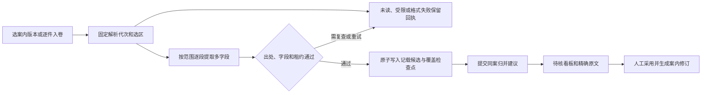

# 律迹 · LexOrder 融合实施计划

**团队版执行范围（2026-11-17）：只实现直接服务律师办案的业务需求。发行、打包安装、部署完善、旧实例升级、备份与整套恢复、运维、性能/容量专项及通用基础设施优化等非业务维护，连同预研、环境准备、独立测试和验收全部延期；M4/W13/AC15 无当前排期，不分配本期 owner，不作为业务开发、提交、验收或里程碑门禁，不因 M3 完成或进入后续阶段自动启动，须用户以后明确重新安排。保留已有代码和历史证据，延期不记为完成。直接支撑业务的权限、审批、来源版本、事务、审计、幂等、材料提交失败处理、实际交付和案件归档继续保留；必要数据库结构变更按受影响业务验证。开发侧只做受影响 API/静态及必要隔离数据库检查，浏览器由用户统一验收，律师专业验收单独记账。**

更新日期：2026-11-20。个人桌面建设覆盖 Windows、macOS、Linux，三端目标、Bun 工具链和首片状态见[个人桌面架构与进度](../desktop/personal-chronicle/docs/lexorder-personal-migration.md#desktop-host-and-bun)。原 Server 计划及其延期范围按各子项执行。

本文是可执行工作清单；[产品需求与验收基线](PRODUCT_REQUIREMENTS_ACCEPTANCE.md)定义做什么，[架构方案](REFACTOR_DESKTOP_TEAM_RAG.md)定义技术边界与 M0—M6 阶段，技能与克制的界面规格并入产品需求，研究来源集中于 [研究依据](RESEARCH_AND_DECISIONS.md)。本文同时承担交接和状态登记，不再单开交接摘要。第一阶段的子任务、依赖、前置条件、验收矩阵和本轮审查记录均维护在本文。旧 12—16 周估算及 R/B 编号不再作为现行排期，历史见 `97867e2`。

**当前状态：Server M2 在当时的七项条件下完成业务预览，证据见 §8.9。** M3 的研究、人工复核、任务等待/依赖和客户交付代码已合入；前批案件范围/状态、争点研究与等待提醒见 §8.21，本批真实 HTTP、人工冲突决定、期限版本及读取授权接续见 §8.22。用户将浏览器验收留给本人，完整桌面业务链与律师专业验收仍未完成，M3 原六项关闭条件不变。M4 的 local 备份/恢复静态工程准备作为历史保留；Server 发行、存量升级、完整恢复及全部非业务维护现已整体延期，不是当前待接续任务。

**当前范围裁剪（2026-11-16，用户决定及参考源码复核）：A 知识沉淀发布、B 结构化方案比较、E 期限计算/版本化重算深化、F 自动客户简报暂缓，优先级最低，不作为开发、验收、里程碑或 Server 发布门禁，也不自动排入 M5/M6。C 保留实际模板的字段补全、少量明确条件和人工核对，通用访谈/递归跨会话依赖及 AI 补问同样暂缓；D 有成熟参考，保留轻量同案任务依赖。案件内成果、既有方案/决定、资料/模板、期限/提醒和人工简报/实际交付继续复用。取舍及来源见[研究 §3.12](RESEARCH_AND_DECISIONS.md#312-范围裁剪与轻量采用的源码复核2026-11-16)。**

**三 agent 全计划分工入口：§7.15 覆盖 M0—M6、W01—W17、RQ/SK/AC、报告余项、条件能力及延期范围。用户已指定 A/B/C，C 为唯一主线集成人；本轮实际检出、owner、子范围与文件占用登记在 §7.14.4，审定小批及汇合步骤见 §7.16。职责归口不等于所有候选均已启动。**

## 1. 目标、基线与本轮范围

产品核心：**以法律事项为中心，完成可追溯、可复核、可交付的专业工作。**

首条交付流程：

**目标/指示 → 材料 → 事实/争点 → 带来源草稿 → 律师确认 → 行动/客户跟进 → 交付/归档。**

首发服务中国大陆律师与小团队的民商事诉讼、仲裁，保留已有其他事项类型。Server 保留 Next.js / Prisma / PostgreSQL、认证与现有 LawLink 页面。当前只实现业务功能；固定发行、部署完善、升级恢复及性能容量专项全部延期。个人版由三端桌面专题推进。实际权限、来源和业务正确性按受影响的业务验证。

- 上游基线：LawLink v2.0.1，`4736aa100515bb15f47443cdb6b0ae65745e5fff`。
- `2997b54` 是二开汇合基线，`f973b87` 是后续 Server 开发起点，均不是当前 main 的代称。当前实现和本次验证见 §8.22，前批验证分别见 §8.21、§8.19、§8.9；保留 RQ/SK/W/子任务/AC 编号及其证据。
- 用户已授权调整计划、拆分并行开发并持续完成下一大里程碑。先由三 agent 审查事实与依赖，再按明确文件所有权实施。§7 的 Server M2 业务预览已按 §8.9 收口；后续只沿当前保留业务推进；M4 与所有非业务维护延期，不自动接续。旧双产物、外部服务及本轮暂缓项的硬前置均已撤销。
- appleoppa 二开已合入上述 main，具体采用、迁移与验证见 [FORK_INTEGRATION_20261116.md](https://github.com/zaenzhang/LexOrder/blob/690232270b46e1f1b105df11bdff167fe7afb80d/docs/FORK_INTEGRATION_20261116.md)；本轮不重复实现或重新宣称其验证。
- 不全面 Rust 重写，不替换 Server PostgreSQL，不另建通用 Agent 平台。W03/W17、W04.2 的个人平台部分及 W13.2 搁置；已有内置解析/检索代码可供 Server 按实际需要复用。

### 1.1 第一阶段的终点与范围

下表是团队版路线。当前推进 Server 的 M3 保留业务范围，M0—M2 已有能力按实际需要复用；M4 全部延期，M5/M6 仅保留后续业务方向，不因编号或阶段完成自动启动。原始 M 分级见[最初路线](https://github.com/zaenzhang/LexOrder/blob/c43608a/docs/REFACTOR_DESKTOP_TEAM_RAG.md#8-后续实施顺序与验收)，下表以用户最新范围决定为准。

| 阶段 | 目标及当前事实 | 下一步或关闭依据 |
| --- | --- | --- |
| M0 基线与样本 | 源码、权限和业务守卫已记录；诉讼、仲裁合成样本已有基础，完整格式和专业预期仍需补齐 | 沿 W01/W02 补受影响工作包；不把源码核查当专业验收 |
| M1 可行性 | Server 原型、版本/来源契约及部分工程验证已有记录 | 可选服务按启用范围单独验；个人桌面进度见 §8.62、§10 |
| M2 材料、来源、上下文 | 原七项条件下的 Server 业务预览已完成，历史证据见 §8.9 | 复用现有资产；本轮发现的新缺口单独修，不重做整个 M2 |
| M3 专业工作与交付 | 保留范围代码已合入；前批服务链见 §8.21，本批真实 HTTP 与人工判断/期限/当前读取修复见 §8.22，完整桌面与专业验收未关闭 | 浏览器由用户后续验收；两类工作包和无程序事项的桌面链及律师专业复核仍按 §7.11.9 原六项汇合 |
| M4 Server 发布与恢复（延期） | 已有 local 备份/恢复脚本边界修复保留；固定产物、升级及真实完整恢复未完成 | W13/AC15 及相关预备、开发、独立测试和验收全部延期；无排期、非业务门禁，须用户明确重启 |
| M5 持续使用与交接 | 保留工作交接、持续使用和已列专业工具方向 | 基于真实使用与证据逐项决定，不作为本轮默认承诺 |
| M6 法域与规模 | 保留专业与法域业务扩展方向（RQ17）；性能/容量等维护专项延期 | 业务扩展按真实需求逐项核规则、样本与效果；不自动启动维护工作 |

Server 人工业务不依赖 AI、OCR、RAGFlow 或外部法库。W09.3 知识发布、B 结构化比较、E 期限重算深化、F 自动客户简报及 C 通用访谈保持暂缓，不自动排入 M5/M6；已有人工方案、期限、交付和轻量同案任务依赖继续保留。详见 §7.11.10。

### 1.2 办案痛点与原工作项

下列是报告、源码和已有场景中可核对的代表性问题，不宣称对所有律师具有相同频率。历史实现与验证见 §8.19—§8.22；§8.24—§8.27保留各次核对与证据，本轮执行范围与状态统一见 §7.14。

| 工作场景 | 现有承接与当前改进 | 原编号 / 阶段 |
| --- | --- | --- |
| 收案、冲突核查和客户信息衔接 | 复用收案审批、冲突复查、客户及转案事务；转案材料和后续来源处理按真实归属核对 | RQ02；W07；AC02/11；M2 基础、M3 复验 |
| 重新接手案件，看不清状态、责任或下一步 | 复用事项摘要、程序、环节、任务和等待；修复全案/程序/环节范围、状态和选择入口 | RQ01/20；W07/W11；AC02/16；M3 |
| 找材料、核对旧引用和反证 | 沿用一行一版本的 Document、来源位置及 EvidenceItem 的支持/反驳；保留原件与历史引用，分别核对授权和无法定位情形 | RQ03/04/RQ05；W05/W06；AC03—05；M2 基础、M3 复验 |
| 从事实争点进入法律研究 | 本批在研究保存时固定实际采用的争点内容、来源与核对时点；正常创建/修改/核对入口的修复和本次证据见 §8.21 | RQ04/05/07/08；W06/W09.1；AC04/07 |
| 等客户材料、跟进任务或期限 | TaskWaiting 到期检查接入站内提醒与待检查筛选，重新核对当前责任/资格并去重；与法定期限和外发邮件摘要分开，本次证据见 §8.21 | RQ09/10；W11；AC09；M3 |
| 形成建议、文书并审阅 | 复用已有 OPTION/DECISION、具体文书版本及人工复核，核实真实指示与审批；新增研究关联须先由场景证明 | RQ01/04/11/18；W10；AC04/08；M3 |
| 交付后找回发过的版本 | 延用固定版本清单、导出、人工发送登记、回复及案件归档；真实页面与律师专业验收仍待完成 | RQ02/11/12；W12；AC10；M3 |
| 保密与撤权 | 保留事项、原件、财务、审批和成果的独立授权；只验证实际业务涉及的撤权和结果发布。系统升级/完整恢复延期 | RQ06/14/15 业务子范围；W04/W05；AC11/12/13；M3 |
| 交接后重新理解目标、待办和风险 | 复用已有责任与交接记录，是否需要监督或无下一步提醒由真实使用场景决定 | RQ01/02/09/18；W14；M5 按使用证据评估 |
| 跨语言或法域核对 | 复用已有法域信息和研究记录，新法域逐项核规则、来源及专业判断；现有字段不代表完整支持 | RQ11/RQ17/RQ18；W15；M5/M6 逐项验证 |

文档反复修改是用户提出的痛点示例；已有版本上传及受控取件/回传代码，是否形成可用连续编辑体验仍需单独验证，不在本轮假定为已完成或必做。

## 2. 起点能力与本轮增量

| 领域 | `f973b87` 起点基础 | 本轮及后续增量（实际状态见 §8.4、§8.6、§8.9） |
| --- | --- | --- |
| 客户 | 负责人、ClientActivity、ClientFollowUp、合并、幂等与审计；已有权限内关联事项和最近动态 | 统一连续活动、分页与完整跟进聚合，客户指示/决定/交付关联 |
| 事项 | Matter、程序、阶段、委托范围/交付描述、沟通与研判 | 目标/约束/方案决定版本记录、MatterBrief 聚合 |
| 责任 | Task、WorkResponsibility、接受/完成/交接；部分审批等待 | 等待对象/原因、轻量同案依赖和下次检查；复用 Task 既有日期 |
| 期限 | 确定性规则、人工保护、Holiday、提醒台账 | 保留现有期限、来源/理由、确认和人工调整；完整规则/日历计算历史及待复核重算差异暂缓 |
| 材料 | Document 版本、文本提取、私有存储；短信 OCR 与传票首页本地解析/可选 OCR | 内置处理、页级覆盖、稳定锚点与解析代次；通用 OCR 可选且未验真实质量 |
| 证据 | FACT/CLAIM/ANALYSIS/ISSUE/TODO_VERIFY；单来源/页码 | 多来源、反证/矛盾关系、事实时间线、确认与修订 |
| 搜索/AI | 授权关键词正文搜索、元典/cncases 适配；模型客户端与外发日志；RAG 原型 | 将内置处理接实际入口，可选 RAGFlow/模型/MCP；来源覆盖与成果确认 |
| 文书 | 模板含三份执行文书、缺项/临时字段、生成快照、送审/批准/驳回/入卷 | 引用复核、成果版本绑定、实际交付及客户确认 |
| 财务/归档 | 原有确认、核销、审批、守卫、归档快照 | 回归保留；将新成果和交付接入现有链 |
| 运行 | 云开发 PG 托管、JobQueue、独立 cron/监督器、15 分钟补扫、备份 CLI | 复用现有环境，保留材料提交及具体任务正确性；运行时治理、备份恢复和运维增量全部延期 |

“存在”依据代码核查，不表示本轮重新运行或完整点击验收。已有验证及其边界见本文第 8 节及对应历史记录。

## 3. 工作项、依赖与退出证据

新增条目按“相关参考研究与用户合理性审查 → 设计 → 必要模型/迁移 → 服务与权限 → 原页面入口 → 有界场景验证”实施。起始基线已有部署业务；本轮已将内置处理、来源与上下文接入原工作台，M2 代表性页面验收已按 §8.9 收口，新增 M3 与专项页面另按实际改动验证。可选 RAGFlow 原型未接通不影响这些内置业务，代码存在和历史测试不能代替产品完成。

| 编号 | 工作及需求 | 依赖/阶段 | 可审阅交付与完成条件 |
| --- | --- | --- | --- |
| W01 | 受影响业务基线与验收材料；RQ01—RQ20 保留子范围 | M0 既有基础 | 记录本次业务提交、相关授权/数据守卫及必要工作包；客户跟进等真实点击由用户验收。独立环境盘点、容器与性能观察准备延期 |
| W02 | 已合入二开的业务接续核对；RQ08/10/11/15 | M0；移植由 `2997b54` 完成 | 复用既有记录，只核对受影响法规/模板/传票/调度业务；真实供应商/OCR 依具体启用需求，成功恢复等维护验证延期 |
| W03 | 个人运行时与存储（搁置）；RQ13/19 | 当前范围外、未排期 | 保留历史失败与局部证据；不再开发/测试，不阻塞 Server |
| W04 | 内置处理与可选服务契约；RQ03/04/06/14 | W01.2；M1→M2 | 共用来源/覆盖/错误；内置先接业务；RAGFlow/模型等按需配置，启用时单独验，不作为基础功能前置 |
| W05 | Server 材料与长任务；RQ03/04/15 | W04.1；M2 | 原件、解析代次、覆盖、任务意图及租约；重试/撤回/旧结果隔离；远端分支可选 |
| W06 | 来源、事实与争点；RQ04/05 | W04.1/W05；M2 | 多来源/支持/反驳、原版本与不可变解析快照；手工编辑保存/确认，完整自动分析另据配置 |
| W07 | 上下文、目标与客户连续；RQ01/02/17/20 | W01.2；M2 | 目标/指示/决定历史、授权 MatterBrief、现有客户关系复用；不依赖 AI 或个人版 |
| W08 | 首批成果及可选技能执行；RQ06/17/18 | W05/W06/W07；M2→M3 | 手工选择来源、编辑/保存/确认可独立完成；AI 候选按需启用，未配不造回答；版本/来源/审计可回查 |
| W09 | 法律研究与可选法库；RQ07/08；RQ16 子范围暂缓 | W09.1 需 W08；M3；W09.3 无排期 | 授权资料研究、官方 MCP 目录/自定义接入与真实外部调用分开；没有知识发布或外部服务也可完成研究 |
| W10 | 方案/决定记录复用、草稿与复核；RQ01/05/11 | 现有文书/模板与 M2 来源；引用研究时接 W09.1 修订；M3 | 现有 OPTION/DECISION、轻量模板字段链、具体版本人工复核和既有审批；结构化比较与通用补问平台暂缓 |
| W11 | 行动、等待、轻量依赖与既有期限；RQ09/10 | W07/W08；M3 | 责任链增等待对象/检查日，同案任务依赖采用成熟机制；复用现有期限/提醒/确认保护，深化重算暂缓 |
| W12 | 人工客户简报与实际交付；RQ02/11/12 | 具体 Document/版本与原审批、披露合同；M3，与 W11 并行 | 人工编辑或上传 Document 简报、固定交付版本、实际发送登记及独立回复；自动汇总暂缓 |
| W13 | Server 发行与恢复（整体延期）；RQ19 及相关维护子范围 | M4；无当前排期 | 发行、部署完善、升级、备份/完整恢复及其预备工程、独立测试和验收全部延期；非业务前置，须用户明确重启 |
| W14 | 持续使用、交接；RQ01/02/09/18；知识治理子范围暂缓 | 对应业务及来源基础；M5 后续候选，不依赖 W13 | SK10、今日工作、交接、审阅反馈和顾问周期按真实业务需求评估；SK12 知识治理不随 M5 自动启动 |
| W15 | 双语与专业扩展；RQ11/17/18 | 对应业务及来源基础；M5/M6 后续候选，不依赖 W13 | SK11、更多模板/法库/法域逐项评估与验证；翻译不隐式改变准据法 |
| W16 | 规模、性能与通用技术优化（延期） | 无当前排期；不随 M6 自动启动 | 包含监测环境、预备测量及专项验证，全部延期、非业务门禁；具体业务已证实的阻断仅按该业务范围处理 |
| W17 | 个人版运行实现，RQ13/19 | 三端宿主及 Bun 工具链推进中 | [个人版架构、实现与验收](../desktop/personal-chronicle/docs/lexorder-personal-migration.md#desktop-host-and-bun) |

W01/W02 不重复已合入模块；每次实施前重新固定基线，只回归受影响功能及规定门槛。同一工作区保持单写者。

M1 已有局部工程证据，Server M2 现已按 §8.9 收口；后续不重复已完成业务、SQL 兼容、Personal、Windows 或全树 hash 检查。新验证只解决后续变更的真实风险。

W03/W17 和 Windows 产物已移出当前关键路径；状态为搁置而非通过。子编号仍用于追溯，不因策略调整重排编号。

### 3.1 执行与状态规则

- 每个子项按“设计/数据影响 → 服务及边界 → 可达界面 → 场景证据”提交；原型仅交付其明示范围。新表名与接口草案统一维护在架构第 6 节，业务语义由产品需求定义。
- 每个模块编码前补一条参考实施记录：实际阅读相关项目的 UI 与业务来源，说明采用/不采用及用户合理性检查；按需求第 9.1 节审查布局、文字、状态和操作路径。记录并入研究文档，不能用参考清单代替阅读或用说明文字代替可用交互。
- 状态使用：未开始、实施中、待外部条件、待验收、通过、失败、搁置。通过须有对应提交、环境与范围；可选服务未配置不等于失败，也不等于已接通。Server 父项按当前 Server 范围关闭；不等待搁置项。
- 依赖表示使用已有交付；仅当前业务可提前设计或使用明确标注的测试替身，不能用替身冒充真实业务联调；延期维护不开展提前设计、环境准备或验收。W09.2 的外部依赖不阻止 W09.1、W10—W12 开发。
- 每个独立 worktree 一名写者；不同模块可以在隔离 worktree 并行编码。schema/migration、共享页面和总文档由 root 统一写。开工前通知其他可见 agent 并取得边界确认；跨会话收不到回执时记录未收到，不宣称已通知成功，不改对方 main。

### 3.2 M0：基线、工作包与前置条件

| 子项 | 前置 | 实施与交付 | 退出证据 |
| --- | --- | --- | --- |
| W01.1 | 无 | 固定 main SHA；登记已有功能、账号/材料/财务授权与数据库守卫；标出当前真实点击缺口 | 可指向现有文件/历史记录的基线清单；已有能力与新增计划分开 |
| W01.2 | W01.1 | 按架构第 6 节定义 Server 操作者、文档版本、来源/覆盖、代次和错误契约；约定候选采纳及确认边界 | Server 样例及团队确认规则可复核；Personal 样例和策略保留历史但当前搁置 |
| W01.3 | W01.1 | 准备受影响业务所需的两类合成工作包、人工期望与页面路径 | 原件、事实/反证/引用预期及专业复核状态明确；容器、性能或恢复环境不作为当前前置 |
| W02.1 | W01.1 | 核对二开已合入的法规/模板/传票/调度模块及历史验证边界，只标记本阶段会改动的入口 | 保留源码与来源记录；不重复宣称已做通用 OCR、真实法库或成功恢复 |

### 3.3 M1：现有基线与可选服务

| 子项 | 当前前置/状态 | 实施与退出证据 |
| --- | --- | --- |
| W03.1 | 搁置 | Personal 运行与存储；无恢复排期 |
| W04.1 | W01.2；已部分实现 | 共用版本、来源、覆盖、代次、错误和检索范围契约；接入 Server 持久业务 |
| W04.2 | Server 内置复用可推进；Personal 平台部分搁置 | 先用现有 PG 正文检索，不为本批新增 LanceDB 索引或向量服务；现有 Lance 原型保留历史，语义未实测不记通过 |
| W04.3 | 可选业务适配，不阻塞 Server | 仅在明确的业务需求选择启用时复用管理配置、受信端点及权限映射；独立 RAGFlow 部署、运维、预备联调与平台完善全部延期 |
| W04.4 | 可选，不是 W08 基础链前置 | 生成/OCR/嵌入/重排独立启用、配置与调用；未配/无权/超时/无结果分开，真实能力另验 |
| W03.2 | 搁置 | Windows 托管包；不构成当前平台承诺 |
| W03.3 | 搁置 | Personal 生命周期与故障；不投入本期验证 |

所有第三方能力均按操作懒加载，不进入启动、登录或核心 health 依赖。关闭全部服务是合法运行配置，失败不能回滚已成功保存的普通业务。

### 3.4 M2：Server 材料、来源、上下文与首批成果

| 子项 | 前置 | 实施与交付 | 退出证据 |
| --- | --- | --- | --- |
| W17.1 | 搁置 | 保留已有模式/actor 接线，不继续个人运行适配 | 不作为 Server 子项前置 |
| W05.1 | W04.1 | 原件可靠提交、Document/解析代次/任务意图；领取 token、续租、条件发布及重试 | 旧 worker 不能发布新领取结果；处理不重复建正式材料；文件/DB 中断有可解释恢复出口 |
| W05.2 | W05.1 | Server 内置摄入：文本/PDF 文本层/DOCX/基础表格，扫描/图片原件保留并明确未识别 | 真实材料行显示覆盖/失败/不支持；无 OCR 可继续人工处理；不伪称全文完成 |
| W05.3 | W05.1；可选 RAGFlow 启用时 | 远端意图、映射与状态核对；未配置时不投递 | 有实际条件再验超时/取消/删除；未配不阻塞内置链，不盲重传 |
| W05.4 | W05.1/W05.2；已启用远端分支单列 | 取消/撤回、代次切换与恢复屏障；原件引用保留 | 删除/撤权/旧代次迟到不得重新发布；远端待确认不冒充已停 |
| W06.1 | W04.1/W05.1 | 原版本引用与不可变解析快照；PDF 页、文本偏移、表格位置按真实支持 | 新版本/重解析后旧引用不漂移；无法定位明示；打开时复核材料权限 |
| W06.2 | 人工多来源可先并行；完整快照需 W06.1 | 同一要点的支持/反驳/背景来源，手工事实/争点及时间线内容可编辑保存确认 | A 支持/B 反证可见且各回原件；类型、确认与来源不混同；重复保存不重复正式结果 |
| W07.1 | W01.2；独立并行 | 目标/约束/指示/方案/决定版本记录，授权 MatterBrief；语言/法域/时区保持独立语义 | 旧指示与确认可还原，新版待确认；费用约束服务端过滤；不补造未知 |
| W07.2 | W07.1 | 复用 ClientActivity/FollowUp 与已有事项关联，显示来源关系和客户连续记录 | 成案前后不复制客户身份；跨事项聚合不扩大权限 |
| W17.2 | 搁置 | Personal 业务接入 | 不作为 W08/W10 前置 |
| W08.1 | W06/W07；不依赖真实模型 | 可保存的人工成果与来源/确认边界；可选 AI 候选的受控调用/失败/采纳契约 | 无模型可手工完成；AI 未配不伪造产出，正式写入需人确认 |
| W08.2 | W08.1；Server 原页面 | 将材料阅读、事实/争点整理、上下文恢复接实际入口，构成 M2 完整预览 | 完成 §7 七条出口；真实页面可重开/回查；自动生成质量按实际配置另记 |

第一批并行 W05/W06/W07，root 统一 schema、队列、上传和页面接线；第二批合拢来源快照、手工成果编辑/确认、可选服务配置和真实页面验证。只完成第一批不能登记 M2 整体完成；AI 自动能力未配置不阻断人工闭环，也不记为 AI 已通过。

### 3.5 M3：研究、成果、行动与交付

本阶段的可执行细化、专项交接、分批顺序和退出条件统一见 [§7.11](#711-m3-详细执行计划与审查2026-11-16)。下面保留原 W 编号；依赖表示开发与集成顺序，不要求用户为了起草或交付补造客户决定、等待或法定期限。

| 子项 | 前置 | 实施与退出证据 |
| --- | --- | --- |
| W09.1 | W08.2 | 保留三类来源契约，使用实际获准资料开展 SK03/SK04；事项材料和法律资料即可完成研究，保留法源时点、反向依据与缺口，不要求新增经验条目 |
| W09.2 | W04.1；可选并行 | 官方法律 MCP 目录、自定义远程接入、认证/能力发现/只读查询及错误隔离；配置、发现、实际调用分开记录，未配置不阻塞发布 |
| W09.3 | 暂缓；最低优先级；无实施批次或恢复日期 | 案件成果→脱敏/审核→知识发布/撤回整体暂缓；RQ16/SK12 对应子范围和 AC14 仅保留追踪，不作为 M3/M4 或发布门禁。恢复时另审现有成果、受众与权限，不提前建模 |
| W10.1 | W07.1；既有记录直接复用 | 方案、建议和真实客户指示沿 OPTION/DECISION 文本、来源与更正链保存；结构化比较、成本/时间矩阵及自动变化分析暂缓最低，非门禁 |
| W10.2 | 现有 Document/模板与 W06 来源；引用研究时消费 W09.1 修订；不等新比较模块 | 采用成熟模板链：实际字段/主体/程序→补必要值→人工核对→具体稿件；保留人工问题/回应/修订/复核及原审批。通用自适应访谈、递归跨会话依赖/AI 补问暂缓 |
| W11.1 | W08.2/W07.2 | 同案 Task 依赖、等待对象/内部责任/检查日及现有 Deadline；不自动级联排程/改期。缺责任记录的旧任务只读可见，不伪造责任/历史；存量升级核查与修复专项延期，不作为本期门禁。完整计算历史、规则/日历版本和待复核重算深化继续暂缓 |
| W12.1 | 具体 Document/版本与原审批、披露合同；引用新研究/复核成果时接对应合同 | 人工 Document 简报、固定版本清单、实际发送登记、独立回执/客户回复及原归档；可先用既有文书开发和验证，不等 W11、自动简报或知识发布 |
| W17.3 | 搁置 | Personal 生命周期/迁入，不作为 W13 前置 |

先接通 W09.1→W10→W12 的实际成果链；W11 保留范围独立推进，最后一并满足 M3 六条关闭标准。W12 可先消费既有具体文书，不把整项 W11 设为开发或交付门禁。可选真实服务不反向阻塞普通业务。M5/M6 维持后续扩展，不把个人版自动插入任何阶段。

### 3.6 M4：Server 发行、升级与恢复

**整体延期（2026-11-17）：本节仅保留任务编号和原范围，不开展预研、环境准备、开发、独立测试或验收。M4/W13/AC15 不作为当前业务门禁，不因 M3 收口自动接续；未来须用户明确重新安排。**

| 子项 | 前置 | 实施与退出证据 |
| --- | --- | --- |
| W13.1 | 延期；无当前前置/排期 | 固定镜像、部署配置、迁移安排、发行清单与限制说明全部延期；保留现有文件 |
| W13.2 | 搁置 | Windows/Personal 不在当前发行范围 |
| W13.3 | 延期 | 实际发行容器、持久化及发行专项验收延期；当前业务沿用已有运行入口验证 |
| W13.4 | 延期 | 旧实例升级、失败回退、备份一致性与隔离完整恢复，以及旧库专项核查全部延期；既有脚本、限制和历史结果保留，不记为通过 |
| W13.5 | 延期 | 正式发行证据汇总与发布验收延期；M3 业务及专业证据在各自业务任务记录 |

团队版业务当前无需发行清单、容器产物或维护验证报告。可选服务未配置时仍须能办理普通业务。

### 3.7 首批执行状态与源码基线（2026-11-16）

该节为历史记录；完成、未完成与未验状态按原记录区分，详细范围、提交和证据见[固定历史记录](https://github.com/zaenzhang/LexOrder/blob/b1b213f/docs/WORKBENCH_PLAN.md#37-首批执行状态与源码基线2026-11-16)。当前执行与状态分别见 §7.11.4、§8.19—§8.21。

### 3.8 M1 执行批（2026-11-16）

该节为历史记录；完成、未完成与未验状态按原记录区分，详细范围、提交和证据见[固定历史记录](https://github.com/zaenzhang/LexOrder/blob/b1b213f/docs/WORKBENCH_PLAN.md#38-m1-执行批2026-11-16)。当前执行与状态分别见 §7.11.4、§8.19—§8.21。

### 3.9 参考研究进入 M2—M4 的具体增量

依据[研究 §3.5](RESEARCH_AND_DECISIONS.md#35-按国际执业能力审查参考实现2026-11-16)，以国际执业的研究、判断、写作、监督与交付能力为优先级依据。本表保留原工作项和 AC01—AC16 追踪，现行必做范围以本节更新、§7.11 及暂缓声明为准；编号全集不等于全部首发门禁。本节保留 `545e216` 的研究细化，设计待办不等于本轮已实现；本节记录 Server 业务增量。当前 M2 业务预览按 §7 七条出口登记，较完整的能力深化仍逐项保留在所属工作项，不能由本轮 PG/HTTP 数量推定通过。

| 顺序 / 既有工作项 | 依赖与应落实的增量 | 必须加入的场景 / 专业产物 |
| --- | --- | --- |
| M2 先做：W05.1—W05.3；RQ03/15、SK02 | 沿既有材料与任务协议记录批次/单件意图/状态；区分重复操作、不同来件的同内容、明确新版本。W04 契约既定后实施；Server 内置链不依赖 W04.3；只有实际启用的 RAGFlow 分支使用该依赖 | AC03/11/12：五件两件失败只重试失败件；重复请求只写一次；相同通知不同送达/举证方保留来源，跨案 hash 不泄漏。原件与派生状态分开，恢复不伪造完成 |
| M2 先做：W06.1/W06.2 → W08.1；RQ04/05/18、SK02 | 落不可变锚点、多来源与关系；自动提取启用时，候选组、逐材料提取及人工处理记录分开，严格相同候选才可继承处理结果，实质变化/矛盾重新复核。人工记录保留原始时间表述，结构化时间线需支持精确、区间和未知，不以记录创建时间代替事实发生时间 | AC04/05/12：同一事实三来源仅一正式项；拒绝后重复 OCR 不再弹，纠正身份/新反证可复核；并发采纳只写一次；“某年夏天”不得补造某日 |
| M2 先做：W08.1/W08.2；RQ03/04/06/18、SK01/02（供 M3 SK07 复用） | 人工选材/编辑/保存/确认和来源回查先独立完成。实际启用 AI 技能后按具体切片记录真实输入、供给和未覆盖，区分定向问答与指定材料审查；是否采用 AiRun 另行决定。可选检索补可复现详情，实际能力按 W04.4 验证，不将模型作为人工链前置；SK07 的专业复核/作者回应仍在 M3 | AC03/04/06/11/13：末页风险和另一附件反证不冒充已读；指定但未送入材料可见；重复引文歧义拒绝；排序分不显示为事实置信度；撤权后诊断/历史同步受限 |
| M2 并行：W07.1/W07.2；RQ01/02/17、SK01 | 版本化目标、范围/排除项、时间/预算假设、决策人、客户指示；在已有客户 insights/沟通/跟进上统一连续记录及分页，逐来源鉴权 | AC02/11/16：成案前后、合并及第二事项保留来源；超过当前截断窗口仍可继续查；无权事项不泄漏正文/计数；客户改指示保留旧基线，不自动改合同或费用 |
| M3：W09.1/W09.2；RQ07/08/17/18、SK03/04 | 研究委托先明确问题、用途、时限、资料和成本约束；ResearchMemo 保存查询、法域/相关日期、法源版本、例外及不利依据；IssueMatrix 明确材料缺口原因 | AC07：旧法期间、同名不同法域、不利案例、无权/无结果分别验证；未收到答辩不能写“对方无异议”。W09.1 可先用授权资料，W09.2 只对实际启用的提供商登记真实权益和调用证据，不作为 Server 核心发布前置 |
| M3：W10.1；RQ01/11/12、SK05 | 复用 OPTION/DECISION 文本及来源、更正版本；结构化备选方案/费用时间矩阵和自动差异分析暂缓 | AC08 仅验现有建议与真实指示分开、旧版可回查、未知不编造，指示不自动修改合同或收费 |
| M3：W10.2 的起草部分；RQ04/11/18、SK06 | 参考 j-lawyer 的实际字段值核对与 docassemble 的有限条件，使用现有模板/缺项/渲染快照；准备只读、临时值与主数据修改分开 | AC08：预览/取消/失败不改 Client/Party；切模板/主体/程序重新核对实际字段，不沿用失效值；不验通用访谈平台 |
| M3：W10.2 的复核部分；RQ04/05/11/18、SK07 | 按确切文书版本记录问题、作者回应、修订证据与复核结果；检查引用的实质支持、正反证、金额构成及来源变化的直接影响。依赖 W06 显式来源边 | AC04/08：引用可打开却不支持论断、旧法、遗漏反证、明细合计不符分别定位；问题处理不自动批准；新稿不借旧批准；无依赖记录显示检查有限，原文金额和旧成果不被改写 |
| M3：W11.1；RQ09/10、SK08 | 复用责任与期限，补等待/检查日；参考 ERPNext 保留同案前置关系、自依赖/环和完成检查，不带入自动排程 | AC09：等待仍有责任；依赖不能越案或成环；未完前置不能被完成操作绕过；既有期限确认/人工调整及提醒守卫保留，深化重算非门禁 |
| M3：W12.1；RQ02/11/12、SK09 | 律师人工整理 Document 简报和固定交付清单，按原审核/归档服务导出并人工登记发送 | AC10：具体版本、披露资格与必要批准可查；导出/发送/收悉/客户确认分开；自动汇总不参与验收 |
| 业务保留、维护延期：W05.4；RQ03/06/15 | 保留原件/来源、当前授权、代次与旧结果隔离，仅随实际业务变化验证；整套恢复、通用任务恢复、备份 manifest、索引维护及独立完整性报告延期 | AC11/12 业务子范围：撤回后不新外发，过时/取消结果不发布，当前业务引用不漂移。AC15 和维护演练不参与当前验收 |

前四项是 M2 优先顺序：材料与事实关系由一名集成者协调契约/模型，W07 客户上下文可独立推进，W08 待边界收敛后汇合。M3 的 W09.1/W10 专业研究与起草、W11 责任推进可按既有依赖并行，W12 汇合交付。每个实现批启动前读取最新 main/任务状态、明确独立工作区与唯一写者并通知在途协作者，公共契约、schema、迁移和主文档由集成者统一落地；该研究快照本身不算启动或完成实施，当前已执行批次和剩余范围见 §8.9。

### 3.10 M5/M6 专业工具的后续顺序

下列已纳入后续计划，但**不属于本轮实现或第一阶段新增必交项**。专业功能由真实样本及人工评审关闭，不用候选项目 README、模型自评分或企业平台宣传替代验收。

| 优先顺序 / 工作项 | 能力与来源 | 先做的可审阅交付、依赖及验收 |
| --- | --- | --- |
| M5 第一组：W14，回接 W10；SK06/07 | Word 谈判轮次：Counsel 的发出/返回/可选原始基线比较 | 绑定实际两或三份确切 Document/hash，显式选发出/返回角色及存在时的基线，不按上传顺序猜。报告保留/回退/修改/新增/无法归因及比较覆盖；缺基线只作可证明的二方比较，页眉/脚注/字段/版式等未覆盖内容明示。读前和结果返回重验权限；缺修订痕迹、重排、取消样本原件不变，文字保留不等于法律承诺 |
| M5 第一组：W14/W15；SK02/03/07 | 跨文档问题表：结合 Clio 产品对照与现有来源/覆盖设计；不是声称开源已有完整尽调系统 | 同一事项“问题 × 材料/版本”矩阵。肯定结论逐格有依据；已读未发现记录检查范围；未读/失败/不适用明示，不强填引用。依赖 W06/W08/W10；导出固定问题集、材料集和范围，先验证一个真实高频审查场景 |
| M5 第二组：W14；SK08/09/10 | 交接监督、无下一动作巡检：j-lawyer/Frappe/Twenty | 复用 WorkResponsibility/交接，输出目标、最新决定、期限、等待、未读范围和未决问题；接收确认后才转责任。活跃事项没有未完成有效任务、未结期限/庭期或有效等待复查等下一步安排才提示，已完成历史任务不作有效安排；已归档或已有有效安排不误报。多人交接仅 Server；当前只实施 Server 的资料整理与自我巡检；可复用设计不构成 Personal 排期 |
| 最低优先级暂缓：W14/W15 知识子范围；SK12 | 从案件经验形成的版本化作业包、条款立场与知识治理 | 依赖 W09.3 的新增能力不排入 M5/M6，不作为其他专业工具的前置。未来重新评估后才细化选入、脱敏、受众、审核、版本和复审；现有模板、普通文书复核与审阅反馈继续保留 |
| M5：W15；SK11 | 双语一致性工具：当前开源审查未证明完整可直接采用实现 | 原译文版本对齐、术语、主体、币种/单位、数字、否定、条件与例外差异；输出当地律师待核实项。植入遗漏否定、单位改变和不可直接对应概念；语言一致不能自动变成法律效果一致 |
| M6：W15；SK03/11 | 多法域研究与专项字段/模板包：能力缺口，需新增法源和专业证据 | 按法域分栏的同问题比较、相关时点/效力角色/适用条件/来源权益；外部律师问题与回传结果绑定版本和内部责任。每包单独核规则及样本；不把语言/地区字段当全球法律支持 |
| 企业治理候选（延期）：W14；RQ14/15 | SSO、数据区域/留存、企业审计导出和基础设施治理 | 非当前业务需求的治理专项全部延期，不预研或自动排期；实际事项隔离/外部协作需求须另据业务明确范围，现有权限继续保留 |

M5/M6 仅保留后续业务候选，按实际业务需求与对应 W10/来源基础逐项决定，不以 W13 发行收口为前置，也不自动启动。W16 性能/容量等维护专项全部延期；新外部连接和自动发送仍须明确业务需求与权限设计，当前人工交付继续可用。

## 4. 数据和服务的实施约定

### 4.1 复用主对象

- Client / Intake / Matter / Document / EvidenceItem / Task / WorkResponsibility 保持主身份。
- ClientActivity / ClientFollowUp 已实现，继续补关系与聚合，不再次创建相同概念。
- 文档一行一个版本；不新增平行 DocumentVersion 身份体系。
- 事项摘要是视图；目标/指示/决定保存独立可追溯记录，不复制整个事项状态。
- 交付台账适用于诉讼、仲裁、顾问等所有事项，首发完成最小交付链；复杂续约周期后置。
- `Engagement.endedAt` 是实际终止，`serviceEnd` 是约定到期，不能合并语义。
- `Task` 与 `Note` 当前依赖事项，未成案客户跟进继续用已有独立对象。

### 4.2 只提取确实需要共享的边界

保留现有框架与可复用 UI，按内容优先原则收敛呈现；仅在具体业务需要时整理 actor/校验入口与服务边界，不独立推进运行模式拆分或通用分层。Server 使用认证成员，worker 不伪造会话；页面刷新留在入口，权限、版本、状态与审计在事务内复核。

解析、检索、模型和法库分别使用清晰接口。Server 默认内置处理/PG 搜索，RAGFlow/AI/OCR/MCP 均按需独立配置。TS worker 管理本地作业与已启用远端映射；不把正式财务/业务写入交给模型或第三方。

### 4.3 增量与恢复

新结构仅按当前端到端流程的实际需要增加，采用单一现行实现，同步更新调用方并删除被替代的代码/配置路径，不保留向后兼容、旧配置迁移或 fallback。除数据库或用户明确指定的要求外不写 migration。必要数据库迁移只使用可证明的既有事实，不补造缺失的确认人、来源或交付时间；SQL 与数据库守卫一并审查，实际执行沿用仓库授权及演练流程。

每批可关闭新入口；不得覆盖真实业务记录或补造历史。W05 的材料提交和旧结果隔离按实际业务保留；整套备份、配置/密钥恢复、旧实例升级和 W13 恢复专项全部延期。已有运维说明仅记录实现与限制，不触发维护开发或验收。

## 5. 参考项目与职业能力如何使用

技术/业务来源完整登记于 [RESEARCH_AND_DECISIONS.md](RESEARCH_AND_DECISIONS.md)；律所岗位与培养来源登记于 [RESEARCH_AND_DECISIONS.md#7-全球律所职业能力研究](RESEARCH_AND_DECISIONS.md#7-全球律所职业能力研究)。

| 参考组 | 本轮吸收 |
| --- | --- |
| LawLink 与二开 | 完整业务、法规/案例入口、传票、模板和调度；保留权限与审计 |
| ANQI | 今日工作、期限解释、人工保护与建议待办 |
| Kosmos / 诉讼可视化 | 原文关联、多来源事实、矛盾和时间线 |
| Paperless-ngx | 文档摄入、派生处理、失败恢复与归档 |
| AnythingLLM / Cherry | 内置组件和模型管理研究；桌面打包/生命周期随个人版搁置 |
| RAGFlow | 可选解析/索引/检索服务；LexOrder 保留授权/引用/确认，未配不阻塞 |
| Counsel OS | 上下文与版本引用、实际阅读覆盖 |
| Docassemble / j-lawyer | 缺项问答、条件字段、文书与事务流程 |
| Twenty / Frappe / Clio | 统一客户视图与服务过程 |
| 全球律所官方样本 | 研究、判断、准确表达、商业目标、项目交付、监督与知识复用 |

岗位学历、执照、年资和语言筛选条件保留为人的要求；技能采用可执行且可验收的方法。来源中的国家特定程序不直接复制为中国大陆规则。

## 6. 验收与审查范围

每个工作项提交：需求/技能编号、变更对象、授权路径、数据与版本影响、实际执行环境、结果和未覆盖范围。

必须贯通三组检查：

1. **专业产物**：事实与推断区分，反证与缺口可见，引用不仅可打开还应支持论断；文书与简报对客户目标有用。
2. **执行与数据**：正式写入经确认，权限即时生效，索引和成果版本稳定，任务重试与恢复一致。
3. **使用与交付**：实际页面可达、真实交付事实与内部完成分开；浏览器由用户统一验收。安装、升级和整套恢复专项全部延期。

本节验证 Server 的受影响路径。历史测试只证明各自快照，不重跑不受影响部分。外部服务未配置/失联是正常配置分支，单独验证错误隔离；不重复 hash 检查。

### 6.1 工作包、前置条件与专业判定

准备一类民商事诉讼工作包和一类商事仲裁工作包，每包记录原件哈希、事项目标/指示、关键事实、反向材料、未知项、来源锚点、研究问题及预期成果。共同覆盖扫描失败页、表格、同名主体、金额/日期矛盾、长文截断、新旧材料版本、待确认款、外部等待和实际交付证据。材料必须合成或有明确授权；只在独立验收环境生成/使用，真实原件、密钥和模型原始输出不入源码库。

M0 固定每包的“必须发现/必须标未知/不得确认/引用支持关系”清单及核查方式。自动化检查定位、版本、状态与访问边界；专业复核人核对事实、反证、法律前提和成果可用性。关键样本未通过时修复或明确缩小声明并重新验收；缩小声明只限未经承诺的能力，不得删除已定 RQ、必交产物、材料格式或关键场景，也不能改记为不适用。当前承诺业务的缺口如实保留，不能登记为通过；发行版本及 prerelease 状态不作为当前业务门禁。专业判定不用另一个模型自评分、平均准确率或输出字数代替。不另开性能观察或资源专项。

下表登记外部条件，仅影响对应可选或产物验证；不推断用户私有环境，不将全部凭据齐全作为开发前置。Windows 条目仅保留历史状态，当前搁置。

| 前置条件 | 本轮状态 | 影响项 | 就绪证据 |
| --- | --- | --- | --- |
| Windows x64 | 当前搁置，无新产物 | W03/W17/W13.2 当前范围外 | 无当前门禁；将来另行启动才由用户验收实物 |
| 独立 Server 容器及持久存储环境 | 原批准备与未验证事实保留 | W04.3 配套维护、W13.3/W13.4 | 全部延期，不准备、不单独验证，不阻塞当前业务 API/静态工作 |
| 独立生成/嵌入及所选 OCR 服务 | 无真实模型凭据；Server-only 实跑缺配置 | W04.4 及实际启用的生成/嵌入/OCR 能力 | 各能力真实请求成功、模型/指纹可查；只保存非秘密配置与脱敏结果 |
| 法库/MCP 账号及使用权益 | 未配置时可不启用 | 可选 W09.2，不阻塞核心发布 | 实际启用时分工具记录鉴权、能力和允许再处理范围 |
| 两类工作包及专业复核人 | 已有诉讼/仲裁合成样本；完整格式、专业预期和真实复核人待落实 | W01.3、W08—W12 业务范围 | 授权/合成说明、业务预期与真实复核结果；不依赖 W13 |

### 6.2 第一阶段验收矩阵

下列 AC 编号保留追踪，当前只验 Server 保留业务；Personal、AC15 及其他非业务维护场景全部延期。M2 以 §7 业务预览为出口，M3 继续原六项业务条件；不要求候选发行产物。可选服务只在明确启用的实际业务范围登记证据，未配置不记通过或系统失败。

| 场景 | 对应需求/任务 | 首次取得 / 正式复验 | 必须观察到的结果 |
| --- | --- | --- | --- |
| AC01 身份与基本业务 | RQ14；W01/W02 业务基础 | M2/M3 | Server 登录/有效账号/角色/审批及现有本人确认例外有效；独立运行所有权与发行维护专项延期，Personal 搁置 |
| AC02 客户与事项连续 | RQ01/02/17；W07 | M2 | 成案前后跟进/指示可查，跨事项聚合不扩权，重复转换不造新客户；目标和法域/时区语义明确 |
| AC03 原件与解析覆盖 | RQ03/15；W05 | M2 | 支持矩阵逐格式验证；失败页/截断/不支持可见；原件校验与摄入恢复正确，重复处理不重复正式材料 |
| AC04 引用与版本 | RQ04/05；W06/W10 | M2/M3 | 引用存在、位置真实、版本正确且支持论断；材料新版本、远端重解析/块变化、索引重建后旧成果仍回原版本 |
| AC05 事实与反证 | RQ01/05/18；W06/W08 | M2 | 时间线、同名主体、矛盾与反证符合人工期望；客户陈述/材料记载/推断/确认状态不同；重复采纳幂等 |
| AC06 内置与可选检索 | RQ06/14；W04/W05/W08 | M2 | 现有中文精确检索与人工选材可用；可选向量/RAGFlow 另验，未配不阻断；不把词法测试称语义质量 |
| AC07 法律研究及可选接口 | RQ07/08/17/18；W09 | M3 | 授权资料和真实提供商分列；官方 MCP 目录、认证、能力和错误隔离可核对；未配不影响普通业务 |
| AC08 决定、起草与复核 | RQ01/04/05/11/18；W10 | M3 | 方案回应目标，客户决定有真实指示；正文可编辑/导出；问题定位到版本，新稿不借旧批准，Server 团队审批及既有明确本人确认例外准确 |
| AC09 行动、等待与期限 | RQ09/10；W11 | M3（保留子范围） | 等待有内部责任/检查日；同案依赖及完成检查有效，自依赖/环/越案拒绝；任务安排不改法定期限；沿用既有确认/调整/提醒，新增计算历史与重算深化暂缓 |
| AC10 沟通、交付及归档 | RQ02/11/12/15；W12 | M3（人工简报） | 人工简报进入实际文书审核，不把待确认状态写成已完成/到账；交付/客户确认分开、具体版本固定；原收费、结项、归档守卫保留；自动简报非门禁 |
| AC11 授权与撤回 | RQ04/06/14/15；W04/W05/W08 | M1/M2 | Server 经办/无权/团队只读/财务/审批资格分别验证；空范围不查询全库，汇总关闭；成员撤权与材料整体撤回分别处理；Personal 验证搁置 |
| AC12 业务失败与旧结果隔离 | RQ03/15 业务子范围；W05 | M2/M3 | 只验证本次业务涉及的材料提交失败、重复操作、过时/撤回结果及启用远端的迟到回执；独立崩溃恢复、通用租约深化和整套恢复演练延期 |
| AC13 可选服务配置 | RQ06/14/15；W04/W05/W09 | M2 | 全部关闭可启动/认证/业务；生成/OCR/嵌入/RAGFlow/MCP 独立启用且凭据分离；失联只影响该项，不能用空回答冒充成功 |
| AC14 经验发布（暂缓） | RQ16/SK12 知识子范围；W09.3 | 最低优先级；非当前门禁；无排期 | 编号与未来设计追踪保留，不登记通过或失败；另行恢复后才验证选入/脱敏/审核/发布/撤回、独立受众及原案权限 |
| AC15 Server 发行/更新/恢复（延期） | RQ19 及相关维护子范围；W13 | M4；无当前排期 | 全部延期，包含准备、开发及验收；不作为业务门禁，不把历史脚本测试记为已通过 |
| AC16 内容与交互 | RQ20；W07/W08/W10/W12/W17 | M2/M3 | 事项/客户/原文/草稿/设置真实点击可达；空白、长文、失败、等待、键盘与返回位置可用；窄屏与 Personal 暂不纳入 |

AC11 在检索前、送模型前、显示/缓存/历史读取和打开引用处检查当前资格，不能只测隐藏按钮。Server 权限场景使用独立测试账号、真实认证会话和有效授权，可由同一验收人员分别执行；专业内容由实际专业复核人核查，不要求每轮权限回归有多名真人同步参加。材料下载、AI 外发、财务、审批资格不由案件概况可见性推导。AC04 的位置校验与论断支持校验分别记录。

### 6.3 关闭任务与发布的证据

每项业务证据记录对应子任务/AC/RQ/SK、代码提交、实际环境、业务输入及版本、操作步骤、期望/实际和未覆盖范围；仅实际调用模型时记录必要配置。浏览器与律师专业验收分别记账。候选产物哈希、发行清单、部署及恢复专项验证全部延期，不为业务提交补做。

当前只检查承诺业务的正确性：已知越权、虚构引用/批准、未经确认写入、版本漂移、旧结果错发、具体业务操作造成的已保存记录/原件丢失或核心操作不可用，仍阻断相应通过结论并须按实际业务修复。正式发布、安装部署、升级恢复、性能容量及其他非业务维护均延期，不阻塞业务开发、提交或验收；延期不登记为通过。

第一阶段细化与旧文档清理属于历史文档批次，其三轮审查、链接和路径检查保持原语境。M1 历史代码与 Server 验证见 §8.3；M2 初批、连续记录和最终收口分别见 §8.4、§8.6、§8.9，不用历史全仓测试证明尚未接通的能力。

## 7. Server 执行计划：M2 基线、界面专项与 M3

本节保留 M2 退出标准与历史分工，原七条已按 §8.9 满足。§7.10 维护独立界面专项，§7.11 细化当前 M3 专业工作与交付；M4 与所有非业务维护按 §3.6 整体延期，不自动接续。

### 7.1 七条关闭标准

1. **外部服务全空可运行**：启动、登录、客户/事项、原件和人工业务可用；单项失联不拖垮其他设置或业务。
2. **真实上传和处理状态**：从原事项材料入口进入后台解析；支持内容可查，扫描/损坏/截断/不支持范围可见，可查看原件并重试。
3. **来源稳定可回查**：具体 Document 版本和不可变解析位置；支持/反驳各回原件，新版或重解析不改旧引用，读取时复核权限。
4. **上下文可恢复**：目标、约束、指示与决定可保存/修订/确认，历史保留，MatterBrief 按当前权限聚合；无财务资格不返回费用约束。
5. **人工成果完整保存链**：选材料/来源 → 编辑事实、争点或摘要 → 明确保存/确认 → 重开 → 回查来源；AI 是可选候选来源，不造自动结果。
6. **失败/并发不破坏已有记录**：幂等、版本冲突、旧租约、撤回和撤权有实际受影响验证；失败不丢已保存原件。
7. **原界面实际可达**：LawLink 事项内完成上述闭环；普通/空白/长文/失败/键盘路径有实际页面证据，不以技术演示或脚本替代。窄屏按用户最新“暂时不考虑”指令暂不纳入当前 M2 验收。

七条完成才登记 M2 预览完成；它不代表 M3 研究/正式交付、M4 镜像/升级/整套恢复或未配置 AI/OCR/语义/MCP 已通过。

### 7.2 并行分工与文件所有权

该节为历史记录；完成、未完成与未验状态按原记录区分，详细范围、提交和证据见[固定历史记录](https://github.com/zaenzhang/LexOrder/blob/b1b213f/docs/WORKBENCH_PLAN.md#72-并行分工与文件所有权)。当前执行与状态分别见 §7.11.4、§8.19—§8.21。

### 7.3 审查与通知记录

该节为历史记录；完成、未完成与未验状态按原记录区分，详细范围、提交和证据见[固定历史记录](https://github.com/zaenzhang/LexOrder/blob/b1b213f/docs/WORKBENCH_PLAN.md#73-审查与通知记录)。当前执行与状态分别见 §7.11.4、§8.19—§8.21。

### 7.4 M2 连续记录与事实日期续做（2026-11-16）

该节为历史记录；完成、未完成与未验状态按原记录区分，详细范围、提交和证据见[固定历史记录](https://github.com/zaenzhang/LexOrder/blob/b1b213f/docs/WORKBENCH_PLAN.md#74-m2-连续记录与事实日期续做2026-11-16)。当前执行与状态分别见 §7.11.4、§8.19—§8.21。

### 7.5 用户页面验收反馈修复（2026-11-16）

该节为历史记录；完成、未完成与未验状态按原记录区分，详细范围、提交和证据见[固定历史记录](https://github.com/zaenzhang/LexOrder/blob/b1b213f/docs/WORKBENCH_PLAN.md#75-用户页面验收反馈修复2026-11-16)。当前执行与状态分别见 §7.11.4、§8.19—§8.21。

### 7.6 修复期间继续并行的下一项工作（2026-11-16）

该节为历史记录；完成、未完成与未验状态按原记录区分，详细范围、提交和证据见[固定历史记录](https://github.com/zaenzhang/LexOrder/blob/b1b213f/docs/WORKBENCH_PLAN.md#76-修复期间继续并行的下一项工作2026-11-16)。当前执行与状态分别见 §7.11.4、§8.19—§8.21。

### 7.7 按钮与任务路径的真实界面审查（2026-11-16）

该节为历史记录；完成、未完成与未验状态按原记录区分，详细范围、提交和证据见[固定历史记录](https://github.com/zaenzhang/LexOrder/blob/b1b213f/docs/WORKBENCH_PLAN.md#77-按钮与任务路径的真实界面审查2026-11-16)。当前执行与状态分别见 §7.11.4、§8.19—§8.21。

### 7.8 M2 快速收口与新业务实施纪律（2026-11-16 最新指令）

该节为历史记录；完成、未完成与未验状态按原记录区分，详细范围、提交和证据见[固定历史记录](https://github.com/zaenzhang/LexOrder/blob/b1b213f/docs/WORKBENCH_PLAN.md#78-m2-快速收口与新业务实施纪律2026-11-16-最新指令)。当前执行与状态分别见 §7.11.4、§8.19—§8.21。

### 7.9 案件操作全流程审查与组件约束（2026-11-16）

本节保留 `f9282b9` 的历史审查及当时状态；当前事实校准、具体方案与实施顺序以 §7.10 为准，不能用本节旧“在途/未覆盖”表述重复安排已经交付的子项。

**范围与状态：审查及规范落文档完成，本批未修改应用代码。** 用户要求审查案件界面下所有操作流程，随后指出时间线渲染异常，并要求优先采用所用框架的内置样式、避免自行重写。协作约束落 [AGENTS §5.3](../AGENTS.md#53-现有组件与框架样式优先2026-11-16-用户追加)，产品规范落[需求 §9.2](PRODUCT_REQUIREMENTS_ACCEPTANCE.md#92-组件复用与内置样式优先)。本批沿用现有四份主文档，不新增平行计划。

审查固定源码 `6410d09`，在独立 `work/case-workflow-audit` 工作区完成；三路只读核对导航/权限/编辑、材料/证据/研究、文书/财务/归档。本批不覆盖其他工作区的代码、文档或运行进程。

并行开发覆盖状态另以原工作区 `d7327e4` 及当时未提交差异复核：材料作用范围、筛选空态、查看全部待办/记录的定位，以及上下文按钮和焦点返回已有提交；要点“记录已核对”与来源关联用语、要点关闭焦点及案件编辑分区定位仍有未提交改动。这些分别改善 UX11/15/17/19 的子问题，不能记为整项关闭。UX01 的 Portal 样式依赖、UX03 的保存顺序、UX11 的 URL/返回状态与 UX20 的实际 AI 审查覆盖尚未改；新增离线输入诊断也不等于已修正实际送审范围。相关代码是否可用仍以该开发批次的验证记录为准，不用本次只读复核代替浏览器验收。

#### 实际页面证据与时间线根因

使用已登录的隔离 Server 测试实例 `localhost:3216`、合成案件 `LL-2026-CC-9001`，实点四个案件页签、事项摘要、案件编辑表单、事实时间线/要点详情/返回、开票表单、合同到财务工作台及返回。没有提交开票、审批、删除、归档或真实外部调用；多角色、窄屏和具有写入副作用的路径尚未逐项浏览器复现，相关发现以下注明为静态控制流核实。浏览器未记录到应用来源的 console error，扩展元数据错误单独排除。

- **事实时间线样式缺失已实证。** 同一 `.dos-ev-list` 在案件页内为 `display:flex`、`gap:8px`，元信息为 flex；进入时间线 Dialog 后变为 `display:block`、`gap:normal`，元信息为 block，正文 `white-space:normal`。弹窗节点没有 `.mo-dossier` 祖先。[要点列表](../src/app/(app)/matters/[id]/_components/evidence-panel.tsx)依赖 [moan-pages.css](../src/app/moan-pages.css) 的 `.mo-dossier .dos-ev-*`，而[时间线](../src/app/(app)/matters/[id]/_components/evidence-timeline.tsx)经[公共 Dialog](../src/components/ui/dialog.tsx)的 Radix Portal 挂载到 body，样式选择器因此失配。修复目标是共享列表自身的组件组合和布局，不复制整份页面 CSS 或重新实现弹窗。
- **工作位置丢失已实证。** 从“办案与材料”刷新后回到“档案与摘要”；从“合同 / 补充协议”先出现旧合同弹窗，再进入全局财务的“总览与登记”，点击“返回案件”也回到默认档案页。财务页面确有返回案件入口，问题是目标操作及页签状态没有保留。
- **入口分布已实证。** 材料行可见要点/预览/下载，补版本和首次人工送审缺失；时间线在材料及人工要点长列表之后，材料处理另列同批文件。开票依据只提供新增文件，未提供已有本案材料选择。

#### 修复清单

P1 表示数据一致性、核心流程断点或可重复的错误操作；P2 表示任务连续性、信息组织与状态表达。下表记录 `6410d09` 审查基线的问题与验收目标，后续局部覆盖见上段；尚不将任何一组登记为完整修复通过，也不将源代码分析计作运行验证通过。

| 编号 | 优先级 | 已核实问题及触发条件 | 修复与验收要求 |
| --- | --- | --- | --- |
| UX01 | P1 | 时间线 Portal 脱离 `.mo-dossier`，共享列表间距、排版、层级和换行失效；页面实证 | 复用现有公共组件，列表布局自包含；同时验页面/弹窗、长文、来源、键盘与窄屏 |
| UX02 | P1 | 案件列表无条件加载要求 `clients.read` 的收案客户数据；按钮又混用 `matters.write`，与材料/日程/导出/归档真实权限不一致；静态核实 | 案件只读不依赖收案表单权限；服务端输出操作级能力；不可用原因就近显示，保留后端权限 |
| UX03 | P1 | 统一编辑先提交基本信息、再团队、最后校验程序；改主办被交接守卫拒绝时，前项已保存却只报总体失败；静态核实 | 校验前置；分区独立保存或统一事务；更换主办进入现有交接流程，明确部分成功状态 |
| UX04 | P1 | 材料补版本、撤回和卷宗调整缺少用户入口；旧版混列可读，但没有同族版本历史与当前版本标识，失败提示却要求补传版本；界面及源码核实 | 在统一材料详情接已有版本、撤回与卷宗服务；程序/环节归属更正另补受控入口；失败提示直达补救动作 |
| UX05 | P1 | 新文书首次人工送审与批准后入卷无客户端入口；审批页仅有重新提交，却指引回案件送审；静态核实 | 文书状态和送审/进入审批/修订重提/入卷形成完整链；AI 审查与人工审批分别表达 |
| UX06 | P1 | 开票申请先上传附件，后检查审批路径；失败重试无稳定上传键或已成功文件 ID，可能重复入库；静态核实 | 资格预检、稳定幂等键、保留已上传 ID、仅重试失败步骤；支持选择已有本案材料 |
| UX07 | P1 | 开票从有税号客户切到无税号客户时未清空旧税号；静态核实 | 切换客户显式重置购方字段；无资料保持空白，不混用上一个客户的信息 |
| UX08 | P1 | 已归档案件的补充归档向导上传不传归档卷宗 ID，合法补传也被归档守卫拒绝；静态核实 | 向导绑定本案允许补充的归档卷宗；原快照与补充资格守卫保持 |
| UX09 | P1 | 可选 AI 审查在 A 请求未结束时切到 B，迟到结果可写入共享状态，保存又取 B 的 ID；静态核实，未调用模型 | 状态绑定文档/请求/审查记录；迟到结果隔离；保存按服务端审查记录核对来源 |
| UX10 | P1 | 案件列表导出漏传状态、起止日期和排序，API 支持但 UI 未传；静态核实 | 列表与导出共用筛选序列化；对比导出范围、顺序和页面条件 |
| UX11 | P2 | 页签/程序/环节只保存在组件状态；回列表丢筛选页码，刷新和财务返回丢工作位置；部分页面实证 | URL 保存工作位置，返回保留可信列表条件，关联动作直达具体对象 |
| UX12 | P2 | “改记事项”直接卸载已输入的沟通记录；新建要点关闭也缺少草稿保护；静态核实 | 统一草稿保护与切换语义；保存后保留下一步核对入口，不能自动确认 |
| UX13 | P2 | 新建要点的来源选择缺少版本/格式；非 PDF 也显示 PDF 页码，若填写页码则提交时才被拒绝，不填写可正常保存；静态核实 | 显示版本/当前标志；按格式提供有效位置；新建和追加来源复用同一选择组件 |
| UX14 | P2 | 删除程序提示先取消期限/开庭，但取消保留记录，删除仍计数拒绝；删除当前程序后选中 ID 又不回退；静态核实 | 用保留历史的关闭/撤销语义或准确说明不可删原因；选中项失效时回到有效程序 |
| UX15 | P2 | 当前环节材料、全程序处理、全案事实和记录混排；状态与文件重复铺开，重要入口落到长页下方；页面实证 | 明确全案/程序/环节作用范围；处理状态与重试贴近材料；提供稳定的事实/来源入口 |
| UX16 | P2 | 合同入口异步改跳全局总览；开票成功仅提示后关闭，案件页没有该申请状态入口；部分页面实证 | 正确能力在渲染时选定；直达合同操作，保留返回位置；申请结果可追踪 |
| UX17 | P2 | 历史加载失败被显示为无记录，筛选无结果被写成无材料，开票加载状态过早结束；静态核实 | 加载/失败/无权限/无结果分别表达；重试保留输入，错误状态不诱导重复创建 |
| UX18 | P2 | 目标与指示最多列最近 100 条，仅提示截断，无继续加载或检索；静态核实 | 增加游标分页与类型/核对状态筛选；摘要与完整管理列表分开 |
| UX19 | P2 | 文书草稿保存称“已归档”；归档申请入口称“不可逆”；待核实性质与版本确认并列易误读；界面及源码核实 | 区分保存草稿、人工核对、批准、入卷、归档；归档前置检查提供具体对象的处理入口 |
| UX20 | P2 | AI 长文提示写前 6000 字，服务实际最多 6 段；分析字符数又取全文长度；静态核实 | 分开显示原文长度、实际送审范围、未覆盖范围；使用真实覆盖数据，不调整法律判断 |

主要源码定位：导航/入口见 [matters/page](../src/app/(app)/matters/page.tsx)、[matters-view-v4](../src/app/(app)/matters/_components/matters-view-v4.tsx)、[matter-detail-tabs](../src/app/(app)/matters/[id]/_components/matter-detail-tabs.tsx)；编辑见 [team-editor-dialog](../src/app/(app)/matters/[id]/_components/team-editor-dialog.tsx)与 [matters/actions](../src/server/matters/actions.ts)；材料/文书见 [procedure-workflow-panel](../src/app/(app)/matters/[id]/_components/procedure-workflow-panel.tsx)、[documents/actions](../src/server/documents/actions.ts)、[approval records](../src/server/approval-permissions/records.ts)；财务/归档见 [invoice-request-sheet](../src/app/(app)/matters/[id]/_components/invoice-request-sheet.tsx)、[archive-wizard](../src/app/(app)/matters/[id]/_components/archive-wizard.tsx)与 [archive/guard](../src/lib/archive/guard.ts)；AI 见 [document-review-dialog](../src/app/(app)/matters/[id]/_components/document-review-dialog.tsx)、[save-review](../src/server/ai/save-review.ts)。

建议执行顺序：先 UX01 的实际渲染缺陷与 UX02/03/06/07/08/09/10 的正确性问题，再补 UX04/05 的材料/文书闭环，随后处理 UX11—20 的导航、草稿、范围、状态和可发现性。各修复按实际改动范围验证；不重新跑未受影响的整库、Personal/Windows 或未启用外部服务。不把当前已正确实现的旧引用保护、未保存时禁止确认、来源撤权和人工复核删除来换取表面顺畅。完整 M2 仍按原七条退出条件登记，本审查不自动关闭里程碑。

### 7.10 案件界面与操作流程修复计划（2026-11-16）

本节保留案件修复的 RP 编号和合同。部分修复已合入，不能将整批标为未实施或已完成；当前案件状态与工作区待办以 §8.20 为准。继续复用已有组件和业务守卫，按实际对象及权限交付端到端路径。规范见 [AGENTS §5.3](../AGENTS.md#53-现有组件与框架样式优先2026-11-16-用户追加)、[§5.4](../AGENTS.md#54-单一现行实现与适度工程2026-11-16-用户追加)、[需求 §9.3](PRODUCT_REQUIREMENTS_ACCEPTANCE.md#93-案件操作的分区与交互修复规格)、[架构 §6.4.6](REFACTOR_DESKTOP_TEAM_RAG.md#646-案件操作修复合同)。

本节取代旧计划中保留兼容路径的实施要求。§7.2—7.9 与 §8 已完成批次中的旧 ID/调用兼容等内容保留为当时事实和验证记录，不作为现行接口或新增兼容要求；本轮也没有据此宣称应用分支已经删除。

#### 事实基线与承接状态

下表为此前专项审查时的事实和接续决定，部分问题已合入后续修复；当前状态以 §8.19—8.20 为准。

本轮从原开发分支的干净提交 `4fe7479` 建立独立 `work/case-repair-plan`；保留前轮 `f9282b9` 的审查内容，因主开发文档已有 §7.7/§7.8，将历史审查归到 §7.9，将样式约束归 AGENTS §5.3。三名 agent 分别只读核对导航/编辑、材料/来源/AI、文书/财务/归档；本集成人单写本批主文档。后续只补核与计划冲突的 `d3b5cb0`，不追随每次提交反复全仓审查，也不写其他开发工作区。

| 已有成果或原问题 | 本轮事实校准 | 本计划的处理 |
| --- | --- | --- |
| 按钮名称、编辑分区定位、焦点返回、材料筛选空态、性质与记录核对用语 | 已由 `919fca4` 及其前序提交集成；原 §7.9 中“未提交在途”是当时历史状态 | 保留成果，改造后的实际返回/焦点再按受影响路径验证；不重新开发这些文案。UX02/11/15/17/19 仅部分覆盖 |
| W08 离线材料读取检查 | 已有服务、组件与共享页接线；明确 NOT_SENT | 复用其选材和诊断，在材料操作中按需展示；不新建一套，也不据此关闭 UX20 实际 AI 输入覆盖 |
| 人工要点创建幂等 | `4fe7479` 是模型/增量 SQL；`d3b5cb0` 已合入客户端稳定键与迟到回调隔离，服务由原 M2 专项继续 | 原 owner 完成并交接后再集成 evidence-panel 的样式/草稿/来源修改。只消费已定身份与指纹合同，不二次安排幂等方案；关闭保护 UX12 仍待修 |
| 核心逻辑及流程缺口 | UX01—10、12—14、16、18、20 的核心仍未覆盖；UX17 剩余为 AI 历史错误和开票加载，证据历史已有错误状态 | 逐包修复；旧版本可读、非 PDF 仅填页码才被拒等条件沿用原精确描述 |
| 本轮新确认的实施前置 | 程序可选字段会写 null；成员事件与成员写入不完全同事务；fileDocument 入卷前置在事务外；申请创建缺幂等身份；Note 没有程序/环节 ID | 已进入 C04/06/07/10 及相应工作包，不用只接按钮掩盖服务缺口，不从名称推断历史归属 |
| 新工程约束下的历史核实 | 当时路由、模板/报告、合同和归档曾有旧实现或空版本族路径；其中部分已在后续合并中改变 | 当前版本族和上传行为见 §8.19；C02/05/08/12 与 RP02/05/06/07 按实际代码核查，不将当时现象当作现行结论 |

本计划是案件专项修复，不改 Server M2 §7.1 的七条退出条件。既有条件对应的故障仍按原条件核验；完整修复计划、全局视觉改版、可选 AI/第三方、Personal/Windows 均不追加为 M2 总门禁。修复完成与 M2 收口分别登记。

#### 交互重设计的执行决定

1. **四个案件主页面保持，办案页内按任务切换。** 材料、事实与来源、待办、办案记录只显示当前区；程序/环节是当前区的有标签筛选，不再增加第三层业务页签。事实与记录为全案；待办使用真实关联；材料范围在切回时恢复。
2. **列表与详情承担不同任务。** 首条链直接打开具体 Document ID；后续统一版本族写入与必要数据库数据后再做每族一行、当前/历史版切换，不加临时族投影。处理、异常与重试贴近材料；要点→来源在一个详情表面顺序往返，版本、历史和审批不各造重叠弹窗。合同/复杂审批使用既有专门工作区。
3. **编辑按对象独立保存。** 基本信息、程序及当事人、承办成员各自一项任务；主办交接另走既有流程。完成一个任务不写其他对象，不用更多文字解释巨表单的部分成功。
4. **布局先于说明。** 当前区、范围、选中对象和就近动作表达操作关系；常驻内容不重复介绍功能或流程。短标签、真实状态、字段错误、未处理范围和必要确认保留。现有 Button/Badge/FormDialog/Sheet/Tabs/确认模式及主题变量优先，不升级或另造视觉体系。
5. **位置和草稿分别处理。** URL 记录合法工作位置，同一任务查看来源/历史保留草稿和请求身份。受控跨任务/关闭默认继续编辑，明确放弃后离开；浏览器离开边界按 C10，不承诺所有历史跳转均可取消或草稿持久恢复。显式目标失权、删除或失效时显示不可用及重新选择/查看列表动作，不静默替换对象。首次省略参数的初始状态另行定义，不把默认入口当失败 fallback。

以上是结构和行为决定，详细流转及文字约束见需求 §9.3，不把本计划的业务规则全文搬进产品界面。

#### 工作包、依赖与退出条件

下表保留 RP01—RP09 的范围和验收追踪；部分实现已合并，逐项按当前代码与 §8.19/§8.20 判断，不重复开发或声称全包通过。

| 工作包 / 对应问题 | 具体修复范围 | 前置与复用 | 完成条件 |
| --- | --- | --- | --- |
| RP01 事实列表与 Portal（UX01） | 共享要点展示自包含，沿用 Badge/Button/Dialog 及现有主题；修复长标题、正文、来源和元信息布局 | 等原创建幂等专项交接 evidence-panel；不重写 Portal、焦点、时间线库或页面 CSS | 页面与真实弹窗/详情均正确；日期、未知分组、具体来源与已有核对语义不变；长文及键盘返回通过；窄屏暂不纳入 |
| RP02 入口与列表条件（UX02/10） | 案件读取与收案客户选项解耦；复用现有服务纠正实际入口资格；只用现行编号路由；导出与列表共用生效条件 | 本链实际触及 C01—03 的部分先确定，复用路由/权限/导出，不建能力投影体系 | 仅案件读可浏览；可读不可写不出现错操作或空财务页签；现行调用方都生成实际编号地址，无旧 ID/fallback；导出条件及资格准确 |
| RP03 编辑与程序（UX03/14） | 三种对象独立保存；主办走交接；程序与当事人完整合同；事务内比较实际对象前置值；仅删无历史空程序 | C04/C12；复用程序事务、交接、auditTx；不造团队 hash/快照框架，不清理取消记录制造可删除 | 程序失败不改案件/团队；成员失败不报其他对象失败；陈旧编辑不覆盖；空程序删除后进入程序列表待选择，有历史明确不能删 |
| RP04 任务切换与继续办理（UX11/12/15/18） | 先接材料→要点/来源→返回；再接四区、跨工作区返回及上下文分页；同任务草稿和按需读取 | 当前链只对齐具体详情 props/返回字段；原 evidence 创建合同先交接；复用已有 Tabs/确认及客户分页模式，不建通用导航/草稿/分页框架 | 普通刷新/历史及跨工作区返回恢复有效位置；事实/记录全案；受控离开可取消，浏览器边界按 C10；超过100条可继续；隐藏区不轮询 |
| RP05 材料与文书闭环（UX04/05/13，UX19草稿用语） | 复用具体材料/来源详情、版本上传、撤回、卷宗、送审/退回及批准入卷；核查实际写入和存量 | C05/06/11；复用摄入和文书服务。用户明确提交新版时，现有事务允许前版无 familyId 且以该原件 ID 建族；读取不补写，不凭名称猜关联 | 专项覆盖的新建写入路径不再产生空 familyId；旧件只在明确提交新版时按现有事务建族，不猜测历史关系。旧引用按事实核对；新草稿可首次送审，退回仍同版，修订才新 DRAFT；不提升历史版/挪用旧批准；归档后普通入卷拒绝 |
| RP06 开票与合同（UX06/07/16，UX17开票加载） | 先已有依据→提交→定位申请→返回，再接新附件失败续做；购方整体重置及真实异步状态；合同直达现行登记/变更，删除旧表单/createBilling 调用和 ledgerReady 分流 | C07；已有摄入、listMatterInvoiceRequests、registerBilling/signBilling/合同变更；本包开始时落实最小数据库请求身份，不建通用幂等平台 | 第二附件失败与申请响应丢失可安全重试；新接口必带键，权威指纹只在申请服务计算；切客户不串资料；申请和具体合同可追踪并正确返回；无旧合同入口 fallback |
| RP07 结案、归档与固定包（UX08，UX19归档用语，UX02归档导出） | 分动作核对→处理阻断→提交/批准→固定包；补合法 folderId；删除缺表跳过、旧指纹算法、当前数据生成 manifest 兜底及同次重复 hash | C08/C12；复用 closureFacts、现行准备/批准/验证/导出；必需 schema 用数据库迁移，不搭通用检查平台，不改普通上传守卫 | 结案不加未结款门禁；合格补传成功；原批准包不变；缺现行结构/冻结清单/资格或 hash 异常整体失败；同次已验证 Buffer 和权威指纹直接复用 |
| RP08 现有 AI 审查正确性（UX09/20，UX17历史错误） | 对象/轮次隔离；ReviewRecord 保存与报告来源关联；实际 segments 覆盖；历史错误；新审查与历史读取分开 | C09；复用请求序号、Document/ReviewRecord 和原读取入口，必要数据库关联只随本链落地；不引入完整 AiRun 或旧报告恢复流程 | 延迟 A 不污染 B；源撤回/失权限制发布/历史/报告；缺可信绑定拒绝而非降级；三档数字真实、失败不报全完成；停用模型不阻止有资格的历史读取 |
| RP09 集成与代表性操作验收（贯穿各增量） | 每条链接入真实页面，检查状态、保存、返回、失败及可访问性；同步删除本链被替代的重复入口/分支 | 共享页单写，每个可用增量随做随验，不等全部包完成才汇合；合成资料和现有隔离 Server 环境 | 当前链有实际证据和明确未覆盖项；代码完成不冒充运行验收；未触及后续包继续保留待实施状态 |

#### 核心端到端优先与文件所有权

该节原材料链顺序和当时分工已归档，材料与来源仍是现行 M3 工作的一部分；当前批次以 §7.11.4 和 §8.20 为准。历史过程见[固定记录](https://github.com/zaenzhang/LexOrder/blob/b1b213f/docs/WORKBENCH_PLAN.md#核心端到端优先与文件所有权)。共享工作区保持单写者。

#### 必要验收矩阵

| 场景 | 最小证据与通过标准 |
| --- | --- |
| 权限与入口 | 仅案件读、可读不可写、缺客户/财务/approval、日程/材料写入不同、归档/借阅等代表性组合；页面不因辅助读取崩溃、不出现空页签，不把隐藏按钮当授权证据 |
| 分对象保存 | 人为制造程序校验失败、成员责任冲突、旧前置值与角色撤销；不改无关对象，事务内事件一致，输入保留。程序/当事人拆分不清空未编辑资料 |
| 导航与合理切换 | 四主页签/四任务区、两个程序、真实/虚拟/失效环节、刷新/历史/复制链接；失效目标明确不可用、不选替代对象，其他有效位置保留；事实/记录全案。列表→案件→财务/审批→案件→列表恢复生效条件；错配或非法来源不自动跳转；只接受现行完整编号，旧 ID/大小写后备不再命中 |
| 草稿与原创建意图 | 来源/历史往返、脏表单关闭/ESC/遮罩/切区、继续编辑/明确放弃及保存失败；提交中禁受控切换。同案仅查询参数变化且壳仍在时不先卸载草稿；真正卸载的标准提示和跨路由浏览器历史边界分别验证，不承诺一律拦截。离开不误报服务端取消，重开不自动重提；同意图重试按原合同不换键，无持久恢复承诺 |
| 材料/文书/来源 | 先验具体 ID 的读取/创建要点/来源/返回；后续验统一族写入及实际数据库迁移，不以空值造临时族。历史版/新版重试、旧引用、当前 v2 撤回/失权后 v1 不提升且受限内容不泄露；非 PDF/未知页数；首次送审/本人确认/退回同版/修订新版；内置及 CUSTOM 入卷事务、竞争及归档后拒绝 |
| 开票与合同 | A有税号→B无税号、上下文慢/失败/切换、已有依据、第二文件失败、申请成功但响应/通知失败、同键异载荷与并发；重放已批准/已开票申请返回原状态、不重发副作用，撤权后拒绝读取，非请求唯一错误不伪装成功；新收费/补充协议定位具体对象，金额更正权限保留 |
| 结案与归档 | 真实阻断对象可定位，结案/归档前置不混用；未结款符合现有收尾安排仍按原规则；补传合法卷宗、无资格拒绝、原快照不变。缺现行结构不得跳过规则，旧指纹不再试算；旧待审不满足现行合同按既有退回重提，不自动改批准历史 |
| 导出 | 生效条件/排序一致，页码不限制导出；完整包资格不足、冻结 manifest/固定清单缺失或 hash 变化整体失败并留页；无当前数据兜底/缺件包。同次已验证文件 Buffer 供打包复用，不在路由/清单层重复读盘计算 |
| AI与异步历史 | 可控延迟 A→B、关闭重开、历史重试、来源撤回/失权、保存后重读；缺必要来源绑定拒绝正文/预览/下载，无普通材料 fallback 或旧报告恢复入口；三档真实 segments、部分失败和未记录覆盖分清；模型停用后按读取资格看历史，不用真实第三方调用验竞态 |
| 页面表现与读取 | 实际页面/Portal、普通/长文/空白/失败和键盘；窄屏暂不纳入；一个当前任务区、一个主要详情表面，状态和动作就近，必要文字保留。隐藏区停止活动轮询，批量状态读取不退化为逐行请求；不宣称首屏所有查询都已延迟 |

涉及新唯一约束、重放及事务竞争的部分使用隔离真实 PG；纯筛选/URL/范围合同可用定向案例；视觉与焦点用实际浏览器。文档本轮只核对源码、约束和链接，不运行上述未来验收。未启用外部服务不制造调用，不重跑未受影响的旧材料/财务/MCP全套、Personal/Windows或全库hash。

#### 多轮计划审查记录

| 轮次 | 实际审查范围 | 发现与处理 | 状态 |
| --- | --- | --- | --- |
| 第一轮：事实校准 | 三路独立读取 4fe7479，补核 d3b5cb0；集成人核现有组件、主题和路由文档 | 区分已提交改善；确认程序缺省清空、成员前置值、入卷事务、申请幂等、Note 全案和实际 AI 文本来源；纳入产品/技术/计划 | 已完成；源码结论，不是运行验收 |
| 第二轮：交互与方案交叉审查 | 交叉审阅方案，定点核申请模型、内置岗位事务、文书状态及报告来源 | 纠正跨工作区返回条件、普通/应急交接、当前版失效、模型停用与历史读取；补真实事务、原始载荷幂等及当前状态重放、退回/本人确认、持续来源检查和 owner | 已完成并修订；当时回退方案随后依最新约束撤销 |
| 第三轮：依赖与验收收口 | UX01—20 覆盖、不重复原专项、文件边界和必要验收 | 材料/交付复核通过；导航指出不能把跨路由浏览器历史当可统一拦截，已按 C10 区分受控动作、同案查询参数历史和真正卸载，不承诺持久恢复 | 已完成并修订；新增工程约束另做下轮定点核对 |
| 用户追加约束后的定点复核 | 仅核兼容、抽象/投影、hash、版本族写入、报告来源和核心链顺序 | 三路与集成人确认路由/旧合同/归档回退及当前空族写入；删除计划中的通用层前置、旧报告恢复和自动替代目标，必要事务/数据守卫保留；三名 reviewer 均确认修订无新增阻断 | 文档定稿复核通过；应用修复与运行验收仍未实施 |

定稿检查：仅改 AGENTS 和四份主文档，新增内容的 67 个相对链接（含目录）及 23 处章节锚点核对通过，git diff --check 通过。本轮未启动应用、运行数据库迁移或重复业务测试；文件引用通过不等于未来界面与操作验收通过。

计划通过条件：当前核心链可直接实施，后续增量的对象、状态、失败出口、owner 和验收明确；已发现的阻断设计问题纠正，无整套通用设施前置；未实现/未验证范围明示。实施按上述端到端顺序接续，不把审查轮数或文档提交登记成修复完成。

### 7.11 M3 详细执行计划与审查（2026-11-16）

本节保留 M3 的业务合同、验收和六项关闭标准；代码合入及历史证据见 §8.19，当前修复见 §8.20。范围为 Server 的 W09.1、W10—W12 保留子范围及按需 W09.2；W09.3 暂缓。产品操作见[需求 §9.4](PRODUCT_REQUIREMENTS_ACCEPTANCE.md#94-m3-专业工作与实际交付的操作规格)，技术边界见[架构 §6.8](REFACTOR_DESKTOP_TEAM_RAG.md#68-m3-最小持久关系与执行边界)。

#### 7.11.1 目标、范围与本次事实基线

M3 的目标是在一个事项内，用获授权资料完成研究、记录真实客户指示、起草和复核、推进任务与等待、登记实际交付，并能重开所用来源、具体版本、责任与未决项。外部服务关闭时人工路径仍可用。

原分支和未合并候选仅是[历史基线](https://github.com/zaenzhang/LexOrder/blob/b1b213f/docs/WORKBENCH_PLAN.md#7111-目标范围与本次事实基线)；当前已合入的代码及证据边界见 §8.19，未完成修复见 §8.20。

#### 7.11.2 新约束如何落入实施

| 约束 | 本阶段执行决定 |
| --- | --- |
| 先证明问题，先看现有能力 | 每批开工列“已有入口/对象、确定缺口、采用关系、受影响场景”；没有证据的猜想不转为修复。复用下面的事实表，不每批重查全仓 |
| 无兼容、无 fallback | 同批更新现行调用方并删除被替代路径；不迁移旧配置，不保留旧参数、双读双写或另一后端自动接管。首次进入的正常初始值不是失败兜底；明确目标失效就提示重新选择 |
| 数据库迁移例外 | 只为本批确切持久需求生成可审阅 SQL，保留已执行迁移和真实历史；不补造旧确认、法源核实、客户指示、审批或交付。数据库迁移不扩成应用兼容方案 |
| 核心端到端先行 | 第一批就交付“争点→研究→来源→保存→重开”；随后接一份草稿和一条复核，不等待完整技能执行平台或全部共享模型 |
| 模块化、少抽象 | 页面组合业务组件，规则留在相应领域服务；只提取已稳定且实际重复的能力。不新增万能成果表单、通用状态机、全局 dirty registry 或影子事项摘要 |
| 成熟能力优先 | 先用现有 Next/React/Prisma/Zod、shadcn/Radix、React Hook Form、docxtemplater/PizZip/docx、日期与责任服务；本计划没有新增库或框架升级前置 |
| 少 hash、少投影 | 普通研究/方案/简报读取引用现有版本 ID 与已记录指纹，不重新读原件算 hash；实际文件摄入、固定包导出、请求幂等仅在负责边界做必要校验，结果复用 |
| 布局表达逻辑 | 不增加一级“研究/策略/复核/交付”菜单墙；操作在现有任务区和具体对象详情。正常页保留短标签/状态/动作，错误、补救和必要范围说明就近出现 |
| 按事实验证 | 文档本轮只核对一致性/链接/差异。实施后每个风险用对应服务、真实 DB 或浏览器证据关闭；不重复无关全量测试，不拿模型自评代替专业复核 |

#### 7.11.3 已有能力与确定增量

| 原工作项 | 已有基础和剩余事项 |
| --- | --- |
| W09.1 | 研究修订和来源已合入；正常争点进入研究的版本缺口已复现，须修复并保留授权及历史 |
| W10.1/W10.2 | 复用 OPTION/DECISION、模板与人工复核；完整操作和专业判断仍待验 |
| W11.1 | 同案任务、等待和任务依赖代码已合入；检查日可见与提醒、期限人工保护按实际路径核实 |
| W12.1 | 固定版本交付及回复代码已合入；真实页面、披露资格与归档接续仍待验 |
| W09.3 | 知识发布暂缓；既有事项成果、资料和模板继续保留 |

不将历史分支的测试或构建扩大为合并后完整验收。旧能力表和当时前置见[历史记录](https://github.com/zaenzhang/LexOrder/blob/b1b213f/docs/WORKBENCH_PLAN.md#7113-已有能力与确定增量)。

#### 7.11.4 分批交付与依赖

| 批次 | 实际工作与依赖 | 关闭证据 |
| --- | --- | --- |
| 1 案件工作区和状态 | 全案总览、程序/环节真实范围、事项级保全、未归属材料/任务和明确状态动作作为同一用户链；不引入程序前序模型 | 按 §8.20 验证多程序、保全、无程序、权限、草稿与刷新返回；查看不改业务状态 |
| 1 并行：争点→研究 | 修复 W06/W09.1 当前修订缺口；固定所用内容、来源与确认时点，保留历史和授权 | 使用真实创建、修改、核对及保存路径，检查变更/撤权与冲突；不手工预置当前修订 |
| 2 M3 专业工作闭环 | 汇合研究、人工方案/指示、文书与复核、W11 责任/等待/现有期限、W12 实际交付 | 两类工作包及无程序事项，真实页面和律师专业判断分别留证，满足 §7.11.9 六项 |
| 延期：M4 及全部非业务维护 | 发行、部署完善、升级、备份恢复、运维及相关准备和验收全部暂停排期 | W13/AC15 非当前业务门禁；M3 完成后不自动恢复，须用户明确重新安排 |

上述是开发和汇合顺序，不要求为每项业务补造程序、客户决定、等待或法定期限。已有具体文书的交付不因 W11 尚未闭环被阻断；无程序事项仍可研究、记录方案、创建普通任务和交付。独立修复可并行审查；共享工作区只有一名写者。每批只验证受影响路径，不重复无关全量测试。

#### 7.11.5 各工作项的最小业务合同

**W09.1：研究与争点。** 研究保存问题/用途、事项/争点、法域、相关事实日期与研究时点、选入资料版本、实际查询/阅读记录、规则及例外、支持/反向依据、适用分析、结论条件、未覆盖和下一步。初始入口允许未知字段保存草稿；核对时明确哪些信息仍待核实，不默认适用最新法。法律原文作为现有 Document 固定版本，补法源元信息；只有链接/摘要时如实记录，不把它装成已有全文与锚点。争点表按“问题/前提→支持→反向→缺口→下一动作”组织；尚未取得、已取得未读、核查范围内未见分别表达。保存引用的是实际来源/版本，核对不改变事实性质，也不自动批准输出文书。研究一经核对或被 Document/方案/简报等实际引用，该修订即固定；未核对草稿被引用后也不能原位改写，后续保存形成新修订并保留待核实性质。分析稿绑定真实研究修订，不能以“当前研究”重建旧稿依据。

**W10.1：复用方案和客户决定。** 使用既有 OPTION/DECISION 文本、来源、发生时间、更正与核对记录表达可行方案、理由及已知费用/时间假设。律师建议与实际客户指示分开；未知不编造，尚未回复保留未决定。需要比较时可手工编写文本或上传比较文档，旧记录不覆盖，指示不自动改合同、实收或文书。B 的并排比较模型、评分、结构化成本/时间矩阵、自动变化分析暂缓最低，不增加本期模型或验收门槛。

**W10.2：轻量模板起草和人工复核。** 保留已有模板变量、detectMissing、本次渲染字段与快照，参考成熟流程完成“选模板与确切主体/程序→实际字段/现值→补必要缺项→人工核对→具体 Document”。只实现当前模板真实需要的少量明确条件和直接重核；模板/主体/程序改变后重新展示实际字段，失效临时值不能静默复用。删除 buildContext→applyOverrides 的隐式 Client/Party 写入，主档编辑沿原明确入口和权限；准备/预览/取消/失败不改主数据。本次值保存到稿件快照；原件编辑继续生成或上传新版本。完整自适应访谈、递归/跨会话字段依赖、任意表达式运行及 AI 自动补问暂缓最低，不为本批新增运行时或平台。

人工复核针对具体 Document：提出问题及位置/依据→作者接受、部分接受或不接受并说明理由→关联真实修订 Document/位置或保留说明→有资格复核人核对处理结果。提出问题和核对允许当前具体文书的合法审批人沿原对象授权执行，不额外要求整案经办/文书编辑权；作者回应和改稿仍需原办理/写入资格。/approvals 可直达同一面板，不开放其他案卷或无权来源，受限范围如实显示。AI ReviewRecord 只可作为问题来源，未配 AI 也能手工提出。回应、已修改、已处理、文书批准分别记录；未解决问题保留可见，问题关闭不得执行批准。送审/批准继续用既有资格和制度；不因做了新研究模块就给所有既有文书额外强制客户决定或 AI 审查门禁。旧批准与交付固定旧版，新稿重新走自身审批。

**W11.1：行动、等待、轻量依赖与既有期限。** 普通 Task 可只有 matterId；同一切片接通创建、全案待办读取与保存后定位，stageId 为空的任务不能因旧程序筛选消失。程序筛选下明确选择“事项级”后保存回到全案该任务，不暗补程序/环节；待办与责任板复用同一 Task/WorkResponsibility。等待挂在任务上，记内部负责人、外部对象、原因/所需成果、开始时间、nextCheckAt 和结果；答复只结束等待，不自动办结。

D 采用已研究的轻量同案有向前置关系：拒绝自依赖、越案和环，选择器只给当前有权任务。依赖满足只认 WorkResponsibility.state=DONE；Task.completed 同时包含取消，不能用于该判断。取消前置保留关系并继续阻塞，具有后置任务管理资格者显式移除/替换前置并留理由才解除；前置重开影响尚未完成后置的下一次完成检查，不自动回滚已完成历史。边变更与单条/批量/责任面板的 COMPLETE/REOPEN/CANCEL 复用现有 approvalTransaction；在同一事务核当前资格、责任状态和关系。批量入口先核资格，再把 DONE 识别为已办结重放，CANCELLED 不返回办结成功；逐项结果沿现有批量语义，不自动按依赖重排。删除本切片触达的“责任未就绪就直接改 completed”旧绕行，缺现行责任数据明确报错；不全仓清扫。只建当前需要的 Task 关系，不另造锁框架、项目树、工作流引擎或自动级联改期。

法定日期继续使用已有 Deadline、来源/理由、确认/人工调整、recalc-guard 与提醒台账。任务安排和等待 nextCheckAt 不调用法定日期 RESCHEDULE，不新增含糊的“计划”改期入口；若后续确有独立计划日需求，再按真实消费者定义字段。来源或日历变化由律师复核，必要时沿原有权限和明确调整动作处理。E 的固定规则/日历版本、完整计算历史、自动受影响清单及逐条待复核重算暂缓最低，不预建计算/差异表或新调度；已确认日期不得被既有规则静默覆盖的保护继续保留。已读现有 holidays.ts 存在查询失败返回空表、deadline-rules.ts 使用宿主日期方法；按实际保留调用链定点处理状态/业务日语义，不将其包装为已完成的上海日历保证，也不扩成 E 新重算平台。

**W12.1：人工客户简报与实际交付。** 律师在现有获准页面查看进展，手工编辑或上传简报，保存成具体 Document 草稿并沿原审核/新版本流程继续；建议内容为进展、风险、待决定项和下一步。MatterBrief 保持现有只读聚合，不新存一套摘要状态。F 的自动跨业务汇总、受众改写、定期生成和自动发送暂缓最低；不以 AI 或自动摘要服务作为简报前置。人工成果仍核对实际材料/任务/实收状态，费用读取和披露保持原资格。交付准备固定受众/目的、具体 Document ID/版本、顺序及未决项，逐件核披露/导出资格，摘要可读不推出附件可交付。

清单在首次导出前已持久固定；办案记录按已准备、已导出未登记发送、已登记发送显示真实事件，关闭/刷新可回原清单。固定后改文件或接收范围另建关联准备记录，已导出旧清单保留。导出仅记录导出，不标记已发送。用户实际发送后在系统登记接收对象、发生时间、渠道、发送凭据或明确的事实说明、登记人和当时版本；无附件凭据时必须标“仅人工登记，未附凭据”，不能显示已核验。回执/收悉与客户内容确认是独立追加事件。固定清单和发送事实不可静默覆盖，后续更正/补发引用原记录和新具体版本；不自动发邮件、重发或提交法院。响应丢失先查询同次登记结果，重试不重复建交付。归档复用现有服务与批准快照，新增成果/交付记录通过现有事项关联纳入核对；不由已交付自动结案/归档。

**W09.3：知识发布（暂缓设计）。** 当前最低优先级，不分配批次、owner、模型、迁移、入口或 AC14 验收，不作为任何当前门禁；成果保留原事项。未来重新评估时才细化显式选入、原案内私有候选、手工脱敏、审核、发布受众与撤回；原案权限与共享知识权限必须分开。现有 FirmFile 资料/模板继续按原规则使用，不能将其自动标作已审核经验，也不因暂缓删除既有来源契约。

**W09.2 与可选 AI：** 复用现有法律适配/MCP 配置及目录，管理员连接预览不等于律师研究已接通。真实启用时才把获准结果保存为研究来源并记录查询/权益/时间；仅链接、摘要、全文权限分清。用户指定的服务失败保留已存草稿和错误，不换模型/换法库/扩大搜索域。持久 AiRun 与候选处理记忆只随实际自动技能纳入；已有 C09 审查报告与真实输入修复仍归原 owner，M3 不另造一套。

#### 7.11.6 与专项的交接及并行所有权

工作区保持单写者，其他 agent 负责可复用的只读事实核对和交叉审查；共享模型、入口与主文档由集成人维护。原分支所有权与交接是[历史记录](https://github.com/zaenzhang/LexOrder/blob/b1b213f/docs/WORKBENCH_PLAN.md#7116-与专项的交接及并行所有权)，不再作为现行分工。实际切片记录其入口、数据身份、权限、失败出口和验证结果。

#### 7.11.7 状态、权限、版本与失败的共同规则

- **一个事实一个权威来源。** 研究核对、客户指示、问题处理、文书批准、入卷、导出、实际发送、收悉/内容确认和归档分别保存；UI 不用一个“完成”串联替代。
- **固定所用版本。** 研究/方案/文书/交付只链接选用的具体版本；来源更新给出直接影响和待核对提示，不切换旧引用、不撤销历史批准。不连边的内容显示未检查范围，不能声称全案无影响；M3 不做跨案多跳图谱。
- **权限贯穿结果。** 普通研究/派生正文、方案/决定及历史、MatterBrief/客户聚合按实际来源核当前资格，不能只靠 visibility 放开受限研究/费用。具体审批附件的既有授权只开放所绑定文书版本的正文，不自动开放底层研究/原件/片段、费用接口或交付；原文无权就标未核实。这个明确对象授权不是来源校验失败 fallback；普通案件读取权不能借用。送审仍核发起人真实来源及披露资格，目标/实际来源撤回或附件授权失效后阻断受影响正文与导出。细则见架构 §6.8，C09 的专门来源守卫保持；不做全文污点或多跳平台。
- **只保留必要并发保护。** 正式创建/登记沿现有稳定请求身份和数据库约束；修订使用所见业务版本，冲突保留草稿并展示已变化对象。新增关系/状态与审计使用同一真实事务；不要依赖按钮 pending 或通用重复 hash。
- **失败不变更事实。** 加载失败与空列表分开；保存失败保稿；外部调用失败不回滚已成功的普通保存；权限或版本失效不换目标。已导出但未发送、已发送但未登记回执等中间状态都能重开继续。
- **草稿与位置分开。** 同任务来源/历史往返保留输入；应用受控切区/换对象/关闭可取消且默认继续编辑，提交中禁受控切换。已保存结果跨刷新恢复；浏览器真正卸载/跨路由历史不承诺统一拦截或持久恢复，不加本地草稿库。

#### 7.11.8 必要验收矩阵

最终保留原诉讼、仲裁两类工作包；第 1 批用一件只为先打通链。每类的专业期望由真实专业复核人预先标注；工程侧可先检查关系/权限/状态，不能代替法律适用判断。另用一个无程序事项验证普通业务入口，范围限本次新增链。

| 对应编号/路径 | 真实操作或反例 | 必须观察到的结果 / 证据类型 |
| --- | --- | --- |
| AC07 研究 | 事实在旧法期间、同名不同法域、反向案例/材料、只有链接或缺原文 | 保存相关日期/法源版本/查询与核查范围；关键依据未核实可见，不编条款和页码；专业期望＋浏览器重开 |
| AC04/07 争点 | 未收到答辩，另一材料未解析，已读部分没有记载 | 三种缺口不混成“对方无异议/没有证据”；支持与反向来源分别打开真实版本 |
| AC08 方案/决定 | 用已有文本记录建议、待回复和后来收到的附条件指示；更正目标/预算 | 建议、内部核对与真实指示分开，既有历史可查、不自动改合同/费用；不验结构化比较或自动差异 |
| AC08 只读准备 | 补字段后预览、取消、缺项或生成失败 | Client/Party 未被隐式更改；临时值与明确编辑分开；定点服务/DB 反例 |
| AC04/08 人工复核 | 引用可打开却不支持论断、漏反证、金额明细不符；作者部分接受或拒绝 | 问题有版本/位置，回应和修订关联真实，有权复核保留未决或处理；不会自动批准；专业＋浏览器 |
| AC04/08/10 新版本 | 未核对研究修订已被草稿引用后再改研究；V1 已批准/交付后产生 V2；原法源被替代 | 被引用研究修订固定，新保存不重写旧稿依据；V2 自身复核/审批，V1 交付不变；简报新稿不改旧清单；直接影响可见，无关系不宣称已全查 |
| AC09 等待/任务 | 零程序事项新建任务→登记等待→刷新→全案待办打开同一 Task；程序筛选与责任板往返 | 不造程序；同一任务、责任/检查日可找回；待办与责任板不重复身份，答复不自动完成任务；真实 DB＋页面 |
| AC09 依赖 | 自依赖/环/越案；取消或重开前置；相反依赖边并发保存；增删边与单条/批量/责任完成并发 | 仅 DONE 满足前置；取消保留阻塞，显式解除有权限/理由；重开不回滚历史；同事务检查不可绕过，批量取消项不误报完成；隔离真实 PG |
| AC09 期限 | 调整任务安排/检查日；沿原期限入口确认或人工调整；既有重算保护受影响回归 | 任务安排不改 Deadline.dueAt；原确认/调整/保护有效；实际计算入口日历错误不冒充未配置正常结果，业务日不依宿主时区；不要求 E 新历史/差异 UI |
| AC10 简报 | 手工编辑/上传简报；核对待确认实收、等待任务及可披露内容 | 具体 Document 版本和原审批可查；现有页面无权费用不下发；不把系统导出宣称自动核实人工全文，不验自动汇总 |
| AC10 交付 | 用已有具体文书且无任务/等待创建清单；导出→登记发送→收悉/回复；后传 V2；从新增客户动态进入 | 首次导出前持久固定，刷新/客户动态回到同一清单与回复，不选 latest；必要审批不过不可正式导出，普通附件不一律审批；无凭据标明仅登记；回复不改决定/合同 |
| AC08/11 独立审批岗位 | 无整案经办/documents.write 但有具体审批附件资格者从 /approvals 打开该 Document/问题；随后撤回来源或撤销资格 | 可读获授正文并提出/核对问题，不能因此读原研究/片段或交付；受限来源不能记已核原文。撤回/资格失效后受影响派生正文及导出仍阻断；原 C09 限制不放松 |
| AC11/12 失败/权限 | 创建响应丢失、修订冲突、撤权/撤回后刷新研究/历史/复核/简报/导出 | 不重复正式成果或交付，研究/方案/决定/客户历史及简报不泄露派生或费用正文；固定包任一必要件无权/缺失就停止并保留清单，不悄悄删件生成“完整包” |
| AC13 可选服务 | 全外部关闭；显式选择的已配置服务失败 | 人工完整链可走，故障明确且不换源；已保存草稿不丢；实连只验实际启用分支 |
| AC10 归档接续 | 一件已完成业务的合成事项走既有结项/归档，检查新成果与交付关联 | 既有财务/审批/冻结清单守卫保留；准备失败有对象入口；此证据不等于 M4 容器/升级/整套恢复 |
| AC16 全部受影响页面 | 入口、主动作、空白/长文/失败、保存/重开、键盘、来源往返和合法返回 | 使用真实 Server 浏览器完成需求 §9.4 的全部新增路径；本轮不验窄屏，不以源码或截图代替实际操作 |

每批只选与实际差异相符的 lint/类型/Prisma/局部测试或构建；模型/事务变化用隔离真实 PG，UI 用真实页面。已验证且未受影响的 M2/财务不反复跑。缺少专业复核人、启用服务凭据或实际页面证据时分别记“待验收/未启用”，不能混成通过；未启用可选服务不阻断人工 M3。

#### 7.11.9 M3 关闭标准与审查账本

1. **研究可复查：** 两类工作包完成 SK03/SK04，法源时点、实际范围、支持/反向和未知、具体来源均可重开回查。
2. **方案与指示真实：** SK05 使用既有上下文版本；建议与真实客户决定分开，变化不静默改合同或旧成果。
3. **文书与复核闭环：** 每类有分析成果及必要模板文书，纯人工意见→回应→修订→处理与原审批走通；预览无主数据副作用，新稿不借旧批准。
4. **责任与期限清楚：** 事项级任务/等待、负责人、检查日及轻量同案依赖可用；复用既有期限/提醒/人工保护，任务安排不改法定日；E 深化不参与关闭。
5. **实际交付可还原：** 人工简报、固定版本导出、真实发送登记、回执/客户回复及原归档接续可查，不把下载写成已交付；F 自动简报不参与关闭。
6. **共同正确性与界面通过：** 外部全关的 Server 核心链、版本/权限/失败/重开、全部受影响桌面路径及真实专业复核有对应证据；非业务维护及其他暂缓项状态明确，均不追加为业务门禁。

A/W09.3（含 RQ16/SK12 知识子范围、AC14）、B 结构化比较、E 深化重算、F 自动简报及 C 通用访谈/递归跨会话依赖暂缓、优先级最低，不属于上述关闭要求，也不作为后续 M4 或 Server 发布前置。C 轻量模板与 D 轻量同案依赖继续验收。暂缓不等于已实现或验收通过。

原方案审查过程保留于[历史记录](https://github.com/zaenzhang/LexOrder/blob/b1b213f/docs/WORKBENCH_PLAN.md#7119-m3-关闭标准与审查账本)，不作为当前实现或验收通过的证明。

#### 7.11.10 本轮范围裁剪与采用依据

W09.3 知识发布、B 结构化方案比较、E 期限重算深化、F 自动客户简报以及 C 通用访谈/递归补问暂缓，非本期或发布门禁。C 的轻量模板字段与人工核对、D 的轻量同案任务依赖、已有期限/人工方案/交付继续保留；RAGFlow 等外部服务按需配置。

源码依据与当时裁剪理由见[研究 §3.12](RESEARCH_AND_DECISIONS.md#312-范围裁剪与轻量采用的源码复核2026-11-16)；原详细审查见[历史记录](https://github.com/zaenzhang/LexOrder/blob/b1b213f/docs/WORKBENCH_PLAN.md#71110-本轮范围裁剪与采用依据)。

#### 7.11.11 裁剪后的一轮执行优化（2026-11-16）

该节为历史记录；完成、未完成与未验状态按原记录区分，详细范围、提交和证据见[固定历史记录](https://github.com/zaenzhang/LexOrder/blob/b1b213f/docs/WORKBENCH_PLAN.md#71111-裁剪后的一轮执行优化2026-11-16)。当前执行与状态分别见 §7.11.4、§8.19—§8.21。

### 7.12 案件边界审查后的定点修复（2026-11-16）

用户要求依据实际代码落计划、交叉审查后快速修复，并避免重复无关验证。起点 `0fc5da1`；本批只处理此前报告的收案客户越权与部分提交、案件状态/归档竞态、归档关联可写和程序/审计分次提交，不改变既有业务模型、审批资格或归档快照，不新增迁移。

| 事实与触发 | 修复合同 | 验收重点 |
| --- | --- | --- |
| 收案已有客户仅 CUSTOM 做读取范围检查；自动建客户/追加联系人先提交，收案后提交 | 在同一事务内按实时操作者校验有效客户读取范围；对已有客户追加联系人沿用主档维护资格和写范围，保留普通收案人自由新建本人客户的能力；客户、联系人、收案及对应审计共同提交。无主档写权仍可填写收案自身联系人，不修改客户主档 | 超出当前读取范围或已停用客户不可关联；合法选择、自由新建可用；收案或审计失败无孤立客户/联系人 |
| 结案、暂停、重新开放及服务轴先事务外校验、后无条件更新；可与归档审批交错 | 按现有授权锁→案件行锁顺序，在事务内重查当前账号、主办/协办及案件状态，再校验目标转换；状态、时间线与审计同事务 | 已归档或撤权的旧页面不可写；合法状态转换仍可用；归档先提交时旧请求不覆盖归档 |
| 案件关系双方仅查成员，归档详情页仍给管理入口 | 在同一事务内按固定顺序锁定双方，重验成员和两端非归档状态，关系及审计同事务；界面禁用归档案件管理并排除归档候选 | 双方任一归档均拒绝新增/删除；正常关联、反向删除仍可用；对向请求避免锁顺序死锁 |
| 新增程序、动态、审计分次提交 | 保留 `schedule.write` 和现有案件关联要求，在一个事务内重验账号、案件经办与未归档状态，锁定案件后排序，创建程序、动态及严格审计 | 动态或审计失败整体回滚；待办/仅信息程序原默认状态保持，并发新增唯一排序或明确冲突、保留重试 |

**计划审查记录：** 第一轮按当前调用链核实五类缺口；审批始终启用，旧直接建案入口当前不可达，不扩修。第二轮交叉审查纠正客户范围：保留全所或既有关联的合法客户、普通收案人自由建档，不因主档维护资格误拒；程序沿用 `schedule.write` 和本案关联；关联的双方及页面入口均覆盖。第三轮核对事务与证据：客户合并与本批统一先授权锁再客户行锁，关系双方按 ID 排序锁定；角色撤销、成员移除与已归档状态在锁内重验。补正入口也使用事务内实时客户范围，避免旧会话授权继续选择其他客户；授权锁等待后的读取必须观察已提交变更，冲突明确提示重试，不宣称并发必然全部成功。实施由唯一写者负责，另由只读审查者复审差异。仅运行受影响的类型/lint、定点服务测试及一轮隔离 PostgreSQL 事务/并发验证；不重跑无关全仓、浏览器、Personal 或迁移演练。实施和结果另记 §8.12，计划不等于完成。

安全边界复核另确认相邻入口：收案查重须保留全局证件冲突判断，但无权或停用客户只能返回不含身份和链接的冲突提示；已有案件关联搜索的查询条件不得覆盖本案关联过滤。选中已有客户时，服务器须核对并采用已授权主档身份，不能将不同主体当成该客户；冲突核查始终覆盖实际关联客户及提交的当事人。旧错误关联的历史数据不自动改写，需另行核对。

### 7.13 案件状态与核心界面审查后的待实施方向（2026-11-16）

本批以用户确认的“一个全案总体状态、全案总览、可选择的程序和环节”为目标。材料与任务按真实归属显示；事实、研究、保全和旧记录按其真实事项或程序范围标明，未关联内容可找回。选择仅改变查看位置，合法读取审计仍可发生。

本节与 §8.20 保留当时的修复前计划；案件范围/状态与争点研究接续已在 §8.21 记录实现，不能继续整体列为未开发。当前剩余业务按 §7.14 推进，不新增程序前序字段、依赖表或强制前序门禁。

### 7.14 两份审查报告合并后的业务实施计划（2026-11-17）

用户要求按已推荐方向继续，但计划须结合当前实现、参考项目和架构，经几轮交叉审查；随后指定复核 `c24c2fc` 与 `8333f7d` 是否可以改进、简化或合并。当前基线为 `8333f7d90c36bb975f0e5672af1c405bb1383f7a`；两提交均未改业务源码。`c24c2fc` 是既有31条静态发现的报告整理，`8333f7d` 是另一次云端构建的10组F观察、8组D建议及22张截图归档。**这些编号合计49组观察/建议，不是49个已确认缺陷，也不自动等于49项本期开发任务。**

本节是本轮实施范围、顺序、owner和关闭状态的唯一入口。研究 §3.24/§3.25 保留原始发现与证据编号，§8.24—§8.27保留历史核对，不继续各维护一份可变任务表。合并的是实施工作，不合并业务身份、授权或验收语义；每个原问题须分别有对应的修复与证据才能关闭。下表为经交叉审查细化的执行合同，具体数据与调用边界见架构 §6.9；计划本身不表示已实施。

#### 7.14.1 当前实施切片

原 §8.24 五项继续保留。最新主干另外确认的来件错误和合同准入不一致先处理；触及同一入口时一并修复已确认的草稿/返回/附件用途错误，不顺带启动其他候选模块。

| 顺序 / 原工作项 | 合并的发现 | 真实进入、操作与保存合同 | 复用与独立验收 |
| --- | --- | --- | --- |
| 1；W02/W11，来件确认 | S01—S04 | 收件箱逐项核对事件、程序及采用方式，再原子应用。每条事件建议保存实际创建或明确关联的 Hearing/Deadline；不同事件分别办理，同事件只有核对一致才复用；当前无唯一程序时由人选择，不能默认第一个。分类元数据与待人工决定集合一致 | 复用责任触发器，删除重复错误INSERT，不补兼容列；保留当前授权、归档与来源。首次创建/已有generated ID/同批不同事件/同一事件明确复用/多程序/剩余待办分别验证；G12跨来件候选记忆不进入此切片 |
| 2；现有财务业务，正式承接 | S05 | 直接登记已签署原合同与草稿确认签署，在生效前执行同一当前主体/委托范围复核；失败保留输入，不能创建ACTIVE或分期应收 | 复用 `assertMatterReviewCurrent`、现有财务事务与审计；不新增合同状态机，也不另造可以绕过复核的历史补录入口。草稿可保存、未复核拒绝生效、明确复核后成功分别验证 |
| 3；W05/W08，材料主入口 | G13、F02、F07、D06中的材料动作/文案 | 主列表按真实familyId一族一个入口，详情保留具体历史版；上传当前任务内关闭保护输入，成功才清空；委托收费的附件只取真实BillingAttachment，普通采购合同仍属材料 | 三种身份分别使用Document版本族、上传意图和BillingAttachment，不能因为同一文件修改就视为同一缺陷。当前版无权/撤回不提升历史稿；旧版具体引用不变；采购合同分类不影响账务；Esc/遮罩/关闭/重开与失败保稿分别验。保留一个材料详情主入口 |
| 4；W07/W11，记录与位置 | G14、F08两条路径 | 办案记录就近编辑本人已有Note，带所见更新时间保存；服务端锁内复核当前作者、案件资格、归档、未删除与版本，同事务审计。任务在真实程序/环节创建后保留该范围；明确选择事项级才回全案。收款返回原案件财务视图 | 复用ProgressDialog/updateNote、当前案件路由与财务returnTo。Note标签不作程序外键；冲突保稿，不覆盖他人新值。任务与财务是独立回调，分别验对象归属、返回参数；不建通用导航或持久草稿系统 |
| 5；W06/W09.1，研究来源 | G09（即§8.24第3项） | 在既有研究来源编辑器选择实际材料版本、解析代次及已有锚点；查看片段后仍回当前研究草稿，再保存/重开核对固定来源 | 复用事实来源选择、`listMaterialSources`、SourceAnchor与`prepareSource`；不建研究专属来源表或解析器。DOCX目前TEXT片段不是原生段落号；表格只用实际坐标，未知页数不猜页码；空/失败/撤权/旧响应分别处理 |
| 6；W07.2，客户历史定位 | G03的具体指示返回（即§8.24第5项） | 客户动态打开确切MatterContextRecord修订，可读旧版也准确定位；失权/不存在明确显示，返回原客户动态页签及本条所在的历史分页位置 | 复用精确记录读取与现行受控路由，仅补真实记录ID及读取，不默认为最新版。联系人/附件、历史筛选及邮箱同步不混入此切片；指示正文金额不自动改案件标的 |
| 7；W07/W10/W12，直接采用关系 | G15（即§8.24第4项） | 实际形成方案、草稿或人工简报时可明确选入目标/客户指示修订；保存采用时修订及确认时点。所选输入更正或仅确认变化后，只提示确有直接关系的成果待核对，保留原批准与交付 | 限定新OPTION修订与分析稿/模板/人工上传形成的新Document，采用时记录当前末版与确认时点；无选择即未检查，不强制客户决定、不按同案或文本相似推断。保留来源当前授权，来源更正不自动改正文/合同/金额；不扩大为B比较、F自动简报或全案多跳分析 |

当前由root集成，唯一源码写权按§7.14.4逐阶段明确移交，其余分工只读审查；四份主文档和主线集成由root收口。下发实施前固定字段与独占文件，没有依赖关系的审查可并行，同一检出不并发写文件。代码集中修改后统一选择受影响API、类型/lint及必要隔离PG检查，不重跑全量，不开启浏览器；浏览器由用户统一验收，律师专业验收另记。

#### 7.14.2 其余发现的归并与边界

本表保留处理方向，不自动分配本批owner；确定缺陷仍待处理，候选不会因为与当前切片同文件而自动纳入。

| 后续业务切片 / 原编号 | 能合并的工作与不能省略的边界 |
| --- | --- |
| 收案、审批与案件基本信息回显：F03/F04/F05/F06/F09、D01/D04 | 复用实际送审轮次`IntakeRevision.submittedAt`、现有冻结状态和案由名称。提交时刻与收案日分开，待审批只读与补正动作按真实状态，必填完成度与阻断同源；无需重建审批模型。各原场景独立关闭 |
| 期限精度/日期筛选：F01、S10、D08日期子范围 | F01需要区分日期/时刻精度并覆盖新增、调整与显示；S10是上海业务日筛选边界，二者不是同一个bug。不得把历史日期批量平移8小时、把只改显示称为已支持17:00、或恢复E复杂重算；D08机构/联系人字段归属另按实际需求处理 |
| 轻量模板：S06 | 自定义循环scope和可选空数组按现有docxtemplater实际渲染合同修复；不借机恢复通用访谈，也不与来件共享抽象 |
| 找到具体对象：S07/S08、G07 | 案件真实关联搜索、固定材料命中定位分别修；G07的搜索、复核依据、归档总览是三条不同授权查询，分别有界续查、分别验收，不建通用分页平台 |
| 待办与页面呈现：G02、D03、S09、D02/D05/D07 | 等待/前置摘要可随同一Task复用；日程与责任合并显示仍保留负责人/承接/交接权限。事实重复S09是另一对象，不能凭日程改动一并关闭；桌面程序卡与空态按实际页面处理，不恢复全站视觉重做 |
| 沟通与材料连续：G01、G03剩余、G04、G06、G08、G10、G11、D06剩余 | 按客户跟进、原件/联系人、批量上传、真实位置预览、前版未决、类案采用、转案归类逐任务接续。G08位置与前版提示两条验收，不能新增“全部意见关闭才可批准”；G10需实际选择启用的法库，不因查询代码存在就宣称全文取得；D06只收敛业务文字，不启动SMTP/运维建设 |
| 待定规则或方案：F10、G05、G12 | F10已证明文案与非空校验不一致，尚未决定待补或严格格式，不自动增加全部组织必须18位的准入门槛；G05的案件内连续编辑交互已认可，实际接线待实施，见§8.55；G12跨来件复用与恢复需按真实业务量明确，不成为S02修复前置 |
| 条件启用：O01/O02；后置：C01—C04 | 实际使用AI时才补续审及逐项来源；无下一步案件、交接摘要、主张要件表、Word轮次比较继续按后续业务需求选择，不预建模型或增加M3门禁 |

#### 7.14.3 多轮审查及证据规则

第一轮已按当前调用链和两提交差异核实：G09/G13/G14与§8.24重复；G03精确指示返回是原第5项；F02已有BillingAttachment，F03已有IntakeRevision，无需新模型；F08是两条目标回调；S01—S04同链但不等于G12。F01与S10、S09与D03不可互相冒充关闭。F10改记规则待定，不把49组全部称确定缺陷。

第二轮交换审查实际草案，纠正：来件复核和auditTx必须真正在同一事务；排除DOC_TYPE后仍核文件处置；历史ACCEPTED不补造产物；Note保留原时间精度及未知标签；来源选择隔离迟到响应；精确指示读取不能依赖50条历史窗口；客户动态分页返回需显式传递本切片cursor。G15限定新OPTION/新Document，并区分“已知采用旧版”与“采用后新增变化”，删除可由目标创建事实取得的重复操作者/时间字段。第三轮已针对架构 §6.9冻结的接口、最小字段与反例交叉复核：补来件同一决定/目标才可重放，明确原结果从payload/审计取得；采用时末版必须同series且锁内确为末版，确认变化只比较所选记录；四个现有生成/摄入载荷均纳入采用输入，不因schema剥字段或同键请求误复用而丢关系。三个分工未发现阻止对应切片开工的剩余合同问题；这只是计划可执行结论，不表示代码或业务验收通过。

浏览器截图继续保留原件与原编号；当轮构建没有登记可还原的Git提交，明确记为未知，不用归档commit或当前main反推。当前静态复核、后续API/数据库检查和用户新浏览器验收分别登记，不能把已有截图重新标为本次通过。只检查实际改动相关链接、类型、事务/来源与场景，不做全树hash校验或维护准备。

#### 7.14.4 当前认领与跨分支协作（2026-11-17）

2026-11-18 案件详情连续办理的当前实施切片见 [§7.18](#718-案件详情的连续办理2026-11-18)。

2026-11-18 Semi UI 迁移的现行认领及分支见 [§7.17](#717-semi-迁移协作计划2026-11-18)。

**2026-11-18 用户授权接手：** 用户因原 A/B/C 对话限流，明确委托当前 `/root` 接手未收尾任务、验证、集成并上传 main。唯一主线集成人迁至 `/workspace/scratch/670471d95ca3/lexorder`；原三会话实时状态未知，不声称已通知或收到回执。接手实核 `main@8eedad70cf78a61dc41b9ec8acbddf28282dad5c`、旧报告分支 0 独有提交、开放 PR 0；原三个临时检出当前不可访问。会话报告的 A2 `9d68e4528804f15a3f07b7fb24ed4640e67e43f1`、B3 `08661d36e295350abbb50cbee030143e1ba45011` 经 GitHub 查询均不存在，不能把其历史通过数字作为本轮验证，也不能宣称已经合并原提交。

本轮先按已冻结 §7.16.13/§7.16.14 恢复 A2/B3，使用两个独立 main 检出各一名写者：`recover_a2` 独占 `/workspace/scratch/670471d95ca3/lexorder-a-recovery` 中既定九生产/六测试文件；`recover_b3` 独占 `/workspace/scratch/670471d95ca3/lexorder-b-recovery` 中既定两新测试文件。两者先只做静态/纯组件验证，向 root 交 base SHA、提交和未覆盖项；不自行 push、不改四主文档/共享授权/schema。root 独占主线、四主文档及本轮隔离合成 PostgreSQL，数据库用例顺序运行，不连接原会话数据库。以本轮真实新提交与验证收尾；尚未选择的候选、明确延期和用户/律师验收仍分别保留，不把“两个在途批次”冒充全计划剩余。

**2026-11-18 接管收尾状态：** 原冻结A2/B3已重建并完成集成及必要开发验证；接管时确认的C8保全编辑与B3固定来源JSONB位置误判已修复。12个测试文件117个不同用例通过，完整边界与剩余工作见§8.56。本轮隔离PG均正常停止；各恢复检出不再持有运行时段。下列2026-11-17三人表和原数据库时段保留为历史记录，不能据此继续认定A2/B3待开工或A2仍持有数据库。原外部会话在线状态仍不可见。

**全计划三人执行登记（2026-11-17，初查基线 `c456e4b349f4792b460dfcf9727e6597ad3b1276`）：** 用户已把客户/事项执行交 A、材料/研究文书交 B，并指定本会话 C 为唯一主线集成人。C 已实查下列三个独立 main clone，初查均在上述基线且无未提交修改，不创建任务分支。A/B 是用户的外部会话，不是 C 的只读审查子代理；其会话工具身份和实时状态不可见。随后已实际读取 A/B 各自临时交接中的本人确认、准确方案和文件清单，C 交叉复审后发布下列合同；只读审查与发布后实施分别记账，角色归口不是无限文件写权。

| 角色 / 真实检出 | 当前准确子范围与状态 | 本批文件所有权及交接 |
| --- | --- | --- |
| A：用户指定客户/事项组；`/workspace/scratch/1fb3f0cf432f/lexorder-a`；main | **A1=G03已集成，见 §8.51；A2=G01本人原跟进改期合同已审定，本次发布后实施** | A1采用 `b05a532`；A2九生产+六测试见 §7.16.13，无schema/公共授权变化。B2交还后另分配PG；转交/提醒、F10/D08/G12、联系人/原件关系及保全编辑不在本批 |
| B：用户指定材料/研究组；`/workspace/scratch/36f32dac17c2/lexorder-b`；main | **B1/B2已集成；B3=M3真实格式两包合同已审定，本次发布后实施** | B1采用 `34fcc5f`、B2采用 `2cfa07b`；B3仅两新测试文件见 §7.16.14，PG须A2交还后C另分配。G05本地工作副本的交互已确认，接线未开工，见§8.55；Word定位和完整OOXML未启动 |
| C：本会话 `/root`；`/workspace/scratch/618136981e82/lexorder-c`；main | **C0 已以 `de4ca5a` 发布；C1=D02 代码与开发静态复审完成，见 §8.45；用户桌面待验** | C1 仅改 `src/app/moan-pages.css` 的 `.mo-dossier .dos-proc*`，本片结束。四主文档、共享合同与全局文件/main 仍由 C 独占；后续使用须按准确小批登记 |
| C2：同一 C 检出/唯一写者 | **W12 已选交付材料移除已修复，代码/组件与静态复审完成，见 §8.46；用户待验** | 仅 `src/components/deliveries/delivery-panel.tsx`、`src/tests/components/delivery-panel.test.tsx`；合同见 §7.16.4，本片结束。无 schema/公共授权/数据库/运行进程变更 |
| C3：同一 C 检出/唯一写者 | **D05 空事项级保全子范围代码/静态复审完成，见 §8.47；用户待验** | 唯一生产文件 `src/app/(app)/matters/[id]/_components/procedure-workflow-panel.tsx` 的 `MatterPreservationContent`，合同见 §7.16.7；本片结束，不把 D05 总号关闭 |
| C4：同一 C 检出/唯一写者 | **D06/D07 欢迎区重复入口与邮件文案子范围代码/组件及静态完成，见 §8.48；用户待验** | 首页、两份旧冲突弹窗文件删除及既有首页mock清理；合同见 §7.16.8，本片结束；不把D06/D07总号关闭 |
| C5：同一 C 检出/唯一写者 | **本事项保全创建后的默认事项恢复已修复，代码/组件及静态完成，见 §8.49；用户待验** | 唯一生产文件的reset及新专用组件回归见 §7.16.9，本片结束。编辑接线因解除关联/责任读权合同未齐，另列未开工 |
| C6：同一 C 检出/唯一写者 | **普通完整卷宗服务链与精确获批归档真实HTTP成功已验证，见 §8.52；用户/专业待验** | 唯一代码文件 `src/tests/server/m3-http-contracts.integration.test.ts`，合同见 §7.16.10；无生产改动，最终2用例通过，Next/PG正常停止。旧三条例外链未重建 |
| C7：同一 C 检出/唯一写者 | **D03事项页日程与责任呈现已实现，见 §8.54；用户桌面待验** | 四生产+三测试按 §7.16.12；同次getWorkBoard/同源Map/唯一原编辑器，保双版本、当前资格、历史与交接。71个不同用例已有通过证据，无服务/schema/公共授权或PG改动 |

C 内部 `c_d02_plan_review`、`c_m3_acceptance_review` 及后者的归档只读审查均无源码/文档写权，不占据 A/B 角色。`/workspace/LexOrder`、`/workspace/lexorder-case-audit`、历史 `lexorder-s10` 保留原成果，不用作新的并行写入检出。A/B 的临时交接可在各自检出忽略提交的 `.runtime/` 提供方案/patch 与 base SHA；C 读取后把正式合同和证据写回本账本，不另建并行主计划。每个检出始终一名写者；同一运行进程或隔离数据库必须另行登记当次 owner。

**首批数据库时段：** C0/C1/C2 均不占数据库。B1 优先取得既有合成 `_test` 库的串行运行权，B 准备好并在临时交接登记开始后可使用；随后明确停止并交还 C，C 再交 A1，最后由 C 做普通归档成功链。其余组等待，只能并行静态/纯组件检查。不得同时修改同库全局角色/制度/模板或 fixtures；不新建维护环境、不重置已有库、不无理由重复迁移。既有库连接和密钥仅在本机忽略文件传递，绝不写入公开文档。

**当前运行交接：** B1→A1→C6→B2均已正常停止并明确交还。C接B2后补最终 `material-processing.integration` 8/8通过，正常fast stop；锁文件不存在，55483/3216实际拒绝连接。现将下一必要窄PG时段交A2，A登记开始后独占运行，结束必须明确停库交还C；B/C期间不连接修改同库。C6制度/模板已按捕获值恢复，C7仅组件与静态验证，不占数据库。

B2本轮验证结束。A2可按已发布 §7.16.13先纯测试、再在明确交接时段做必要窄PG；不把未来其他认领发布或进程暂时未监听当作自动取得数据库写权。

**本次开工核对：** 远端只有 `main@c456e4b` 和 `docs/round-issues-20261117@2874ab7`，旧报告分支已是 main 祖先、独有提交为 0，开放 PR 为 0。历史两个检出干净且旧成果已有后续主线记录；没有发现需要重复合并的业务。C 每阶段结束再次 fetch 和核对检出/账本；未推送外部会话状态仍明确未知。

**用户要求先将现行计划和正在做的业务标记合入 main，供多个 agent 分工；每完成一个阶段，检查其他分支可合并或已经完成的工作，避免重复开发。以下是当前唯一认领账本，不另建平行任务文件。** 认领与完成分别登记；后续 agent 应先读取最新 main 的本节和实际工作树，再领取未认领范围。

**提交后的领取顺序（用户最新约束）：完成本批并提交后，优先领取本对话现行计划中尚无人认领的保留业务；每次开工前先查可见其他agent状态、本表、远端main和相关分支，确认有没有正在处理或已经完成的成果，先登记owner/子范围/分支/主要文件再动代码。** 已有人处理的任务先协调移交，已完成的直接核实复用；没有新提交不等于无人认领。外部会话实时状态不可见时明确记录该边界，不假称已联系或已确认。已有未提交成果先保留、验证和交付，不因新任务覆盖；延期及仅候选范围不因“无人认领”自动恢复。

以下为此前 **root 集成组** 在 `/workspace/LexOrder` 的历史交付账本；`plan_business_correctness`、`plan_material_sources`、`plan_context_adoption` 当时按阶段移交唯一写权。**下表七块的代码与开发侧定点验证均已完成：前五块见§8.31，G03具体指示定位见§8.33，G15见§8.34。完成切片不重复实现；G03/D06仍只关闭各自列明子范围，浏览器和律师专业验收没有完成。** 本轮三人状态以上方新表为准，不把历史 owner 当作仍占用文件。

| 本组已认领业务 | 原编号 | 当前负责人与状态 | 已取得证据 / 剩余 |
| --- | --- | --- | --- |
| 法院来件逐建议真实采纳、程序归属、文件入卷及失败接续 | S01—S04 | root / plan_business_correctness；**代码与开发侧定点验证完成** | 来件真实PG最终27例通过；分析相关11例通过。覆盖建议实际目标、并发重放、当前权限、缺原件补传、逐件结果及清理误报；仅此建议确认和触及的入卷链，不宣称所有手工生成入口已重构 |
| 直接已签署合同与草稿后签署采用同一当前承接复核 | S05 | root；**代码与开发侧定点验证完成** | 纳入本次m3-gates真实PG18例：未复核可存草稿，直接签署拒绝且不落ACTIVE/应收，当前复核后两入口可用，主体变更后拒绝；浏览器/专业验收未做 |
| 材料按实际版本族显示、真实收费附件、上传保稿与材料动作 | G13、F02、F07、D06材料子范围 | plan_material_sources / root；**代码与开发侧定点验证完成** | 材料族4例、收费附件真实PG3例通过；受影响范围/主壳组件纳入47例验证，类型/lint通过。上传关闭保护已接真实入口并静态复审，完整交互待用户；不关闭D06其他文字范围 |
| 原Note记录编辑、任务和财务两条返回 | G14、F08 | plan_material_sources / root；**代码与开发侧定点验证完成** | Note真实PG12例通过，含真实并发、锁后撤权/归档及审计回滚；任务/范围/主壳三个组件文件47例通过。财务returnTo静态核对，完整交互待用户 |
| 研究使用真实材料解析位置 | G09 | plan_material_sources / root；**代码与开发侧定点验证完成** | 研究真实PG10例、两个研究组件文件13例通过；修复PAGE锚点重开后错误带回手填page，旧解析代次在预览/另存修订中保持；类型/lint及交叉复审通过 |
| 客户动态定位确切指示修订并返回原历史位置 | G03具体指示子范围 | plan_context_adoption / root；**代码与开发侧定点验证完成** | 确切修订Action→服务→真实PG及当前来源资格通过；原页请求cursor/行、缓存页面恢复与迟到响应已验证，类型/lint和两名只读复审收口；见§8.33。不关闭G03的联系人/附件等其他范围 |
| 新方案/文书明确采用目标或指示修订及直接变化提示 | G15 | plan_context_adoption / root；**代码与开发侧定点验证完成** | 六个真实保存入口、当前来源授权、重放、固定输入提示及新批准归档已接通；第18个业务迁移在隔离PG通过、schema无差异。本阶段17文件127条不同用例通过，类型/lint及三方定点复审收口，见§8.34 |

**提交后的新增认领（基线 `43bea7a`）：** root再次检查可见agent、账本、全部远端分支与开放PR；原三个分工均已交回上批成果，远端仅main及已合入的旧报告分支，PR为0。以下四项在可见账本中无人认领且实际缺陷仍存在，现由本组接续；外部会话实时状态不可见，不冒称已联系。先发布本表和§7.14.6，再按阶段移交唯一写权。

| 原编号 / 准确子范围 | owner / 分支及检出 | 当前状态与文件边界 |
| --- | --- | --- |
| S08；全局材料搜索打开确切版本/解析位置 | plan_material_sources / root；现有main、`/workspace/LexOrder` | **代码与开发定点验证完成**；固定来源及独立原件/归属入口已接通，查询/选择/滚动/焦点保留。搜索服务12例、搜索组件8例通过，静态复审收口，见§8.35；文件释放独占供F01顺序接手 |
| S09；事实只展示一次并保留争点研究入口 | plan_material_sources / root；同上 | **代码与开发定点验证完成**；Timeline单套、受限占位及研究动作已接通；新组合4例、既有evidence-panel 10例通过，见§8.35。原事实/来源/历史服务未变 |
| S06；自定义DOCX循环作用域、空可选集合及实际补填 | plan_business_correctness / root；同上 | **代码与开发定点验证完成**；实际DOCX作用域、真实循环成员补填、原值/主体核对及失败保稿已落地，4文件31条本阶段用例、类型/lint及三方复审通过，见§8.36。没有DB变更；模板相关文件释放独占，历史仍保留 |
| F01；期限日期/时刻精度的新增、调整与真实消费 | plan_context_adoption / root；同上 | **代码与开发定点验证完成**；日期/准确时刻、历史未知、新建/调整/责任/SMS及实际查询、页头/StickyBar、交接、提醒/ICS已贯通。14文件86条本阶段用例、类型/lint、隔离第19业务迁移及三方复审通过，见§8.37；旧dueAt/18迁移未改，未恢复复杂期限重算，文件释放独占 |

**F01交付后的新增认领（基线 `745e8d5`）：** 按约束重新检查可见agent、全部远端heads、开放PR和两个已知独立检出。仅main及已合入的旧报告分支，无开放PR；两个检出干净且提交已包含main。G02的实际缺口仍存在、现行账本无人认领，现由本组接续。外部会话未推送状态不可见，不冒称已联系。当时G07只读预查确认三窗口仍缺续查、未认领；G02完成后的接续认领见下文，不回写此前实施范围。

| 原编号 / 准确子范围 | owner / 分支及检出 | 当前状态与文件边界 |
| --- | --- | --- |
| G02；全局任务等待、前置阻塞及待检查摘要/筛选 | plan_business_correctness / root；现有main、`/workspace/LexOrder` | **代码与开发定点验证完成**。首页摘要/确切任务入口、完整责任板筛选、当前权限及隐藏选择已接通；8文件43条本阶段用例含真实PG5条、最终类型/lint及三路复审通过，见§8.38。8生产源码/8测试，无schema/迁移、共用WorkRow或冻结清单改动；文件释放独占 |

**G02完成后的接续认领：** 正式交回写权后再次fetch全部heads、检查可见agent和账本。远端main仍为`120ca99`，旧报告分支已合入、开放PR0；两个已知其他检出仍干净且提交已纳入。G07三窗口未被其他提交或认领覆盖，本次在交付G02时同步发布其已审定计划，发布后再移交唯一写权。未推送的其他会话状态不可见；以下仅认领本表范围。

| 原编号 / 准确子范围 | owner / 分支及检出 | 当前状态与文件边界 |
| --- | --- | --- |
| G07；全局搜索、人工复核依据和归档总览三条有界续查 | plan_material_sources / root；现有main、`/workspace/LexOrder` | **代码与开发定点验证完成**。三域继续入口、当前授权、确切版本/草稿与归档记录口径已接通；6文件51条本阶段用例含真实PG11条、最终类型/lint及三路复审通过，见§8.39。12生产源码/6测试，无schema/迁移或新框架；文件释放独占 |

**G07完成后的接续认领：** 正式交回写权后再次检查可见agent、账本、全部远端heads和开放PR；main仍为`ddf7c1d`，旧报告分支已合入、开放PR0，两个已知其他检出干净。G06下列子范围未被可见认领/提交覆盖，root首查、context二审、business三审均完成。先随本次交付发布认领和审定合同，再开始源码实施；外部会话未推送状态不可见，不冒称已联系。

| 原编号 / 准确子范围 | owner / 分支及检出 | 当前状态与文件边界 |
| --- | --- | --- |
| G06；固定抽取来源准确呈现、Office整份转换说明及同版下载子范围 | plan_context_adoption / root；现有main、`/workspace/LexOrder` | **本子范围代码与开发定点验证完成**。纯展示合同接通实际消费者，同版下载与整份转换分开；11文件55条本阶段用例含真实PG2条、类型/lint与交叉复审通过，见§8.40。10生产/11测试，无schema/迁移/依赖变动；文件释放独占。Word/表格原文DOM准确跳转与完整OOXML映射仍未实现，不关闭完整G06 |

**G06完成后的接续认领：** context正式交回写权后，root再次核对可见agent、账本、全部远端heads与开放PR；main仍为`dd26036`，旧报告分支已合入、开放PR0，两个已知其他检出干净且提交已包含在主线。G04未被可见认领或提交覆盖，业务首查、context二审、business/root事务三审及material实际界面复核已完成。先随本轮成果发布下列认领与审定合同，推送确认后才交下一写者；不可见外部会话的未推送工作不冒称已确认。

| 当前子范围 | owner / 分支 / 检出 | 状态与独占文件边界 |
| --- | --- | --- |
| G04；案件批量接件、逐件真实归属及失败接续 | plan_business_correctness / root；现有main、`/workspace/LexOrder` | **代码与开发定点验证完成**。唯一批次Dialog、逐件真实归属/G15、准确前置拒绝/未知结果及确切回执、终态保护已接通；6文件23个本阶段不同用例含真实PG6个、最终类型/lint及交叉复审通过，见§8.41。10生产/6测试，无schema/迁移/依赖变动；文件释放独占 |

**G04完成后的接续认领：** business正式交回写权后，root再次fetch全部heads并核对可见agent、账本及开放PR；main仍`62c254e`，旧报告分支已合入、开放PR0，两个已知其他检出干净且提交均包含main。G11未被可见认领或提交覆盖，实际转换/材料筛选首查、material界面与context资格/失败审查及窄范围三审均完成。先随本轮成果发布下列认领和计划，提交推送确认后才交新写者；外部未推送工作不可见，不冒称已确认。

| 当前子范围 | owner / 分支 / 检出 | 状态与独占文件边界 |
| --- | --- | --- |
| G11；转案材料保持真实未归属并提供准确接续 | plan_material_sources / root；现有main、`/workspace/LexOrder` | **代码与开发定点验证完成**。转案实际程序、当前授权材料接续、成功结果和完整/只读收案入口已接通；3文件24个本阶段用例含真实PG4条、类型/lint及交叉复审通过，见§8.42。5生产/3测试，无schema/迁移/依赖或分类写服务；文件释放独占 |

**G11完成并推送后的新增认领（基线 `077a52e`）：** root确认G11已推送并同步、工作树干净后，重新检查可见agent、认领账本、全部远端heads和开放PR；仅main与已合入的旧报告分支，PR0，两个已知其他检出干净且提交已包含main。G08两条实际缺口仍在，没有可见其他owner或成果覆盖；root首查、context数据/权限及固定参考二审、business UI二审与root三审已收口。先发布下列认领和§7.14.13，再交context唯一写权；不可见外部未推送工作不冒称已确认。

| 当前子范围 | owner / 分支 / 检出 | 状态与独占文件边界 |
| --- | --- | --- |
| G08；三处可选固定原文位置及前版未决意见只读接续 | plan_context_adoption / root；现有main、`/workspace/LexOrder` | **代码与开发定点验证完成**。认领以`29e3b3e`发布，root保留未提交成果并接续复审、修正和集成。三位置、前版只读及新归档消费接通；10文件74个不同用例含真实PG26条、类型/lint和三列业务迁移验证通过，见§8.43。原权限/来源/固定历史与批准独立性保留；本批文件释放独占 |

**G08上传后的接续认领（基线`944f2fb`）：** 原生Git缺HTTPS写入凭据，root通过已连接GitHub接口上传，核远端tree与已验本地tree相同后同步干净main。再次核可见agent、认领、所有远端heads及已知其他检出，没有可见相交成果；旧报告分支已合入，开放PR0。只读计划组比较G01/G10实际链路，另两路核权限/分页与真实表单/返回，选择下列G01较小闭环。先发布认领与§7.14.14，再移交唯一写权；外部未推送工作不可见，不冒称已确认。

| 当前子范围 | owner / 分支 / 检出 | 状态与独占文件边界 |
| --- | --- | --- |
| G01部分；本人跨客户待跟进队列、确切目标办理与返回 | resume_plan_review / root；现有main、`/workspace/LexOrder` | **代码与开发定点验证完成**。认领与审定合同以`18a89b8`先行发布，resume_plan_review单写实现后交回root集成。首页/客户队列、当前授权及准确读取、原位共用结果Dialog、返回及保存/合并刷新接通；10文件113个不同用例含真实PG23条、类型/lint与交叉复审通过，见§8.44。无schema、责任模型或扫描器改动；本批文件释放独占。原记录改期、转交、离岗检查及后台提醒未认领，不因本片完成而关闭G01 |

**独立收案组认领（case_audit_intake，本次云端案件审查对话）：** 按用户要求仅领取本对话内未被上述集成组占用的F03/F04/F05/F06/F09及D01/D04。保持已有main分支，在独立检出`/workspace/lexorder-case-audit`中实施，避免覆盖上述共享工作区的未提交改动；没有新建分支。当前状态为**阶段A/B/C的7个编号均完成代码、开发定点验证与交叉复审，浏览器及律师专业验收待用户接续**；步骤见§7.14.5，证据见§8.32。该记录发布用于跨会话协调，不冒充已收到其他会话确认。

| 本次独占范围 | 原编号 | 文件边界 |
| --- | --- | --- |
| 收案审批时间及未知时间展示、筛选/排序 | F03 | src/server/approval-permissions/records.ts、inbox.ts；src/lib/approvals/workspace.ts；src/app/(app)/approvals/approval-inbox.tsx、intake-approval-dialog.tsx；src/server/dashboard/actions.ts、src/components/dashboard/work-queue-card.tsx及src/app/(app)/page.tsx的同一审批等待摘要；对应审批/摘要测试 |
| 收案详情状态入口、冻结冲突说明只读 | F05/F06 | src/app/(app)/intakes/[id]/page.tsx及其intake-actions.tsx、conflict-section.tsx；独立收案状态组件测试 |
| 收案完成度、委托方诉讼地位和确认摘要 | F04、D01/D04 | src/app/(app)/intakes/_components/intake-wizard.tsx；新增独立向导组件测试，不改PartyCard或案件主壳 |
| 已选案由首次回显 | F09 | src/app/(app)/matters/_components/cause-combobox.tsx；新增独立选择器测试，复用getCauseById，不改matter-detail-tabs.tsx或matter-editor-focus.test.tsx |

**本组已交付的文件边界：** 下列七切片完成后均释放独占标记，保留实际owner和证据供追踪；其他agent可按本节规则领取其余准确子范围，先核对最新实现及工作树，不能覆盖未提交成果或把已完成切片重做。

- 来件：`src/server/sms/`、`src/lib/sms/suggestions.ts`、`src/app/(app)/inbox/`及对应短信测试；合同：`src/server/finance/ledger-registration.ts`和S05对应测试。
- 材料/记录/来源：`src/app/(app)/matters/[id]/page.tsx`及其`matter-detail-tabs.tsx`、`matter-archive.tsx`、`procedure-workflow-panel.tsx`、`progress-dialog.tsx`、`evidence-panel.tsx`；`src/server/notes/actions.ts`、`src/server/finance/actions.ts`的附件读取；`src/components/matters/task-work-panel.tsx`、`src/components/research/`及`src/components/documents/material-source-location-picker.tsx`和相关测试。
- G03/G15已交付边界：客户历史服务/分页/定位和`dossier-location.ts`，`prisma/schema.prisma`及`20261117140000_context_adoption`迁移、上下文服务/编辑入口、文书来源授权/详情/摄入、研究出稿、模板生成、人工简报及新批准归档摘要。后续业务涉及这些文件时先核对当前合同与新认领，不改已执行迁移或回填采用历史。
- 主计划和本次集成状态由root维护；外部agent接手时在本节登记自己的原编号、准确子范围、分支、主要文件和状态，完成/移交时更新。认领不代表验收通过，不将范围未明的候选直接升级为必做任务。

**静态审查后续会话的独立认领：**该会话使用标识 `static_audit_followup`，与上表 root 集成组区分；两名只读分工 `review_date_plan` / `review_claim_scope` 完成计划和占用交叉审查。主工作区的未提交成果仍由原组持有写权。

| 原编号 / 准确子范围 | owner / 分支及检出 | 状态与主要文件 |
| --- | --- | --- |
| S10；案件与收案列表的上海业务日筛选 | static_audit_followup；从 `main@ab3b161` 建立隔离检出 `/workspace/scratch/91902aff7f9c/lexorder-s10`，不新建任务分支，按最新 main 增量集成 | **代码与开发定点验证完成**，证据见§8.29。仅 `src/app/(app)/matters/page.tsx`、现有 `src/lib/ui/sh-time.ts` 的日界函数、`src/tests/app/matters-list-access.test.tsx` 及本账本；浏览器由用户统一验收 |
| S07；案件列表真实关联搜索及共同客户的导出筛选 | static_audit_followup；S10合入`7665d2c`后同步`main@ba59a88`，沿用上述隔离检出 | **代码、真实PG定点验证与静态复审完成**，证据见§8.30。仅`src/server/matters/actions.ts`、`src/server/matters/export-xlsx.ts`、独立`src/tests/server/matter-search.integration.test.ts`及本账本；浏览器由用户统一验收 |

S10 实施前审查结论与合同：

- 当前列表仍按宿主本地时区构造日界，实际进入 `listMatters.intakeDateFrom/To` 与 `listIntakes.receivedAtFrom/To` 两路；导出 `export-xlsx.ts` 已使用明确 `+08:00`，本批只使列表符合既有上海日期口径，不把导出重记为同一待修缺陷。
- 保留 `YYYY-MM-DD` 参数、已有 `gte/lte` 闭区间、权限、状态、排序和分页。起点为上海 00:00，终点为 23:59:59.999；空值、格式错误和不存在日期不传入无效时间或自动滚日。单端筛选有效，不自动交换倒置区间。
- 日界转换限于现有时间工具与页面接线，不改 schema、迁移、历史时间或服务查询，不新增日期库、配置层或筛选框架。F01 的日期/时刻精度及 D08 其他范围仍单独排期。
- 验收优先服务调用合同和静态检查：在既有列表权限测试中定点核对两路查询、当日与相邻日边界、单端、年界/闰日、无效输入；同一组在 UTC 与另一宿主时区运行以回答宿主依赖风险。检查改动文件 lint 与差异，静态确认导出日界及服务 `gte/lte` 接续。页面服务 mock 不称真实 HTTP/数据库验收，浏览器由用户统一验收，不为本切片运行数据库或全仓测试。
- 计划阶段已核对远端 `main@ab3b161`、全部两个分支及开放 PR（0）；`docs/round-issues-20261117@2874ab7` 已是 main 祖先，无待重复合并成果。可见账本和文件差异支持 S10 独立认领，外部会话实时状态不可见，不宣称已获其回复。实现及提交阶段再次检查 main、分支和相交文件；有相关新成果先核实复用。

S07 实施前审查结论与合同：

- 两名只读分工依据真实模型、列表与导出入口交叉审查，确认仍未实现且文件未被占用。列表在原搜索`OR`中增加`firmCaseNo`、`procedures.some.caseNumber`、`parties.some.name`、`clientLinks.some.client.name`；导出仅补共同客户关系。两处搜索仍分别位于现有授权/删除/状态/日期/范围条件的`AND`内，不统一列表与导出的权限，不新增搜索平台或公共查询框架。
- 程序和当事人按全部现存关系匹配，不受卡片显示20个程序/3名当事人的截断影响，不限制为ENGAGED；保留历史程序和仍关联的停用客户。上述关联表没有`deletedAt`，不添加虚构过滤；删除案件继续由现有条件排除。多关系命中不重复案件，`findMany/count`继续共用同一条件。`clientId`精确筛选、收案搜索、案由搜索及S08/G07不随本批改变。
- 验收优先真实服务与静态：如能直接复用已有本地隔离`_test`库，使用合成对象检查所内/程序案号、卡片外当事人、非主客户、重复命中、无权/删除案件、状态/日期交集与导出较窄授权。只启停已有且无PID锁的本地数据库进程，不创建数据库、重建环境、运行迁移或启动应用；若现有库不可用，保留真实数据库未验证的边界，以类型、调用链和定点复审记录事实，不新增镜像ORM解释器或以mock假称实际命中。只做受影响lint/类型和必要差异检查，浏览器仍由用户验收。
- S10阶段结束复查发现`ba59a88`新增独立收案组认领，已同步并保留其F03/F04/F05/F06/F09和D01/D04范围；旧报告分支仍已合入，无开放PR。S07认领基于此更新后的账本，不能按旧计数重复分工。实现结束及集成前继续核对新增主线和文件重叠。

**`c456e4b` 发布时的报告余额（历史盘点）：**原七切片、S10/S07、独立收案组、S08/S09、S06/F01及G02/G07/G06/G04/G11/G08/G01累计34个编号已有开发完成范围，其中30个完整编号、G01/G03/D06/G06四个部分编号。当时余下15个未认领编号为G10、D02/D03/D05/D07/D08、F10/G05/G12、O01/O02和C01—C04；当前认领以上方三人登记和后续批次为准，不继续把已登记范围称无人认领。准确边界沿§7.14.2和研究原编号；部分编号未纳入的子范围仍保留，完成统计仅指开发证据，不是浏览器/专业验收，也不把15项全部升级为本期必做。

这不是全项目只剩15项：G01的同记录改期/转交/离岗检查/后台提醒等仍未认领；G06的原文DOM准确跳转仍未实现且完整OOXML映射继续后置，G03/D06还有未关闭子范围；报告外的跨文档问题表、双语一致性、多法域研究/专项模板包仍是§3.10的后续候选；M3两类工作包、无程序事项、完整普通归档成功路径、浏览器及律师专业证据另行记账，不误算为缺少六套功能。G11按原允许的真实未归属接续方案关闭，不冒称已实现手工分类。非业务维护、Personal/Windows及明确暂缓业务继续不排期、不作门禁。

**阶段分支检查记录：**协调文档阶段已检查`c5abae3`与已合入的`docs/round-issues-20261117@2874ab7`。本阶段再次拉取全部heads并同步至`57cf6a1`：复用`7665d2c`的S10及`57cf6a1`的S07修复，保留`ba59a88`的独立收案组与其他当前认领；没有把其他组未提交的实现当作无人处理。唯一其他分支仍已是main祖先，无待重复合并成果。S10原23个场景两时区结果与S07真实PG11例分别沿§8.29/§8.30归原组，本组审查其增量并保留原证据，不重复记成自己的新测试。每阶段结束及新任务前继续检查新增提交与认领；外部会话实时状态不可见，只报告实际读取的账本和分支证据。

#### 7.14.5 独立收案与审批修复计划（2026-11-17）

**范围与顺序：先计划，交叉审查计划，再分阶段执行。** 本次仅接续研究§3.25中已复现且无人认领的收案/审批/案由问题。开工检查了全部远端分支、开放PR、现行认领账本和共享检出的未提交文件：远端仅main及已合入main的docs/round-issues-20261117，无开放PR或其他未合入业务分支；上述集成组七块业务仍在进行，不能因远端代码尚旧而重复认领。实现保持main，不新建分支；独立检出与原共享工作区分别由其集成人写入。

| 阶段 | 真实问题与最小改动 | 受影响验证与关闭边界 |
| --- | --- | --- |
| A：F03/F05/F06 | 审批提交时间使用Intake.revisions最新round的submittedAt；无真实轮次即未知，不用收案日、创建日或当前时间补造。nullable贯穿审批列表、筛选、排序、收案弹窗和工作台等待摘要，未知值排末尾且不计虚假等待/紧急数量；我已处理仍按本人实际处理时间。详情动作按真实状态/身份：待审批查看进度，有审批资格者前往审批，退回后才补正，草稿沿已有编辑/送审入口。冻结冲突结论显示只读原说明，保留后端冻结与撤回规则 | 首次/再次送审、缺轮次、日期筛选/排序、本人处理日期、工作台未知等待时长；待审批申请人/审批人、补正、草稿、无编辑资格；冻结后原说明仍可读。复用现有审批服务/组件测试并补调用方状态测试，无模型/权限变更 |
| B：F04、D01/D04 | 完成度从现有intakeCreateSchema的真实问题路径归到当前步骤并去重，与下一步校验共用含CLIENT_PARTY的原始RHF输入，保留委托方纯空白名称阻断，不用移走委托方后的提交payload计数；不把可选收费方式计为阻断，不新增信用代码格式门槛。委托方本案诉讼地位放在身份折叠区外，其他身份字段保留原用途。确认页展示完整案名、双方名称、标的和律师费，金额语义分开 | 公司代码缺失与当前步骤错误数量一致；可选feeType不阻断；已有客户直接填写诉讼地位；长案名、多相对方、不同标的/律师费与既有0值场景。组件测试覆盖真实状态/校验，桌面视觉由用户统一验收 |
| C：F09 | 选择器复用现有getCauseById为已有value加载名称；显示加载/失败或不存在状态，保存值不受名称读取影响；切换值后的迟到响应不能覆盖新值，仍沿已有案由范围规则 | 首开已有ID、切换ID、清空、读取失败/不存在及迟到响应；不打开整个案由库也能正确回显，不触碰其他组案件主壳与金额保存链 |

**计划审查关注点：** 第一轮按现有schema、实际服务和原截图校准范围；第二轮由未参与方案编写的只读分工检查文件重叠、状态/身份、null语义、可选规则、旧响应和验收是否真实覆盖缺陷。审查修改落在本节后才开始业务代码。无需新依赖、schema、迁移、并行身份或通用表单/导航框架。参考沿既有LawLink收案/审批实现、现有shadcn/Radix及固定研究记录，补读范围随本批结果登记。

**当前计划纠正：** F03已有Prisma轮次关系，不增加raw SQL；独立复审补齐工作台等待时长、紧急数量及摘要标签的同一消费链，未知时间不显示为“今日”；F06隐藏编辑时仍保留原核查理由；F04的收费方式本来可选，不把错误的完成度提示变成新门槛；F09复用按ID读取，避免侵入已占用的案件详情文件。F10的严格格式或待补策略仍未决定，本次不认领。

**计划审查结果：** 两名只读分工先核对状态链及表单规则，再由intake_plan_cross_review独立复审；复审指出的工作台null消费链及最新认领计数已补齐。原始表单输入、未知提交时间、冻结理由、可选规则和迟到响应纳入验收，未发现需要新模型、共享文件改造或扩大范围的剩余阻断，可按A/B/C执行。

**执行状态：** 计划先以`ba59a88`发布到main，再分阶段实施。阶段A的F03/F05/F06已以`a85dec2`合入，9个定点测试文件54例通过；阶段B的F04、D01/D04已以`9afe44b`合入，独立向导组件14例通过；阶段C的F09已完成，独立组件15例及既有范围6例通过。三阶段共12个测试文件89个不同场景，定点lint、无产物类型检查及独立只读复审通过。阶段A接续`57cf6a1`的S07及`36db883`的主执行组前五切片；B提交前main为`a85dec2`。C先同步`9afe44b`并只读观察到原共享区G03未提交实现，最终发布前再次拉取捕获`e9a4938`的G03交付，已接续其源码和原owner证据；两份文档的状态/段落冲突合并保留双方成果，业务源码无重叠。随后又保留`30dcb1d`的G15实施中标记，未按旧状态覆盖。唯一旧报告分支始终已合入，开放PR为0。其他组测试仍归原证据，不计入本组89例。

计划期间已同步static_audit_followup的S10认领及AGENTS追加约束；其日期工具和案件列表文件不在本组写入范围。唯一账本计数同步为22个已有owner、27个尚未认领，避免旧“35项无人认领”再次分配本组任务。

**阶段同步和合并：** 每完成A/B/C及最终提交前，拉取main与其他远端分支，检查新增提交、认领和本批文件重叠。已有修复先复用，未完成或无关分支不盲合；发生重叠先缩小或移交范围。只提交本组明确文件，按当前远端内容合入main并更新本账本，保留其他组未提交工作。执行以静态、类型/lint及受影响服务/组件测试为主；不重跑全仓、hash、浏览器、维护准备或延期业务。组件通过不冒充真实浏览器/律师专业验收。

#### 7.14.6 提交后接续无人认领业务：搜索定位与事实呈现先行（2026-11-17）

G15以`43bea7a`提交后重新核实认领与实际调用链，按§7.14.4接续S08/S09/S06/F01。先完成不改模型的S08/S09；S06与F01继续只读计划审查，具体技术合同审结、发布后再交接写权。搜索两文件由S08交付后再由F01接手，同一检出不并发写入。

| 先行阶段 | 当前事实与实施合同 | 必要验证及关闭边界 |
| --- | --- | --- |
| S08 材料搜索命中 | 服务已返回具体Document版本/run/anchor/location，UI却只去案件/收案。具体原件href与matterLink分开；点击和Enter共用打开动作。有完整锚点时复用getMaterialSource和documents.read，显示本次实际返回的原文/位置/旧解析提示；无锚点原件由服务器按真实格式生成受控URL，另页打开。案件/收案保留独立动作 | 原件/PDF真实页/Office与其他格式、名称命中、固定三元组、旧run、失权或来源不可用、不把缓存snippet冒充原文、迟到/关闭。源弹层隔离父搜索Enter/Tab，关闭后保留query/scope/选中/滚动位置。只验证受影响服务与组件，不新增来源API或分页平台 |
| S09 事实呈现 | FactsWorkspace重复渲染Timeline和第二套EvidencePoints。保留一套日期/时间未明分区，研究动作传入同一EvidencePoints；仅现有canAdd且ISSUE、非restricted时提供新研究。日期分组排除的受限项单独保留一次无日期、无正文占位；错误优先于旧列表，真正全空才显示空态 | 每个条目只呈现一次；有日期、时间未明、受限、错误/空态；争点携真实ID进入研究且保留原程序位置；只读/归档不出现新研究。原来源、详情/历史、日期语义及forceMount研究草稿合同不改，不把S09算作D03日程/责任去重 |

**三轮计划审查及具体纠正：** 第一轮plan_material_sources核当前调用链并实际读固定Kosmos/Counsel相关模块，确认G09/G03没有修复S08、S09仍重复。第二轮plan_business_correctness交叉审查：Office须沿officePreviewKind分流，旧解析不能换最新，嵌套来源弹层须隔离父搜索键盘；删除第二套事实后仍保留受限占位。第三轮root核现行来源服务和事实树：不能借需要matters.write的研究预览误拒可读用户，错误先于列表，ISSUE研究以实际写权为准。合同已收口，认领与计划发布后可实施；审查通过不是产品验证通过。

主要定点文件为material-search服务测试、新search-dialog组件测试、既有evidence-panel及新facts-workspace组件测试；需要时只补触及的类型/lint和来源服务反例。S08/S09不改数据库模型、授权算法、来源快照或历史，不为本批重跑整套PG/HTTP、全仓或浏览器。结果回写第8节与四份主文档，阶段结束先检查远端/认领并提交，再继续已认领S06/F01或其他无人认领保留业务。

S08/S09计划已先以`49a9339`发布后实施，10个源码/测试文件的实际成果、34条定点验证及三方代码复审见§8.35。S06/F01的后续三轮审查现已完成，按下一节接续，不以此回写原计划时点。

#### 7.14.7 轻量模板与期限精度的执行合同（2026-11-17）

两项均已在§7.14.4认领，先基于S08/S09交付接续S06，再移交F01；不另建工作区或并发写同一检出。编写者核完整真实调用链、另一分工交叉审查、root第三轮核框架/数据/消费者后，冻结下列合同。下表保留审定合同；S06/F01均已完成代码和各自开发验证，分别见§8.36/§8.37。计划审查、实际通过及浏览器/专业验收分别记账，不回写原计划时点。

| 阶段 | 真实进入、修改与保存 | 必要反例与证据 |
| --- | --- | --- |
| S06 模板 | 上传、准备、普通生成共用当前DOCX实际编译结构和作用域；variables仅索引元数据，删除extraVariables补充入口，不推断旧并集来源或回写历史。空集合/未激活块不造必填；真实循环成员的活跃标量可仅在本稿补填。prepare将原值/实际主体身份顺序与effective补填值分开；明确重新核对保留补填/G15，服务端再核当前原值/身份和活跃字段。纯renderDocxBuffer不加普通生成缺项门禁，保留专用归档目录空字段语义 | 两真实原告一项缺值、空第三人与反向块、父scope及空字符串；存量坏metadata无需重传；同名换人/重排拒旧输入，重核及失败保稿。复用模板真实PG验证幂等/G15/审计回滚，并解密实际DOCX核输出；只跑受影响模板单测/组件、类型/lint。无模型或迁移 |
| F01 期限 | Deadline新增可空DATE/DATETIME精度，无默认/回填，旧dueAt不改。实际新建、人工调整和Deadline责任改期显式精度；规则建议初始化DATE/PENDING，随后由律师明确改准确时刻时保留该选择；当前短信建议已有timeText故CREATE为DATETIME，旧短信生成入口同步。确认/办结不补精度；当前来源/权限、锁、版本、理由与审计保留。真实首页/程序/摘要/责任/搜索/日程/ICS均消费精度，混合日程只改变真实Deadline | 日期、17:00、准确00:00与历史未知08:00分开；时区/无效日、旧值秒毫秒保留；精度-only在隔离PG触发责任版本、承接失效与真实审计；短信不得用DATE/未知伪装时刻匹配；同日日期不提前逾期、已过时准确期限已逾期；提醒原去重和ICS准确时点。新业务迁移仅改本字段/相关触发器，旧18迁移不改 |

**具体审查纠正：** S06不能只改新上传提取；旧元数据无来源标记，内置T16未消费案由也不构成额外必填。原值/补填值分开，数组身份从同次真实CLIENT_PARTY/OPPOSING_PARTY/THIRD_PARTY及原告为空时所选client取得；不能以choices.clients或同名推定。同对象重核不复用清稿路径，不逐次击键读DOCX；只应用本次真实活跃标量。采用现有docxtemplater InspectModule，补其实际所需的既有lodash直接运行依赖，不另写DOCX解析器。

F01补齐ImportantItemDialog等实际新增入口、责任SQL与短信LINK/重复判断、精度-only变更触发器、新交接快照及实际逾期谓词；只读实施准备另确认matter-detail-tabs页头逾期数和MatterStickyBar→nextUncompletedDeadline仍是活跃消费者，同步接同一精度谓词；未改时间且精度不变保留原ISO秒毫秒。旧NULL编辑以未知开始，主动选择后才调整；同一ScheduleItem类型混有保全/收案紧急事项，按真实来源区分。无调用的getDashboardKpis不在本批；提醒同日SENT仍不重发，ICS准确期限是无虚构结束时间的时点，庭期语义不变。root复核共用触发器只在Deadline分支访问新列，DATE约束不依赖数据库session时区。三方均未发现剩余计划阻断。

实现前/阶段后继续查当前main、相关分支和认领，已完成成果复用；结果回写四份文档后提交推送。仅受影响API/静态及必要隔离PG验证，不恢复维护、浏览器、复杂期限重算、通用访谈或自动简报，不把计划/测试称为专业验收。

#### 7.14.8 全局任务等待与前置摘要（G02，2026-11-17）

F01发布后先检查认领、分支和实际调用链，见§7.14.4。第一轮由business核服务/组件与固定参考；第二轮context核权限、非互斥状态和读写边界；第三轮root核真实消费者、框架与刷新出口，material另核导航和集合口径。以下保留当时审定合同；已先以120ca99发布，再由business独占源码/runtime实施。G02现已完成代码和本阶段开发验证，实际证据见§8.38；浏览器及专业验收仍分别保留。root在正式交回后反馈四文档并集成。

| 合同 | 实际范围与必要反例 |
| --- | --- |
| 总览及完整入口 | 首页保留最近五条个人任务预览，加入真实摘要并用既有view=work/workPane=tasks/task精确打开；完整筛选在schedule已有责任板，独立于五条及月历日期窗。链接锚到责任板、称“打开任务责任总览”：该板还含同案其他人/拟接收/应急责任，不冒称与首页“我的任务”同一总数。不新增分页/看板/视图平台 |
| 原对象语义 | activeWaiting与直接前置未DONE可同时存在，待检查按nextCheckAt实际时点且是等待子集；CANCELLED仍阻塞。筛选用“无已知阻塞”而非办结承诺；当前责任、承接、停用、归档及写资格仍独立。缺责任/异常关联不归此类，等待结束不办结、不移动任务或法定日期 |
| 当前授权读取 | 首页在take/count前核当前有效角色、schedule.read及Task正文范围，与原事项读取范围取交集；独立审批读取不被任务不可用阻断。责任板先保留原基础可见行，再仅对真实Task读资格装配summary；应急/拟接收基础可见不授予等待正文。复用assertTaskMatterAccess规则，按有权Task批读；他案前置/缺责任只显示匿名待核对，普通数据库故障不得吞成无等待 |
| 不产生第二事实 | 当前责任以WorkResponsibility为准；历史无责任行如保留须显示未知。摘要只在dashboard/board DTO，不改共用WorkRow/readWorkRows，因其也被责任写者、提醒和交接/归档快照调用。无schema或迁移，不回填历史，读取/切换不写业务状态 |
| 操作及刷新 | 复用原TaskDetailDialog及其busy/dirty、预期事项、迟到响应与返回焦点。已知等待/阻塞/未知任务不直接单条或批量办结，服务端仍终判；批量仅当前可见可选ID，筛选不暗送隐藏勾选或卸载草稿。workflow-actions、tasks/actions普通/批量及work-actions.done同步失效实际首页/，不保留只刷新/dashboard的假入口 |

验证只覆盖本批风险：真实隔离PG复用任务夹具，核当前责任/拟接人、CUSTOM/FINANCE/团队概况/撤权、跨案或缺责任匿名异常、完整集合第六条及月窗外/无截止任务、读前后不变；复用等待结束仍OPEN、CANCELLED仍阻塞与日期不变反例。组件验证首页确切链接/总览入口、重叠摘要/完整筛选、隐藏勾选、保稿/返回及非Task的F01日期语义；定点Action验证真实首页失效并保留F03审批合同。集中跑受影响测试、类型/lint，数据库不迁移，浏览器/专业验收仍由用户另行进行。

具体审查纠正：不在首页五条上伪造全局筛选，不把派生摘要塞入冻结清单，不以应急权限枚举正文，不将CANCELLED或未知记录视为可办；首页计数和责任板集合分开，不把单个/dashboard替换当所有更新出口均已接齐。研究与采用边界见研究§3.30、架构§6.12，沿用现有组件与Next本地文档。

#### 7.14.9 三处有界列表的继续查找（G07，2026-11-17）

第一轮material核三条实际查询/入口及既有S08/G09/G15边界；第二轮context核当前授权、游标推进与草稿身份；第三轮root读实际search/review/archive及现有pagination-cursor，并复核固定参考和现行Next页面/Action合同。三处均为已有数据缺继续入口，不是数据丢失；认领/合同已先以ddf7c1d发布，再由material独占源码/runtime实施、其余分工只读复审。以下保留当时合同；现已完成代码和本阶段开发验证，实际证据见§8.39，不回写成当时已通过。

| 查询 | 审定API/UI合同 | 定点反例 |
| --- | --- | --- |
| 全局搜索 | 保留五组首屏，追加单组有界继续读取；各组原排序补id稳定次序。复用现加密游标，分别绑定当前user、规范化query、group及实际扫描边界，每次重新授权。材料仍逐件canReadDocument和发布文本核对，至展示上限即停时cursor取最后实际扫描者，不跳过预取而未检查的候选；整批过滤后可空结果加继续游标。显示“已显示N条/继续检索”，不把候选数或首屏条数作总量；保留S08确切Document/run/anchor、返回焦点/位置和F01精度 | 第201候选后的可读命中、前批全过滤、20条即停后的剩余候选、同时间排序、跨user/query/group游标拒绝、旧query迟到响应不写当前列表。继续失败遮蔽该组旧正文/来源操作并保query/cursor/选择身份/位置，恢复只展示当前重新授权读取的内容，不按错误文案猜权限 |
| 人工复核依据 | 在原actions/service/contracts提供独立依据页（当前documentId、名称query、cursor），沿reviewAccess与canRespond才枚举同案，再逐件canReadDocument。按createdAt/id继续，不通过reload整张复核表翻页。当前所选确切Document ID与其独立读资格不依赖是否在本页；查询/翻页/失败保问题、依据文字、已选版本和requestId，保存仍原事务重验；不自动取同族最新版 | 最新100之外的可读依据、独立审批授权不能枚举整案、已选材料不在当前页、撤权、翻页失败/迟到不丢草稿或换版本。不扩revisionOptions后续版本列表，不混入G08原文位置/跨版本意见 |
| 归档总览 | 原APPROVED＋事项可见where增加名称/案号/归档号query、按archivedAt/id有界继续；同where给recordTotal，表头称“归档记录N条（含补充归档）”。原archive页面用URL保query/cursor和重查入口，非法游标明确失败。listArchivePageData的ALL台账资格与借阅入口保持，ZIP仍确切archiveId | 200条之外、同时间排序、同案补充归档仍为两条记录、当前权限交集/count一致、非法/异query游标、借阅用户不获台账；不重复完整打包/审批或借阅验收 |

只复用server/pagination-cursor的加密原语，各查询用自身小schema/domain，不建通用列表平台、不改成无界全量、不增加数据库模型/迁移。现有材料失败数量的独立授权统计保持，不把“继续检索”宣称为必有更多已确认命中。新增输入/页面按本地Next及现有组件契约实现，明确当前读取结果不冒充跨请求冻结快照。

集中验证受影响搜索服务/组件、复核服务真实隔离PG/组件及小范围归档列表/页面；复用现有合成夹具和现有数据库，不重跑整个打包流程、M3或全仓测试。三条查询分别验收、G07按原报告仍只算一个编号；没有代码和本次通过前不关闭。本批不恢复维护/在线编辑/完整OOXML映射或其他暂缓项。

#### 7.14.10 固定来源与转换预览准确表达（G06子范围，2026-11-17）

按§7.14.4先认领并推送，再交context唯一写权；root维护文档/主线，material和business只读复审。root首轮读实际来源、预览与固定参考，context第二轮核消费者，business第三轮核完整调用链和下载资格。当前S08/G09已有确切Document/run/anchor全文与真实TEXT/TABLE坐标，不重新实现；本片只解决Office整份转换被称作原件、缺独立同版下载的入口问题，**不关闭G06的原文DOM精确跳转，不增加OOXML映射**。

| 审定合同 | 实际边界与反例 |
| --- | --- |
| 单一展示链接 | 按现mime-ext给previewKind=NATIVE/CONVERTED/NONE、previewUrl或null、downloadUrl，均绑定同一确切Document；PDF真实PAGE只在预览URL带页码，Office不造DOM锚点。统一material-processing与evidence/source-links重复判断，research沿既有EvidenceSourceResult |
| 实际消费者 | 搜索、事实、研究的原来源弹层保固定全文/版本/位置及历史run；Office明确为整份转换、未跳到所示抽取位置，另给同版下载。处理状态同链误标同步；无锚点搜索仍可开预览。MaterialSourceListItem闲置originalUrl删除，位置选择器不加新链接，不保旧字段兼容 |
| 失败与当前权限 | UNAVAILABLE不带URL；转换入口类型不等于转换成功，转换失败仍有下载/返回，沿现草稿、焦点及迟到隔离。Office路由只加可信静态说明，保留releaseDocumentRead、no-store、sandbox CSP与失败响应。既有PDF/图片下载水印保持，不承诺返回字节等于存储SHA |
| 精简与验证 | 不改公共Dialog、DocumentDetail、解析器/来源历史、schema/迁移或依赖；只选受影响材料来源/搜索/Office转换及三个来源弹层、处理状态的API/组件与类型/lint。若无读取规则变化，不为展示强制整套PG。浏览器/专业验收继续独立 |

三轮纠正：公共Dialog原本已有高度与滚动边界，撤销“未限高”的推测；补上material-processing-status的同链误标；删除未消费URL而非扩位置选择器；下载保既有水印资格，CONVERTED不冒充成功。参考及实际阅读见研究§3.32，展示合同见架构§6.14；认领/计划先以`dd26036`发布，本子范围实现与本次验证见§8.40，未实现的原文DOM映射仍保留。

#### 7.14.11 案件批量接件与逐件失败接续（G04，2026-11-17）

先按§7.14.4核对认领/分支并发布计划，随后由business独占源码与runtime、context/material只读交叉审查、root集成。已有MaterialIngestIntent、单件uploadDocument、未完成上传与处理状态直接复用；本片扩案件接件入口，不建立第二套摄入/取消/进度平台。30份只是验收样本，不新增数量门槛；单文件类型与20MB守卫保持。

| 审定合同 | 实际入口与失败边界 |
| --- | --- |
| 唯一批次入口 | 父工作区已有allProcedures及uploadSignal，实际Dialog按此业务拆出，原材料区保触发入口。多选文件有独立row UUID/key，同名不去重；列表与当前行编辑，不挂30套表单，发送不自动换行/焦点。共同默认值明确应用尚可编辑项，G15选择逐行独立 |
| 真正逐件归属 | 批次固定事项，打开时页面上下文与row目标分开；逐行选同案真实程序、原始status=ACTIVE环节或明确未归属。改程序清空旧环节/来源方并提示，不能套另一程序来源。仅打开时当前虚拟环节可ensure一次；按真实返回ID接续自身物化后的URL/openContext，页面已切走则不抢回，不按名称猜归属 |
| 顺序提交与结果 | 每次ensure后、发送前及下一件前核当前范围、资格和mount epoch；切范围/卸载停未发，已发迟到归原行，返回后明确继续。每件沿单文件Action，失败不回滚其他成功，不重发已保存；实际documentId复用onOpenDocument，保存等待处理不冒充解析完成 |
| 确定前置拒绝 | uploadDocument统一为成功或REJECTED_BEFORE_RESERVATION结果，同步现5调用方；其余4入口只沿原错误出口。专用标记仅来自输入校验或新预留事务回调中intent.create前的已知业务校验，G15/归属仍在事务内；approvalTransaction会翻译DB异常，不可在事务外凭ActionError猜阶段。已存在/竞争intent先沿实际resume/冲突，storage/commit/刷新及未知异常不作前置拒绝 |
| 不确定结果与接续 | 首次发送冻结完整payload/key；只有历次调用均明确预留前拒绝且从未结果不明/预留才允许纠正并保原key。一次未知失败后，后续typed拒绝或NOT_RESERVED空读均不解冻。同key同内容接续；确切COMMITTED结束该行，真实CLOSED后才可明确重选/new key。现存intent重试不把新bytes补写为原件，不能假称重新上传成功 |
| 最小回执与关闭 | 仅按当前documents.write/经办、本人+事项+确切UUID读现有intent，不受最近20条窗口影响，不扫描原件/算hash；仅对当前可读的已保存版本给id/版本，没读权不露入口。关闭复用abandon；补守storage失败迟到不覆盖UPLOAD_ABANDONED。关闭弹窗仅放弃本地草稿，不宣称取消已发请求，保持busy/草稿确认 |

三轮审查已纠正共同目标与逐件真实目标混用、空回执当取消、普通ActionError当安全前置拒绝、同名文件身份、隐藏/虚拟阶段及unmount后继续发等问题；root另核ensure会触发revalidate，补物化后真实ID接续反例。实际固定参考/不采用理由见研究§3.33，技术合同见架构§6.15。

实施范围为uploadDocument/ingest-actions/material-ingest、工作区唯一批量Dialog与实际5调用方、受影响用例；不改schema/迁移、历史材料、审批/归档门禁或新增并行旧接口。集中验证三十件含同名/一件失败、A/B程序/未归属/隐藏环节、G15逐行独立、物化后父props更新、页面切换/卸载停未发、首发明确拒绝可纠正、未知后typed/空读仍冻结、已保存不重发、真实关闭后迟到I/O不能重开；数据库只验证受影响事务/来源/权限，组件与API不冒充浏览器验收。

本计划以`62c254e`先发布，现已实现；23个本轮不同用例含真实PG6个、类型/lint和交叉复审均通过，具体失败修正及证据边界见§8.41。

#### 7.14.12 收案转案材料的准确接续（G11，2026-11-17）

已按§7.14.4核对agent、认领和最新分支，以d2fbc40发布计划后实施；本片代码与24个开发定点用例已通过，实际证据见§8.42。采用研究原G11已允许的明确未归属方案：保留真实程序关系和stageId=null，不把收案材料自动当成“代理授权”；本片解决转换结果与后续材料入口，不声称实现手工分类。

| 审定合同 | 实际入口与边界 |
| --- | --- |
| 真实转换结果 | 原convertIntakeToMatter事务返回实际创建的procedureId，不能从后来程序名称/顺序推测。新转换停止追加不再参与筛选的旧阶段标签并纠正注释；历史标签、Document身份/原件及IntakeRevision送审快照不修改 |
| 即时与持久入口 | 审批工作台保留当前页面，以确切成功结果条提供可选接续，returnTo不替换、不自动跳转。已转案收案详情提供持久入口；teamReadOnly也包含无写权的合法只读经办，完整/只读两分支均按接续自身资格呈现，不由该展示标记猜权限；按同一intakeId+matterId的当前可读材料真实procedureId/stageId确定目标，核程序同案并去重，不借旧标签猜归属 |
| 目标与当前资格 | 明确matters.read/documents.read、有效当前人员/岗位及hasMatterBusinessAccess，然后逐件canReadDocument。独立审批、历史收案附件或团队概况资格不扩整案材料。真实stageId=null的程序入口为view=work&workPane=materials&procedure=实际ID&stage=unassigned；全案未归属只筛无程序材料，不能替代 |
| 失败与草稿 | 可选投影局部失败只显示材料接续暂不可用，不落入原转换失败、不令可读收案详情404，也不冒充没有材料。只有当前收案读资格已确认才给该收案重试链接；否则说明有权经办可稍后查看，审批人保既有我已处理出口，没有已验证资格就不给目标链接；原事务/审计错误仍沿原合同。结果链接在点击时读最新草稿/busy与所选身份，确认后再核，迟到结果不清新审批草稿 |
| 有界实现与验证 | 复用现收案领域、审批结果区与案件材料页，不加分类写Action、通用导航/持久队列或新schema/迁移。定点核真实程序ID、历史真实未归属/旧标签、混合程序、独立审批/撤权、空态/可选读取失败、当前草稿及returnTo；原事务和冻结来源守卫保留 |

root沿转换/查询/材料筛选实链首查，material核实际UI与固定参考，context复核当前资格/来源/失败传播，再审收口旧toast闭包和可选读取导致404两处风险。固定参考、采用边界见研究§3.34；技术合同见架构§6.16。计划发布与实际成果分别记账；本片API、隔离PG与组件证据见§8.42，浏览器/专业验收独立。

#### 7.14.13 人工复核固定位置与前版未决接续（G08，2026-11-17）

G11已先提交推送并确认同步，再按§7.14.4检查无人认领范围。本片同时承接原G08两条业务：三处可选真实位置，以及新稿就近查看前版未决意见。先发布认领和以下审定合同，再移交唯一写权；不复制或重绑旧意见，不新增“全部意见关闭才能批准”的门禁。

| 审定合同 | 实际入口与边界 |
| --- | --- |
| 三处可选固定位置 | 问题原文绑定Issue.documentId，依据原件绑定basisDocumentId，回应修订绑定Event.revisionDocumentId。沿现人工文字/原件流程，可选已知PDF页或真实parseRun/anchor；缺事项/可靠SHA或解析能力不阻断人工业务。换依据或修订文书只清该处结构化选择，不从旧文字推位置 |
| 最小持久模型 | Issue.position、Issue.basisPosition、Event.revisionPosition三个nullable Json，只存服务器准备的documentSha256/location/parseRunId/anchorId；文档身份沿现FK，不存全文或另建来源表。必要业务迁移不设默认、不回填历史；核shape、run/anchor配对、依据文档存在、RESPONSE及修订文档存在的CHECK。沿既有Issue固定内容与Event全不可变触发器 |
| 当前权限与保存 | 复核私有helper先reviewAccess及确切位置角色/文档资格，再于原approvalTransaction复用prepareSource的版本锁、当前ACL、服务器SHA、PDF页或固定锚点核验；内部CONTEXT仅准备参数，不生成Evidence关系。依据须当前同案可读，修订须真实同family较高version。新位置字段缺省/null不改变原无位置请求指纹；实际选择进入指纹，重放先当前资格并沿已存固定来源，不按最新run/pageCount重新解释 |
| 选择与保存后查看 | Picker从真实Document补pageCount/isPdf/hasIdentity，窄loader沿approval会话+reviewAccess+确切slot，只列已核单文档的位置；不放宽原documents.read Action或借独立审批枚举整案。保存后只交issue/event/slot，由服务端取已存FK/SHA/run/anchor，当前失权或固定来源失效明确不可用，不换新run |
| 原文呈现与草稿 | 沿现位置Picker和G06固定抽取/原生PDF/Office整份转换/同版下载，不新建viewer或Word DOM映射。选择位置计dirty；搜索/翻页/预览/关闭不改变draft/requestId。实际修订位置须文字或有效固定位置至少一项；无结构化位置时保原文字要求，不强迫重复填写。失败/迟到不清稿 |
| 前版未决只读视图 | 两消费者继续用原共享DocumentReviewPanel及当前documentId/key/审批对象/returnTo。摘要仅同非空matter/family、较低真实version、当前逐件可读的OPEN/WAITING_CHECK；标示关联本版只看最新RESPONSE的revisionDocumentId，后续CHECK不抹掉，任意旧回应不冒充。按需打开准确旧意见的只读内容/历史，服务器重核当前与前版真实关系及来源裁剪；不挂可写旧Panel、不调用当前select/onIssueChange或跳另一审批。独立读状态/请求序号隔离关闭、换对象及迟到失败，回到触发处保当前草稿；不得静默截断候选 |
| 既有归档消费 | 新批准专业历史快照明确选择新增固定位置，并把保存SHA加入现documentReferences校验；旧冻结快照不补写，不增加影子归档模型，不把位置选择当已阅读/已核对 |
| 必要验证 | 集中跑受影响公开Action/真实PG与组件：三位置/真实页/旧run/同族修订/失权，当前资格与重放/请求冲突，SQL shape/固定触发器，新批准快照与错误hash；V2草稿看关V1、最新RESPONSE、隐藏前版、失败/迟到、共享Picker保既有调用。类型/lint和新增业务迁移按实际执行记账，浏览器由用户、律师专业验收独立 |

root实链首查，context数据/事务/固定参考二审，business两个消费者/草稿二审，root三审合并：补依据位置与新批准归档消费；改掉独立审批直接调用全局位置Action的错误；以复核薄helper复用现prepareSource，保已知PDF页；前版意见采用独立只读查看，避免把可读旧文书误当可打开旧审批；请求指纹与旧固定来源按真实保存保持。固定参考及不采用范围见研究§3.35，字段/授权见架构§6.17。上述为实施前审定记录；实际代码与开发定点验证现已完成，证据见§8.43，浏览器及专业验收仍独立。

#### 7.14.14 本人跨客户待跟进的办理闭环（G01子范围，2026-11-17）

G08已实际上传main后，比较G01与G10源码并完成三路计划审查。G01复用ClientFollowUp与原沟通事务可完成一条真实日常任务；G10还涉及外部结果输入/文件保存/来源性质和研究草稿接续，暂不与本片混做。仅领取本人全局待跟进队列，不把“关闭旧项并安排下一项”说成原记录改期或责任转交。

| 审定合同 | 实际边界与验收 |
| --- | --- |
| 当前读取 | 客户域窄查询读取当前有效账号/岗位及clients.read，Client条件取clientVisibilityFilter与clientRelationshipFilter(read)交集后再count/take；仅本人assignee、OPEN、未删除客户。财务主档豁免不放开沟通正文；读队列不强制write，canClose另核当前write和沟通写范围 |
| 有界分页和日期 | 首页同合同前5条；完整列表用现page/count/skip及固定页长，dueAt/id稳定排序，RepeatableRead事务保证本次身份/count/items一致，按当前total夹到有效末页（零条为第1页）。URL保filter/page，全部/今日/逾期分别查询；今日沿上海日界，逾期严格dueAt<同一observedAt，二者可重叠而不相加；跨请求不冒称冻结快照，无新游标平台/轮询 |
| 真实入口 | 首页待我处理增加跟进分段，只有跟进时不能默认落空审批；客户列表提供就近入口到/clients/follow-ups，不加一级菜单或schedule.read门禁。首页/行操作带确切followUp+client标识，独立精确读取不依赖前五/当前页 |
| 精确目标变化 | 先按当前所属客户鉴权，再核跟进实际clientId和本人assignee；合并/归属变化要求刷新重开，不从缓存补标题或静默换clientId，不泄露未获准的新客户。已结束的可读记录明确显示当前终态且无办理动作；撤权遮蔽正文，普通读取失败不吞成空 |
| 原位共用表单 | 从客户原Panel提取现结果/取消Dialog这一个真实复用点；原客户详情和队列共用recordClientActivity/saveClientActivity，保来源/结果关系、下次跟进、当前权限/客户锁/OPEN条件/审计/幂等。dirty放弃确认、pending禁退、失败保稿和同requestKey、迟到/目标隔离与焦点一起保留，不只复制JSX；队列本人范围不反向改变客户详情原管理办理资格 |
| 返回与刷新 | 队列内办理后保同筛选有效页，空末页仅校准到最后有效页；行消失回稳定标题。关闭/保存清精确目标参数并保filter/page。客户档案为独立链接，现returnTo白名单仅窄扩真实队列路径/参数。原客户分页Hook会回首页，保持原用途不泛化；保存及客户合并按新增消费者补首页/队列刷新 |
| 必要验证 | 公开Action/真实PG核完整授权集合、同刻排序/页外目标、主档可见但正文无权、停用/撤权、上海边界、完成/取消/下次跟进/重放、合并及失效；组件核首页和完整入口、分页/筛选/精确读失败与迟到、共享表单保稿/退出/回焦、成功保页。定点类型/lint，无schema/迁移/新依赖，浏览器和专业证据另记 |

root实链首查，resume_plan_review实际模型及参考研究，server核当前授权/合并/计数，UI核原表单/分页/返回，合并后纠正了“直接跳客户第一页”“复用必回第一页的历史Hook”“用财务主档范围读正文”和“只加returnTo就保证返回”的方案。固定参考与不采用范围见研究§3.36，合同见架构§6.18；本计划和准确认领先以`18a89b8`发布，随后完成实现、定点验证和复审，证据见§8.44，不以计划或认领替代成果。

### 7.15 全计划的三 agent 分工清单（2026-11-17）

本节回应用户“目的是整个计划”的要求，统一组织全部现行工作及保留方向，供用户分别交给三个 agent；不另建同义计划，也不修改此前的范围裁剪。盘点基线为 main 的 73770ca8b636035b90f4386bd6c655581db5f0ca。后续实际开工须重新读取最新 main，而非把此基线当永久起点。

**本节保留全计划归口；实际指定与开工状态见 §7.14.4，详细小批见 §7.16。** C 是三人中唯一集成人，A/B 先交准确合同再实施。当前可执行目标是完成保留的 Server 业务余项，并按 §7.11.9 原六项关闭条件汇合 M3 验收；M5/M6 的候选列明归口，明确延期范围仍不排期、不分配当前实施 owner。下文的 A/B/C 是 agent 角色，与 §7.11.10 历史“裁剪项 A—F”不是同一编号。

#### 7.15.1 全计划状态和里程碑

任务状态分别记录为：已有成果、当前业务余项、方案/规则待定、已有实现待验收、条件启用、后续候选、明确延期/搁置。同一 W 项可能包含多种状态。M、W、RQ、SK、AC 与报告编号是交叉追踪维度，不能相加计算完成率或“剩余任务总数”。

| 里程碑 | 当前真实状态 | 三人计划中的处理 |
| --- | --- | --- |
| M0 基线与样本 | 源码、权限和业务守卫已有记录；诉讼/仲裁合成样本有基础，完整格式、预先标注的专业期望和真实复核结果未齐 | C 汇合 W01 工作包，A/B 提供领域场景；只补确实缺的材料和证据 |
| M1 可行性与契约 | Server 原型、版本/来源合同及部分工程验证已有，不能概括为全部通过 | 复用既有合同；可选服务只在实际启用分支核真实能力，不补 Personal/Windows 验证 |
| M2 材料、来源、上下文 | 原七项条件下的 Server 业务预览已完成，见 §8.9 | 保留原完成事实；后续缺口按准确子范围处理，不重做整个 M2 |
| M3 专业工作与交付 | 保留范围主体代码已合入，仍有业务增量；完整桌面链及律师专业验收未关闭 | A/B/C 完成当前余项并汇合两类工作包、无程序事项和普通完整卷宗的成功归档/导出证据 |
| M4 发行与恢复 | 整体延期；历史脚本和局部证据保留，未完成事实保留 | 不安排当前实施 owner；发行、部署、升级、备份/整套恢复及准备/测试均不启动 |
| M5 持续使用与专业工具 | 后续方向，尚未作为整阶段交付 | 按 §7.15.6 的候选归口，具体业务被选入后才发布实施合同 |
| M6 法域与规模 | 法域/专业扩展为后续候选；性能/容量维护延期 | 逐法域、来源和专业样本验证；不因进入 M6 自动启动维护专项 |

依据为 §1.1、§3、§6、§7.11、§7.14、§8.9、§8.19—§8.44，以及产品需求 RQ/SK 总表。历史批次中的待办须用后续交付覆盖，不能直接从 §8.24 等旧核对重领已完成工作。

#### 7.15.2 三个职责位置及建议首批

| 职责角色 | 主责与交付目标 | 对接工作项 | 建议首批 |
| --- | --- | --- | --- |
| Agent A：客户、事项上下文与办案执行 | 客户/收案连续记录、目标/真实指示、跟进、任务/责任、等待、现有期限与程序事件接续 | W07、W11；W10.1 的既有方案/决定；选入后的 W14 交接/持续使用 | G03 历史日期/类型/事项筛选与准确返回。先在服务端按完整授权集合筛选，保留有界分页和确切指示定位；后续再做原件/联系人关系与 G01 改期 |
| Agent B：材料、来源、研究与文书 | 从材料版本/解析位置到事实、研究、模板稿、人工复核的一条连续链；按条件处理实际启用的外部能力 | W04/W05/W06/W08/W09.1—.2/W10.2；选入后的 W14 文书工具、W15 | G10 的最小接续：现有已保存类案材料加入当前研究的待核实来源，保留真实已知的查询、来源、取得时间及片段性质。先核定现有法库/材料合同，真实服务联调另记 |
| Agent C：界面、实际交付归档与主线集成 | 全局界面收敛、人工简报/固定交付/回复/归档，M3 证据汇合；四主文档、共享合同与 main 唯一集成发布 | W01/W02 协调、W12、跨域 AC；共享 schema/授权/入口 | 先发布三人准确认领和必要合同，再做 D02 桌面程序卡布局的窄批；同步整理 M3 已有证据及用户待验路径。D06 文案随后按领域文件所有权接续 |

首批是顺序建议，不是已审定的新实现合同。各组开工先核当前代码、相应参考实现/界面、用户任务和框架约束，由 C 发布准确范围后再编码。A/B 在 C 完成首次登记期间可并行做只读核对及方案，之后在独立检出中实施。规则尚未明确的部分先形成有依据的推荐方案，继续处理已明确的业务，不借此擅自添加准入门槛。

选择这三个边界是为了让 B 独占材料到研究/文书的来源与版本链，让 A 独占客户/责任语义，让 C 保持交付归档和共享入口一致。C 同时承担业务和集成，不增加第四位集成人；浏览器仍由用户统一验收。

#### 7.15.3 报告中的全部未完整关闭范围

49 组报告只是全计划的一个输入。基线时其中 30 个编号开发范围完整完成，G01/G03/G06/D06 四个编号仅部分完成，另有 15 个编号未认领；因此仍有 19 个编号需要保留状态，但并非 19 项全部应当立即开发。下表逐一覆盖这 19 个编号；代码完成、开发验证、用户浏览器验收和律师专业验收分别记录。

| 原编号 | 准确余项与已有成果边界 | 建议归口及推进条件 |
| --- | --- | --- |
| G01（部分） | 本人跨客户队列、准确办理/返回、原结果/取消和下一次跟进已有。余项为同一记录有原因改期、转交与承接、离岗检查、后台业务提醒 | A；依次切成可闭合小批。改期不以关闭旧项再新建冒充；转交先明确现有资格与接收/拒绝/撤回语义。提醒沿现调度，不扩运维平台 |
| G03（部分） | 连续历史、确切指示修订与历史位置返回已有。余项为日期/类型/事项筛选、沟通原件/实际联系人关系及仍缺的准确来源位置 | A；先筛选，再关系。游标/返回绑定筛选条件，不能只过滤已加载的一页；Document 关系与 B 固定来源合同对齐，必要 schema 由 C 落地。邮箱/即时通讯同步不在此片 |
| G06（部分） | 固定抽取片段/表格坐标、Office 转换说明、同版本下载已做；原始 Office 预览的准确位置跳转仍缺 | B；先选择能证实映射的一种位置/格式，不能猜页码。完整 OOXML 段落/修订/布局映射继续后置，不以重做已交付抽取片段关闭整号 |
| D06（部分） | 材料重复词和入口子范围已修。余项包括创建事件中的 Intake 技术词及管理员首页的环境/SMTP/重启说明 | C 协调；收案事件文件由 A 写，首页/设置呈现由 C 写，或先明确移交单一批次。现首页技术提示已有管理员资格保护，不能写成向所有普通律师泄露；不做 SMTP/维护建设 |
| G10 | 元典结果已能保存为本案 MD，人工研究可选入。余项为查询/保存结果到当前研究的直接采用、queryLog 和准确法源元数据接续 | B；首批只消费已有保存结果并标待核实。旧材料缺少的查询/取得信息明确未知，不能补造；保存片段不等于取得全文。MCP、AI 研究、外部全文和 RAG 各自另列 |
| D02 | 桌面程序卡挤压、竖排标题/案件编号截断等设计问题 | C；按当前仍存在的具体布局问题处理，沿现 shadcn/Radix，不扩全站视觉重做 |
| D03 | 日程/责任重复呈现及动作词汇需要收敛 | C 写全局呈现，A 复核责任语义；保留 Task/Hearing/Deadline 和 WorkResponsibility 各自权威身份、负责人及办理资格 |
| D05 | 首页空保全卡片的占位与信息权重 | C；核当前实际入口后调整空态/布局，保留真实保全对象及动作 |
| D07 | 冲突/日程重复入口和无意义空态 | C；逐入口确认是否确属重复，保留用户所需的实际业务路径 |
| D08 | 机构公共联系方式与具体联系人字段归属；日期/表单呈现的其余不一致 | A 定数据/校验并写客户域表单，C 审呈现和负责全局日期消费者；先发布规则和文件边界。F01 精度、S10 上海业务日筛选已完成，不重复计算 |
| F10 | 信用代码文案与非空校验不一致，允许待补或严格格式尚待选定 | A 先形成真实客户类型/收案场景下的规则方案；不能直接要求全部组织必须 18 位，也不未经决定清洗历史记录 |
| G05 | checkout、受控取件、过时基线冲突及版本写入已有。Tauri 承载现有页面，案件材料行直接打开本机编辑并回传的交互已获认可 | 待实施。先贯通同一 DOCX 的打开、保存、保稿/重试和不可变新版本，第三方云盘按具体接入能力选用。见§8.55 |
| G12 | 同文件候选去重及逐项真实采纳已有；跨不同来件的同一程序事件复用/忽略/恢复和多来源接续尚缺 | A 先明确事件身份与业务范围；如涉及提取载荷由 B 配合，C 处理必要 schema；不泛化成自动合并所有事实 |
| O01 | 已有 AI 文书审查有真实发送/未发送和失败覆盖；同一固定版本长文的后续范围及失败分段补审仍缺 | B；仅在实际使用该 AI 审查时推进。O01/O02 不作为无模型人工工作链或 M3 关闭的前置 |
| O02 | 已有审查是文书级来源；逐项引文、真实输入片段及服务端依据校验未贯通 | B；与实际启用的审查链接续。离线输入检查的 NOT_SENT 不冒充已发送，不先预建通用 AiRun |
| C01 | 活跃事项没有有效下一步的巡检/接续 | A；M5 后续候选，复用任务/期限/等待，已完成历史不算未来安排 |
| C02 | 交接中的目标、指示、研究/复核/交付上下文摘要与监督 | A；M5 后续候选，原责任交接/承接已有，不另造平行责任链 |
| C03 | 逐主张/要件回应与证据缺口的小型对照 | B；按复杂诉讼真实需要选入，不恢复裁剪项 B 的结构化方案比较平台 |
| C04 | Word 两/三版谈判轮次比较 | B；后续候选，固定送出/返回/可选基线版本和覆盖边界，与 G05 编辑回传分别验收 |

每个 D 类建议仍需核对当前页面/组件事实，不能因被列入就认为所有重复或空态都已确认要删除。源报告及性质见研究 §3.24—§3.25；完成证据见本计划 §8.31—§8.44。

#### 7.15.4 W01—W17 全工作项归口

本表保留所有 W 编号及子范围差异；只是归口，不把已完成基础重新变成任务。详细原子任务仍沿 §3。

| 工作项 | 已有事实、真正剩余与状态 | 三人中的对接位置 |
| --- | --- | --- |
| W01 基线/验收工作包 | 源码/授权/守卫基线已有；补受影响的诉讼、仲裁样本、预先专业期望和真实页面路径；不做环境/性能/恢复准备 | C 汇合，A/B 提供领域样本与预期；专业结论由真实复核人确认 |
| W02 二开业务接续 | 已合入的法规、模板、传票、调度等不重复移植；仅核本批触及的行为，真实可选服务另验 | C 保持基线；A/B 按所属业务回归 |
| W03 个人运行时/存储 | Personal 整体搁置，已有原型保留 | 无当前实施 owner |
| W04 内置/可选服务合同 | 内置版本/来源/覆盖/错误合同与 PG 正文搜索复用；生成、OCR、嵌入/重排、RAGFlow 分开启用。W04.2 个人平台搁置，W04.3 部署/运维准备延期 | B 负责实际业务适配及消费者，C 只落实必要共享授权/schema/配置合同 |
| W05 材料处理 | 原件、代次、覆盖、提交/重试/撤回和旧结果隔离已有；G04 批量接件已交付。G05 已有获认可的案件内编辑预览，产品接线待实施；W05.3 远端分支条件启用 | B；不为接续材料建设通用恢复/调度系统 |
| W06 来源/事实/争点 | 固定版本、解析位置、多来源/反证、人工时间线及确认已有；G06 剩余、专业支持关系验收和实际启用后的候选深化分别处理 | B；A/C 消费固定来源，不重绑旧成果 |
| W07 客户/上下文 | 目标/指示/决定、连续历史、采用修订关系及本人跟进队列已有；G01/G03 等剩余按 §7.15.3 | A |
| W08 人工成果/技能执行 | 无模型选材、编辑、保存、确认与回查链已有；实际新自动技能的输入/覆盖/复核记录及 O01/O02 条件启用 | B；不以通用执行器或 AiRun 平台为前置 |
| W09 法律研究/可选法库/知识 | W09.1 人工研究及固定修订已有待完整验收；W09.2 G10 业务续接、真实 MCP/AI 研究和全文取得按准确条件处理；W09.3 知识发布暂缓 | W09.1—.2 由 B；W09.3 无当前实施 owner |
| W10 方案/稿件/人工复核 | W10.1 复用 OPTION/DECISION 与真实客户指示；W10.2 轻量模板、问题/回应/修订/核对和原审批已有。结构化比较、通用访谈等继续暂缓 | A 维护真实建议/指示，B 维护起草/复核；C 消费批准的具体版本 |
| W11 任务/等待/期限 | 同案 Task、责任、检查日、轻量依赖、完成守卫、提醒和全局摘要已有；补实际余项与无程序事项的完整验收。深度重算/自动排程不恢复 | A；C 负责全局壳和呈现接线 |
| W12 人工简报/交付/归档 | 人工 Document 简报、固定清单、导出、发送事实、独立回复、归档已有；补具体缺陷及完整普通卷宗成功路径证据。自动简报暂停 | C；可直接使用已有合格 Document，不等全部 W11 或 B 后续工具完成 |
| W13 发行/升级/恢复 | W13.1/.3/.4/.5 整体延期，W13.2 Personal/Windows 搁置，含准备和测试 | 无当前实施 owner、无本轮门禁 |
| W14 持续使用/交接/专业深化 | 交接监督、无下一步巡检、Word 轮次、跨文档问题表、顾问周期等为后续候选；知识/企业治理暂停 | 选入后 A 管持续使用/交接，B 管文书/问题工具，C 管交付与集成 |
| W15 双语/法域扩展 | 双语对齐、多法域研究、外部律师接续、专项字段/模板包是后续候选；已有字段不等于已支持 | 选入后 B 主责，A/C 按实际消费者配合 |
| W16 性能/容量/通用技术优化 | 整体延期，包含测量、环境、预研和独立测试；已证实直接阻断某业务的缺陷在该业务内处理 | 无当前实施 owner |
| W17 Personal 运行实现 | actor/共享页面等历史资产保留，生命周期/迁入/Windows 不继续 | 无当前实施 owner |

#### 7.15.5 RQ、SK 与 AC 的完整追踪

RQ/SK 用于防遗漏和说明业务归属，不另外建立同义开发任务。共同的当前权限、真实来源、不可变历史和业务正确性由每个实现者负责，C 负责公共合同和汇合。

| 需求编号 | 当前归属与边界 |
| --- | --- |
| RQ01、RQ02、RQ09、RQ10 | A：上下文、客户连续、责任/等待及现有期限保护；RQ02 的实际交付由 C 接续；RQ10 深度重算暂停 |
| RQ03、RQ04、RQ05、RQ06、RQ07、RQ08、RQ18 | B：材料、引用、事实、检索、来源性质、研究和可复核技能；RQ07 复用现有获授权资料，RQ18 不预建通用平台；外部能力条件启用 |
| RQ11、RQ12 | A 的真实建议/指示 → B 的稿件/复核 → C 的人工简报/实际交付；自动简报仍暂停 |
| RQ14、RQ15 | C 管共享资格/合同，A/B/C 各验实际写入、撤权、幂等和结果隔离；独立基础设施与系统恢复子范围延期 |
| RQ17 | 保留现有法域/语言/时区合同；B 归口后续专业扩展，逐法域核来源和样本 |
| RQ20 | C 管全局内容/交互收敛，各领域实现者负责自身可用入口；用户验桌面，窄屏/Personal 不纳入 |
| RQ13、RQ16、RQ19 | 分别为 Personal、知识发布、发行/恢复，均保留追踪且无当前实施 owner |

| 技能编号 | 当前归属与边界 |
| --- | --- |
| SK01、SK05、SK08 | A：上下文、既有方案/真实指示、行动责任；复杂比较和期限重算继续裁剪 |
| SK02、SK03、SK04、SK06、SK07 | B：事实/证据、研究、争点论证、起草、复核；人工完整链与可选模型分开 |
| SK09 | C：人工简报、固定版本交付和独立回复；A 接客户活动关系 |
| SK10 | A：现有交接基础保留，更完整上下文摘要/监督属 M5 候选 |
| SK11 | B：双语/法域核查属 M5/M6 候选，结论需当地/相应专业复核 |
| SK12 | 知识提炼、发布与治理暂缓，无当前实施 owner；既有审阅反馈、案件成果和资料/模板继续使用 |

AC 是贯穿多个 W 的验收场景；下表不将“已有定点证据”改记为完整通过。

| 验收编号 | 本次全计划中的准确状态 | 对接 |
| --- | --- | --- |
| AC01 身份/基本业务 | Server 基础及部分认证/HTTP 证据已有，只回归实际变更；不补 Personal/发行 | C 统公共合同，各组验本域 |
| AC02 客户/事项连续 | 已有历史、指示和跟进增量证据；G01/G03 余项与新增桌面路径另验 | A |
| AC03 原件/解析覆盖 | 内置处理与批量接件已有证据；完整样本和实际启用 OCR 的质量分别记录 | B |
| AC04 引用/版本 | 固定来源和历史版本已有证据；引用是否支持论断需专业复核，Office 定位边界另记 | B，C 验交付/归档消费 |
| AC05 事实/反证 | 人工多来源基线已有；两类工作包的矛盾、缺口和支持关系仍需真实专业复核 | B |
| AC06 内置/可选检索 | 内置正文搜索和有界续查已有；语义/向量/RAG 不由词法测试推导通过 | B |
| AC07 法律研究 | 人工研究及定点保存链已有；完整桌面/专业验收、真实外部业务按启用分别补 | B |
| AC08 决定/起草/复核 | 轻量链与原审批已有；完整专业和桌面闭环待齐，暂停功能不成为前置 | A/B，C 接审批后的交付 |
| AC09 行动/等待/期限 | 轻量责任/依赖/等待/期限守卫已有；无程序事项的真实完整操作待验 | A |
| AC10 简报/交付/归档 | 固定清单、发送/回复和归档已有；普通完整卷宗成功归档/导出页面证据尚缺 | C |
| AC11 授权/撤回 | 多批定点证据已有；新增动作继续服务端核当前资格，隐藏按钮不替代鉴权 | C 公共合同，A/B 各域 |
| AC12 业务失败/旧结果 | 幂等、材料失败、撤回和迟到结果隔离已有局部证据；只验本批或实际启用分支 | B 材料主责，各组验自身写入；通用恢复延期 |
| AC13 可选服务 | 全部关闭时人工核心链已有 M2 证据；新变更按实际影响回归，启用/发现/调用/质量分别记账 | B 真实服务分支，C 汇合人工链 |
| AC14 经验发布 | 明确暂缓、最低优先级；不标通过或失败，不作为当前门禁 | 无当前实施 owner |
| AC15 发行/更新/恢复 | 整体延期，含准备和验收；不标完成 | 无当前实施 owner |
| AC16 内容/交互 | M2 历史页面证据保留；新增路径不能沿用旧通过，用户统一桌面验收 | 各组交路径，C 汇总；无窄屏/Personal |

#### 7.15.6 条件能力、后续候选与明确暂停项

**条件能力：** 只有选定具体业务、实际服务及授权范围后才进入对应实施批；没有账号或服务不阻塞人工 M3。已有接口、配置、工具发现、真实调用和实际成果质量分别记录。

| 条件能力 | 当前边界与进入条件 | 归口 |
| --- | --- | --- |
| 生成、OCR、嵌入/重排 | 现有客户端/协议和部分处理复用；分别核真实输入、输出、覆盖、权益及失败，不整体宣称所有模型接通 | B |
| O01/O02 与实际技能运行记录 | 固定版本续审、失败段重试、逐项真实引用、输入/召回/覆盖和人工处理记录按真正启用的技能补；现有审查不是完全不存在，离线 NOT_SENT 也不是实际调用 | B |
| 自动候选记忆 | 接受/拒绝/纠错/重开按具体自动业务决定持久范围；G12 的窄程序事件规则由 A 单独负责 | B，G12 由 A |
| 法律 MCP/API、AI 研究采用 | 管理员配置/发现/只读查询基础已有，普通研究采纳保存未全部贯通；选定机构、工具、权益和真实凭据后做，缺失的认证方式不得宣称支持 | B |
| 外部法源全文 | 片段/网址/保存 MD 不等于全文已取得；人工上传授权全文可继续使用，自动获取须核真实来源及再处理权益 | B |
| RAGFlow 普通业务接续 | 适配/验证基础已有，普通案件入口尚未贯通；仅在选择已有兼容服务的具体业务后接线。独立部署、运维、预备联调延期，未证明全来源授权的高级汇总/Agentic 能力不自动开放 | B；C 处理必要共享合同 |

**M5/M6 后续候选：** 以下列入全计划但不是本轮默认实施或 M3 关闭条件。用户选入具体业务后再发布小批计划；同一候选沿原编号追踪，不重复计数。

| 后续候选 | 最小业务方向 | 候选归口 |
| --- | --- | --- |
| C01/C02、持续使用/监督 | 有效下一动作检查、交接上下文、承接核对、使用反馈、顾问服务周期/复杂续约；复用现有责任与交接 | A，C 接入口/交付 |
| C03 主张/要件对照 | 逐项回应、依据和待补材料；研究现有文本不是已完成的完整结构化工具 | B |
| C04 Word 谈判轮次 | 固定送出/返回/可选基线，显示修改/批注及能证明的归因和覆盖限制；不与连续编辑混为一项 | B |
| 跨文档问题表 | 问题 × 固定材料版本；有依据结论、已读未见、未读/失败/不适用分别表达并保留导出范围 | B |
| 双语一致性 | 原译文版本对齐，术语/主体/金额/单位/数字/否定/条件/例外差异及专业待核实项 | B |
| 多法域、外部律师、专项包 | 逐法域法源/时点、外部律师问题与返回固定版本、内部负责人，专项字段/模板及专业样本 | B 主责，A/C 按实际消费者配合 |

**明确暂停/搁置：** 下表全部保留现有代码、历史证据及未完成事实；不分配当前实施 owner，不因“整个计划”、M3 完成或 M5/M6 编号自动恢复。需要以后明确重新安排的范围，不列成三人的本期待办。

| 范围 | 当前保留与暂停边界 |
| --- | --- |
| Personal/Windows：W03/W17、W04.2 个人部分、W13.2、RQ13 | 保留原型与共享资产；不开发生命周期/迁入、打包或平台验收 |
| M4/W13/AC15/RQ19；W16 与全部非业务维护 | 发行、部署完善、旧实例升级、备份/整套恢复、运维、性能容量、通用基础设施，以及预研、环境、测量、独立测试/验收全部延期 |
| 知识发布/治理：W09.3/RQ16/AC14/SK12 子范围 | 不预建候选/脱敏/审核/发布/撤回模型；依赖它的知识复审、作业包、条款立场同样暂停。案件成果、FirmFile 资料/模板及既有反馈保留 |
| 结构化方案比较（裁剪项 B） | 既有 OPTION/DECISION、人工比较文档、真实指示和历史保留；结构化矩阵、评分、成本时间平台与自动差异暂停 |
| 通用访谈等（裁剪项 C 扩大部分） | 实际模板字段、有限条件、临时补值和人工核对保留；任意表达式、递归跨会话依赖、AI 补问暂停 |
| 自动排程及期限深化（裁剪项 D 扩大部分、E） | 轻量同案依赖、已有确认/人工调整/提醒保留；级联排程、完整规则/日历版本、计算历史及重算传播平台暂停 |
| 自动客户简报（裁剪项 F） | 人工 Document、现有摘要、固定实际交付与回复保留；自动汇总、受众改写、定时生成/自动发送暂停 |
| 完整 OOXML 映射 | G06 可证明的局部原文定位另按准确子范围处理；全面段落/修订/布局映射后置，不作为小修前置 |
| 企业治理/泛平台及窄屏专项 | SSO、数据区域/留存、企业审计导出等治理，以及全面 Rust、替换 PG、共享 SaaS、离线共编、通用工作流/Agent 平台、完整门户不立项；桌面可用性继续保留，窄屏暂不纳入 |

#### 7.15.7 独立检出、共享文件和集成规则

三个 agent 可同时编码的前提是**三个独立 clone/检出、每处只有一名写者**，均从既有 main 接续，不创建新任务分支；不能让三人在 /workspace/LexOrder 同时写。用户指定前不占用假定路径；C 登记各自实际环境与文件范围。跨会话/环境不能假定能访问对方本地路径或未推送改动。

| 文件/合同边界 | 唯一写者与交接方式 |
| --- | --- |
| 四主文档、§7.14.4 账本、main 发布 | C。A/B 提供已核事实、方案、证据和未覆盖项，由 C 合入对应章节；不各建平行主计划 |
| prisma/schema.prisma、必要业务迁移/编号、共享数据库约束 | C。A/B 先交最小字段/事务/约束及实际消费者合同，C 发布后给新 base；历史迁移不重写，不为并行预建无消费者模型 |
| 共享 auth/roles/permissions、Document 派生授权/导出资格、derivation-access.ts | C。各域消费当前资格，来源/审批/财务读取资格不互相替代 |
| /matters/[id]/page.tsx、matter-detail-tabs.tsx、procedure-workflow-panel.tsx、全局首页/dashboard/schedule 与导航 | C。A/B 提交独立领域组件/API 和精确接线需求，C 顺序集成；不能各拿旧整份大页面覆盖 main |
| 客户/收案/上下文/跟进、Task/责任/程序事件领域服务与组件 | A。D08 客户表单及 D06 收案事件词汇按此所有权；C 的界面角色不自动取得这些文件写权 |
| 材料/来源/研究/文书/复核领域服务与组件 | B。包含 material-processing.ts、evidence/source-links.ts、DocumentDetail、来源选择/阅读组件；C 交付/归档消费既有固定来源，需要改时先明确移交该文件 |
| 通用 src/components/ui、全局样式、依赖/锁文件 | C，仅因已证实业务需要改；优先现有 shadcn/Radix 和标准变体，不为界面批次重做公共组件 |
| 现有运行进程、隔离 PG/业务夹具 | 每次只有一名实际操作 owner，由 C 协调时段；禁止多个 agent 同时改同一数据库/夹具。可独立的静态/纯单元检查并行，不为凑并行数新增基础设施 |

领域间先固定本批确实需要的合同：G03 活动/联系人由 A 维护，Document/来源身份由 B 提供；G12 程序事件确认沿 A 原服务，B 若改提取载荷先对齐；D03 由 A 审责任语义、C 写全局呈现；B 的具体研究/稿件/复核版本交给 C 的固定交付与批准归档消费，旧引用和 frozenManifest 不改绑最新版。

**每批的串行点与提交交接：**

1. 三组开工前及阶段结束时检查最新远端 main、全部相关分支、可见 agent 与 §7.14.4。已经完成的复用，已占用的协调；不可见会话明确标注未知，不能把“无新提交”当“无人处理”。
2. C 先发布真实 owner、准确子范围、文件清单、基线、接口/数据库必要合同和验证边界，A/B 再实施该批。共享合同需改变时先回 C 顺序处理，不能悄悄扩写公共文件。
3. A/B 在各自检出做小提交，交出 base SHA、commit 或可应用 patch、实际文件、合同变化、必要验证、未覆盖项和用户验收步骤。不同环境用可传递 patch/提交，不只报一个无法访问的本地路径。
4. C 每次集成前核新 main/认领与相交变更。同文件系统可从独立 clone 取提交，跨环境可应用基于明确 base 的 patch；逐批集成、解决实际冲突，只验证受影响部分，然后由 C 发布 main 并给正式 SHA。
5. A/B 接到正式 SHA 后保护未交付工作，更新到已经集成的基线再开始下一批；不以强制重置丢弃改动、不盲目合并无关分支。共享文件交还后才能由下一名写者接手。
6. 需要交叉复审时其他组只读审实际差异和相关链路；不能所有人同时“顺手修”同一检出。C 若正在处理集成/公共合同，本轮自身业务小批暂停写入，集成完成后继续。

#### 7.15.8 阶段顺序、完成标准与 M3 汇合

不采用未经依据的周数承诺；以能验收的小批和明确依赖推进。每组一次只占用一个实施小批，完成、复审和交接后接下一项。

| 阶段 | A | B | C / 汇合条件 |
| --- | --- | --- | --- |
| 0：用户指定后的开工准备 | 只读核客户/责任真实余项，提交首批文件和场景 | 只读核已保存法库结果/研究接续和固定来源合同 | 核全部认领/分支，登记三人和独立检出，发布首批准确认领；必要共享合同先落地 |
| 1：首批并行 | G03 筛选与准确返回 | G10 最小已有材料采用链；实际法库未选定时先审定窄合同，不冒称真实联调 | D02 窄布局批；汇合已有 M3 证据、缺材料与用户待验步骤；顺序集成 A/B |
| 2：当前业务接续 | G03 原件/联系人；G01 原记录改期，再按合同推进转交/离岗/提醒；F10/D08/G12 先定规则 | G06 可证明的定位；G05 按获认可的预览另行接续；保留研究/模板/复核链的真实缺口 | D03/D05/D07、D06 与 D08 呈现按文件分工；修复交付/归档已证实的缺陷，持续集成 |
| 3：M3 完整业务验收汇合 | 目标/真实指示、无程序事项、任务/等待/期限 | 两类工作包的材料、反证、研究、稿件及人工复核 | 人工简报/固定交付/回复、普通完整卷宗成功归档/导出；用户做浏览器，专业复核人完成专业判断，按原六项登记 |
| 4：按条件推进外部能力 | 如实际业务涉及，提供程序/客户资格和候选消费者 | 实际启用的 O01/O02、模型/OCR/检索、MCP/全文等各成独立批 | 公共合同/集成和对应证据；此阶段可按需求与前面并行，但不阻塞人工 M3 |
| 5：选入后的 M5/M6 业务 | 交接/无下一步/持续使用方向 | Word/跨文档/主张要件/双语/法域方向 | 交付与界面接入、版本和验收；明确暂停项仍不自动启动 |

**一个开发小批交付的标准：** 真实可达入口 → 当前获授权的确切对象/版本 → 操作及持久保存 → 重开/返回和失败接续；保留既有事务、审计、幂等、审批与历史。先核相关参考 UI/实现和框架本地文档，再审业务/交互合理性；完成必要定点复审并修阻断问题。验证只做受影响 API、静态与必要隔离 PG，轻量文案/布局不机械补镜像测试。提交包含准确证据、未覆盖范围及正式 main SHA；浏览器或专业结果未取得就写待验，不以测试数量代替。

**M3 仍按 §7.11.9 的六条原条件关闭：**

| 原条件 | 各组应汇合的真实成果及尚欠证据 |
| --- | --- |
| 1. 研究与论证可回查 | B：两类工作包中真实来源/相关日期、支持和反向依据、缺原文/未知均可回查，专业判断真实复核 |
| 2. 方案与真实指示区分 | A：既有建议/OPTION、客户真实指示/DECISION、当前修订与历史可区分，记录不自动改合同/费用 |
| 3. 有依据的稿件与人工复核 | B：分析稿/模板稿，逐项意见→作者回应→实际修订→核对与原审批，新稿不借旧批准；A 提供真实指示，C 消费批准版本 |
| 4. 行动、等待与现有期限 | A：无程序事项也能使用同一 Task，负责人/检查日/依赖清楚，任务安排不改法定期限；C 接全局入口 |
| 5. 实际交付可还原 | C：人工简报/固定清单/导出/发送登记/独立收悉回复/案件归档，下载不当作已发送，普通完整卷宗的成功归档与导出链取得真实证据 |
| 6. 共同正确性与完整界面/专业证据 | 各组交领域证据，C 汇合完整格式样本、预先专业期望、用户桌面结果及专业复核；可选服务全关仍有核心链，暂停范围不追加为门禁 |

上述主体已有实现，不重新开发六套系统。特别是历史归档串联采用了缺项说明和独立例外核准，旧 HTTP 归档/ZIP 还只证明匿名/无权拒绝；这些不能冒充普通完整卷宗的成功页面链。补证据前先区分缺代码、缺合成/授权材料、缺用户操作记录还是缺专业结论，按真实缺口处理。

#### 7.15.9 可直接交给三个 agent 的任务说明

以下供用户复制指定。**建议先把 C 的说明交给集成人，再把 A/B 说明交给两位领域执行者；三人身份被真实登记前，本节不自动产生认领。** 实际 checkout 路径由各自环境确定，不能假定所有会话共享本机目录。

**给 Agent A：**

~~~text
你负责 LexOrder 全计划中的 A 组：客户、事项上下文与办案执行。先读 AGENTS.md、四主文档及 WORKBENCH_PLAN §7.15，核最新 main、所有相关分支、§7.14.4 认领和可见 agent。你的范围以 W07/W11 为主，包括 G01/G03 剩余、F10/D08 客户规则、G12 程序事件规则，以及以后被选入的 W14 交接/持续使用；已完成基础必须复用。

首批建议 G03 历史日期/类型/事项筛选与准确返回，先交真实缺口、业务/交互方案、准确文件和必要合同给 C。等 C 发布准确认领后，在独立 main 检出中作为唯一写者实施，不新建任务分支；后续按计划小批接续。共享 schema、四主文档、全局壳/授权由 C 独占，Document/来源合同由 B 维护。跨域改动先交合同，不能直接覆盖对方文件。

每批先研究参考/现实现并审计划，再实现、定点复审、修正、验证受影响 API/静态及必要隔离 PG。交 C：base SHA、commit/可应用 patch、文件清单、验证证据、未覆盖项、用户验收路径。C 唯一发布 main，收到正式基线后继续下一批。浏览器由用户、专业结论由真实专业复核人验；延期及仅候选范围不自动开工。
~~~

**给 Agent B：**

~~~text
你负责 LexOrder 全计划中的 B 组：材料、固定来源、事实、法律研究、模板稿与人工复核，覆盖 W04/W05/W06/W08/W09.1—.2/W10.2；可选服务及 W14/W15 专业工具按 §7.15 的条件推进。先读 AGENTS.md、四主文档、最新 main/相关分支和 §7.14.4，复用已经完成的摄入、来源选择、人工研究、模板与 G08 等成果。

首批建议 G10：现有已保存类案材料进入当前研究待核实来源，保留真实已知的查询/provider/时间/链接及片段性质；未知不得补造，片段不叫全文。先核实际材料和法库合同，不捆绑 MCP、AI 研究、全文获取或 RAG。将准确文件、最小保存/来源合同和验证场景交 C，C 发布认领/必要共享合同后，再在你独立的 main 检出中单写，不创建新任务分支。

后续处理 G06 可证明的定位、交互已认可、接线待实施的 G05；O01/O02、真实模型/OCR/检索/MCP 只按实际启用的业务接续。你拥有材料/来源/研究/文书组件与服务；共享 schema/授权、四主文档、全局壳及 main 发布交 C。每批做参考与方案审查、实现、交叉只读复审、必要定点验证，然后交 base SHA、commit/patch、文件、证据及未覆盖项；同步 C 正式基线后继续。浏览器/律师专业验收另记，暂停范围不自动恢复。
~~~

**给 Agent C：**

~~~text
你负责 LexOrder 全计划中的 C 组：界面、人工简报/实际交付/回复/归档、M3 验收汇合，并作为三人中唯一集成人维护四主文档、共享 schema/必要迁移、公共授权/全局入口和 main 发布。先读 AGENTS.md、四主文档及 §7.15，核最新 main/相关分支、§7.14.4、其他可见 agent 和工作树，保留所有既有改动。

先登记用户实际指定的 A/B/C 身份和三个独立检出、首批准确范围及文件占用，发布到 main 后再允许对应实现。没有新任务分支，每个检出只有一名写者。A/B 提交领域合同和小提交，你顺序处理必要共享变更与集成；不假定跨环境本地路径互通，不让三人同时改同一壳/schema/数据库。

你的首个业务小批建议 D02 桌面程序卡布局；D06 和 D08 按领域所有权配合，后续处理 D03/D05/D07 及已证实的交付/归档缺口。同步汇合诉讼/仲裁工作包、无程序事项和普通完整卷宗成功归档/导出路径；主体代码已有，不能重新开发六套 M3 系统。用户验浏览器、律师验专业，你记录真实结果并组织修复。

每批集成前后核 main/分支/认领，复用已完成工作，定点复审并只验证受影响风险，更新既有章节、发布正式 SHA、通知 A/B 同步。按 §7.11.9 原六项关闭 M3；条件能力单列，M4/W13/AC15、W16、Personal/Windows、知识发布及其他明确暂停项不启动。
~~~

#### 7.15.10 本次规划核对与发布边界

本次 root 是计划文件唯一写者，三个审查者只读核对完整范围、服务/协作边界、界面/验收。复审确认 M0—M6、W01—W17、RQ01—RQ20、SK01—SK12、AC01—AC16 以及 19 个报告未完整关闭编号均有对应位置；统一研究/G10 归 B、共享授权和主壳归 C，分开 D06/D08 的实际文件所有权，并纠正了 O01/O02 不得成为人工链前置的依赖方向。

阶段前后均读取远端与认领：main 仍为 73770ca，唯一其他远端业务相关 head 为已合入的 docs/round-issues-20261117，无开放 PR；两个已知独立检出干净，提交已包含在 main。外部会话未推送状态不可见，没有冒称已联系或已确认。仅变更本计划，检查了章节、编号覆盖及 git diff --check；没有修改业务代码/schema、启动应用/数据库、执行浏览器或律师专业验收，也没有新增业务认领。正式发布提交可由本文件 Git 历史查得，后续三位执行者须以届时最新 main 接续。

### 7.16 用户指定后的 C 组详细实施与汇合合同（2026-11-17）

本节细化 §7.15 的阶段，不另建计划。先按 §7.14.4 发布真实认领和经审查的合同，再实施对应小批；每阶段完成、复审、发布后必须重新检查 main、相关分支、其他检出及交接，再决定下一批。C 集成 A/B 时暂停自身业务写入，避免把两个未完成批次混在一个提交。

#### 7.16.1 C0 登记及 C1=D02 审定合同

| 步骤 | 真实问题与确定处理 | 文件及验收边界 |
| --- | --- | --- |
| C0 | 核 main/历史成果、三个独立检出、实际用户分工；把历史 root 占用与当前 A/B/C 区分。A/B 的首批代码合同须收到真实方案和文件清单后登记 | 本轮仅四主文档。检查章节、内部链接、差异及分支；不启动应用或迁移。先发布 C0，后开始 C1 |
| C1 对象布局 | `.dos-proc` 当前横向 flex；选中且有写权时，已有底边动作区与主信息横向争宽。改为纵向卡片，主信息占满宽度，原动作在下；沿原网格、LawLink 外观和按钮 | 唯一源码 `src/app/moan-pages.css` 原 `.mo-dossier .dos-proc*` 定义处；不追加末尾覆盖层，不修改 Button/Badge、组件状态或程序服务 |
| C1 长文 | `.top` 允许换行，标题保持正常文字流，徽标不压缩；案号和机构允许完整换行，连续编号/英文允许断行。保留删除按钮预留空间 | 同时核经办卡、全案/未归属、团队只读概况和新增卡消费者；不改变字号或加入常驻说明，不以 tooltip 作为唯一完整信息出口 |
| C1 业务边界 | 点击卡片仍只改变查看范围；开始/终结/恢复仍由原 Dialog 和服务处理，保所见版本、真实日期/原因、当前资格和失败保稿 | 只读 `matter-detail-tabs.tsx`、`procedure-status-actions.tsx`、`team-matter-overview.tsx` 与程序动作。仅信息/非诉讼/归档语义保持，无 schema/API/迁移 |
| C1 开发验证 | 差异检查、现有 PostCSS 语法解析、局部样式层叠/消费者静态复审 | CSS-only 不新增镜像测试、不运行数据库/全量构建；这不能证明浏览器排版已通过 |
| C1 用户待验 | 桌面选中待开始的一审→核上方标题/状态/案号/机构、下方动作；长名称/中文机构/连续英文编号；多程序、全案/未归属、只读/已归档及键盘开关状态 Dialog | 用户记录真实浏览器结果；旧19号截图只作修复前证据，窄屏不纳入 |

**实施前审查：** C 首读当前数据流与样式；`c_d02_plan_review` 独立核根因、历史19号截图、所有卡片消费者及固定 Frappe Lead 页面，C 合并复审。已纠正：不把低频动作机械搬入新菜单；仓库没有 `ui/card.tsx`，不宣称复用不存在的组件；改原定义而非堆叠 override；团队只读卡也使用同一规则，须纳入静态边界；CSS 只控制页面卡，不延伸到 Portal。冻结上述窄合同后未发现剩余开工阻断，真实视觉仍待用户验收。来源见研究 §3.37，技术合同见架构 §6.19。

#### 7.16.2 C 组后续小批与串行条件

| 接续范围 | 开工前必须核实的事实 / 本批目标 | 独占边界与结束条件 |
| --- | --- | --- |
| W12 已选交付材料移除 | 已按 §7.16.4 先发布合同，再复现并修复顺序列表“移除”残留 sourceDeclarations；实际证据见 §8.46 | 仅 delivery-panel 及一条真实组件/schema回归，本片已结束；不改交付授权或存储合同 |
| D05 首页空保全卡 / D07 重复入口空态 | 先定位实际首页、案件及只读页面，看空态是否提供独有入口或真实对象；只有确属空占位/重复才调整，保留必要创建与办理路径 | C 全局呈现；不因此删业务对象、菜单资格或归档历史。逐入口登记真实变更，不把整个 D 编号一并关闭 |
| D03 日程/责任呈现 | 由 A 核 Task/Hearing/Deadline/WorkResponsibility 的权威对象、办理/接收/交接资格，C 读当前页面确定重复边界 | A 交语义合同，C 写全局首页/schedule/责任呈现接线；不合并身份、不仅按标题去重。合同未齐先继续其他已明确业务 |
| D06 余项 | 分开核收案事件技术词与首页管理员说明；管理员限定的提示不写成向普通律师泄露。业务必需错误/补救保留 | 收案领域文件 A 写，首页/设置呈现 C 写；C 需要领域修改先登记移交。只收敛呈现，不启动 SMTP/运维配置建设 |
| D08 呈现配合 | 客户机构/联系人归属及规则由 A 先定，C 接真正跨域日期/表单消费者 | 不重复已完成 F01/S10，不擅加全部组织18位准入。必要 schema/公共授权由 C 顺序落地 |
| A/B 集成 | 收到 base SHA、小提交/patch、准确文件、合同变化、定点验证与未覆盖边界 | C 核最新 main/重叠→读实际差异及消费者→必要修正和定点验证→发布正式 SHA→更新账本。未收到完整交接不假称已合入 |

每个后续小批只在实际合同发布后占用源码。上表是详化顺序和审查入口，不把仍待定的规则、候选、条件能力、延期范围变为当前编码任务。

#### 7.16.3 M3 四类路径与证据汇合

| 工作路径 | 已有可复用事实 | 本轮准确补齐与责任 |
| --- | --- | --- |
| 诉讼工作包 | 目标/指示、材料/反证、研究、分析稿、人工复核、等待、交付已有基础；`m3-business-chain` 有诉讼合成服务链 | A 交目标/真实指示和行动路径，B 交固定来源/研究/模板及复核路径，C 串人工简报→具体版本清单→导出→实际发送登记→独立回复→归档；用户逐页面验，专业人独立核支持/反证/法源/稿件结论 |
| 仲裁工作包 | 同一业务对象和仲裁合成服务链已有，不另建仲裁系统 | 与诉讼分别登记实际仲裁对象、真实来源、人工预期和结果；共用代码不能替代另一包的业务/专业证据 |
| 无程序事项 | 既有事项级 Task、等待/依赖及交付链支持无程序，已有服务证据 | A 验同一任务的责任/检查日/等待及实际返回；C 验不因无程序而无法准备、发送或归档。不得为跑通夹具强建程序 |
| 普通完整卷宗 | 原归档守卫、固定制度/清单、审批、frozenManifest/ZIP 已有；C6已补合成完整普通服务链和精确记录真实HTTP成功，见 §8.52 | 七必交/八原件、独立非例外批准和固定ZIP已核；用户页面与真人专业仍待验。历史三链继续是缺项例外，不用当前文件补造旧包 |

证据分层如下，完成一层不替代另一层：

1. **现有 API/服务基础**：复用 §8.19—§8.22、§8.31—§8.44 及对应测试。`m3-business-chain.integration.test.ts` 三场景只证明其实际服务链；它没有贯通普通模板、收案起点、完整期限与收费，不写成六项均已通过。
2. **完整材料与预先期望**：`src/tests/fixtures/workbench-work-packages.ts` 的支持/矛盾/反证与 `professionalReview=PENDING` 保留；现生成脚本只复用业务样本部分，缺 JPEG/CSV、Word 表格、新旧原件及真实程序来件等按当前需求补准确资产。不得启动 Personal/RAG 原型验收或改成专业已确认。
3. **普通归档成功**：C6按先发布合同/运行owner后验证的顺序，已取得完整必交服务链与归档成功HTTP，见 §8.52；旧整案export-bundle仍只有匿名/无权HTTP。用户页面和专业结论分别待验。
4. **桌面与专业**：C 汇总可点击的页面顺序、对象/版本、失败接续和预期；用户验真实浏览器，真实专业复核人验内容。没有结果保待验，不回填通过、不以合成数据代替执业判断。

M3 仍按 §7.11.9 原六项关闭。W12 主体不重建；Personal、窄屏、M4/W13/AC15、知识发布、自动简报、完整 OOXML、未启用外部能力及 M5/M6 候选均不进入本轮门禁。

#### 7.16.4 C2：交付材料移除与来源声明一致

C 与 M3 只读审查者已分别读完整 `DeliveryPanel → prepareDelivery → prepareDeliverySchema` 调用链。材料复选框取消勾选已同时移除ID与该版声明，顺序列表“移除”却只删除ID；含旧材料来源声明时，真实 schema 会拒绝与当前清单不对应的声明，剩余合法材料也无法保存。这是已确认的请求构造缺陷，不是服务授权或固定清单规则错误。

| 实施前冻结项 | 合同与证据 |
| --- | --- |
| 最小修复 | 顺序列表“移除”使用同次 `changeDraft` 同步过滤 documentIds 与该ID的 sourceDeclarations；保留其他材料、顺序、声明、接收人、披露范围及未决输入。沿原dirty/pending/失败保稿与请求机制，不预建通用集合helper |
| 固定历史 | 修改只作用于尚未保存草稿；已固定清单的版本、hash、原顺序、实际发送与回复不回写。无外发，不把保存或下载当发送 |
| 准确文件 | C 独占 delivery-panel.tsx 与既有 delivery-panel.test.tsx。原contracts、服务、schema及公共授权只读，不放宽校验 |
| 必要回归 | 在真实组件通过复选框选两份需声明材料，各声明普通附件；从下方顺序列表移除其一，点击保存。Action替身用真实prepareDeliverySchema解析请求，断言剩余ID与其声明保留、进入固定详情、无失败找回分支。旧代码应因残留声明失败，修复后通过 |
| 验证边界 | 运行该组件文件和受影响lint/类型、diff检查；不跑PG或全量。用户另验移除/取消勾选、失败保稿、已保存清单不可改；静态/组件不代替真实浏览器 |

首轮由 M3 审查沿实际数据流确认，C 复读服务schema和两处回调；独立复审纠正测试必须经过真实UI构造载荷并用真实schema，不只断言mock接收了filter结果，也不改变全套mock默认行为。无剩余开工阻断；先随 C1 完成记录发布该认领，发布后才修改这两个文件。

#### 7.16.5 A1：客户动态完整集合筛选与准确返回

A 已提交本人身份、准确文件及三路只读审查方案，C 实读九来源查询/授权/游标并另作独立交叉复审。当前仅有 clientId/cursor，没有日期/来源类型/事项过滤；原20条页长、40条扫描批、200条预算、加密游标及确切CONTEXT旧修订读取继续复用。基线为 `d359fdc`（较 A 提案的 `de4ca5a` 仅增加已审定 D02 与文档）。先发布本合同，A 同步后编码。

| 冻结合同 | 实际边界 |
| --- | --- |
| 输入/日期 | 独立 ClientHistoryInput={clientId,cursor?,from?,to?,source?,matterId?}，不改变其他 ClientPageInput。from/to 为有效上海业务日界，可单端；无效/倒置/重复URL参数拒绝，不自动清筛选。服务端查询先筛选后扫描/分页，不只过滤当前20条 |
| 九源真实语义 | CLIENT_ACTIVITY/CONTEXT/DELIVERY/FEE/NOTE 用 occurredAt；CONTACT/FOLLOW_UP/INTAKE/MATTER 用 createdAt，跟进 dueAt 不是该历史行日期。CLIENT_ACTIVITY/FOLLOW_UP 保 relationshipRights.canRead；INTAKE 保原 canMatters 与 intakeReadVisibilityFilter；其他资格按原源分别保持，不顶层增加 matters.read |
| 事项条件 | CONTEXT/MATTER/NOTE 交原可见事项集合；FEE 交原 financeMatters 且 RECEIVED/CONFIRMED，不新加事项读门槛；DELIVERY 按 recipientClientId、真实 delivery.matterId 及原清单/凭据深资格，不强加主/共同客户关系。INTAKE 交真实 Intake.matter.id；无事项外键的客户沟通/联系人/跟进在显式事项过滤下不返回，不猜关系 |
| 候选/当前名称 | 新客户域候选Action只回 id/title/internalCode 与不透明游标；复用有界 MATTER/DELIVERY 两流，候选不随日期/类型收窄，页内去重，跨页可重复。交付必须通过原逐事件/清单/凭据资格才披露关联；收案转成的事项同时核当前事项读资格。selectedMatter 在同次当前授权事务读取，仅表示显式事项标题可读，不证明客户关联，不反向补候选；撤权/删除保ID与主动清除，不缓存补名 |
| 游标/返回 | history 游标绑定用户/客户/kind及规范四筛选标量，旧无筛选游标明确失效；不增加hash或旧fallback。候选用 historyMatters kind。URL为historyFrom/historyTo/historySource/historyMatterId，应用/清除保客户/tab/合法returnTo、清旧cursor/row。确切CONTEXT返回携同筛选、当前请求cursor及行ID，不带nextCursor |
| 交互/草稿 | 现标题下日期/类型/事项/清除，沿现Popover/Select/Input。只重挂历史结果，不重挂客户其他页签或扩共享分页Hook；初始服务端filters与URL不匹配必须重读，即使cursor/row均空。失败不当空、迟到不覆盖、隐藏页签不抢焦点，所选名称只用匹配当前请求的成功payload |
| 准确生产文件 | `src/lib/clients/history.ts`、`navigation.ts`；`src/server/clients/history-cursor.ts`、`history-service.ts`、`history-actions.ts`；`src/app/(app)/clients/[id]/page.tsx`、`_components/client-history-panel.tsx`、新增`_components/client-history-filters.tsx` |
| 定点测试文件 | `src/tests/server/client-history.integration.test.ts`、`client-history-cursor.test.ts`、`delivery-history.integration.test.ts`；`src/tests/lib/client-navigation.test.ts`；`src/tests/app/client-history-location.test.tsx`、新增`client-history-filters.test.tsx`；仅受页面mock影响时同步`client-master-edit.test.tsx`/`client-settings-tabs.test.tsx` |
| 必要验收 | 上海边界/非法区间、页外命中/同刻稳定分页、游标换条件拒绝、三类无事项关系、真实转案、finance-only/recipient-only/隐藏交付及撤权；第二页旧指示返回同条件/请求页/行、旧props换条件、失败/迟到/页外选择。受影响类型/lint与独占PG；浏览器/专业待用户 |

先后纠正了统一套事项读权限、用六张卡/当前历史当候选集合、跟进日期误用dueAt、原生history更新后复用旧server props、清空条件或缓存补旧事项名等问题。C 复审补明 INTAKE/沟通/跟进原门槛；实施复审另核候选游标仍记录真实扫描事件而非matterId、查询OR与页界OR用AND组合、带筛选读取回调稳定、旧history与其他现行游标分别验证。在冻结边界内无剩余开工阻断。G03原件/联系人、G01、D07共享分页呈现及D03责任整合均不顺带编码；若需要额外文件先交 C 更新本合同。

#### 7.16.6 B1：已有类案材料进入当前研究（G10-1）

B 已提交本人确认、方案、固定参考与交叉复审，C 复读现有保存Action/审计、研究JSON合同、来源读取和后续稿件消费者，再由独立只读审查者核对。研究已有手工选材与 queryLog/lawMetadata，不新建模型。先发布本合同，B 同步正式main后编码。

| 冻结合同 | 实际边界 |
| --- | --- |
| 入口/已知范围 | 既有ResearchEditor「依据与阅读」→采用已保存类案→现Dialog选本案确切Document版本、查看材料所载元信息与片段性质→明确加入当前草稿；不联网、不新查法库、不宣称取得全文 |
| 识别能证明什么 | 当前可读、未撤回且有可靠原件标识的具体Document；审计action仅两种YUANDIAN_CASE_SAVE、targetType=Matter、targetId=当前matterId、detail.documentId精确匹配。审计只证明经过“元典保存入口”，原Action直接收客户端caseHit，故元信息仍待核实；文件名/tags/同族新版均不当依据。audit失败可漏记，没审计仍可走原手工选材，不冒称候选完整 |
| 最小接口 | ResearchOptions增savedCaseDocumentIds；新增getSavedCaseResearchInput(matterId,documentId)返回已通过schema的source、query和必要展示值。候选不是授权票据，读原件前与异步读取后发布前分别核当前真实会话、事项研究写资格、文档与已有SHA；storage I/O不长期持锁，普通读取不重算hash，不改公共read-release或授权服务 |
| MD/元信息 | 只读既有两种生成格式的固定头，严格单行/顺序/数量；正文不参与身份匹配，换行/重复/分隔符歧义拒绝自动填入或明确未知。材料所载保存时间与审计保存时间分开，均不作检索/取得日期；裁判日期只在说明，不填效力期，地区不自动成为法域。缺原查询只记录真实已保存材料阅读范围 |
| 来源性质 | source固定CASE/PENDING/CONTEXT，不造PDF页/锚点；query有片段为SUMMARY/UNREAD，仅链接为LINK/NOT_OBTAINED，均无为NONE/NOT_OBTAINED，不自动READ/CHECKED/FULLTEXT。未知法域/权益/取得时点留空；不执行或抓取材料中的任意链接 |
| 派生绑定 | ResearchQuery JSON增加可选sourceDocumentId，普通人工查询可无，本批自动采用必填；保存要求同ID仍在sources中。移除来源但保留自动查询时提示保留来源或自行移除查询，保草稿，不静默删除编辑过的query。updateQuery/保存/重开保绑定，原prepareSource固定SHA/授权及派生读取继续覆盖；无DB迁移 |
| 合并/限额 | 用户确认时基于最新草稿检查重复、50来源/40查询，单次同时追加source+query。自动字段先过实际schema，超长/歧义字段就地说明，不静默截断案号/链接或填入必然无法保存的草稿；取消/换对象/关闭/只读/pending/迟到不清原正文、不追加旧响应 |
| 准确生产文件 | `src/server/research/contracts.ts`、`actions.ts`、`service.ts`、新增`saved-case-source.ts`；`src/components/research/research-editor.tsx`、新增`research-saved-case-picker.tsx` |
| 定点测试文件 | `src/tests/server/research.integration.test.ts`、按需`research-contracts.test.ts`、新增`saved-case-source.test.ts`/`saved-case-source.integration.test.ts`；`src/tests/app/research-workspace.test.tsx`、新增`research-saved-case-picker.test.tsx`。不机械创建未消费文件；追加生产文件先交 C |
| 必要验收 | 精确保存审计/固定版；伪标签、越案、无审计、撤回/失权、读后撤权；头部歧义/未知/超长、时间和片段性质；来源被移除但query仍在时拒绝保稿，保存重开绑定保留，来源撤权后研究和分析稿沿原规则拒绝；弹窗限额/重复/取消/迟到。定点API/组件/类型/lint，PG按登记串行 |

审查纠正已纳入：保存审计不证明第三方内容真实性；原审计吞错不回填；新增自动query不能脱离来源资格；固定头不能从正文搜索；不将保存时间/裁判日期填错业务时点；schema限长须在采用前处理。此冻结合同下无剩余开工阻断。schema/迁移、derivation-access、原保存Action、新查询/AI/MCP/全文、全局壳和四文档均不属 B1 写范围。G10总号仅能关闭本子范围，后续分支保留。

#### 7.16.7 C3：空事项级保全区块（D05 子范围）

C 与独立只读审查者已读页面、调用者、`MatterPreservationContent`、原保全对话框与服务。实际问题在案件的全案档案页，不是全局工作台；页面以 `status: ALL` 读取全部保全，不能用在保财产数量判断有无记录。先随 C2 发布本合同，再修改唯一生产文件。

| 冻结项 | 精确行为与验证 |
| --- | --- |
| 空且可办理 | `cases.length === 0 && canManage` 时，只显示紧凑“新建保全”入口，不显示卡片、重复标题/副标题或装饰空态；进入同一 `PreservationCaseDialog`，仍传当前 `matterOption` 和 `initialMatterId` |
| 空且不可办理 | 不占可见区块；不新增管理资格。原调用者仍限制有效全案范围，`canManage` 仍来自实际事项关联/写资格且非归档 |
| 有真实记录 | 只要 `cases.length > 0`，保留完整卡、全部 targets/properties、续封/解除和到期提示；全部已解除、无在保财产、尚未添加被保全人都不是空事项 |
| 文件/状态 | 仅 `src/app/(app)/matters/[id]/_components/procedure-workflow-panel.tsx` 的该组件。只改变可见 JSX 分支，所有 Hooks 与共享对话框位置保留；不改列表查询、原对话框、创建/续封/解除服务、公共授权、样式或模型 |
| 开发证据 | 局部 lint、类型和差异/消费者复审。既有 navigation 用例只 mock 保全 Dialog，editor-focus 整体 mock 此组件，无直接适用断言；不新增镜像测试、不跑PG或全量 |
| 用户待验 | 新事项全案档案→紧凑入口→原表单首次默认当前案件→取消/失败保原行为；只读/归档空事项无空卡；有在保、全解除及仅空保全记录的事项仍可查看真实记录。浏览器结果另记 |

参考本轮重读固定 Frappe Lead 的有条件对象区块与就近动作；收起空保全是 LexOrder 针对实际案件首页的设计判断，见研究 §3.39。两轮核对纠正了“首页”指代和“无在保即无记录”的风险，没有剩余开工阻断。原Dialog成功reset清空matterId、initialMatterId仅首次初始化，不能据本片声称每次重开默认案件；该既有创建接续问题另待准确小批。D05 的其他首屏占用、D03责任重复及D07其他空态仍按各自合同推进，不连带记完成。

#### 7.16.8 C4：工作台欢迎区入口与邮件提醒文案（D06/D07 子范围）

当前Topbar按 `intakes.create` 已有冲突预检→`/conflicts`；欢迎区又放独立弹窗入口，同时有泛用“进入日程”。近期日程卡已有“完整日历”，期限/开庭统计和真实焦点分别有业务意义，不能按相同href一并删除。首页邮件提示本已限后台可进入身份，问题是实现术语和把“邮件没配置”误写成所有外发均没配置。

| 冻结项 | 精确行为与文件 |
| --- | --- |
| 主入口 | 删除首页欢迎区 `greet-actions` 的重复冲突预检和“进入日程”。保留Topbar原授权入口、完整冲突页面及收案正式核查，保留近期卡完整日历/焦点/独立期限和开庭统计，不改变查询或服务资格 |
| 管理员提示 | 原 `canEnterAdminWorkspace && !isEmailConfigured()` 条件保持；改为“邮件提醒未启用，提醒仍可在站内查看。”与一个原 `/admin/reminders` 链接。只说明邮件，不声称webhook/全部通道失效；普通律师仍无该提示。配置详情继续由原后台承接，不启动SMTP/运维建设 |
| 精确生产边界 | 改 `src/app/(app)/page.tsx`；全仓引用核实无其他消费者后删除 `src/components/dashboard/conflict-search-button.tsx` 和 `src/components/conflict-dialog.tsx`，不保留死弹窗或迁移其实现。Topbar、conflicts-view-v4、原runCheckAndSave及admin/reminders只读 |
| 开发验证 | 仅清理 `src/tests/app/dashboard-deadlines.test.tsx` 的已删helper mock，复跑原首页组合用例以核期限/开庭/焦点仍各用其来源；受影响lint、类型、全仓引用和diff检查。不新增仅复述文案/分支的测试、不跑PG或浏览器 |
| 用户待验 | 工作台只留顶部冲突预检→完整原页面；普通律师无技术提示，有后台资格且邮件未启用者见短提示并可进入原提醒页；近期日程完整入口、焦点案件与真实统计仍可操作 |

根因和引用边界由C实际读取，独立复审核剩余入口与资格。现有Frappe固定Header/对象动作只提供组织原则，不提供本项目提醒状态；采用理由见研究 §3.40。D06 收案技术词、D07零数据图表/无财务权限占位与客户单页分页均未进入本片；后者文件仍归 A，不能混入当前G03。

#### 7.16.9 C5：本事项保全创建成功后的接续

C3核原Dialog时确认事项入口的常驻表单在创建成功后reset清空关联，下一次新建不再默认当前事项。本片只修这个独立问题；同时发现的编辑走create问题，经进一步审查仍缺解除事项关联后的负责人/读权合同，单独列明后续，不在本批接通update。

| 冻结项 | 精确行为与边界 |
| --- | --- |
| 创建后接续 | `reset()` 继续仅在成功且 `!isEdit` 时调用，matterId恢复 `initialMatterId ?? ""`。同一事项入口再次新建默认当前事项，独立保全页无默认仍为空；取消/失败不reset，不加随open/props同步effect，不锁死用户显式选择“不关联” |
| 保持业务 | 原create、首个被保全人/财产、法院到期日、超期确认和原提醒默认值不动；不改变编辑分支、原字段或服务调用，不把其他创建/编辑缺陷记完成 |
| 准确文件 | 生产仅 `src/app/(app)/preservation/_components/preservation-dialog.tsx` 的一行reset；新增 `src/tests/app/preservation-case-dialog.test.tsx`。服务/Schema/调用者与原日期测试只读 |
| 有意义的回归 | 真实Dialog同实例：成功创建关闭→再打开→再次创建，两次均绑定当前事项；Action替身用真实create schema解析，不卸载重挂掩盖问题。先证明旧代码第二次matterId为null而失败再修。独立保全页无initial仍空由未变表达式/消费者复核，不用双空无权记录的mock成功冒称完整链 |
| 验证/待验 | 定点组件、受影响lint/类型/diff及独立复审；无需PG或新API。用户另验本事项连续新建与取消/失败后继续；独立保全创建及显式不关联的既有责任归属问题另记，不宣称已收口 |

本批在编码前重读三个真实消费者、create/update服务及schema；独立复核确认单行reset不受其他缺陷阻断，不把它冒称每次打开或跨事项props同步。先发布合同后实施。

**后续已确认、尚未认领的保全编辑合同：** CaseCard编辑当前仍调create，未传原ID；需接原update且保不可见担保/申请日期/提醒与原财产。现update只要收到matterId/ownerId就作废PENDING提醒，未来仅实际变化才传这两字段；原始payload测试不能被Zod剥离未知first字段掩盖。更重要的是当前list/access只允许关联本人事项或无事项且owner为本人，schema却允许matterId/ownerId双空；解除关联可能造成记录无人可见。A/C需先明确未关联保全的实际负责人和当前读权，不能自动代填、改权限或以隐藏入口避开需求；跨案更新目前只刷新原案也须准确处理。此合同未齐，不将编辑/解除关联完整链记为已修或已验。

#### 7.16.10 C6：必交齐全的普通归档及精确记录HTTP成功

C及两路只读审查已沿现有HTTP/服务测试、上传、任务/程序、结案/收尾、制度、归档/审批、manifest/ZIP和真实route核对。只在现有HTTP测试文件新增一个独立it，一次提供真实PG服务链与最终HTTP成功，不复制两份归档链、不重建W12。先发布合同；集成A/B期间暂停本片代码写入，数据库等登记时段交C后再运行。

| 阶段 | 现有入口、精确预期及边界 |
| --- | --- |
| 唯一文件 | `src/tests/server/m3-http-contracts.integration.test.ts`。复用现有makeUser/actorFor/httpClient、真实Prisma/storage、Docx/Packer/PizZip；不新建测试框架，不改生产/schema/授权或旧三条例外服务链 |
| 独立身份 | 新建专用合成经办LAWYER、配置LAWYER+SUPER_ADMIN、不同CUSTOM审批人及ARCHIVE_APPROVE组。不得复用旧HTTP用例已撤材料/停用的人；审批资格不代替导出所需完整读权/下载/财务资格 |
| 会话证据 | Vitest沿原显式合成actor与next/cache替身，补requireWorkspaceConfiguration并检查SUPER_ADMIN；Next是独立真实认证/Prisma/存储进程。前段服务动作不是HTTP证据，最后用真实CSRF+密码登录，不造JWT/cookie |
| 制度/模板 | 真实FirmFile制度明文/hash经saveArchivePolicy生效；记录原archivePolicy是否存在及JSON。记录两种同名enabled内置模板ID并临停，再用真实BUILTIN_TEMPLATES构建可读DOCX。仅本it安装，afterAll精确恢复；不seed/迁移/重建环境 |
| 完整材料 | 民商事七必交分别有独立用途及实质内容的合成DOCX：retainer_contract、power_of_attorney、pleading、evidence_catalog、judgment、closing_form、case_summary；证据目录另附一份独立合成证据原件，共8份手工材料。不能把同一分析稿改名充数、不能预置APPROVED；专业审核仍待真人 |
| 真实上传 | 经uploadDocument(FormData)传真实File、matterId、category、sourceOrigin、archiveChecklistItemId、encrypted=true和独立requestKey；断言ok与返回ID，保存原输入Buffer/hash，确认存储为真实加密字节。原件解析worker不启动 |
| 普通收束 | createTask→toggleTaskCompleted使同一责任DONE；addProcedure→读当前updatedAt→updateProcedure(CONCLUDED)；随后closeMatter产生CLOSED/MATTER_CLOSED真实小结，再saveClosure并assertClosureReady非null。没有的财务/票据是本合成场景空集合，不冒称结清真实账款 |
| 准备/提交 | getArchivePrepData核七必交、真实docsByItem及刚写的existingSummary；七必交全ATTACHED，五可选逐项NOT_APPLICABLE并说明场景原因，四manualChecks确认工程包范围/原件去向/零财务事实/实际顺序页码。archiveMatter(forceWithMissing:false)须missingItems=[]、PENDING_REVIEW、无frozenManifest/审批人，事项仍CLOSED |
| 独立批准 | 用matterId+返回archiveNo读本次ArchiveRecord ID；不同合格人逐项requiredArchiveVerificationIds审批且exceptionApproved:false，才APPROVED/ARCHIVED并冻结manifest。定位含核验/制度/exception字段的事务内批准审计，不错断同action总数=1（当前另有摘要审计） |
| 服务ZIP | buildArchiveZip(exact archiveId,owner.actor)解包，manifest深等批准快照，核八份输入原件字节、ID/版本/hash/顺序及两份真实生成的封皮/目录DOCX标识；不把直接build当真实HTTP或导出登记 |
| 真实HTTP | 同owner真实登录请求 `/api/archive/<matterId>/export?archiveId=<archive.id>`，须200、application/zip及本次文件名；实收ZIP非空，独立对照冻结快照/已知输入字节与审计size/checksum。实际Next Node适配层过滤handler的Content-Length；仅在实收有该头且无内容编码时核其数值，记录真实传输头，不要求必有长度或chunked。当前route没有no-store合同，不套其他route断言 |
| 精确记录/审计 | 直接build后ARCHIVE_EXPORT为0，唯一成功GET后为1，核真实登录人、ArchiveRecord ID、matterId/archiveNo及收到ZIP的size/checksum；同案显式不存在archiveId须404，不退回最新批准记录、不新增导出审计。不对GET发明requestKey幂等 |
| 退出/清理 | 恢复原制度JSON/原enabled模板ID；关闭本轮模板、停用合成人/角色/组、软删本轮事项/客户，只关闭本次document.parse未成功job并清lease。保不可变审计、原件、制度和获批快照所引文件，不unlink归档来源 |
| 必要运行 | A交还后C独占既有_test库，同一运行生命周期正常start→独立Next就绪→定点Vitest→正常stop；两进程同DATABASE_URL、APP_STORAGE_DIR、实际共享密钥、SERVER/local和loopback origin。原run.mjs verify先测后启动Next，不能假称已有HTTP环境。只运行该HTTP文件两个用例、确认未skip，记录实际Next代码版本；不全量构建/浏览器/部署 |

审查已纠正：复用旧HTTP数据会沿用撤权对象；新增程序实际名addProcedure；archiveMatter不直接返回ID；普通链不能用必交不适用或例外核准；同名模板需明确隔离；密钥不可让Vitest自行随机；批准审计有两条不同内容；route的记录ID与matterId不能互换。此证据合同下无生产实现开工阻断。完整M3仍须诉讼/仲裁真实格式包、无程序路径、用户桌面及真人专业结果，不因本it通过关闭原六项。

#### 7.16.11 B2：固定XLSX单格转换预览（G06 子范围）

B先交实际parser→已发布快照→固定来源→Office route→四消费者的细化方案，C主审及两路只读复审后冻结下表；发布后才编码。当前正式main `6e956ce`，A1/B1均已集成，C检出干净、旧报告分支无独有提交；B2不与C6唯一测试文件交叉。下列九生产文件是唯一现行范围，明确覆盖临时提案旧“七文件、parser不改、非目标用cell.text”的版本。

| 部分 | 准确合同 |
| --- | --- |
| 九生产文件 | `src/lib/documents/presentation.ts`；新增 `src/lib/documents/xlsx-cell-text.ts`；`src/server/rag/parse-material.ts`；`src/server/documents/material-processing.ts`；`src/app/api/documents/[id]/preview/route.ts`；`src/components/layout/search-material-source-dialog.tsx`；`src/app/(app)/matters/[id]/_components/evidence-panel.tsx`；`src/components/research/research-workspace.tsx`；`src/components/document-reviews/review-position-source.tsx` |
| 七测试文件 | 复用 `src/tests/server/document-preview-isolation.test.ts`、`src/tests/server/material-processing.test.ts`、`src/tests/components/search-dialog.test.tsx`、`src/tests/app/evidence-panel.test.tsx`、`src/tests/app/research-workspace.test.tsx`、`src/tests/app/document-review-position.test.tsx`、`src/tests/server/material-processing.integration.test.ts`；不新建测试DSL或机械helper镜像测试 |
| 最小展示接口 | `previewKind`增加TABLE，只表示可以请求固定单格转换预览。`materialPresentation(document,location?,{runId,anchorId}?)`仅在严格XLSX MIME、xlsx转换类型、TABLE单行单列及完整固定身份时生成带编码runId/anchorId和`#material-source`的原preview URL。无引用、多格、DOCX、xls/不可靠MIME保持CONVERTED；PDF原生页码和同Document下载不变 |
| 来源与资格 | `readMaterialSource`传已核准的原run/anchor，保合法旧run/旧版本。route沿真实session→具体Document→canReadDocument，成对非空不重复且各≤512的run/anchor；不接受客户端坐标，不转最新。调用领域`readMaterialSource`而非额外要求documents.read的Action，保具体审批附件资格，来源SHA须等于本次文件快照 |
| 文本共享的等价边界 | 新纯`xlsxCellText`仅type import ExcelJS CellValue；原样提取parser的Date ISO、标量String、公式/共享公式缓存标量、richText原序、text分支。公式缓存Date/错误对象仍undefined，不执行或重算公式。保undefined/空串/空白串区别，parser仍由原addText判空并保存原文；合并从格跳过、UNSUPPORTED占位、unit/coverage、限额、异常传播、anchor和parser版本均不变 |
| 精确目标证明 | ExcelJS真实sheet.name/rowNumber/columnNumber，非合并从格，HTML转义前原文本严格等于anchor.text；不trim/折叠/截断。全工作簿恰好一个目标才赋`id=material-source`，`:target`高亮并保换行。真正空格保持空；非空不支持值显示“未转换”，不以cell.text掩盖。目标undefined、缺格、从格或不符明确拒绝，不能退回整份HTML冒充成功 |
| 状态/放行 | 400参数残缺/重复/空/超长；401无session或最终登录失效；403初始或最终资格拒绝；404无Document或固定来源UNAVAILABLE；409可用来源与文件SHA不一致或目标证明失败；415沿原Office不支持；422固定来源存在但非XLSX单格；500沿原存储/解密/转换失败。成功才沿原releaseDocumentRead及DOCUMENT_PREVIEW，保持CSP sandbox无脚本、private/no-store/nosniff；失败不记成功审计、不回退最新 |
| 四入口展示 | TABLE明确“单元格转换预览/查看单元格转换预览”，CONVERTED继续“整份、未按引用位置跳转”，NATIVE/NONE保持。直接用服务URL，不由标签拼坐标；保固定片段、历史提示、同版下载和关闭后草稿/焦点。不能凭iframe load宣称定位成功；研究页仅保另页链接，不新增iframe |
| 最小开发验证 | route测试真实ExcelJS字节经现parser取得真anchor；稀疏行列、多表同值、Date/富文本换行/缓存0与false/超链接文本/合并主格及拒绝边界，明确文本预期不得调用helper生成。至少核一次unit/location/text顺序与coverage，包含不支持缓存及合并从格。从格、无缓存/错误缓存不能产生真anchor；强制409的矛盾AVAILABLE替身须如实标明。原研究XLSX多格fixture仍CONVERTED，另加单格；四UI核准确URL/slot/返回草稿 |
| 窄PG及证据层次 | C另交时段后，真实XLSX入队/解析发布、新代次后的旧run、只有具体审批附件资格可读本表而非无关表、撤权及无成功审计。直接GET handler不是真实HTTP；匿名handler401与实际proxy307分开。此批不另加HTTP文件，C6旧DOCX通过不算TABLE通过 |
| 未动范围与用户验收 | 不改source-links、无位置的material-processing-status、schema/迁移、公共read-release/授权、全局壳及四文档。实际浏览器滚动/高亮/换行、失败呈现、返回草稿由用户验；Word TEXT定位、完整OOXML/页版式、模型/OCR/MCP仍未启动，不作人工M3前置 |

两次追加审查纠正已纳入：两个真实消费者共享转换而非复制语义；公式缓存类型不能扩展；保原空白与UNSUPPORTED的身份贡献；不支持的非空格不能悄悄显示空白；测试不能仅由两端同helper互证。此合同下无已知开工阻断，代码/运行/浏览器完成仍须后续分别登记。

#### 7.16.12 C7：事项页期限/庭期与责任合并呈现（D03 子范围）

A已交Deadline/Hearing/WorkResponsibility身份、两种版本/确认及主办交接的只读映射；C主审及界面/服务两路交叉复审沿page→tabs→NextActions/责任板核对。以下合同无剩余已知开工阻断，先发布再实施；不扩全局首页/schedule数据或重建责任链。

| 冻结项 | 准确合同 |
| --- | --- |
| 四生产文件 | `src/app/(app)/matters/[id]/page.tsx`；`src/app/(app)/matters/[id]/_components/matter-detail-tabs.tsx`；`src/app/(app)/matters/[id]/_components/procedure-workflow-panel.tsx`；`src/components/matters/work-responsibility-panel.tsx`。无新增生产文件/全局CSS/公共组件框架 |
| 单次读取接线 | page只读原同一次getWorkBoard，必填workBoard数据经tabs交workflow，删除responsibilityNode双入口。保原返回形状含null；组合render函数只在client workflow创建，不从Server跨RSC传普通函数，不新发责任查询 |
| 最小接口 | 责任板导出WorkBoardData、ScheduleResponsibilityTarget和renderer类型；可选schedule={targets,render}只供事项组合。target为Deadline/Hearing显式targetId，Deadline另带hasDeadlineAdjuster。全局日程/收案消费者不传schedule，原任务/紧急项/交接保持 |
| 同源Map | Panel只以targets与同次data.items的OPEN记录按kind+targetId匹配；同一Map既返回责任摘要/动作又按work.id抑制板内副本。Deadline沿原ID，Hearing补显式hearingId，不拆key、不按标题/日期匹配。无匹配返回null，只读匹配仍返回真实摘要；其他程序/终态/Task/Urgent/Memo/waiting不合并 |
| 折叠含义 | targets取实际传给NextActions的全部期限/庭期，带计数及明确展开按钮的折叠组是该唯一可达列表；收起不恢复副本，不做DOM登记/render中setState。保原scope=all及原展开行为 |
| 复用摘要/动作 | 同文件普通render函数提取原责任人/停用/承接/待交接状态、reason和动作，仍闭包用原openWork/run/busy/submit，不复制表单。日程行不重复标题/日期；责任区放.what或紧凑.body内独立换行区，沿flex-wrap，不挤入span.ops或省略号区 |
| 双身份/动作分工 | 日期按钮明确“确认日期/调整日期”，仍用Deadline.id+expectedUpdatedAt；承接/交接/办结/取消仍用work.id+revision+必要reason。匹配Deadline删除旧toggleDeadlineCompleted简化完成，仅原changeWork办结；未匹配期限保旧服务行为。adjustDeadline与责任RESCHEDULE审计/原因并非等价，不作等价声明 |
| 唯一改期入口 | 同一predicate判canManage、deadlineId、at、deadlineUpdatedAt齐全，驱动原调整按钮及hasDeadlineAdjuster；该入口可达才省该匹配Deadline的责任RESCHEDULE，否则沿原责任资格保留；Hearing不受此标记影响。pending禁用不改变入口身份 |
| 稳定编辑器 | Panel只按matter.id区分实例，不随程序/环节/展开/版本重挂；唯一原work/handover/urgent Dialog留在责任section固定位置。openWork固定打开时Item/版本/日期；刷新/换程序不换旧草稿或自动加revision，失败保输入 |
| 当前可用性 | 责任写按钮沿原data.canWrite，不借canWriteTasks补权；旧work编辑器当前对象不再可读或写资格已撤时禁提交并提示，不复制服务授权或换成当前revision。data.matters已知ARCHIVED时只留OPEN的CANCEL、不提供REOPEN；原服务最终核权，不能因无日程编辑而丢取消出口 |
| 回焦/null | work弹窗优先回原仍可见按钮，已移除则回boardHeading，不聚焦hidden/inert。data=null且可读日程仍经schedule.render显示NextActions；无日程资格不传schedule但保合法责任/应急交接。终态及固定交接快照不补造逐次历史，不增DECLINE入口 |
| 准确空态 | 剩余items空且matched非空显示“其他责任事项为空，期限与庭期责任见上方对应记录。”；不误报全范围无待办、不删整板/主办交接/终态开关 |
| 三可改测试 | `src/tests/app/procedure-workflow-navigation.test.tsx`扩真实组合及动作替身；`src/tests/app/matter-editor-focus.test.tsx`只补必填workBoard=null fixture；`src/tests/app/task-workflow.test.tsx`补无schedule的收案Urgent/交接接线并保全局板。另运行已有`src/tests/app/deadline-due.test.tsx`，不机械改写 |
| 必要验证 | 同名同刻不同ID/kind、两程序切换、折叠唯一可达、双确认/准确payload及不调旧toggle；旧版本/失败保稿/换程序不重挂/当前撤权禁提交；null/只读/无日程/归档CANCEL、准确空态/固定快照。导航内调整stub只证明准确入参，真实AdjustDeadline表单提交由已有deadline-due证明。四文件定点组件、受影响lint/类型/diff及实码复审，无PG/浏览器任务 |

本片开发与用户桌面结果分记；用户另验实际滚动、键盘、折叠和返回草稿。不关闭整个D03，不混入保全编辑或更改公共授权。

#### 7.16.13 A2：本人同一待跟进原记录有原因改期（G01 子范围）

A在同步正式main `6d3a552`的干净独立检出提交九文件终版，C主审及服务/UI两路复审核原客户锁、毫秒版本、精确队列/URL/结果Dialog和审计。下列合同无剩余已知开工阻断，发布后才编码；不把完成/取消原项再建下一项当改期，无新表/迁移/公共授权或后台提醒。

| 冻结项 | 准确合同 |
| --- | --- |
| 九生产文件 | `src/lib/clients/follow-ups.ts`；`src/server/clients/follow-up-queue.ts`；`src/server/clients/relationship-service.ts`；`src/server/clients/relationship-actions.ts`；`src/components/clients/personal-follow-up-queue.tsx`；新增`src/components/clients/client-follow-up-reschedule-dialog.tsx`；`src/app/(app)/clients/follow-ups/page.tsx`；`src/server/clients/history-service.ts`；`src/components/clients/client-activity-dialog.tsx` |
| 严格输入/资格 | clientId、followUpId、精确expectedUpdatedAt、带时区dueAt、trim后1—1000字reason、UUID requestKey；拒额外负责人/状态/来源等字段。沿原1900—2200及上海转换，不加未来only；DTO带真实updatedAt。Action先clients.write，事务liveRelationshipWriter沿72606101复核账号/岗位，lockClientRelationship锁客户核沟通读写；目标真实clientId、本人assignee及当前可办理均须成立，不把管理岗可完成他人规则扩成他人改期 |
| 原对象CAS | 新请求须OPEN、毫秒expectedUpdatedAt相同、dueAt真变；nextUpdatedAt=max(Date.now(),旧毫秒+1)。updateMany同时含id/clientId/本人/OPEN/旧updatedAt并恰1行，仅改dueAt/updatedAt；标题、状态、负责人、来源/结果、创建/关闭字段保持，不生成沟通或另一跟进 |
| 窄审计重放 | 当前资格/目标通过、客户锁内查actor+CLIENT_FOLLOWUP_RESCHEDULE+ClientFollowUp+原ID+requestKey；规范ISO/trim后逐字段核请求和前后日期/版本，不增hash/请求平台。完全同请求且当前仍为该结果可重放、不重复审计；同键异内容拒绝；已保存但又变化/结束明确告知重读，不覆写或称旧结果为当前成功 |
| 事务/并发 | 更新与auditTx同事务，失败整体回滚；与现完成/取消/merge同一授权锁→客户锁次序。当前撤权、合并目标变化、结束/旧版本拒绝；receipt不替代当前授权，不改公共审计/权限 |
| 精确读取和草稿 | 本人队列行就近“改期”，重新getPersonalFollowUp核原对象/资格，显示客户/跟进/负责人/当前时间/状态，字段仅新时间/原因。精确dueAt/updatedAt/对应分钟显示值单独作基线；控件未实改不能保存，填理由不截断原秒毫秒。pending禁退、dirty放弃确认、普通失败保稿/同key，目标/模式/序号隔离迟到 |
| 冲突/未知提交 | 字段编辑/历史展开/props刷新不自动换key掩盖未知提交。主动“重新读取并核对”成功后才更新基线与新请求身份，保日期/原因供再次明确保存，不自动重发；若新安排已等于草稿则不造改期。撤权/终态只读，不用缓存继续写 |
| URL完整身份 | 仅mode=reschedule，须与合法followUp/client同现；重复/未知/缺目标拒绝。无mode规范为原结果入口，原取消仍由结果编辑器status区分、不新建取消URL。initial identity、closed target、Server载荷/迟到/URL恢复均含clientId+followUpId+规范mode，不能只改Dialog key；前后退/新props不替换正在编辑稿 |
| 原查询返回 | 关闭/成功清followUp/client/mode，保filter/page；成功沿原服务重读并夹有效末页，行消失回稳定标题。客户returnTo仍只filter/page，不改白名单/首页入口。FOLLOW_UP事件仍原createdAt/ID/source，摘要改“当前安排”含日期时间，不把改后日期冒充创建时约定 |
| 确切历史组件 | 新文件内同一窄只读组件用于改期Dialog及ActivityDialog的verifyPersonalTarget且精确成功分支；放原form兄弟节点，按钮type=button。不改原结果/取消保存、key、草稿或读取attempt；终态本人可读，客户详情管理分支不接入。展开/翻页/重试不重挂父表单，目标变化/精确重读或失败清旧历史并丢迟到 |
| 历史授权/分页 | 每页20+1，RepeatableRead内先核当前clients.read、客户读取交集、本人/真实目标，再核上一末auditId属于同action/type/target，按createdAt/id严格倒序。只投影前后dueAt、原因、操作者名称/未记录与时间，不返detail/requestKey/IP；坏JSON明确失败，不静默跳过补造。各页重核授权，失败与空分开，不增通用分页平台 |
| 合并后的历史 | 按当前followUp.clientId授权同followUpId，不按audit.detail旧clientId授权或过滤。真实改期→merge后新clientId读原历史、旧clientId拒绝必须加入PG断言；UI不偷偷换客户续写，重新从队列取得新客户后才能打开，旧响应不得回填 |
| 六测试文件 | `src/tests/server/client-follow-up-queue.integration.test.ts`；`src/tests/app/client-follow-up-queue.test.tsx`；新增`src/tests/app/client-follow-up-reschedule-dialog.test.tsx`；`src/tests/lib/client-navigation.test.ts`；`src/tests/lib/client-relationship.test.ts`；`src/tests/server/client-history.integration.test.ts`（只扩FOLLOW_UP受影响例） |
| 必要验证/时段 | 原ID/关系/状态不变、一条审计、同版本并发仅一成功、毫秒推进、精确重放/异内容/随后变化、非本人含管理岗/撤权/终态/合并及审计回滚；21条同刻分页/错cursor/只读终态/合并后历史。UI模式/秒毫秒/同key/主动重读/失败草稿焦点，先填结果稿再历史展开/翻页/重试不保存且原key不变。先静态/纯组件，窄PG等B2正常交还后C明确分配，不全量或迁移 |

本片不含转派/承接/退回/撤回、离岗/后台提醒、客户原件/联系人、F10/D08/G12或保全编辑。PG是实际服务/Action调用、会话受控，不称HTTP/浏览器；用户另验本人队列筛选/第2页改期后同查询有效页、确切链接重开、并发拒绝及原记录历史。专业与G01其余范围仍保留。

#### 7.16.14 B3：两类真实格式工作包到文书复核（M3 工程证据增量）

B提交细化提案，C已核当前 `f4e19e6` 的实际上传/解析、研究出稿、模板和复核接口，两个独立只读方向补正后无已知开工阻断。旧三类服务链已有明确缺项例外归档；C6另有普通完整卷宗及精确归档HTTP成功。本片只填真实格式及实际来源到稿件复核的证据缺口，不重建已实现M3，也不继承为用户或专业通过。

| 冻结项 | 准确范围与验证 |
| --- | --- |
| 文件/owner | B唯一写者，原独立main检出；仅新增 `src/tests/fixtures/m3-format-work-packages.ts`、`src/tests/server/m3-material-research-review.integration.test.ts`。不改旧workbench工作包、旧m3-business-chain、template-generation或C6 HTTP，不改生产/schema/公共授权/依赖；实际发现生产缺口先交C |
| 生成器 | 复用旧工作包的合成材料陈述和人工expected，仅消费文本与期望；明确SERVER，不采用其默认Personal、虚拟scope/binding/ID/anchor。用现有docx/ExcelJS/pdf-lib生成真实bytes；不造数据库身份/解析/批准。两包均provenance=SYNTHETIC、professionalReview=PENDING |
| 两包差异 | 诉讼合同120000、付款XLSX V1=40000/V2=50000且10000无凭证，数量签收/质量异议分开；仲裁合同60000/首期30000、台账30000与邮件35000矛盾、真实DOCX纪要V2补安全整改及未签验收。未知付款条件/最终金额/仲裁协议和期限不假定已核实，不生成财务到账确认 |
| 真实格式/覆盖 | DOCX含普通表格，位置只标实际抽取TEXT；XLSX用真实sheet/row/column，含无缓存公式并保UNSUPPORTED；PDF真三页，第1支持、第2实际图片且无任何文字层（含页眉页码）/未启OCR为PENDING、无anchor，整份PARTIAL/总页数3，第3反证仍PAGE3，不把空白页冒称图片、不压缩页序。不加字体/格式依赖，实际内容与人工预期逐项对应 |
| 上传/处理 | `uploadDocument(FormData)`与`uploadNewVersion`实际原件、同族新版、原自动队列；仅对本轮确切run/job设置受控租约，再真实processMaterialJob/completeJob，调用getMaterialProcessingStatuses/listMaterialSources/getMaterialSource核SHA、ID、run/anchor/coverage及旧版可读。不开通用worker，不领取他人job、不手写发布快照 |
| 事实/争点 | createEvidenceItem/addEvidenceSource/confirmEvidenceItem走真实revision返回；FACT只记材料载明等可核记录事实，客户交付/验收/付款说法保CLAIM；ISSUE及SUPPORTS/REBUTS/CONTEXT分别登记，原件陈述不当专业事实真值。真实research options选择争点，save/read/source读核原固定来源及未知法源状态，不调用模型/OCR/法库/MCP |
| 研究链 | R1保存→createResearchDraft真实DOCX与DocumentResearchSource→另存R2后旧稿仍绑R1。当前createResearchDraft不自动入解析队列，作者须经retryMaterialProcessing按实际parseGeneration发起，再处理确切run后才取得SUBJECT锚点；不以textContent/MANUAL冒充已发布解析 |
| 模板并列链 | prepareTemplate/renderTemplate核实际所选主体/程序/字段、模板原件SHA和snapshot；单稿补填不回写主档，解密DOCX无未解析变量。模板原有自动入队，不重复触发；其接口无researchRevisionId，不宣称模板自动采用研究稿，不补造DocumentResearchSource关系 |
| 复核与独立批准 | 作者与复核人不同；复核人有真实本案LAWYER成员读权（如CO_LEAD）和独立DOCUMENT_APPROVE资格，不能复用旧仅审批附件CUSTOM来伪装BASIS可读。实际解析SUBJECT/BASIS/REVISION位置，回应核对后重新读取已保存位置；错引/金额矛盾/遗漏分别提问题、作者回应、回传真DOCX V2并解析；问题关闭不自动批准，独立approveDocument后才批准。新稿不借旧批准，旧研究/稿件/意见不改绑，修订继承原研究来源 |
| 生命周期 | 会话/缓存及存储适配层可明确受控，真实bytes/加解密/业务/PG保真，不冒称HTTP或实际磁盘。afterAll只按本轮user/requestKey/intent及parseRun找到自己的document.ingest:*和document.parse:*未成功job清lease退役，再软删/停用本轮主体、模板/组，保审计/引用/修订历史；不使用旧parse-only收尾，不改全局制度或归档模板 |
| 验证/接续 | 仅新集成文件的诉讼、仲裁两场景，两个新文件lint/合并类型/diff；不重跑无变化的B1/G08/模板权限矩阵。A2交还后C明确分配独占PG，no-file-parallelism，不提前占库。C未来可在自己同一fixture生命期复用生成器接交付/普通归档，不接afterAll已失效ID或跨进程内存原件；持续用户样本须另认领保留 |

本片只补M3第1/3项的工程连续证据；原六项标准不删减，JPEG/CSV及来件矩阵、无程序桌面、人工简报/真实发送与回复、完整普通归档接续、真实浏览器与真人专业判定各自保留。G05、Personal、M4与全部明确延期范围不因此启动。

#### 7.16.15 C8：保全编辑更新原记录（2026-11-18 接管续修）

用户已授权收尾原 A/B/C 工作。root 复核当前 main 后确认：全局保全卡的编辑弹窗仍调用 createPreservationCase，显示“已更新”却新增记录；原 update Action 未接入 UI，关联变更只刷新旧事项、只要传 owner/matter 就作废提醒。C5 仅修空事项保全呈现，未修此问题。独立只读复核已校准负责人读权、现有事务锁和最小文件范围；本合同先发布后编码。

| 冻结项 | 实施与验证边界 |
| --- | --- |
| owner / 文件 | root 唯一写者，现有 main 检出；四生产文件：preservation-dialog.tsx、preservations-view.tsx（均在 src/app/(app)/preservation/_components）、src/server/preservations/actions-v2.ts、schemas-v2.ts。扩 src/tests/app/preservation-case-dialog.test.tsx，新增 src/tests/server/preservation-case-edit.integration.test.ts；日期组件测试只在新 Action 导入所需时补 mock。不改 schema、其他保全 CRUD、公共权限或提醒 worker |
| 原记录与隐含字段 | 编辑提交原 id、精确 expectedUpdatedAt 及实际变更的可见字段；不传创建首项、默认提醒、未展示的担保/申请日。当前读到的关联项即便不在截断选项中也保留。新建仍走 create，保留 C5 连续两次创建 initialMatterId 行为 |
| 稳定表单 | 点击编辑时固定该次记录快照并挂载；父刷新不替换草稿或版本，关闭重开读取新记录。未变更禁保存，pending 禁关闭/重复提交，失败保稿，放弃修改用既有确认；不新增自动保存、重放平台或全局状态 |
| 当前授权与事务 | create/update 使用现有 lockWritableMatters 的授权锁→排序事项锁，update 再锁原保全行并重读；核当前账号/岗位、原关联可写及目标事项未归档且可关联，原独立保全仍仅当前负责人可写。精确旧毫秒 CAS，成功时间单调前进；审计和提醒与记录同事务，失败全部回滚 |
| 解除关联 | 最终无关联事项时必须明确有效负责人，不自动选当前人。负责人须 active、岗位启用；CUSTOM 须具备 matters.read，内置岗位沿原读取规则，不新增写权或管理岗例外。选其他负责人后按现有列表授权转移可见性；关联事项保留原负责人规则 |
| 真变化与刷新 | trim 后实际未变不写版本/审计/提醒；实际关联、负责人或提醒日集合变化才作废该记录下 PENDING，SENT 保留。备注等编辑不重建提醒。提交后刷新 /preservation 与去重的新旧事项 |
| 必要验证 | 真实卡片→编辑→update，不调用 create；隐藏字段/子项/续期及原 ID 保留，原创建回归；刷新/关闭/失败/pending 草稿。隔离真实 PG 验原 ID/数量、隐含数据、无变化与实际变化提醒、原/新事项刷新、独立负责人可读、当前撤权/归档/旧版本/并发和审计回滚。组件、Action/PG、用户桌面证据分记 |

本片不扩转派承接、历史平台、保全审批或独立模块重构；桌面及专业验收仍由用户安排。A2/B3 按原合同并行恢复，root 串行持有隔离 PG，集成结果更新原四份主文档。

#### 7.16.16 B3 阻断修复：固定来源位置按结构比较（2026-11-18）

root 首轮隔离 PostgreSQL 实跑 B3 两场景，上传/解析/要点成功，但 readResearchSource 对真实 DOCX TEXT 来源均返回 UNAVAILABLE。实际源码及最小复现确认：PostgreSQL JSONB 的键顺序与 Zod 输出不同，resolveReference 单侧规范化后用 JSON.stringify 比较，语义相同的 TEXT/TABLE 误判；PAGE 历史用例未揭示此问题。这是当前真实格式链的确定生产阻断。

root 在现有 main 唯一修改 src/server/evidence/source-links.ts 的 resolveReference：固定位置双方沿原 sourceLocationSchema 规范后比较；已存位置不合法明确 UNAVAILABLE，保留当前读权、SHA、确切 run/anchor 和位置值核对，不改历史 JSONB/schema/授权或新增比较平台。B3 作者仍只改原两测试文件，纠正研究列表位置文字与真实来源位置文字的不同口径，补实际 researchSource 与 getMaterialSource 身份断言，不绕过失败。两类真实 PG 工作包覆盖 TEXT/TABLE/PAGE 成功，受影响既有来源用例验证错误位置/SHA/撤权仍拒绝；合同先发布，验证后随本次接管集成。

### 7.17 Semi 迁移协作计划（2026-11-18）

**全站主题基线（2026-11-18，用户确认）。** 以 [DSM Timeless 1.0.38](https://www.npmjs.com/package/@semi-bot/semi-theme-timeless/v/1.0.38) 为主题基线，在 `src/app/semi-theme.css` 定制律迹亮色方案。采用 Timeless 的炭黑主色与浅灰画布，依照 Codex 参考方向收敛中性灰阶与圆角。主操作、选中、焦点使用主题变量，状态色归 Semi 管理。现成包标注 Semi Foundation 2.103.0 及以上，发布的 CSS 仍缺少本项目 Semi 2.105.0 的分页按钮规则。因此将所用主题令牌落到项目，组件样式使用项目现有同版本 Semi。整站结构参考 Semi 官方「侧边导航 + 页签」，由现有 Layout、Nav 和 Tabs 承载。

本阶段同时调整共享导航、业务与管理壳、登录和案件标题，统一仍在使用的旧焦点与选中颜色并移除已确认无引用的规则。页面级特有布局、文案和图标按业务路径继续审查，等消费者迁移后删除旧样式和依赖。

**现行 UI 约束（2026-11-18，用户追加）。** 全项目 UI 优先用 Semi 官方组件和标准交互，视觉验收采用律迹定制的 Timeless 主题。收尾以实际调用和界面验收为依据，清除无消费者的旧框架、样式和依赖。本地已清除无人引用的 Radix 手风琴动画配置。保留业务网格和排版，删除旧主题的列表色条和按钮视觉。包清单没有 Radix 直接依赖，锁文件中的 Radix 来自 Prisma Studio。

**控件与旧样式清理。** 案件列表用标准 32px 搜索与筛选控件，下拉浮层设最小可读宽度。Select 使用 Semi 的勾选、聚焦和多选标签样式，共享主题控制颜色，异常、禁用和无边框变体由 Semi 控制。实际冒烟覆盖案件筛选展开、列设置勾选与恢复、全局搜索的命中高亮及 Escape 关闭。移除 254 条已排查无引用的旧选择器，清理本地残留的 TanStack Table 包。业务排版分布在 `workspace.css` 和 `business-layout.css`，保留仍有消费者的 Tailwind。应用图标统一为 Semi Icons，移除 Lucide 直接依赖并同步锁文件。

**高亮与公共元素复核。** 删除侧栏及案件环节的自定义左侧标记，侧栏使用 Semi Nav 的选中态搭配 Timeless 较深的浅灰底，环节使用 Semi Button 主题变体。全局搜索用 Semi Highlight 显示命中文本，键盘浏览使用主题底色。亮色主题的业务状态采用低饱和语义色。案件详情保留程序操作与标题同排，缺少案号或受理机构时省略占位文字。3001 冒烟确认「日程」有主题底色，左边框宽度为零且无内阴影。图标替换时发现案件记录菜单可访问名称带了图标的英文标签，已将装饰图标对辅助技术隐藏，案件记录入口权限的两条回归测试恢复通过。

**弹窗与提示复核。** 借阅申请和外部发票调整使用共享弹窗与放弃修改确认。点击遮罩、按 Escape、取消和关闭按钮进入同一关闭逻辑。借阅弹窗在 3001 验证了点击遮罩弹出确认，继续编辑保留草稿，随后按 Escape 并确认可退出。发票调整经组件测试验证。

**主工作树收尾（3001）。** 业务弹窗和抽屉统一由共享 WorkspaceDialog 承载，底层使用 Semi Modal。新增收案、客户、撤回补正、开票等表单退出使用共享确认，处理中继续保护当前输入。实务工具、日程详情、财务案件选择、审批发起、全局搜索及搜索来源也使用共享外壳。搜索和来源保持分层 Escape 与回焦，案件链接保留为语义链接。移除审批、客户和旧表格规则的行首色条，低饱和状态色集中到 Timeless；侧栏和业务页签保留选中反馈。

**本批逐页冒烟及发现（2026-11-18）。** 检查了 43 个页面入口，包括 15 个管理后台页面与合成案件、收案、客户详情。实点案件筛选、两列勾选及恢复、搜索命中、日程页签、财务案件搜索和实务工具切换。新建收案、新建客户和撤回补正验证继续编辑保留草稿，开票验证取消后确认放弃。以上检查未提交业务。18 个定向测试文件共 178 项通过，类型检查通过。发现案件从开庭时间排序切到收案时生成不支持的排序参数，已复用页面现有排序约束并在 3001 复验。发现列表仍有旧条形装饰，已删除规则和数据属性。报表因当前角色缺少报表查看权限转回工作台，报表页面本身尚未验收。

**全站密度与分区复核。** 表格采用 Semi 标准尺寸，批量导入预览保留紧凑尺寸。Input、Select 使用 Semi 原生表面，字段标签、错误和帮助文字复用 FormField。「添加程序」采用共享表单布局和 DatePicker。案件状态与通用操作集中至案卷页头，日历和责任交接分别加载，财务将待确认和收付流水放在趋势与开票概览之前。逐页信息层级与 3001 验收记录见 [界面布局审查](UI_LAYOUT_REVIEW.md)。

**主题冒烟（3001）。** 登录、工作台、案件列表及详情、收案、客户、日程、财务、归档、管理后台及文书模板均读到品牌蓝和统一圆角。全局搜索浮层继承主题并可用 Escape 关闭，合成案材料和财务切换成功，900px 下所测财务区无页面横向溢出。已修正旧规则覆盖 14px 正文和业务、管理壳的重复主内容标记。验收账号访问报表入口跳回工作台，报表页面视觉待有权限的会话验收。

**本地冒烟记录（2026-11-18，端口 3001）。** 管理员从登录页进入工作台，验证案件状态切换、搜索提交和清空、空状态、排序方向切换与返回工作台。打开「新建收案」后用 Escape 关闭，未提交表单。环境中账号可见案件为 0，案件详情和有数据时的排序待带案件夹具验收。1440 × 900 下对比华文宋体和 Semi 默认字体，宋体小字号的筛选和表格列名较难扫读，业务界面采用 Semi 默认字体，登录标语保留宋体。

用户已选定 Semi Design 作为 LexOrder 的 UI 目标，本节供分派与集成使用。A 组公共基线 `80d218b` 已推送到 GitHub 的 `ui/semi-integration`，B—E 从该提交在四个 WSL 工作树并行实施，首批分支已提交。四组均包含 A 的公共修复 `83c10b7`。起点为远端 main `ab20185`。WSL 登录页已有的文案删减、眼睛图标、登录保护入口和开发角标设置随基线提交。迁移前清点有 159 个文件使用共享 UI、15 个文件直接导入 Radix，唯一位于公共 UI 目录之外的直接导入在全局搜索弹窗。

**3001 预览收尾记录（2026-11-18）。** 工作台首页改用 Semi Card、Empty、Tag 与 Progress，保留焦点跳转、待办页签、日程和数据权限。共享页头、收案信息面板、案件空状态和财务指标迁至 Semi；删除工作台旧选择器、无调用的组件、空转的 Motion Provider 及无直接消费者的 `framer-motion`、`next-themes`，同步 npm 锁文件。浏览器在 1440 × 900 验证了工作台任务和跟进页签、今日焦点跳转和案件页新建收案开关。390px 初测顶栏把布局撑到 488px，改为窄屏图标入口后复测页面宽度 390px。定点 39 项测试通过；本地空数据账号未覆盖案件详情和非空图表。

**仍待整体验收的样式。** 用户反馈选中高亮、下拉、间距、字号和图标大小不一致。源码核对显示：收案向导的当前步骤和选中选项仍走旧青绿色 `.mo-intake .id-step.active` 与 `.mo-intake .chip.active`；案件列表筛选已使用 Semi Select，但用 `size="small"`，案件内检索的两个筛选和结案收尾负责人仍是原生 select；案件详情的元信息仍散布 10.5–11px 字号及局部自定义样式。验收时用同一组实际案件检查默认、选中、聚焦、禁用和弹层状态，核对常规桌面和窄屏下的控件高度、行距与图标尺寸。用户已告知另一 agent 正在迁移，当前改动留在 3001 预览工作树，等待对方改动汇合后再做跨页面清理。

**开发预览性能观察（2026-11-18）。** 3001 内置浏览器已登录。独立 Edge 对同一个 3001 开发服务测量页面完整加载，每页 3 次，以页面标题可操作为完成点。工作台 541–588ms（TTFB 341–381ms），案件列表 495–524ms（TTFB 238–306ms）。首次测量工作台脚本资源解码体积约 9.1MiB，含 Next.js 开发运行时和开发模块，后续访问命中浏览器缓存；数字不能外推到生产包。自动化等待案件类别下拉选项超时，尚未量化打开耗时。全仓迁移草稿已保留在开发树，类型检查通过，尚未合入 3001 测试树；本次没有切换技术栈或清除测试树缓存。

#### 分组和写入边界

本轮集成人兼 B 组负责人为当前主对话。C、D、E 分别由 `semi_matters`、`semi_intake`、`semi_operations` 负责。每组使用独立 WSL 工作树，同一检出一名写者。

| 组 | 分支 | 独占文件与范围 | 交付与重点验证 |
| --- | --- | --- | --- |
| A 接入与集成 | ui/semi-integration | package.json、package-lock.json、next.config.mjs、components.json、AGENTS.md、主文档；根 src/app/layout.tsx、globals.css、moan.css、moan-pages.css；src/components/providers.tsx、workspace-actor-provider.tsx、ui/、patterns/ 中的共享实现 | 固定 Semi 版本，接入 React 19 适配与默认主题并校验样式顺序。定义确有复用需求的业务弹窗、确认、反馈和表单组合。维护合并记录，最后删除失去引用的旧实现和依赖 |
| B 登录、导航与设置 | ui/semi-shell | src/app/(auth)/、src/app/(app)/ 顶层页面和布局、settings/、notifications/、announcements/、policy/、tools/；src/app/(admin)/admin/；src/components/layout/、dashboard/、users/ | 接续已做的登录页。迁移全局搜索、工作台导航、设置与系统管理控件，验证登录保护、密码显示、两步验证码、搜索键盘打开及关闭返回，处理目录外的直接 Radix 导入 |
| C 案件、材料与研究 | ui/semi-matters | src/app/(app)/ 下的 matters/、preservation/、firm-resources/；src/components/ 下的 matters/、documents/、document-reviews/、research/ | 首条业务链以案件筛选和服务端分页进入详情，再走材料、研究或编辑弹窗的保存与返回。核对当前程序/材料、固定版本引用、空态、长表单滚动、保稿以及只读入口 |
| D 收案、客户与任务 | ui/semi-intake | src/app/(app)/ 下的 intakes/、clients/、contacts/、conflicts/、inbox/、schedule/；src/components/intakes/、clients/ | 覆盖独立收案、联系人和冲突筛选、任务/日程、客户跟进。核对保存失败后的输入、原记录改期、所选对象与返回位置 |
| E 财务、审批与交付归档 | ui/semi-operations | src/app/(app)/ 下的 finance/、approvals/、archive/、seals/、express/、reports/；src/components/deliveries/ | 核对审批与实际执行区分、财务确认、交付材料选择与移除、归档入口。危险操作沿现有确认语义，验证无权限、取消和失败反馈 |

B—E 只写本组路由、组件、就近样式及已归属的相关测试。跨组共享组件保持原有业务输入输出，发现需要变更时，把具体调用点与拟调整合同交给文件所属组；无明确归属的文件由 A 分配。各组把拟删除的共享 CSS 选择器报给 A，A 检查剩余引用后统一清理。公共文件、全局样式和依赖锁由 A 合并。

#### 起点、并行和汇合

1. A 提供 `ui/semi-integration` 的固定提交作为共用基线。默认主题使用 Next.js 转译配置，根 Provider 装载 React 19 适配入口和 `zhCN`。见 [Semi Next.js 接入](https://semi.design/en-US/start/getting-started)与 [React 19 适配](https://semi.design/en-US/ecosystem/react19)。
2. B—E 从派发时指定的同一 A 组提交开独立工作树，优先做各组能完整验证的入口。页面控件采用 Semi API。表单继续复用现有校验和 Server Actions，案件列表继续使用现有服务端筛选、分页及查询参数。
3. 每组提交前核对 A 的最新基线和重叠变更，交接给 A 时提供分支、提交 SHA、实际修改路径、已验证场景、待验项、待清理选择器及具体阻断。A 先接 B 的登录与导航和 C 的代表主链，确认公共行为，再按通过检查的批次汇合余下模块。已有日志及静态检查作为各组证据，完整应用构建在集成范围稳定后执行。
4. A 统一清理 Radix 直接导入和直接依赖、失去消费者的 shadcn 配置和旧组件、失去引用的旧页面样式，并更新实际生效的界面与技术说明。对仍有消费者的工具库以实际引用为准。最终只交付已换齐的 Server 界面。

#### A 组接入约定

- 使用 `import { Button, Input, Select, Modal } from "@douyinfe/semi-ui"`。按钮的原生表单类型通过 `htmlType` 指定。现有 RHF 表单从 Semi `onChange` 的首个参数取字段值，保留原校验与默认值。展示信息的受控 Modal 可参照[材料来源弹窗](../src/components/layout/search-material-source-dialog.tsx)，重点核对取消、Escape 和返回焦点。
- 公共表单弹窗、确认与反馈的合同仍由 `src/components/patterns`、`src/components/providers.tsx` 所挂载的主机及其现有调用方管理。通用确认仍会从现有 Radix 表单弹窗内部触发，替换时由 A 与涉及的组连同嵌套调用一起验证焦点、保稿、异常反馈及取消。新增仅展示的弹窗直接组合 Semi Modal。
- 基线固定 `@douyinfe/semi-ui@2.105.0`。应用使用 Turbopack，中文组件配置在根 Provider。已在开发环境验证登录保护键盘打开、Escape 关闭与焦点返回，以及密码图标切换。受影响文件的 ESLint、共享确认与嵌套表单弹窗的两项定点测试、Docker 内的 Next.js 生产构建及 TypeScript 检查均通过。
- **验证记录。** 依赖审计仍报告 `22` 项高危条目，均由既有的 [picomatch 公告](https://github.com/advisories/GHSA-fc5q-39xc-vjpf) 传递产生，与 main 上一次的审计结果一致。Vitest 同时报告现有 `vitest.config.ts` 的未来原生加载器兼容性提示。WebView2 由桌面阶段验收。

#### B—E 首批交接（2026-11-18）

| 组与本地提交 | 已迁移 | 定点证据 | 后续范围 |
| --- | --- | --- | --- |
| B `ui/semi-shell@4417263` | 登录、个人资料与改密、顶栏主要动作、全局搜索及材料来源弹层 | 27 项通过，覆盖登录错误、两步验证码、来源固定版本、搜索重试与双层 Escape 回焦。浏览器核对登录的间距与校验 | 账户与更多应用菜单、通知、其他设置 |
| C `ui/semi-matters@ede6ebc` | 案件列表、筛选和服务端分页、材料工具、研究中选入已存类案 | 67 项通过，覆盖权限与日期、列表返回位置、材料版本、两级 Escape 和取消 | 收案分表、案件其他详情表单、保全、律所资料 |
| D `ui/semi-intake@746a22e` | 收案向导、本人跟进和改期、通讯录与联系人编辑、冲突预检、日历新建任务 | 38 项通过，覆盖主体字段、抽屉内下拉、改期保留草稿及日程重试 | 收案共享嵌套弹层、客户详情、日程订阅、收件箱 |
| E `ui/semi-operations@4a8d731` | 审批与财务筛选、归档检索、交付材料选择、快递、报表控件 | 29 项通过，覆盖筛选参数、权限、草稿和实际交付动作 | 财务对账、发票和用章表单、归档借阅、审批与交付容器 |

四组受影响 ESLint 与类型检查通过。合并检出 `a21a357` 的 Docker 生产构建通过。本地预览监听 `127.0.0.1:3001`，登录已做浏览器冒烟，已登录业务路径待用户统一验收。登录标题旁的保护入口和输入图标已调整间距，同类搜索控件采用相同留白。待清理选择器由集成人按实际调用核对，登录输入和搜索框的旧布局选择器列为候选。

**首批实测问题与处理记录**

- **已修复**。Semi 使用的 `date-fns-tz@1.3.8` 在已有锁树被提升并错误读取 `date-fns@4.4.0` 的内部子路径。删除仓库中无使用点的旧日期依赖直引，按消费者限定 `date-fns@2.30.0`。Semi 的 Lottie 加载需要 2D Canvas，组件测试使用项目已有的 `@napi-rs/canvas`。
- **已修复**。材料来源打开时停用搜索外层交互并将初始焦点放在返回按钮。收案向导的 Semi 下拉保留在父抽屉中，Escape 先关闭下拉。研究中的类案选择也验证了 Escape 逐层关闭。现有 Semi SideSheet 的默认实现缺少所需焦点限制，相关共享抽屉待继续迁移。
- **已修复**。案件分页沿用 URL 上已应用的筛选。审批、财务等立即应用的筛选使用 Semi 内置无动画配置。日历的新建任务判断请求结果并允许立即重试。审批定点测试仍记录 React `act` 提示，29 项断言均通过。
- **审计仍失败**。修复后 npm audit 仍是既有的 [picomatch 公告](https://github.com/advisories/GHSA-fc5q-39xc-vjpf) 所产生的 22 项高危条目。

#### A 组第二批：公共控件与确认回焦（2026-11-18）

本批由云端 A 组在独立检出 `/workspace/scratch/820345e2310c/lexorder-a` 单写，基于 `ui/semi-integration@01226ce`，分支为 `ui/semi-a-shared`。用户要求完成后提交、push 并提 PR，目标为 `ui/semi-integration`。本批不直接发布 main。开工核对的远端 main 为 `ab20185`，远端尚无 B—E 首批分支，§7.17 所列四个本地提交及 `a21a357` 不冒称已获取或合入。

本批代码、定点验证和只读复审已完成，结果及待验边界见 §8.57；文件认领如下：

| 文件 | 现行合同与实施范围 | 定点验收 |
| --- | --- | --- |
| `patterns/confirm-dialog.tsx` | 确认/输入采用 Semi Button、TextArea；保留现有队列、必填、快捷提交、取消返回值及弹层壳。首次入队固定真实入口，末项关闭恢复入口焦点，不把排队中的按钮当返回目标 | 确认与输入队列、显式取消初始焦点、空白必填、Ctrl/Cmd+Enter；父表单内取消/Escape、原稿及回焦 |
| `patterns/filter-select.tsx` | 现有页面筛选改用 Semi Dropdown/Button；原值、全部、清除和不可清空含义不变，关闭动画不延迟立即筛选 | 选择、清除、不可清空、受控值与键盘返回 |
| `patterns/review-dialog.tsx` 与就近布局样式 | 复核页签采用 Semi Tabs/TabPane；维持业务 tab ID、受控切换、计数、只读内容及所有页签挂载，左右区域继续独立滚动 | 切换保稿、受控原 ID、键盘切换、长内容布局边界与原审批调用回归 |
| A 所属共享测试、主文档及两个直接消费方回归测试 | 新增共享合同验证；仅适配 `intake-approval-dialog.test.tsx`、`approval-return-flow.test.tsx` 中受本次共享实现影响的交互与异步等待，不改两组业务生产文件；补足系统管理目录归属 | 定点组件测试、受影响 lint、类型与集成构建；浏览器仍由用户验收 |

源码证实：Semi Modal 的 Escape 栈只协调 Semi，而既有 Radix 父表单在 document capture 处理 Escape，另持有焦点限制与点击边界。将全局确认单独替换为 Semi Modal 会破坏当前嵌套调用；本批不新增双套弹层适配、不临时切换 Radix modal 属性。FormDialogContent、ReviewDialogContent 的外壳及仍在旧抽屉内使用的 ChoiceField 随页面调用链原子迁移，不能写成已整体完成。Sonner 和旧 UI/CSS/依赖按实际消费者保留，待 B—E 成果汇合后统一清理。

**补齐归属：** `src/app/(admin)/admin/**` 属 B 组的设置与系统管理范围，A 只负责其中使用的共享实现。该分配写入现行计划供接续，未把不可见的外部会话写为已收到或已确认。

#### 分支汇合复审（2026-11-18）

[#19](https://github.com/zaenzhang/LexOrder/pull/19)、[#20](https://github.com/zaenzhang/LexOrder/pull/20)、[#21](https://github.com/zaenzhang/LexOrder/pull/21)、[#22](https://github.com/zaenzhang/LexOrder/pull/22) 和 [#23](https://github.com/zaenzhang/LexOrder/pull/23) 已合入 `ui/semi-integration`。#22 以 #20 为祖先。#23 纳入 WSL 案件组首批；B、D、E 与其 WSL 首批实现的重叠，以较完整的远端实现接续，并带回用户确认的简化登录界面、Semi 错误通知和已有的键盘筛选行为。

- **复审发现并修复。** #19 恢复共享筛选通过同一入口再次点击关闭。#22 恢复财务期间／类型、审批状态／事项的可键盘选择的「全部」，以及收案委托方的「清除选择」。审批清除一个条件仍保留其他条件并回到第一页。
- **集成发现并处置。** 用章案件选择改用 Semi 后，原来的嵌套 Escape 测试仍查找旧占位文本。测试已按实际调用方的下拉状态回调和可访问控件更新，验证关闭内层后表单草稿不变。
- **验证。** 30 个受影响测试文件、237 项不同定点测试通过，受影响文件的 ESLint、差异检查和 Docker 生产构建通过。合并结果 `cd99d72` 与本地复审提交的文件树一致。部分客户筛选定点测试有既有的 React `act` 提示，断言通过。业务浏览器验收继续按本节执行。
- **CI 依赖审计待处理。** 原四个 PR 检查在同一依赖审计步骤失败。包清单和锁文件相对集成基线未改；`package-lock.json` 的 SHA-256 为 `809bdf6f1ac2757fdb5c9e957ca0733eb77cd48c2aaf1350710875f1ee8af46e`。审计仍报告同一项 `picomatch` 公告派生的 22 项高危条目，公告尚未列出已修复版本。[依赖公告](https://github.com/advisories/GHSA-fc5q-39xc-vjpf)

#### 验收与停点

- 各组做受影响文件的 lint、类型与界面行为相关测试。长表单覆盖提交失败留稿、取消、键盘焦点、关闭返回、长内容滚动。列表和详情覆盖筛选保留、分页、空态和原有只读出口。A 汇总一次集成类型与生产构建，并核对使用方和依赖清理结果。
- 依据现行分工，真实浏览器由用户统一验收。A 提供入口和步骤，按截图或实际操作区分通过与待验。冒烟发现的问题在本计划登记发生范围、状态和验证证据。
- 本次协作范围为 Server UI。原有登录、权限、事务、文档版本和实际交付均沿已定业务合同。Tauri 承载继续按架构 §6.28；桌面壳、打包和 WebView2 实机验收属于后续桌面工作。合并时现有依赖审计和本轮引入的检查结果分别记录，保持 CI 检查启用。
- **登录页冒烟问题（已修复，2026-11-18）。** 展开两步验证码时，旧卡片的垂直居中使卡片顶部和邮箱框上移约 41px。改用固定顶部后，在 1211 × 823 的真实浏览器中，展开验证码及显示字段错误均未移动卡片顶部或邮箱框。登录失败和服务异常使用 Semi Notification，三项登录定点测试通过。

#### 集成收尾与桌面交互复审（2026-11-18）

从 `ui/semi-integration@7eaf648` 接续。三个独立 WSL 工作树分别处理后台与个人设置、案件与文书研究、收案与运营。集成工作树统一改造弹层并删除失去引用的旧公共控件、直接 Radix 依赖和 Sonner。Prisma Studio 仍间接依赖 Radix Toggle。

- **已修复 · 收案。** 在 1250 × 823 的桌面浏览器，默认填充式步骤条截断「当事人与冲突」，所选案件类别暴露为「selected」。改用 Semi Basic Steps 并绑定字段名称。填写后按 Escape 先关下拉，关闭已编辑抽屉时先询问是否放弃，初始焦点在「继续填写」。取消确认保留草稿和焦点。URL 直开在 Portal 水合后渲染，关闭清除临时参数并回到工具栏入口。
- **已修复 · 案件和公共弹层。** 首次集成浏览器打开案件详情暴露 Semi Tag 进入 Server Component，以及可选内容缺少稳定 key。只读案件头使用静态状态标签。案件编辑已验证继续编辑留稿、放弃后回准确入口。补齐窗口自身落焦与可见控件的双向 Tab 循环，当前下拉和内层确认先消费 Escape。目标和指示沿用点遮罩时的既有草稿确认。
- **已修复 · 日期筛选。** 集成回归发现弹层展开时早输入的日期可能被重置。关闭筛选弹层的动画，原生日期输入按表单提交读取。真实浏览器验证选日期时不改 URL，应用后保留原标签并载入日期，重新打开带回选定值。
- **已修复 · 管理和操作。** 用户新增现场发现密码眼睛使用英文可访问名称，照片选择呈现嵌套按钮。密码输入改用有中文名称的 Semi 图标按钮，照片保留一个可操作入口。受影响组件测试覆盖授权表单标签、证件键盘分层、服务页签保稿、续保正整数和到期日预览、归档核验切换及律所资料的选择和查看。
- **已修复 · 登录。** 两步验证码选项绑定稳定的中文可访问名称。展开验证码时邮箱位置保持不变。
- **验收环境观察。** 首次开临时验收容器时 Turbopack 无法解析挂载到软链接的依赖，使用真实挂载目录后恢复。隔离 PostgreSQL 上，全量演示脚本因当前案件级动态冲突复核拒绝生成数据。本次以合成账号与最小案件和客户夹具验证界面。浏览器也记录了既有的 pg 并发 query 弃用提示，排入运行依赖维护。
- **验收证据。** 浏览器使用 1250 × 823 和 1280 × 720 桌面视口。真实操作覆盖登录、日期筛选、收案深链接、案件编辑、管理员新增账号及正反 Tab。正常偏好下抽屉入场 160ms，模拟减少动态效果后无入场动画。定点验证涉及 69 个文件的 528 个用例。日期修正后重跑同文件的 13 个用例均通过。
- **依赖审计仍待处理。** 重新安装锁定依赖后，`npm audit` 汇总 21 项高危，均来自既有的 `picomatch` 公告（`<=4.0.7`）。CI 审计保持启用。[依赖公告](https://github.com/advisories/GHSA-fc5q-39xc-vjpf)

#### PR #24 依赖审计修复（2026-11-18）

核对 `ui/semi-finish@4fbd60c` 锁文件的四份受告警副本。Tailwind 3、Next ESLint 规则、Vite 与 Vitest 经开发依赖引入。npm 最新版仍为 4.0.7，GitHub 公告暂无官方修复版本。[GHSA-fc5q-39xc-vjpf](https://github.com/advisories/GHSA-fc5q-39xc-vjpf)

从官方 4.0.7 tarball 回移重复 extglob 的编译保护。普通路径匹配沿上游实现，重复组拒绝无法安全展开的无界运算。项目以本地私有包和 npm override 安装同一份已修复源码。Docker 依赖阶段也复制该源码。独立复审对 2.3.2 和 4.0.7 分别比较了 38,580 项常规匹配，结果一致。本次覆盖 npm 锁文件中可审计的四份副本。原包的 MIT 许可、完整性摘要和改动出处见 [回移说明](../vendor/picomatch/README.md)。

全新 `npm ci` 后，`npm ls picomatch --all` 确认四份均归并到 `@lexorder/picomatch@4.0.7-backport.1`。完整 `npm audit` 返回 0。锁文件 SHA-256 为 `f8fc8990636fa7c23226bad7ec0dba387056ab8efbd5b27be91f97065dc90`。

首次完整 CI 在通过依赖审计、类型检查和数据库初始化后报告 28 项测试失败。原集成基线 `7eaf648` 定点复现同名 26 项。补齐审计中文词条，将测试替身对齐当前的材料来源权限、外部等待查询、程序版本校验和 Semi 控件语义。另两项在慢速执行时先点击仍在提交中的按钮，测试改为等待控件可用，保留原有草稿、回焦和请求身份断言。 [首次完整 CI](https://github.com/zaenzhang/LexOrder/actions/runs/44330569782)

### 7.18 案件详情的连续办理（2026-11-18）

目标及屏幕边界见 [产品 §9.3.5](PRODUCT_REQUIREMENTS_ACCEPTANCE.md#935-律师打开案件与继续办理2026-11-18)。问题与证据见 §8.60。本批优先案件详情，其他全站发现归各自路径。运行中界面组件与主题改动先完成并交接，接手后按 `main` 实际实现收敛。参考 [研究 §3.15](RESEARCH_AND_DECISIONS.md#315-案件状态与核心界面的多项目审查2026-11-16) 已核对的 Kosmos 一案多程序与归属结构和 j-lawyer 摘要/待办。当前产品保留案件实际负责人、程序状态、授权和已有动作逻辑。

| 批次 | 可独立交付的用户结果与改动边界 | 桌面验收场景 |
| --- | --- | --- |
| A · 从摘要继续原任务 | 调整案头、摘要和程序入口，下一步提前。先打通「案件列表 → 案件摘要 → 原任务 → 关闭回待办行 → 返回原列表」。复用 `MatterBrief`、`TaskWorkPanel` 与现行 `dossier-location`，只增加已经确认的定位或可读性所需字段。期限行、客户跟进按现有权限与精确目标接续。 | 有任务的案件按状态和日期找到原任务。两条同名任务按 ID 打开。无程序经办可新建事项级任务。团队只读无写入，摘要读取失败有重试。返回恢复列表筛选、排序及可用焦点。 |
| B · 在正确范围工作 | 范围控件从全局程序栏收回需要范围的材料和任务视图。档案独立列程序。退出全案事实/记录再返回材料时恢复有效选择。主上传仅在材料区，业务动作绑定确切对象。 | 同案一审、二审、各环节及无程序任务/未分配材料。检查旧的有效深链接、刷新/后退、失效程序/环节、打开上传后切换对象、失败保稿、成功后回原列表。 |
| C · 从材料、来源到固定版本交付 | 在原文详情显示可恢复失败。准备交付先展示已选固定版本，其他材料按需选择。分开解释加载、缺原件、失权和需审批。原人工复核和交付事件服务沿用。 | 有正文的真实合成文件、只有元数据、已失权、缺原件、需审批、旧版来源。打开材料→事实→来源往返能回原记录。交付可重开，导出失败保同一清单与重试身份，发送/回执版本准确。 |
| D · 结案与跨工作区接续 | 展示归档准备阻断，优先复用原结案核对与归档表单。整理原版本/申请/账单的返回链接，仍执行原固化快照与财务/审批规则。 | 缺制度、未完事项、未结款、有/无审批资格、补充归档及固定卷宗。案内财务与审批返回原位置，角色变化明确显示受限，键盘退出回原控件。 |

每批核对改动消费者、隔离负例、页面和 Portal 中的字段/焦点以及实际读取边界。真实用户桌面验收和律师专业验收单独记账。摘要无新全量读取，材料、财务及归档读入口继续按需开启。现有同案、跨案、迟到结果、提交时重核权限、版本和请求身份的守卫参与受影响验证。

#### 交互复核与首批实施边界

1. **正常任务与键盘。** 在更新主题后的 3001 合成案，从案内侧边「查看全部任务与日程」进入待办，可以用键盘打开「新建事项级任务」，Escape 回原新建按钮。默认摘要中的「下一步工作」没有就近动作，案头有上传及新建保全，继续办理要先绕到另一入口。首个可交付切片复用原待办和任务表单，从摘要直接进入，关闭定位原行。
2. **对象与返回。** 复核 `TaskWorkPanel` 已支持确切 Task ID，当前深链接关闭时可能落到待办标题，即使该行仍在。应优先恢复可见原行。历史缺责任记录只提供原字段核对。期限列表已有精确对象与版本校验，但摘要尚无程序定位及原行入口，后续只补实际定位所需字段。客户级跟进应明确其客户范围，以免推断适用于本案。
3. **范围、权限与加载。** 团队只读已经有独立入口，保留其作用域。案件全局状态与程序实例状态继续独立，材料和待办才消费匹配的真实范围。摘要复用当前有界查询和迟到结果保护，重排不新增全量读取。续办动作复用既有资格、任务详情及 Portal 交互。按需加载材料、财务、归档的合同继续验证。

A 首个切片由本审查会话在 WSL 主工作树 main 接手。原主题对话本轮结束后，保留其未提交改动。生产范围为案件页、事项摘要、案件任务工作区及共用任务回焦，验证复用现有事项摘要及任务用例。期限原行、程序范围、材料交付和归档后续切片待接续。

**A 首个切片已实施。** 摘要先显示「下一步工作」，授权经办空案可直接启动现有事项级任务表单。摘要中的有效责任任务按原 Task ID 进入详情。历史缺责任的任务显示「责任待核实」，继续使用原有只读核对路径。关闭任务优先回到待办内同一任务行，行已不在当前列表时回到待办标题。复用案件范围、读写权限和共享弹窗，材料、财务和归档取数入口不变。

**验证。** 最新本地主题工作树的 4 个定点文件 71 项用例通过，受影响文件 ESLint、TypeScript 和差异检查通过。3001 有一审与二审、当前无待办的合成案实测摘要直接进入「新建事项级任务」，Escape 回到案内待办「新建任务」，未保存合成业务。有效任务 ID 由定点组件验证。有记录的桌面任务回原行及完整写入、用户和专业验收分别待验。期限定位、程序与环节局部化、材料/交付、归档与外部工作区返回继续按本节分批。

#### 原任务、原期限与程序筛选（2026-11-18）

- **冒烟发现并修复 · 办结返回。** 用 `LL-2026-CC-9001` 创建真实合成任务，从摘要以原 ID 重开并提交办结。原默认过滤立即移除任务，关闭落到标题。修复后同一授权查询只额外包含刚办结 ID，显示该行的已办结状态，默认历史筛选仍关闭。若列表在读取，先落到任务标题，读完仍在标题时回原行。主动改筛选、换范围或重开页面恢复正常过滤。
- **期限原行。** 摘要两条同名期限展示所属程序，传入真实程序和期限 ID。摘要正文和侧栏日程都用同一定位函数。浏览器从两个二审入口定位同一行（在「之后」区），打开调整并取消，回该行的「调整日期」。未变更期限。失效定位清除目标后仍可查看当前期限。
- **程序与环节。** Semi MCP 2.105.0 核对 Select 受控值、List、Tabs 与 Button 变体，复用 Timeless 主题。档案程序改普通列表，程序管理留在同一行。材料及待办区使用就近标准 Select，事实及记录仍全案。全案未归属材料和事项级任务分别命名，程序级日程不归入环节。事项责任与交接仍为同案口径。移除案头上传，沿用材料区的原上传草稿范围绑定。
- **程序卡与返回。** 3001 桌面程序档案两行在选择前后均为 65 px。案名上方改共用 Semi 返回按钮，正常入口实测从 `search=LL-2026-CC-9001&sortBy=hearing&sortDir=desc` 返回，保持搜索与排序。
- **范围验收。** 用同案一审、二审分别绑定真实环节、任意同名期限、材料元数据及任务。另验当前案事项级和完全无程序的合成案 `LL-2026-CC-9002`。实际切换一审、二审及其环节，事实页隐藏选择器且回材料保留原范围。未归属材料与事项级任务仅出现对应记录。无程序事项没有虚构选择器，仍可访问材料、单一上传和待办。材料范围证据使用元数据。
- **冒烟发现并修复 · 交互细节。** 范围区迁移首次刷新有 JSX 闭合错误，清理后重测。Semi 原生 Select 默认可访问名称是英文 selected，已用 `aria-labelledby` 绑定「程序范围」和「环节范围」，在 3001 复验。调整弹窗接入共享确认时曾损坏函数边界并触发编译失败，已修复并复验。期限夹具首次因 DATE 不满足日期精度约束而整体回滚，按 DATETIME 创建成功，保留现有数据库规则。

- **冒烟发现并修复 · 弹窗行为分裂。** 同一案件空白材料上传可点遮罩关闭，任务详情不可关闭。核实两处共用 `WorkspaceDialog`，调用方关闭契约不同。任务详情和期限调整均沿用 Semi 遮罩、原关闭入口与 `confirmDiscardChanges`，提交中留在原弹窗。3001 实测任务和期限均可在空白时点外侧关闭，有草稿时默认聚焦「继续编辑」并保留原输入，明确放弃后回原任务行或该期限的「调整日期」。无文件上传弹窗继续支持外侧关闭；本次未提交材料和期限调整。任务快速重开曾出现 URL 有目标但详情未打开，关闭改为等受控位置实际清除再回焦，复验立即重开成功。
- **验证。** 6 个定点测试文件共 94 项通过，受影响文件 ESLint、TypeScript 与差异检查通过。最终 3001 无程序合成事项再次真实提交办结，历史筛选关闭，原行显示已办结，关闭完成后焦点回到该行。测试人身份为本地开发管理员。材料上传写入、提交中点遮罩的人工操作、真文件、团队角色浏览器与律师专业验收未覆盖。C、D 按上表保留。

## 8. 交接：完成范围、证据与未覆盖项

**阅读边界：§8.1—§8.22 为各批当时的实现、验证和交接记录；其中发行/升级/恢复的接续安排已被 §8.23 的用户最新决定覆盖，不授权继续准备或执行维护。已完成结果和未完成事实保留。**

历史批次只保留追溯入口；当前 M2 预览证据见 §8.9，M3 代码及历史验证边界见 §8.19，§8.20 保留修复前计划，当前业务余项见 §8.24 的固定源码核对，进一步的开源模块对照与确定缺陷见 §8.25。详细过程保存在[清理前固定记录](https://github.com/zaenzhang/LexOrder/blob/b1b213f/docs/WORKBENCH_PLAN.md)；历史测试不自动继承为当前验收。

### 8.1 第一阶段计划审查记录

该节为历史记录；完成、未完成与未验状态按原记录区分，详细范围、提交和证据见[固定历史记录](https://github.com/zaenzhang/LexOrder/blob/b1b213f/docs/WORKBENCH_PLAN.md#81-第一阶段计划审查记录)。当前执行与状态分别见 §7.11.4、§8.19—§8.21。

### 8.2 第一批开发、复核与验证（2026-11-16）

该节为历史记录；完成、未完成与未验状态按原记录区分，详细范围、提交和证据见[固定历史记录](https://github.com/zaenzhang/LexOrder/blob/b1b213f/docs/WORKBENCH_PLAN.md#82-第一批开发复核与验证2026-11-16)。当前执行与状态分别见 §7.11.4、§8.19—§8.21。

### 8.3 M1 当前验证与交接（2026-11-16）

该节为历史记录；完成、未完成与未验状态按原记录区分，详细范围、提交和证据见[固定历史记录](https://github.com/zaenzhang/LexOrder/blob/b1b213f/docs/WORKBENCH_PLAN.md#83-m1-当前验证与交接2026-11-16)。当前执行与状态分别见 §7.11.4、§8.19—§8.21。

### 8.4 Server M2 本轮执行（2026-11-16）

该节为历史记录；完成、未完成与未验状态按原记录区分，详细范围、提交和证据见[固定历史记录](https://github.com/zaenzhang/LexOrder/blob/b1b213f/docs/WORKBENCH_PLAN.md#84-server-m2-本轮执行2026-11-16)。当前执行与状态分别见 §7.11.4、§8.19—§8.21。

### 8.5 国际执业能力与参考项目深审（2026-11-16）

该节为历史记录；完成、未完成与未验状态按原记录区分，详细范围、提交和证据见[固定历史记录](https://github.com/zaenzhang/LexOrder/blob/b1b213f/docs/WORKBENCH_PLAN.md#85-国际执业能力与参考项目深审2026-11-16)。当前执行与状态分别见 §7.11.4、§8.19—§8.21。

### 8.6 M2 连续记录与事实日期执行结果（2026-11-16）

该节为历史记录；完成、未完成与未验状态按原记录区分，详细范围、提交和证据见[固定历史记录](https://github.com/zaenzhang/LexOrder/blob/b1b213f/docs/WORKBENCH_PLAN.md#86-m2-连续记录与事实日期执行结果2026-11-16)。当前执行与状态分别见 §7.11.4、§8.19—§8.21。

### 8.7 用户页面反馈修复与真实浏览器复验（2026-11-16）

该节为历史记录；完成、未完成与未验状态按原记录区分，详细范围、提交和证据见[固定历史记录](https://github.com/zaenzhang/LexOrder/blob/b1b213f/docs/WORKBENCH_PLAN.md#87-用户页面反馈修复与真实浏览器复验2026-11-16)。当前执行与状态分别见 §7.11.4、§8.19—§8.21。

### 8.8 离线材料诊断与界面修复交接（2026-11-16）

该节为历史记录；完成、未完成与未验状态按原记录区分，详细范围、提交和证据见[固定历史记录](https://github.com/zaenzhang/LexOrder/blob/b1b213f/docs/WORKBENCH_PLAN.md#88-离线材料诊断与界面修复交接2026-11-16)。当前执行与状态分别见 §7.11.4、§8.19—§8.21。

### 8.9 M2 最终收口账本（2026-11-16）

Server M2 按当时 §7.1 七项条件完成业务预览：材料上传/处理、来源与事实、上下文及人工成果在原事项页面有对应证据。原批真实数据库、构建和页面操作及其限制见[历史收口账本](https://github.com/zaenzhang/LexOrder/blob/b1b213f/docs/WORKBENCH_PLAN.md#89-m2-最终收口账本2026-11-16)。

该结论不代表当前所有变更已复验，也不代表 M3 专业链、M4 发行/恢复或未配置的可选服务已通过。后续只补受影响场景，不重新跑整个 M2。

### 8.10 界面操作流程与浏览器专项（2026-11-16）

该节为历史记录；完成、未完成与未验状态按原记录区分，详细范围、提交和证据见[固定历史记录](https://github.com/zaenzhang/LexOrder/blob/b1b213f/docs/WORKBENCH_PLAN.md#810-界面操作流程与浏览器专项2026-11-16)。当前执行与状态分别见 §7.11.4、§8.19—§8.21。

### 8.11 基线检查修复（2026-11-16）

该节为历史记录；完成、未完成与未验状态按原记录区分，详细范围、提交和证据见[固定历史记录](https://github.com/zaenzhang/LexOrder/blob/b1b213f/docs/WORKBENCH_PLAN.md#811-基线检查修复2026-11-16)。当前执行与状态分别见 §7.11.4、§8.19—§8.21。

### 8.12 案件与收案边界修复（2026-11-16）

该节为历史记录；完成、未完成与未验状态按原记录区分，详细范围、提交和证据见[固定历史记录](https://github.com/zaenzhang/LexOrder/blob/b1b213f/docs/WORKBENCH_PLAN.md#812-案件与收案边界修复2026-11-16)。当前执行与状态分别见 §7.11.4、§8.19—§8.21。

### 8.13 案件状态与核心界面审查（2026-11-16）

当时以隔离合成账户在浏览器走过收案、冲突、审批和转案，并观察新增程序后仍停在全案摘要；详情和范围见[历史记录](https://github.com/zaenzhang/LexOrder/blob/b1b213f/docs/WORKBENCH_PLAN.md#813-案件状态与核心界面审查2026-11-16)。这不是合并后 M3 完整专业链验收。

### 8.14 核心界面三轮源码与交互路径审查（2026-11-16）

该节为历史记录；完成、未完成与未验状态按原记录区分，详细范围、提交和证据见[固定历史记录](https://github.com/zaenzhang/LexOrder/blob/b1b213f/docs/WORKBENCH_PLAN.md#814-核心界面三轮源码与交互路径审查2026-11-16)。当前执行与状态分别见 §7.11.4、§8.19—§8.21。

### 8.15 核心界面修复与提交收尾（2026-11-16）

当时的首页期限/日程、客户表单草稿与焦点、收案日期、跟进分页、记录权限和设置结果修复已有代码及局部检查；修复后的真实页面仍待统一验收。具体范围和证据见[历史记录](https://github.com/zaenzhang/LexOrder/blob/b1b213f/docs/WORKBENCH_PLAN.md#815-核心界面修复与提交收尾2026-11-16)，仅复验受影响路径；窄屏不纳入当前范围。

### 8.16 M3 W11 任务推进并行实施（2026-11-16）

该节为历史记录；完成、未完成与未验状态按原记录区分，详细范围、提交和证据见[固定历史记录](https://github.com/zaenzhang/LexOrder/blob/b1b213f/docs/WORKBENCH_PLAN.md#816-m3-w11-任务推进并行实施2026-11-16)。当前执行与状态分别见 §7.11.4、§8.19—§8.21。

### 8.17 远端汇合后的案件状态和工作区复评（2026-11-16）

该节为历史记录；完成、未完成与未验状态按原记录区分，详细范围、提交和证据见[固定历史记录](https://github.com/zaenzhang/LexOrder/blob/b1b213f/docs/WORKBENCH_PLAN.md#817-远端汇合后的案件状态和工作区复评2026-11-16)。当前执行与状态分别见 §7.11.4、§8.19—§8.21。

### 8.18 新到 M3 分支与更新后的 Prisma 分支（2026-11-16）

该节为历史记录；完成、未完成与未验状态按原记录区分，详细范围、提交和证据见[固定历史记录](https://github.com/zaenzhang/LexOrder/blob/b1b213f/docs/WORKBENCH_PLAN.md#818-新到-m3-分支与更新后的-prisma-分支2026-11-16)。当前执行与状态分别见 §7.11.4、§8.19—§8.21。

### 8.19 M3 保留范围的实现与验证（2026-11-16）

M3 保留范围的研究、人工复核、任务等待/依赖和交付代码已并入主线；完整 M3 仍未关闭。

| 工作项 | 当前可核查的入口 | 状态和边界 |
| --- | --- | --- |
| W09.1 研究 | [研究服务](../src/server/research/service.ts)、[研究界面](../src/components/research/research-workspace.tsx) | 研究修订与来源已有；正常争点入口本批修复，固定输入和本次证据见 §8.21 |
| W10.1/W10.2 方案与复核 | [上下文](../src/server/matters/context-service.ts)、[模板](../src/server/document-templates/actions.ts)、[人工复核](../src/server/document-reviews/service.ts) | 已有对象和服务；不把全部决定写成已直接关联研究 |
| W11.1 等待与依赖 | [任务服务](../src/server/tasks/workflow-service.ts)、[任务界面](../src/components/matters/task-work-panel.tsx) | 一套 Task/等待/同案依赖；本批补到期检查站内提醒和待检查入口，任务依赖与程序前序仍是不同需求 |
| W12.1 交付 | [交付服务](../src/server/deliveries/service.ts)、[归档历史](../src/server/archive/professional-history.ts) | 具体版本、发送登记与回复有承载；登录后的业务链待验 |
| 工作区和材料 | [位置](../src/lib/matters/dossier-location.ts)、[材料摄入](../src/server/documents/material-ingest.ts) | 状态、范围及程序切换的本批修复见 §8.21；无版本族的原材料仍在提交新版时以原件 ID 建立族，不补造读取历史 |

原候选曾有隔离 PostgreSQL、组件和构建证据；其浏览器只到登录页，并无 M3 全链或真实律师专业验收。原批细节见[历史实现与验证](https://github.com/zaenzhang/LexOrder/blob/b1b213f/docs/WORKBENCH_PLAN.md#819-m3-保留范围的实现与验证2026-11-16)；不能将旧分支结果作为当前主线复验，也不能替代 M4 发行和恢复。

### 8.20 合并后的案件工作区优化计划（2026-11-16）

本节供用户审阅；结合用户提供的两份 GPT 报告、本仓库当前源码、固定版本上游源码和真实独立测试更新，报告核实及来源见[研究 §3.20](RESEARCH_AND_DECISIONS.md#320-分支整合后的模型判断2026-11-16)。两份报告是研究线索，不是代码或验收结果。保留 Server 当前范围与 M3 原退出条件，知识发布、自动客户简报、复杂期限重算和 Personal 继续暂缓。本节保留开工前的缺口与退出要求；本批实施和验证结果统一见 §8.21，以下基线描述不再作为修复后代码状态。

**本批开工前已核实的项目事实。**

1. `Matter.status` 是全案总体状态，`serviceStatus` 另记服务是否完成；各 `MatterProcedure` 有各自状态。`MatterStage.status` 只有 ACTIVE/HIDDEN。详情页依据任务、日期、名称等推断当前环节，列表又按另一套规则选程序和环节；无日程读取权限时，相关数据可能被当成空数据。查看环节本身只改变地址；详情读取会写 `MATTER_VIEW` 审计，因此验收要求是**查看不改变业务状态**，不是禁止正常读取审计。见 [`procedure-workflow-panel.tsx`](../src/app/(app)/matters/[id]/_components/procedure-workflow-panel.tsx)、[`matters-table.tsx`](../src/app/(app)/matters/_components/matters-table.tsx)、[`matters/actions.ts`](../src/server/matters/actions.ts)。
2. 真实环节的材料、任务已按外键筛选，但环节导航仅在材料区出现；任务筛选会排除未关联环节的事项级任务。事实/研究明确显示“本事项·全部程序”；记录页注明不限环节，却仍按名称或时间推断分组。开庭计划时间已过时被显示为“已开庭”；保全只有事项关联，界面却称属于当前程序。以上均为源码事实，不推断历史记录的实际归属或实际开庭结果。
3. 受托程序在责任机制启用时新增为 PENDING；已有 `updateProcedure` 的开始办理守卫，当前生产页面未调用该服务。仅信息程序创建时默认 CONCLUDED，该默认值不足以证明法律程序已结束。不同程序独立存状态和日期，`order` 新增时追加，只代表展示顺序。新增表单会过滤已有类型，服务和数据库未设同类型唯一约束。编辑结案日期会设置 CONCLUDED，清除日期不会自动恢复状态。新增程序后表单没有使用服务返回的程序 ID；案件结案时检查开放程序，但现有新增程序守卫只禁止已归档案件。**结案后新增程序应否先重开、程序可否有多个同类型实例，均需按实际业务决定**，不能仅凭这两种实现推定法律规则。
4. 正常新建争点仅创建当前 `EvidenceItem`；修改时保存旧修订并递增当前版本，而 `readResearchOptions` 只列出已持久化的当前 `EvidenceItemRevision`。本轮用隔离 PostgreSQL 对真实服务执行“新建争点 → 修改 → 核对”，当前争点始终不在研究选项；页面会据此提示争点变化或无权读取。该场景测试 1 项通过，证明的是此缺口，**未完成浏览器操作验收**。现有研究集成测试手工预置了当前修订，不能覆盖正常创建路径。见 [`evidence/actions.ts`](../src/server/evidence/actions.ts)、[`research/service.ts`](../src/server/research/service.ts)、[`research.integration.test.ts`](../src/tests/server/research.integration.test.ts)。
5. 现有 `EvidenceSourceLink` 已表达支持/反驳/背景并指向具体文书版本和位置；研究和交付已有后续版本提示。`MatterContextRecord` 已存方案、决定、理由和单个文书/沟通来源，但没有直接指向事实或研究修订的结构化关联；不能声称所有决定已经能回溯到当时研究。现有事项摘要已展示目标、任务、期限和客户跟进，按权限读取并提示截断，可作为全案总览的起点。
6. 静态检查发现，当前保全工作区中未物化保全环节的快捷任务草稿保留旧环节，但弹窗的程序 ID 随当前选择变化；浏览器历史或地址变更可能使提交目标与原草稿不一致。此风险尚未在浏览器复现，不等同于第 4 项已通过隔离数据库复现的研究阻断。见 [`procedure-workflow-panel.tsx`](../src/app/(app)/matters/[id]/_components/procedure-workflow-panel.tsx)。

**已确认的呈现方向。** 以 Kosmos 的全案概览、同案程序和材料归属为主要参考，保留现有一个全案总体状态及服务状态；让程序和其环节表达各自真实情况。全案展示各程序和事项，程序与环节的查看选择不改变业务状态；类型、案号、状态和日期由实际记录表达，缺失时不推断。通常一审、二审的法律时间关系不等于需要产品强制维护程序依赖，保全也可能与审判工作并存。**当前不新增程序前序字段、依赖表或强制前序门禁，也不把它们作为状态修复前置**；现有授权、合同和冲突核查等守卫继续保留。本批已据实际调用链实现显式状态动作，允许多个同类型程序实例，不按名称或展示顺序判定法律先后；实现和验证见 §8.21，律师专业验收仍未完成。

**现有工作区改进。** P0/P1/P2 表示问题优先级；首批应一起交付 P0 状态和必要的 P1 导航、保全、入口与范围，避免状态和操作分离。具体批次见 §7.11.4。

| 优先级 | 具体改进与依据 | 退出条件 |
| --- | --- | --- |
| P0：状态和动作 | 统一全案、程序、环节和查看范围的含义；接通程序实际开始、终结及必要恢复动作，沿用现有合同覆盖、冲突核查和权限守卫。以实际场景确认暂停、结案及多程序的呈现，列表、详情和团队只读概览使用一致的有据状态。 | 多程序及保全并存时分别显示已知情况；不将展示顺序、任务或程序名称推断成司法状态。无日程权限或无资料时如实显示；隐藏环节不作为当前进度，查看不改变业务状态。状态动作在事务内重新核权、检查归档/并发并留痕；不为旧记录伪造进度。 |
| P0：争点进入研究 | 修复真实争点创建与研究所需当前修订之间的合同。先设计在何时固定具体版本及来源、如何表达之后的核对和修改；沿用唯一身份和既有历史，不能在普通读取时悄悄造历史或把旧修订当当前修订。确认不递增当前争点版本，不能仅靠版本号区分研究前后的核对状态。 | 有办理权限且已有来源均可读时，从页面正常创建、修改及核对争点后均可开始研究；不把争点已有来源或已核对作为研究前提。研究保留固定时点的内容、来源和确认语义，后续修改、核对不倒填历史。选择后到保存前发生变化或撤权时重新核权并明确处理，保留输入；用户明确选择的历史修订仍按其真实语义读取。若变更关联，兼顾派生成果的来源检查及归档历史。验证使用实际创建入口，不手工预置修订。 |
| P1：全案—程序—环节导航 | 在现有事项摘要和工作区上明确全案、所选程序、所选环节；材料、任务、事实和记录各自显示实际适用范围，未关联环节的任务保留可见入口。复用现有任务等待和检查日，核实到期等待的可见入口与提醒；新增程序成功后可定位所创建对象。冻结草稿的真实目标，处理程序切换、历史返回和迟到响应；事项级保全可移除旧虚拟程序环节入口。 | 多程序下能从全案找到已授权的受托程序、仅信息程序及未归属对象并如实区分；仅信息程序的默认 CONCLUDED 不冒充已确认结案。环节材料和任务按真实关联筛选，事项级或未归属内容有入口。对保留的程序/环节任务草稿，A→B 或提交期间切换时只允许写入用户原选目标或明确拒绝并保留输入；事项级保全不为此自动造程序环节，旧响应不劫持新位置。 |
| P1：记录和并行事项 | 时间线不按日期、标题或同名标签冒充程序/环节归属；过了计划开庭时间与实际开庭分开。现有保全作为全案对象可见，明确当前未记录程序关联；复用保全记录自身的读取与写入资格，不以全案可见替代。是否新增记录、期限、开庭或材料的跨环节关联，先按真实流程确认，再按需设计；可引用同案有权材料的具体版本。 | 同案多程序和全案保全并存时不会把同一事项误称各程序独有；无权、只读及未参与人员均按真实保全授权处理，不泄露受限对象的存在或数量；未归属和无数据如实呈现，旧记录、原件及历史不被自动改写或复制。 |
| P1：入口与来源 | 入口按实际服务权限和归档状态展示，保留服务端资格检查；复用材料行已有“添加证据要点”、事实/来源、研究及决定记录。评估在创建要点时选择现有解析位置的操作，材料解析不可用时允许人工选择已有的原件/页码。 | 按页面已知的资格与状态展示修改入口；提交时服务端重新检查，期间撤权或归档则清楚提示并保留输入。客户陈述、事实、分析及支持/反驳可区分；核对记录不等于裁判认定或客户授权。需要引用研究或事实时，只展示实际保存且当前有权读取的关系；新增关系先由代表场景证明需要。 |
| P2：版本、交付和材料连续处理 | 延用已有版本详情、研究和交付的版本提示；按具体使用场景评估证据来源的后续版本提示。持续研究多次修改与协作，按需接续文书审核、实际交付及归档，不预设在线编辑或批量失效规则。 | 引用、审批和交付保留当时版本；出现后续版本时不静默重绑或改写历史；来源缺失、撤权及不能定位有明确处理出口。 |

案件状态与工作区的首批代表场景为：一个事项中两条按真实业务可并行的受托程序及事项级保全并存；在各自合同覆盖、冲突核查和授权满足时可分别记录为办理中，不以另一程序结束为前置；不据此断言同一裁判的一审、二审可同时审理。分别进入全案、程序和环节查看材料/任务/记录；正常争点进入研究；另覆盖无程序事项。按权限展示、草稿、版本和错误路径与受影响功能一起验证。诉讼、仲裁及无程序的浏览器业务链和律师专业判断仍需实际验收；单次合成服务测试不能替代。报告的“二分钟恢复上下文”可作为观察问题，不设未经实测的效率或覆盖率门槛。仅对受影响路径做必要验证，不重复无关全量测试或全库/构建摘要校验。

### 8.21 当前主线的 M3 接续执行（2026-11-16）

开工基线为远端 `main` 的 `df48eef`。复用原有 LexOrder 工作区，不再复制仓库；旧开发分支保留。当前环境最多同时运行四个代理，按一个集成人和三路核查/实施安排，完成后交换审查。共享工作区同一时刻只有一名代码写者，其他代理只读或在仓库外准备候选补丁。

| 切片 | 本轮具体交付 | 审查与必要验证 |
| --- | --- | --- |
| 程序状态 | 新增成功定位返回的程序；显式开始、终结及恢复动作核对所见版本、当前授权与归档；进入或恢复受托办理时另核合同覆盖及动态冲突复核；仅信息程序不以默认状态证明实际结案 | 核对真实状态调用链后实施；服务/隔离 PG 检查拒绝时零写入、并发和授权，桌面验证创建及状态动作 |
| 工作范围 | 全案入口与实际程序/环节；材料和任务仅按真实外键筛选，未归属有入口；记录按全案，期限/庭期按程序；保全使用自身权限和事项关联 | 删除名称、时间和任务推断的归属/司法进度；检查只读、隐藏环节、无程序、草稿切换和迟到响应；浏览不改变业务状态 |
| 争点研究 | 正常创建、修改及核对后的争点均可选入；研究保存固定实际采用时点的内容、来源及核对状态；普通读取不写历史 | 当前修订号不能区分核对前后，保存合同必须同时校验核对时点；真实创建入口、选择后变更/撤权、历史修订及派生授权定点验证 |
| 专业工作闭环 | 两类合成工作包依次贯通研究、已有方案/真实指示、分析稿和模板、人工复核、等待/既有期限、固定交付与归档；无程序事项验证独立入口 | 工程操作与律师专业判断分开；保留 §7.11.9 原六条，不凭脚本或模型自评关闭专业验收 |
| 发行准备 | 核实当前工具、镜像及备份/恢复脚本，先完成不依赖专业判断的环境与可审阅修复准备 | M3 汇合通过后才进入 M4 发行验收；未经容器、升级和完整恢复实测不记为发行完成 |

首轮审查核对现行调用链与四份主文档；第二轮核对最小数据合同、权限/事务、草稿与失败出口；每个代码切片完成后交给另一代理审查实际差异，再由集成人执行受影响测试和关键浏览器链。统一批量验证，不重复无关全套或全库 hash。测试账号仅用于获授权隔离实例，全部新增资料明确为合成数据，发送仅在系统登记合成事实，不向外发送消息。结果和剩余阻断在本节继续更新。

#### 本批实际修改

- **程序状态与保存目标：** 新增程序统一为待记录的 `PENDING`；仅信息程序的该状态，以及旧默认 `CONCLUDED` 但无终结日期的记录，显示“状态待核对”，不回填历史。仅信息程序进入办理使用“记录办理中”；旧默认 CONCLUDED 且无日期的记录要求“状态核对说明”，新 PENDING 的说明仍可选。开始、终结及恢复办理使用明确动作和所见 `updatedAt`，在原授权锁/案件行锁/程序行锁内重验当前权限、归档与版本；进入或恢复受托办理时另验合同覆盖与动态冲突。实际终结日期不晚于上海当天且不早于受理日期。恢复需原因，原终结日期和结果进入审计；结案后先通过既有重开动作，再新增或恢复受托程序。新增成功定位服务返回的实际 ID，迟到响应不切走新的查看目标；不增加程序前序或类型唯一限制。
- **案件工作范围：** 全案总览保留整体状态并展示真实程序、事项级保全；材料按真实 `procedureId/stageId`，任务按真实 `stageId`，未归属内容有独立入口。环节只显示已有日期/进度记录，不由任务、名称、顺序或时间推定当前司法阶段；记录按全案，期限/庭期按程序。保全列表改用其现行授权服务，不把案件读取权当成所有保全读取权；无日程读取资格不伪装为暂无日程。查看和切换不写业务状态，正常读取审计保留。
- **正常争点进入研究：** 不改变 EvidenceItem 修改时保存旧修订的原语义。研究保存时新增固定的 `issueSnapshot`，选择当前争点时同时校验 revision 与 confirmedAt；明确历史修订只读真实 EvidenceItemRevision，另存研究可明确保留原研究输入。快照固定采用时内容、来源、核对人与时点及实际捕获者/时点；普通读取不造历史。研究来源原文、派生成果与新归档采用同一固定输入及当前来源授权；旧冻结归档不改写。数据库迁移只复制旧研究实际绑定的历史修订，不能用当前争点补缺失历史。
- **等待检查：** 未结束等待到达 `nextCheckAt` 后，现有扫描器在事务内先取共享授权锁，再检查责任仍开放、账号和岗位有效、当前同案读取/写入资格及检查时点；每条等待/检查时点/责任人/上海日期最多一条站内通知，改期和结束不会发出过期请求的旧提醒。列表增加“待检查”标志及筛选。邮件摘要两次取通知均明确排除 `TaskWaiting`，不改 Deadline，不向外发送本次合成验收资料。

#### 交叉审核的具体纠正

本批使用四个可用并行席位，轮换唯一代码写者。定点交叉审核修正了归档快照读取缺少 `matterId`、数据库 CHECK 的 NULL 三值逻辑、直接清空程序终结日期的旁路、程序进度入口与 `schedule.write` 不一致，站内等待通知会被既有邮件摘要再次外发的出口，以及自定义岗位被额外案件维护权限错误排除的问题。等待提醒复用现有任务权限，自定义岗无需额外取得 matters.write；撤回 schedule.write 后不再下发。以上是本次实际差异审查，测试结果单列，不以审查轮次代替验证。

#### 本次验证账本

| 证据层 | 本次结果 | 证明边界 |
| --- | --- | --- |
| Prisma 与空库迁移 | Prisma Client 7.10.1 生成成功，隔离 PostgreSQL 应用全部 17 个现行迁移成功 | 证明当前空库链可执行，不是存量升级、容器发行或完整恢复 |
| 旧研究绑定迁移 | 两个隔离 PostgreSQL 库先应用前 16 条 SQL，再执行本次迁移：真实旧 FK 精确复制，当前争点后来变化不影响旧输入；错配旧绑定被 CHECK 拒绝，整事务回滚且不可变触发器保留 | 可复验脚本为 [verify-research-issue-upgrade.mjs](../scripts/verify-research-issue-upgrade.mjs)；只覆盖本次关系迁移，不等于 M4 整套存量升级/恢复 |
| 类型 | `npm run typecheck` 本次通过（Next 类型生成及 TypeScript，无关闭校验） | 不等于生产构建或容器验证 |
| 受影响测试 | 合并本次定向运行结果，25 个文件、228 个不同用例通过；首轮失败修正后仅复跑相关项 | 包含组件、服务和隔离真实 PostgreSQL；不沿用历史分支结果，不称全量回归。三个串联服务场景计入同一总数 |
| 受影响源码 lint | 39 个受影响源码首轮 0 错误；清理警告后仅复查最终变化的源码和新增迁移核验脚本，最终 0 错误、0 警告；脚本 `node --check` 通过 | 不重复全仓 lint |
| 合成服务串联 | [诉讼、仲裁、无程序事项三个场景](../src/tests/server/m3-business-chain.integration.test.ts)均通过，延伸至原归档提交、独立例外核准与冻结 ZIP | 采用明确缺项的合成例外归档；不是完整真实卷宗或律师实审。认证、Next 缓存重验与存储适配是测试替身，业务动作/守卫、PostgreSQL、模板渲染及 ZIP 路径为真实执行 |
| 浏览器 | 隔离实例已启动并打开登录页；安全登录表单被取消，后续页签过期 | 未完成登录后的案件/研究/文书/任务/交付/归档操作，不记为浏览器通过 |
| 律师专业验收 | 未完成 | 合成资料和模型/工程人员判断不能替代真实律师复核 |
| M4 | 未执行发行、整套存量升级和完整恢复 | 现行恢复脚本限制见架构 §11.5；本次不以空库迁移替代 |

三条服务链由正常动作推进：创建/核对争点→保存/核对研究→分别保存方案和合成客户指示→分析稿及修订版的提出问题、回应、处理与独立审批→事项任务、等待与依赖→人工简报审批→固定清单导出、合成发送/收悉/回复登记→原归档。导出时未产生 SENT，新简报不改原交付清单。归档先实际拒绝必交缺项，再经显式缺项申请和独立例外核准后才将事项归档；使用现行封皮/目录模板，核对冻结 manifest、原件与 ZIP，并验证归档后普通研究写入被拒绝。未把分析稿冒充合同或裁判等缺少的材料，也未实际外发。

**后续仍按原六项关闭。** 将诉讼、仲裁两个合成工作包和无程序事项带入登录后的真实桌面路径，核对研究及原件→OPTION 与真实指示分别保存→分析/模板与人工意见、回应、修订、独立审批→任务等待/既有期限→固定交付/发送事实/回执与原归档；再完成律师专业复核。M3 未关闭，M4 不提前标完成。可选服务、Personal/Windows 及已暂缓业务范围不恢复为门禁。

### 8.22 API 与静态接续验证（2026-11-17）

本批从已同步远端的 `eaf9e19` 继续。用户明确将后续浏览器验收留给本人，本执行组先完成 API、隔离数据库和静态工作；不再以浏览器登录作为本批前置，也不把 API 或源码检查登记成页面或律师专业验收。仍复用当前工作区，四个并行席位按一个集成人、三路只读审查与仓库外候选实施运行，集成人是唯一受控文件写者。

#### 核实后的实施合同

| 切片 | 开工前已确认事实与最小工作 | 本批验证出口 |
| --- | --- | --- |
| 真实 HTTP 边界 | 真实 NextAuth CSRF/密码登录、原件下载/预览、固定交付 ZIP；匿名请求先被 proxy 重定向，不能跟随登录页的 200 冒充 API 成功。开工时下载/预览只在处理前核权，本批在读取/转换完成后、发布前复核当前会话、材料及来源。研究保存仍是 Server Actions，分开记录其服务/PG 证据 | 同一隔离实例内真实 HTTP 请求、真实密码及当前会话；同源、输入、独立审批附件与来源边界、撤权及导出幂等；处理期间撤回另做定点真实 PG 服务验证。不得伪造 JWT、cookie 或批准/发送事实 |
| 动态冲突决定 | 开工时普通零命中检索自动写入 `DIFFERENT/decidedById/decidedAt`；已经通过后若其他事项新增命中，启动守卫会拒绝但页面入口可能隐藏 | 普通检索保持待人工决定；正式收案批准继承保留。读取与准入复用真实决定证据、主体指纹及新增命中判断；旧历史不回填，有权用户可重新检索和明确决定。隔离 PG 覆盖程序启动的合同/冲突正反例 |
| 期限确认与调整 | 开工时入口未提交用户所见版本，事务内缺少统一案件写锁后的当前授权/归档复核 | 两个现行入口传入所见 `updatedAt`；锁后读取真实期限、比较版本并记录审计；旧页面、撤权、归档和人工确认/调整保护定点验证。不新建 E 重算平台 |
| 发行前静态修复准备 | 恢复脚本变量与应用不一致、缺件仍报成功、加密备份无法恢复；`.runtime` 未被构建上下文排除 | 单一 local 备份/恢复合同，完整性与独立配置/主密钥预检、精确目标和失败出口；只对隔离空目标演练。具备真实工具时验证实际恢复，否则明示工具限制。此项是既定发行准备，不提前进入或关闭 M4 发行验收 |

首轮审查沿实际调用链确认缺陷；第二轮审查纠正普通零命中与正式批准继承的混淆、旧自动决定不得凭文案推断为人工事实、当前冲突变化必须保留可继续的入口，以及恢复数据库和原件不能承诺跨资源原子事务。候选汇合后交换审查真实差异，统一执行受影响的类型/lint、真实 PG 及 HTTP 验证；历史 §8.21 的测试不重复计入本批。

#### 本批实际交付与交叉审核纠正

1. 普通零命中冲突检索保持待人工判断；真实批准转案继承继续保留。旧自动决定不改历史，当前准入只认同一检查、匹配决定人的明确审计；页面与准入共用当前范围/新增命中判断。决定携带所见 `decidedAt`，锁后条件保存并保留原决定审计；冲突动作的等待锁读取改为 ReadCommitted，复核当前岗位及事项关系。
2. 期限确认/调整的全部现行入口提交所见 `updatedAt`，锁后读取实际期限及当前资格/归档，原日期用于审计；原重算保护保持。已有模板继续复用，只补解密后的实际 DOCX 字段/对象断言。旧 `verify-workflow-intakes.ts` 同步内部调用合同，本轮没有执行该旧演练脚本。
3. 下载和 Office 预览在处理完成后、发布前复核真实会话及当前材料/来源，拒绝不写成功读取审计。交叉审核避免在事务内调用另取连接的会话函数：先取版本基线并真实核会话，再在锁内比较版本及材料资格；实际 Next 使用单连接验证。删除没有正常原位写入者支持的额外原件身份比较，不重复 hash。
4. 真实 HTTP 暴露了 Next 将 loopback request.url 规范成 localhost 导致合法交付 POST 被误拒的问题；现按已规定的受信 NEXTAUTH_URL origin 精确校验，不接受不同 loopback 别名或 Host/转发头替代。真实下载响应原来没有 Cache-Control，已补 private/no-store 并实测断言。
5. local 备份/恢复改为单一现行格式：缺件失败、明确加密/独立配置及主密钥、私有暂存固定已验证输入、安全相对路径及精确空目标、PostgreSQL 单事务、原件发布失败明确保留故障。复审纠正了等待确认期间源包可替换的问题；`.runtime/` 排除于 Docker 构建上下文。没有改历史迁移或复制工作区，也没有对外发送。

#### 本次验证账本

| 证据层 | 本次结果 | 精确边界 |
| --- | --- | --- |
| 受影响 PG/服务/组件 | 7 个文件、48 个用例通过 | 包含 17 条冲突/合同/程序/期限 PG 场景、10 条材料读取 PG 正反例及既有模板等受影响测试；并发 fixture 必须实际观察到锁等待。会话/缓存边界替身单独标注，不计真实 HTTP |
| 真实 HTTP | 1 个新增文件、1 条串联场景通过；本批 Vitest 合计 8 个文件、49 个不同用例 | 真实 NextAuth CSRF/随机测试密码、真实 Cookie、Next 单连接池、真实 PG 与加密本地原件；fixture 的研究/送审等仍是服务调用，不能算 Server Actions 的 HTTP 覆盖 |
| HTTP 实际路径 | 原件字节/Office 正文、独立审批附件与来源权限、固定交付 ZIP、跨源及 loopback 别名拒绝、无效输入、重试一条 EXPORTED 且无 SENT、真实团队撤权/来源撤回/停用后的原 Cookie 拒绝 | 归档和整案 ZIP 仅做匿名/审批岗无权 HTTP；成功归档仍只有 §8.21 的服务证据。全部为合成资料，无外发 |
| 类型与 lint | Next 类型生成成功；同步旧验证脚本后 TypeScript 全部通过。首批 20 个受影响文件 lint 通过，最后仅复查后续变化的 4 个文件，0 错误/警告 | 不计生产构建或容器证据；不重跑全仓 lint/测试。最终共触及 22 个源码/脚本文件的 lint |
| local 备份/恢复 CLI | 27 个不同测试项（含子项）通过；源包固定修正后只复跑相关 20 项，不重复累加 | 实际文件、归档、校验与 OpenSSL；pg_dump/pg_restore/psql 明确使用替身，不能证明数据库恢复。测试入口为 `node --test scripts/local-backup.test.mjs` |
| 迁移 | HTTP 隔离新库应用当前 17 个迁移成功；本批无 schema/迁移修改 | 仅为 HTTP 测试环境准备，不重复声称存量升级或 M4 完整恢复 |
| 浏览器与律师专业验收 | 本批未执行，浏览器按用户最新指令留给本人 | 原六项 M3 汇合条件未减；组件/HTTP/模型判断不能替代 |
| M4 | 完成上述静态工程准备，未完成发行/整套升级/真实恢复 | 当前无 Docker/Podman 及 PostgreSQL 客户端；cron 未实现自动停写一致性，独立配置/密钥及可选对象存储恢复仍需实际验证 |

HTTP 用例需显式的 loopback `LEXORDER_HTTP_BASE_URL`，测试进程的 `DATABASE_URL=WORKBENCH_TEST_DATABASE_URL` 且库名以 `_test` 结尾；独立 Next 必须指向同一隔离库并使用相同 local 存储目录/主密钥与正确 NEXTAUTH_URL。测试只在内存保留随机密码及 Cookie，不提交私有环境、原件、数据库、备份或原始输出。

**后续交接：** 用户完成两类工作包及无程序事项的真实桌面路径后，与律师专业复核一起按 §7.11.9 原六项汇合。当前 API/静态切片的历史结果按本节登记，不代表完整 M3 验收；M4、所有非业务维护、Personal/Windows 和已暂缓业务均不自动恢复或追加为门禁。

### 8.23 仅推进业务，非业务维护全面延期（2026-11-17）

用户先明确 M4 全部延期，随后扩大为“只要是涉及到这种维护，不是业务的需求全部推迟并不作门禁，只实现业务”。本次同步 AGENTS 与四份主文档：

- M4/W13/AC15、发行打包、安装部署完善、旧实例升级、备份/整套恢复、运维、性能容量及通用基础设施专项，连同预研、环境准备、独立测试和验收全部延期；不分配当前 owner，不设日期或自动重启条件，须用户以后明确重新安排。
- 这些事项不作为业务开发、提交、验收或 M3/其他里程碑门禁；W14/W15 的后续业务候选移除 W13 发行前置。已有实现和历史证据保留，延期不等于通过。
- 当前只推进律师业务及其必要 API/静态、隔离数据库验证。材料提交失败处理、实际交付、案件归档、权限/审批/来源/事务/审计等直接业务要求继续保留。浏览器由用户统一验收，律师专业复核单独记录。
- 本次先核对现行任务、需求、依赖和交接入口，再交叉审查文档；不为文档调整启动应用、执行迁移、构建容器或重跑业务测试。随后按当前源码核对尚未完成的业务，不用维护缺口扩充业务清单。

### 8.24 维护延期后的业务余项核对（2026-11-17）

用户要求调整文档后核对“还有什么业务没做”。本次以 `89d32453cfcaab380e62220c7d25aa88637fd878` 为源码基线，由三个只读 agent 按领域核对真实页面入口、调用方和保存链，再交叉核对缺口；未修改业务代码，未重跑 API/类型/数据库测试，也未做浏览器或律师专业验收。下表是实现状态核对，不是新一轮通过记录。

#### 当前保留业务的具体缺口

| 顺序 / 既有范围 | 实际缺口与现有能力 | 核对入口与后续边界 |
| --- | --- | --- |
| 1 材料版本族主列表；需求 §9.3、AC04/16 | 版本历史与上传新稿已有；主列表仍把同族的多个版本逐行展示，没有完成“一族一行、详情切换历史” | [案件查询](https://github.com/zaenzhang/LexOrder/blob/89d32453cfcaab380e62220c7d25aa88637fd878/src/app/%28app%29/matters/%5Bid%5D/page.tsx)保留全部版本；[procDocs](https://github.com/zaenzhang/LexOrder/blob/89d32453cfcaab380e62220c7d25aa88637fd878/src/app/%28app%29/matters/%5Bid%5D/_components/matter-detail-tabs.tsx)按程序筛选后未传 familyId/isLatest；[StageMaterialsPanel](https://github.com/zaenzhang/LexOrder/blob/89d32453cfcaab380e62220c7d25aa88637fd878/src/app/%28app%29/matters/%5Bid%5D/_components/procedure-workflow-panel.tsx)直接 map 文档。复用真实 familyId 和现有详情/上传服务，不按同名猜版本，不把历史版自动提升为最新版 |
| 2 沟通/研判记录编辑；需求 §9.3、AC16 | 当前办案记录主入口可新增与展示，但没有编辑已有 Note 的动作；已有 updateNote 服务 | [ProgressDialog](https://github.com/zaenzhang/LexOrder/blob/89d32453cfcaab380e62220c7d25aa88637fd878/src/app/%28app%29/matters/%5Bid%5D/_components/progress-dialog.tsx)仅调用 createNote；[LogRow/CaseLog](https://github.com/zaenzhang/LexOrder/blob/89d32453cfcaab380e62220c7d25aa88637fd878/src/app/%28app%29/matters/%5Bid%5D/_components/procedure-workflow-panel.tsx)操作只接旧备忘/快递；[notes/actions.ts](https://github.com/zaenzhang/LexOrder/blob/89d32453cfcaab380e62220c7d25aa88637fd878/src/server/notes/actions.ts)已有本人记录编辑。补现行记录区的具体对象入口，并核对该保存链的权限、归档、所见版本与审计；不重建记录系统 |
| 3 研究精确来源选取；RQ04/07、AC04/07 | 研究能选具体材料版本及 PDF 页码，也能展示继承的锚点；直接新增来源时尚不能选已有 DOCX 段落/表格等锚点 | [ResearchSourceEditor.add](https://github.com/zaenzhang/LexOrder/blob/89d32453cfcaab380e62220c7d25aa88637fd878/src/components/research/research-source-editor.tsx)仅写 documentId/relation/page；[prepareSource](https://github.com/zaenzhang/LexOrder/blob/89d32453cfcaab380e62220c7d25aa88637fd878/src/server/evidence/source-links.ts)已支持 parseRunId/anchorId。复用已有原文位置选择，只展示实际可定位位置，不猜页码 |
| 4 目标/客户指示到成果的直接影响；架构 §6.8、W07/W10/W12 | 指示自身更正/版本与研究→分析稿绑定已有；尚无把具体目标/指示修订明确选入方案/草稿/简报，以及该所选关系变化后的待核对提示 | [MatterContextRecord/ResearchRevision/DocumentResearchSource](https://github.com/zaenzhang/LexOrder/blob/89d32453cfcaab380e62220c7d25aa88637fd878/prisma/schema.prisma)、[研究出稿](https://github.com/zaenzhang/LexOrder/blob/89d32453cfcaab380e62220c7d25aa88637fd878/src/server/research/draft.ts)和[模板快照](https://github.com/zaenzhang/LexOrder/blob/89d32453cfcaab380e62220c7d25aa88637fd878/src/server/document-templates/actions.ts)核对后确认。只补真实使用的直接关系，没有关系说明未检查；不强制客户决定、不恢复 B 的结构化比较/自动评分/全案多跳分析 |
| 5 客户动态返回具体指示；RQ02、AC02/16 | 动态已呈现具体旧版指示内容，但链接只打开事项，未定位该条记录/修订 | [historyInTransaction](https://github.com/zaenzhang/LexOrder/blob/89d32453cfcaab380e62220c7d25aa88637fd878/src/server/clients/history-service.ts)使用事项链接；[MatterContextSection](https://github.com/zaenzhang/LexOrder/blob/89d32453cfcaab380e62220c7d25aa88637fd878/src/app/%28app%29/matters/%5Bid%5D/_components/matter-context-section.tsx)尚未消费用于定位具体指示记录/修订的路由参数。只补这条具体业务返回链，保留当前权限、旧版本和有效返回位置，不顺带重做全部历史路由 |

上述项目只确认当前缺口和复用边界，本次没有开始实现。优先补材料/记录/研究的可达入口，再按具体业务切片处理指示采用与客户历史返回；已有权限和原件/批准版本不因交互简化而放松。

#### 可选业务仍未贯通的范围

| 业务 | 当前源码事实 | 状态 |
| --- | --- | --- |
| AI/MCP 进入法律研究并保存来源 | [ResearchWorkspace](https://github.com/zaenzhang/LexOrder/blob/89d32453cfcaab380e62220c7d25aa88637fd878/src/components/research/research-workspace.tsx)已有人工保存/核对/出稿；[queryLegalMcpTool](https://github.com/zaenzhang/LexOrder/blob/89d32453cfcaab380e62220c7d25aa88637fd878/src/server/legal/mcp-actions.ts)仍是管理员查询预览，没有写研究或来源。独立 AI 起草返回文本不等于研究保存链 | 可选业务未贯通；按明确需求启用，不阻塞人工 M3，也不由此预建通用 AiRun/Agent 平台或配套运维 |
| 外部法源全文取得并选入研究 | [法规查询](https://github.com/zaenzhang/LexOrder/blob/89d32453cfcaab380e62220c7d25aa88637fd878/src/server/yuandian/regulations.ts)返回检索结果；[saveCaseToMatter/saveVectorCaseToMatter](https://github.com/zaenzhang/LexOrder/blob/89d32453cfcaab380e62220c7d25aa88637fd878/src/server/yuandian/save-case.ts)保存返回片段、元数据与链接为 MD，没有自动取回全文并转为研究引用。人工上传真实全文后选入的路径保留 | 可选业务接线边界；不能将命中摘要、链接或片段保存宣称为已核实全文，不因无账号成为普通业务门禁 |

#### 已有业务与未完成验收分别记账

案件总体状态、全案/程序/环节真实范围、未归属入口、信息程序待核对、显式状态动作、新增程序定位、合同覆盖与人工冲突决定均已有实现。争点创建/修改/核对→研究输入快照也已修复，普通读取不补造修订。客户沟通/跟进、合同补充协议、实收确认、方案/真实指示、轻量模板、人工复核、任务依赖/等待/既有期限、人工简报/固定交付/发送事实/回执及归档接续均有真实调用和保存链；不因旧计划写“待修”而重复开发。

M3 仍缺完整桌面和律师专业验收：诉讼、仲裁两个工作包及无程序事项按 §7.11.9 原六项汇合，浏览器由用户完成。历史串联归档使用了明确缺项并独立核准的例外；完整普通卷宗的成功归档/导出页面证据尚未取得。上一批 HTTP 的归档/整案 ZIP 只覆盖匿名或无权请求，不能写成成功路径已验收；这属于证据边界，不是归档模块缺失。

M5/M6 的 Word 谈判轮次比较、跨文档问题表、交接监督/无下一动作提醒、双语一致性和多法域专业工具仍是 §3.10 的后续业务候选，不因维护延期自动开工。知识发布、结构化方案比较、复杂期限重算、自动客户简报、通用访谈等用户已暂缓业务继续暂缓；在线编辑/同步系统不由“文档频繁修改”这一痛点例子自动立项。

### 8.25 业务与开源参考模块静态对照（2026-11-17）

用户要求细致比较现有业务与相关开源参考模块。本轮基于开始审查时远端及本地一致的 `89d32453cfcaab380e62220c7d25aa88637fd878`，由主审与三个只读分工沿 schema/迁移、服务、调用入口、UI 与失败接续检查，重新读取十个固定参考项目的指定模块。收尾同步了 `a887859` 的文档范围调整与 §8.23/8.24，确认它未改变业务源码；本报告接续这些当前事实。完整发现、来源、触发条件、优先级建议和未来定点复验场景归入[研究 §3.24](RESEARCH_AND_DECISIONS.md#324-业务与参考项目静态对照审查2026-11-17)，本处不复制问题清单。

审查确认当前主要差距是业务入口与已有能力的接续；较高优先级包括来件新建责任 SQL 与现行 schema 错配、消息级去重造成错误采纳、事件程序选择与案号匹配脱节，以及直接已签署登记绕过当前承接复核。对来件明确区分“首次创建先整批回滚”与“已有 generated ID 时另一真实事项仍可被误标采纳”；来件确认文件与固定 LawLink 完全相同，属于继承缺陷。报告同时保留已完成的客户连续历史、同案任务依赖/等待、来源及事实历史、研究成果、人工复核和固定版本交付，不重复安排开发。

**本轮实际完成的是审查文档和交叉复核，没有修改业务代码、schema 或迁移，没有运行应用、浏览器、数据库、测试或第三方项目。** 三个分工复核了各自结论的触发条件与参考边界，收窄了跟进/全局待办等少数过度表述并修正组件引用路径；文档相对文件链接存在性和 `git diff --check` 单独检查，不计作业务验证。以前批次测试结果不冒充本轮通过，静态发现不等于已经修复。

本轮建议没有自动转为实施任务、owner 或新增门禁。按用户现行范围，维护/升级/恢复、Personal/Windows、知识发布、B/E/F 及通用访谈继续暂缓；AI/OCR/RAGFlow/MCP 保持可选。前文历史批次的 M4/恢复后续描述不覆盖该现行决定。后续若实施，先按真实入口定点验证正确性，再接续现有能力；高价值增强分别依据实际使用量选择。

### 8.26 本轮问题报告整理（2026-11-17）

用户要求将本轮发现形成报告并合入 main。本批从与远端一致的 `6dbef4a` 开始，复用[研究 §3.24](RESEARCH_AND_DECISIONS.md#324-业务与参考项目静态对照审查2026-11-17)的固定源码证据，新增[逐项改动清单与状态](RESEARCH_AND_DECISIONS.md#六本轮问题报告与改动清单2026-11-17)，不建立平行问题报告，也不改写既有审查事实。

清单保留31条编号：10条 S 缺陷、15条 G 业务接续、2条 O 可选 AI、4条 C 后置候选。建议先修来件确认/事件身份/程序归属、合同复核及模板，再接通搜索、来源、版本族、Note 编辑和全局工作摘要。G05 编辑回传、G12 跨来件候选仍需选择范围；G15 仅保留实际采用指示修订的直接关系。明确保留 S01 的整批回滚与 S02 当前可达早退分支、S03 被首阻断遮住、S10 时区条件，以及 G08 不新增意见全关闭门禁、G11 未归属材料没有丢失等边界。

本次只修改研究和计划两份文档；编号覆盖、范围与交叉复核、引用/章节和文档差异检查作为报告验证。未修改业务代码、schema 或迁移，未运行应用、浏览器、API、数据库或业务测试。此次授权是报告归档与主线合并；报告中的建议不自动变成已实施、已验收或新增门禁。实际合并以本批 Git 提交与合并请求记录为准，后续业务关闭仍须具体修复提交和对应证据。

### 8.27 云端案件演练证据归档（2026-11-17）

用户要求将云端案件演练的证据和结论整理、合并到main并提交。本次接续[研究 §3.25](RESEARCH_AND_DECISIONS.md#325-云端案件演练与界面审查2026-11-17)，复用已完成的2026-11-17云端构建审查，不重做浏览器任务、不校验hash，也不把历史构建观察写成较新的main已经复验。

| 归档项 | 本次结果与边界 |
| --- | --- |
| 场景与实际路径 | 合成设备采购货款纠纷，旧本金61,560元更正为46,560元，区分谈判授权、扣款争议和律师费；记录客户、收案、审批、案件、上传、任务、期限/庭期、待确认收款和指示更正的实际路径 |
| 问题与建议 | 10组F问题、8组D建议，保留复现条件、截图/操作证据、源码位置和未来修复验收要求；优先关注期限08:00假精度、采购合同混入委托收费、审批提交时间字段。F01—F09为已复现待修复，F10为规则待定，D为待评估，未登记为已实施 |
| 持久证据 | [22张选用截图](evidence/2026-11-17-case-audit/)随仓库保留；逐图索引和5项关键操作/DOM摘录集中在研究§3.25。均为合成资料；没有提交整份原始DOM、登录凭据、运行库、上传附件或测试原始输出 |
| 覆盖边界 | 14份演练材料只实际上传1份PDF；第二角色审批通过正常认证业务接口辅助，不计审批角色UI通过；5,000元仍待确认；两版是指示记录版本，不是DOCX附件版本。admin完整权限、全部文书/交付/归档及律师专业验收未覆盖 |
| 本次归档检查 | 编号与事实边界、22张图片的引用、相对文件链接与章节、文档差异和空白检查；由只读复核交叉检查。没有运行应用、浏览器、API、数据库、类型检查、构建或业务测试 |

本批修改仅限研究、实施计划、文档导航与上述合成证据图片；未修改业务源码、schema或迁移，也不改变现行权限、财务确认、来源版本及冻结规则。研究§3.24和计划§8.25—8.26的静态对照保持独立。按用户授权完成文档提交及主线合并，实际状态以对应Git记录为准；问题关闭仍须具体修复与受影响业务证据，既有延期范围不自动恢复。

### 8.28 两次提交复核与现行计划收敛（2026-11-17）

本轮以 `8333f7d` 为基线，复核 `c24c2fc` 与 `8333f7d` 的实际差异，读取相关当前调用链、原始证据图片，并由三个只读分工交换审查实施合同。两提交均未改业务源码。纠正导航的过时实现状态，研究保留原问题和证据、计划维护唯一执行状态；原31条处置表保存在固定Git提交，22张截图未改变。F10为规则待定，云端构建精确提交未记录，不能用归档提交或当前main冒充被验版本。

原五项入口与直接关系缺口继续保留；S01—S05先处理，F02/F07/F08及D06材料动作随触及入口收口。其余确定缺陷、候选、可选AI和已延期范围分别列明，不将49组观察/建议自动变成49项当前开发。具体取舍、轮次纠正、owner与反例见 §7.14，技术合同见架构 §6.9，产品行为见需求 §9.4.4，来源见研究 §3.26。

本段记录计划与文档审查；未宣称业务实现、API/数据库测试、新浏览器或律师专业验收通过。实际后续代码与本次验证另按切片记录，不沿用旧测试数量。

### 8.29 S10 上海业务日期筛选修复（2026-11-17）

本批接续静态审查 S10，先读取最新 main 的认领、所有远端分支与主工作区差异，再由两个只读分工审查计划。确认七块在办业务仍由原执行组负责，S10 文件未被占用；在 `eec62f2` 先发布计划与认领后，才在独立检出实施。执行顺序为“事实与占用核对 → 计划交叉审查 → 发布认领 → 实现 → 定点验证与复审 → 再查分支 → 主线集成”。

| 本批结果 | 实际证据与边界 |
| --- | --- |
| 业务修复 | 案件列表通过现有 `sh-time.ts` 的 `shDayBoundary` 将日期明确解释为上海 `00:00:00` 至 `23:59:59.999`；同一结果进入 `listMatters` 与 `listIntakes`。空值、格式错误、不存在日期不滚日；单端筛选和倒置区间保持显式输入。删除页面原宿主本地构造 |
| 计划纠正 | 确认导出早已使用 `+08:00`，本次未修改导出。服务授权与日期 `gte/lte` 接续已静态核对；不改历史记录、schema、迁移或期限录入，F01/D08不随S10关闭 |
| 定点验证 | `matters-list-access.test.tsx` 在 `TZ=UTC` 与 `TZ=America/Los_Angeles` 各通过23例，属于同一组23个场景。覆盖五个页签、上海整日边界、单端、年界、闰日、无效输入及原列表授权入口；是服务端页面到业务服务的调用合同验证，业务服务被mock，未访问数据库或发真实HTTP请求 |
| 静态与复审 | 改动三个源码/测试文件的ESLint通过，`tsc --noEmit --incremental false`通过，`git diff --check`通过；只读定点复审无阻断项。既有Vite配置格式提示不影响本次通过，不为此启动维护 |
| 阶段协作 | 实现后复查远端仍为 `main@eec62f2` 和已合入的 `docs/round-issues-20261117@2874ab7`，开放PR为0；`HEAD..origin/main`及`origin/main..旧报告分支`均无新提交。未覆盖主工作区未提交成果，未把旧报告再次合并；实际交付以本批Git提交为准 |

本批仅关闭S10的代码缺陷及开发侧定点验证；未启动应用、真实数据库、浏览器、全仓测试、维护或延期范围，浏览器和律师专业证据不由上述结果替代。后续领取仍先复查最新main、认领及相关文件，S07可作为下一个独立候选，未核对前不抢占其实现。

### 8.30 S07 案件真实关联搜索修复（2026-11-17）

S10合入`7665d2c`后，按阶段约定再次检查main、其他远端分支、PR及认领。发现并接续`ba59a88`的独立收案组计划，保留其全部范围；S07两处源码未被占用或修复。两个只读分工完成计划交叉审查，在`52eabaa`先发布S07认领及明确文件边界，再实施本批。

| 本批结果 | 实际证据与边界 |
| --- | --- |
| 列表修复 | `listMatters`在既有搜索OR中增加所内案号、全部真实程序案号、本案当事人和共同委托客户姓名。沿用已有Prisma关系、大小写语义和`some`查询；显示的20个程序/3名当事人限制不成为搜索限制，同案多处命中仍是一条案件 |
| 导出接续 | 工作簿查询仅补共同客户关系，保留导出原有较窄资格、案由搜索和其余筛选。列表与导出各自的权限、删除、状态、日期、团队/本人等条件仍与搜索求交集；未把两条授权规则统一 |
| 真实服务/PG验证 | `matter-search.integration.test.ts`共11例通过。覆盖原名称/编号、所内案号、显示窗口外历史信息程序、第四当事人/第三人、同案重复命中、主客户及仍关联的停用共同客户；无权/删除/团队受限案件被排除，原本人/状态/日期条件有效。实际生成共同客户筛选的工作簿，选中1个本人案件；单查团队可读案件导出为0 |
| 环境与证据性质 | 直接复用既有本地隔离`_test`库及现有数据库文件，只启停当时没有PID锁的数据库进程。未创建数据库、重建环境、运行迁移或启动应用。测试使用合成用户/案件/客户/团队，结束只停用/软删除本套件创建对象，并停止本次启动的进程。登录会话被mock为合成律师，Prisma和业务服务真实执行；未验真实HTTP、登录或浏览器，不宣称工作簿逐格全面验收 |
| 静态与复审 | 两处源码及独立测试文件ESLint通过，`tsc --noEmit --incremental false`通过，差异空白检查通过；另一只读分工定点复审代码、权限组合和测试场景，无阻断项。集成时恢复S10页面原有Git文件模式，未改其已验证内容 |
| 阶段分支检查 | 验证后main为`52eabaa`，唯一其他远端分支仍是已合入的`docs/round-issues-20261117@2874ab7`，开放PR为0；main没有新的待接续提交，旧报告分支没有未合入提交，主工作区本批文件无他人未提交变化。保留其他组认领与正在落盘的业务，实际交付以本批Git提交为准 |

本批关闭S07的代码缺陷与上述开发证据，未改变schema、迁移、权限模型、`clientId`精确筛选、收案搜索、S08/G07或全文检索。S10与S07分别关闭，不能扩写为其他搜索/日期问题或完整M3已验收；后续阶段继续先核最新认领与文件边界，再审计划、实施和定点验收。

### 8.31 合并计划首五切片实现与定点验证（2026-11-17）

本批接续§7.14经多轮审查的七个切片，完成前五块：S01—S05、G13/G14/G09、F02/F07/F08和D06材料动作子范围。G03具体指示定位与G15采用关系仍由本组认领、随后实施；本段不把它们记为完成。所有数据为隔离合成资料，未操作真实客户、发送外部消息或使用浏览器。

| 实际成果 | 关键改动与保留边界 |
| --- | --- |
| 来件建议与原件接续 | 建议逐项保存真实目标及原请求回执；在当前授权、案件/程序、所见版本、事务和审计下创建或明确关联事件，复用责任触发器。DOC_TYPE不再制造待人工动作，真实待文件仍阻止自动整理。事件采纳与后续文件入卷分别如实反馈；补传保持原文件身份/来源，同内容并发只保存一份，空文件/部分失败分别列出，清理多余副本失败不误报已入卷文件。保留无建议的合法手工生成入口；人工processed不混同ORGANIZED |
| 正式承接与收费附件 | 直接已签署登记在原Serializable事务内使用现有当前承接复核；草稿不新增前置。收费扫描件取双向同案BillingAttachment并逐件检查当前文书读取资格，分类为CONTRACT的普通材料不混入 |
| 材料族与记录入口 | 具体版本先授权、按真实程序/环节筛选后再按familyId分组，历史入口不冒充当前。材料主入口及关闭保稿复用已有组件。Note编辑携expectedUpdatedAt，当前角色/作者/同案/未删除/归档与版本在锁内复查，保存和审计同事务；保留发生时间精度、作者、附件和未知标签。任务保留实际stage，财务调用方带原returnTo |
| 研究来源与固定历史 | 事实和研究共用实际位置选择器，分页/错误/空结果/迟到响应按真实状态处理。保存固定parseRunId/anchorId；交叉审查发现PAGE锚点重开错误恢复page，已修复并验证两代解析下的保存、读取、编辑预览和另存修订，不制造或重写历史 |

**本次运行记录（同一文件重跑不累加为新场景）：**

| 检查 | 结果及证明范围 |
| --- | --- |
| 来件与正式承接 | sms-confirm-suggestions最终27例；sms-analysis 6例、sms-analysis-injection 5例；m3-gates 18例均本次通过。最后仅因新增并发清理反例重跑来件文件，未重复全仓 |
| 材料、Note与收费附件 | note-edit真实PG12例、matter-billing-attachments真实PG3例、material-family-rows纯数据4例通过；实际角色/锁/约束保留，会话传输与审计故障注入分别控制 |
| 研究 | research.integration真实PG10例；research-source-editor 5例、research-workspace 8例通过。解析快照为按已有W05合同发布的合成快照，没有调用解析器/OCR；编辑预览走真实action输入合同 |
| 已有调用方 | procedure-workflow-navigation、matter-editor-focus、task-workflow三个组件文件47例通过；使用jsdom/服务mock，不计真实浏览器。财务返回参数另作静态调用链核对 |
| 静态与数据库 | npm run typecheck通过；全部本批改动源码/测试定点ESLint与git diff --check通过。PostgreSQL16.15的17个既有迁移无待执行、schema diff无差异；本五切片未新增schema或迁移 |

上述服务/Server Action测试没有通过真实HTTP传输；认证传输、短信存储字节/提醒与研究存储沿各测试明确mock。不能把服务通过称为登录、下载/导出HTTP或用户浏览器通过。上传关闭/草稿、记录弹窗、财务返回等完整交互由用户统一验收，律师专业质量和M3原六项关闭条件仍单独保留。S10与独立收案/S07认领已按§7.14.4同步，未重复开发；后续每次任务前与每阶段结束继续核对其他agent、分支和当前实现。

### 8.32 独立收案、审批与案由修复（2026-11-17）

#### 阶段A：F03/F05/F06

本组按§7.14.5先发布认领和经交叉审查的计划，再实施F03/F05/F06。原始云端截图仍是研究§3.25的修复前证据；本批记录实际源码、服务合同和组件验证，不将旧截图改写为修复后验收。

| 实际成果 | 关键行为与证明边界 |
| --- | --- |
| F03 真实送审时间 | 复用Intake.revisions，按round降序取最新真实submittedAt；无轮次为null。审批列表/详情及工作台不把收案日当提交时间，不显示虚假等待或“今日”。未知日期无筛选时保留、双向排序均在末尾，有日期条件时不命中；本人已处理继续用其实际决定时间 |
| F05 状态入口 | 待审批有资格者前往审批，申请人/可读者查看审批进度；只有待补正编辑人得到补正重提入口。草稿沿已有编辑/送审控件，终态不出现重新送审入口。canApproveItem只判资格，调用方额外限定真实待审批状态 |
| F06 冻结说明 | 待审批不提供结论编辑控件，原latestCheck.note只读可见；草稿和待补正编辑人仍可编辑，撤回与后端冻结守卫保持 |
| 定点测试 | approval-workspace、intake-approval-dialog、dashboard-approval-times、approval-wait-time、intake-detail-state、dashboard-deadlines、bugfix-workflows、intake-approval-detail、approval-return-location共9文件54例通过。首轮52通过，修正新增标签断言和既有深链接URL夹具后，仅重跑bugfix-workflows的8例通过；未改变深链接生产逻辑 |
| 静态与复审 | 18个变更源码/测试文件ESLint通过；末次夹具修正后单文件lint通过。tsc --noEmit --incremental false --pretty false退出0，无产物；差异空白检查通过。intake_plan_cross_review逐项审查生产差异、调用链与测试源码，未发现阻断 |
| 阶段同步 | 本组独立检出保持main。集成前拉取全部远端分支并快进至36db883，复用S10/S07及主执行组前五切片；唯一其他分支仍为已合入的docs/round-issues-20261117，无待重复合并提交，开放PR为0。其他组共享检出的未提交工作未被改写 |

服务测试使用mock Prisma/服务边界，组件与页面组合使用jsdom和合成对象；没有真实HTTP、登录或PostgreSQL实执行，也没有浏览器验收。未新增依赖、schema、迁移或历史回填，未做hash校验、全仓测试、维护或延期业务。阶段A已以`a85dec2`合入main；用户浏览器及律师专业验收单独保留。

#### 阶段B：F04、D01/D04

| 实际成果 | 关键行为与证明边界 |
| --- | --- |
| F04 同源校验与计数 | 现有schema读取包含CLIENT_PARTY的原始RHF输入，按完整字段路径去重，并与步骤校验/错误定位共用字段映射；前三步只数本步，确认步数全部。原委托方空白守卫保留，解析结果不回写。onChange使字段红字与计数同步；切类别时对已有ourStanding/parties错误定点重验。顾问电话与超长说明分别回到真实输入步骤 |
| D04 诉讼地位可达 | 已有客户的委托方诉讼地位移到身份折叠区外，沿顶层ourStanding保存；PartyCard身份字段与共享schema保持，不重复要求CLIENT_PARTY.standing。移除现有可选程序、案由、日期、金额、收费说明和主办的误导星号，不新增业务门槛 |
| D01 完整确认 | 案名和各方名称可换行；从watchedParties取当前姓名并复用既有角色标签逐行展示。标的与收费约定分开，0与空值不同；返回修改姓名后摘要同步，不用fieldArray旧快照 |
| 实际验证 | 新intake-wizard.test.tsx共14例通过；使用真实RHF、schema、PartyCard、ChoiceField和Radix，mock保存/外部查询等边界。覆盖双公司缺代码、同路径去重、空白名称、证件格式、切类别、顾问电话、可选字段/空金额、已有客户与档案入口、全名角色与改名、标的/收费零值、超长说明。两文件ESLint及tsc --noEmit --incremental false --pretty false通过 |
| 复审与修正 | 只读复审发现并关闭角色缺失、可选星号及切非诉后旧错误残留。首跑一个断言误认顶部错误顺序，改为对应字段相邻错误后14例通过；类型检查另移除测试辅助查询不支持的exact选项，无生产语义改变。最终复审无阻断 |
| 阶段同步 | 本批仅修改intake-wizard.tsx及其独立测试、更新本账本。交还写权后拉取全部远端分支，main没有A之后的新提交；旧报告分支已合入、开放PR为0。无共享文件冲突，阶段C继续沿原认领 |

本阶段证据为jsdom交互与静态检查，没有真实HTTP、数据库、浏览器或律师专业验收；未修改schema、公共PartyCard、依赖、其他组业务或F10规则。仅关闭本批开发缺陷，原云端截图继续作为修复前证据。

#### 阶段C：F09与本组收口

| 实际成果 | 关键行为与证明边界 |
| --- | --- |
| F09 首次已有案由回显 | 复用getCauseById按ID取名，未打开选择器不读取全量库。移除selectedName同步镜像；显示由当前value、已加载节点名或同ID读取结果派生。加载、失败、不存在分别明确显示，读取不触发onChange，不改当前值 |
| 迟到响应与范围 | effect cleanup同时保护成功/失败；A→B、清空、卸载的旧响应不覆盖当前显示，列表已取得名称时优先使用列表。既有级联/搜索选择回调、同范围审级保留、真正范围变化清空规则继续有效 |
| 实际验证 | cause-combobox.test.tsx的15例全部通过；cause-scope.test.ts的6例通过。覆盖空/已有值、切换后旧成功/失败、清空/卸载、失败/不存在保留ID、正常级联/搜索选择、列表名优先及两类范围变化。新测试使用真实选择器/Popover与mock Server Functions，不是HTTP或数据库验证 |
| 测试修正与静态复审 | 首跑的控件名称定位不符合现有combobox角色合同，改为按角色定位后检查可见文本，生产代码未为测试扩展；仅重跑新组件文件15例，未重复已通过的6例范围测试。两文件lint及最后测试文件lint通过，tsc --noEmit --incremental false --pretty false通过。独立只读审查生产与测试，无阻断 |
| 最终阶段同步 | 接手和交付均保持main。阶段检查先读取9afe44b，最终提交前又接续e9a4938的G03交付；业务源码没有重叠，产品/计划的两个文档冲突按原owner最新交付状态及双方证据合并，保留§8.32与§8.33。合并后再次执行无产物类型检查通过，未重跑已通过测试。发布期间保留新到30dcb1d的G15实施中标记，该次仅文档变化；旧报告分支docs/round-issues-20261117已合入且无新增提交，开放PR为0，原共享检出始终未被本组修改 |

本组7项的开发修复在A/B/C分别完成，共12个定点测试文件89个不同场景通过，不将重跑次数累加。保留22张原合成截图及原报告编号，修复后浏览器、部署和律师专业验收没有执行，不以jsdom、服务mock或旧截图替代。F01、F10、其他组认领、未认领业务及延期事项继续按§7.14记录，不因本组完成而整体关闭。

### 8.33 客户动态的确切指示修订与返回位置（2026-11-17）

G03本阶段只完成§7.14.1第6切片。客户联系人、沟通附件、历史筛选及邮箱同步没有混入此项；G15采用关系仍在下一切片，不能把两者一并关闭。

| 实际成果 | 行为与证据边界 |
| --- | --- |
| 确切修订读取 | 客户动态携带真实MatterContextRecord ID；新Action校验两个CUID，读取事务沿contextAccess及readContextRecordsForHistory读取该版。旧版不依赖当前列表/首50条历史窗口，不存在或当前不可读明确失败，不换成最新版、不写入历史 |
| 当前资格与历史 | 继续核同案、当前账号、财务及实际Document/Note/ClientActivity来源资格。真实PG正例通过公开Action→服务读取第53版存在时的第1版及原确认时点，核对读取前后原记录与数量不变；覆盖跨案、材料下载撤权、原件撤回、财务撤权及账号停用 |
| 客户原位置返回 | 仅受控客户history路径接受原页请求cursor及确切CONTEXT行ID；游标保持不透明，由既有服务核用户/客户/类型。新挂载与同一组件的URL恢复均读取原位置，空游标首屏也使在途旧页失效；错误/重试保留原位置，不悄悄展示另一页 |
| 草稿及显示 | 精确旧版为只读弹层，与当前编辑草稿分离；忙状态、失败保稿和放弃确认保持。目标切换、重复定位及新服务端数据立即遮蔽失效正文，迟到响应无效；来源关闭回仍可见按钮或本版标题，隐藏客户分区不抢焦点 |
| 定点验证 | 本阶段9个不同测试文件、100条不同用例通过：隔离PG17条、组件及导航78条、加密游标5条。首轮六组件/导航文件77条；收尾三个文件22条含16条重跑、1条新首屏竞态及5条既有游标用例，不直接累加。会话和外部边界按测试提供合成对象 |
| 静态与交叉复审 | npm run typecheck通过；合入收案A/B后tsc --noEmit --incremental false再次通过。17个变更源码/测试文件ESLint无错误，修正两条warning后受改四文件无warning；差异空白检查通过。API/来源与UI/返回两名只读复审已收口，最后空位置反例有对应回归。无schema/迁移变化，PG runner确认既有17个迁移无待执行且schema无差异 |
| 阶段同步 | 交回唯一写权后核对可见agent、所有远端分支和开放PR；复用main的a85dec2、9afe44b收案A/B实现，无G03源码重叠。旧报告分支已是main祖先，开放PR为0；F09仍由收案组认领，不重复开发。四份主文档与认领表同步，完成文件释放独占，G15准确边界继续保留 |

本次没有真实HTTP传输、浏览器或律师专业验收，组件用例是jsdom验证。没有新增依赖、维护准备、全仓测试或历史回填；原M3六项关闭条件继续保留。用户的“开工前及阶段后核对其他agent/分支，提交后优先无人认领的保留业务”已由AGENTS§5.2第8/9条和§7.14.4持续约束。

### 8.34 目标与客户指示的明确采用关系（2026-11-17）

G15按已三轮审查的§7.14.1第7切片实施，先以`30dcb1d`将准确认领和实施中状态发布到main，再由唯一写者完成代码，另两名agent及root定点复审。不恢复结构化方案比较、自动简报、通用访谈或其他延期范围。

| 实际成果 | 行为与证据边界 |
| --- | --- |
| 两个具体关系 | DocumentContextInput及OptionContextInput各固定目标ID、所选记录ID、采用时末版ID及所选确认时点；复合主键、Restrict外键与SQL触发器约束同案、合法类型、同series/真实末版/确认时点及不可更新删除。仅新OPTION或新Document同事务写关系，没有历史回填；采用人和时间从目标创建事实取得 |
| 六个实际入口 | OPTION保存/更正、研究分析稿、模板生成、普通上传、文书新版本、人工简报均接入真实schema、载荷与请求身份；摄入metadata不剥字段。无选择仍可保存；已有采用关系的新版本区分省略与明确空数组，不能静默丢关系 |
| 固定版本及变化 | 明确历史版与采用后变化分别显示；确认不升修订号仍按所选确认时点判断，未选择的末版仅被确认不误报。重读可核对后继续选原recordId，不自动换最新版；成功请求重放先核当前资格和原请求，不被后来修订误判为未保存 |
| 当前授权 | OPTION正文/更正/确认/重放及派生文书继续核当前来源和财务资格。独立审批只取得具体送审正文，来源存在性递归不返回源正文、不放宽普通报告读取；同一visited集合拒绝循环，真实撤回、跨案或指纹变化仍拒绝。新关系进入既有purge引用计数 |
| 实际归档消费 | 新批准professionalHistory只冻结所选文书的documentContextInputs；记录不可变正文、来源ID和采用时确认时点，原材料加入documentReferences固定version/hash。Note/ClientActivity只留原来源ID，不把其当前正文补成旧历史；旧frozenManifest不刷新，交付继续绑定既有具体文书版本 |
| UI与失败 | 六入口选择参与原有草稿/关闭/忙状态；失败保留文件、固定输入和请求身份。当前读取失败后遮蔽已选缓存正文但不删选择；出稿失败与另一动作失败的重试对象分开；OPTION各展示入口均可打开确切采用记录 |

**本阶段17个不同测试文件、127条不同用例通过：**

| 本次实际验证 | 文件及数量 |
| --- | --- |
| 隔离PostgreSQL：7文件59条 | context-adoption 8、matter-context 12、research 10、template-generation 4、material-ingest 11、delivery 9、archive-professional-history 5；全部为对应integration.test.ts |
| 组件及单元：10文件68条 | context-input-picker 4、matter-context-usability 12、research-workspace 10、app/document-detail 8、fork-search-templates 4、delivery-panel 11、document-derivation-access 8、server/document-detail 5、lib/context-inputs 3、lib/matter-context 3 |
| 迁移与静态 | prisma generate及npm run typecheck通过；第18迁移在隔离PG成功应用，无待执行迁移、schema diff为空。全部本批TS/TSX执行ESLint，最后测试未用导入warning已删除，受改三文件复验退出0；差异空白检查通过 |

PG覆盖真实OPTION Action并发及一次审计、确认不增版、历史采用与未选修订确认、上传和新版本Action、持久metadata和重放、文件I/O期间确认变化/来源撤回不发布孤立成果、研究及人工brief真实服务、当前来源权限与SQL关系守卫。真实saveReviewToMatter构建“输出→GOAL→审查报告→原件”链，实际独立审批资格可读输出但不能读指示/报告/原件或导出/重新送审；普通报告即使另有直接审批grant也仍受原来源ACL限制，原件撤回阻断输出。该例的待审状态由合成fixture设置，不冒充实际送审Action测试。

归档新增用例使用独立context-only来源，证明固定source version/hash及当前拒绝，避免研究来源守卫掩盖新关系；这是专业历史构建/读取服务证据，没有新增实际归档批准、成功ZIP或HTTP证据。组件首轮67/68，一例在过渡期点击禁用按钮，已改为等待真实可用状态；同时修复Badge非法嵌套，随后仅两组件12条通过。purge断言前移至没有旧版本守卫干扰的首版，再仅复跑context-adoption 8条通过。收尾少量结果因执行会话不可续读而定点重取并留存忽略目录日志；重跑不累计为新增用例，未重跑全仓。

交回唯一写权后再次拉取全部远端分支并快进`d573d93`，独立收案A/B/C、S10/S07及本组此前成果全部复用；唯一旧报告分支已是main祖先，开放PR为0，没有遗漏待合并分支。G15与F09源码无重叠，文档保留双方完成证据；合并后tsc --noEmit --incremental false通过，未重复已通过测试。浏览器和律师专业验收继续由用户接续，M3原六项关闭条件未整体宣称完成。业务迁移没有扩成发行/升级或维护门禁。

### 8.35 材料命中定位与事实单套呈现（2026-11-17）

S08/S09在`49a9339`发布认领与三轮审查计划后，由plan_material_sources独占源码实现，business复审S08、context复审S09，root核实际差异和新增测试。10个源码/测试文件，无schema、迁移、依赖或授权算法变更。

| 本次成果 | 实际行为及验证 |
| --- | --- |
| S08 | 具体Document/run/anchor调用现有当前授权reader，只显示新返回的版本、原文、位置/原件URL；旧run合法保留，不用缓存snippet兜底。原件href与案件/收案链接分开，按现有Office能力及真实PDF页生成；无锚点原件另页打开。click/Enter同路，关闭保留query/scope/sel/scroll并回焦，迟到响应丢弃；业务digest与固定内部失败文案分开 |
| S09 | 删除第二套事实列表，日期、时间未明、受限三组互斥呈现一次。受限不泄正文/发生时间、不供编辑或新研究；只有实际canAdd且ISSUE可就近进研究，绑定真实ID并保留程序/环节。error先于旧列表，真正空与受限占位分开；来源/详情/历史及研究挂载草稿保持 |
| 定点测试 | 一次集中运行4文件34条全部通过：material-search 12、search-dialog 8、facts-workspace 4、未修改的既有evidence-panel 10。新增组合测试使用真实Timeline/EvidencePoints，研究子组件仅在挂载/导航边界mock；来源弹层读取与失败/重试/返回的实际组件已运行 |
| 静态与交叉复审 | 10个本批文件ESLint退出0、无警告；tsc --noEmit --incremental false退出0、无诊断；diff检查通过。root纠正失败仍说“正在核对”及内部错误原文，两位独立reviewer最终无阻断；验证后未重复已过测试 |
| 阶段分支检查 | 交回全部写权及runtime后再拉取所有分支；main仍为49a9339，旧报告分支已合入、开放PR0，无新增待接续提交。S08共享搜索文件留给已认领F01顺序接手，S06/F01的审定计划同步发布 |

服务测试沿现有Prisma/auth mock，组件在Action/router边界mock，证明调用合同及组合状态，不是真实PG或HTTP传输；未启动数据库、应用或浏览器，律师专业验收未做。34是本阶段不同用例数，不与先前阶段重叠用例累加为全项目独立覆盖。原M3关闭条件与未验事项继续保留。

### 8.36 实际模板作用域、循环补填与重核保稿（2026-11-17）

S06按`a7ec202`已发布的认领和三轮合同实施；plan_business_correctness独占源码/runtime，material核实际作用域及纯归档渲染，context核表单/G15/幂等/事务，root核实际差异。共12个源码、测试及依赖文件（6个生产TS/TSX、4个测试、package及锁文件）；四份主文档由root在交回写权后反馈更新。本批无模型或迁移，不回写历史模板或文书。

| 本次成果 | 实际行为及证明边界 |
| --- | --- |
| 实际DOCX与存量模板 | 上传、准备和普通生成读取真实编译节点，variables仅索引，移除extraVariables入口。空正向集合不造必填，反向块按真实条件；null/undefined沿真实父作用域回退，空字符串仍留在本成员。现有InspectModule所需lodash 4.18.1列为直接运行依赖，沿原锁定版本与完整性条目，没有升级依赖树 |
| 真实成员及本稿输入 | 循环字段按实际成员显示，允许现有成员标量补填，拒整组替换、越界或原型路径。原值expectedValues与有效字段分开，实际ID/顺序来自同次查询；同名同值换人/重排拒绝旧请求。最终主体快照取服务端currentSubjects，不保存客户端额外未核实身份；主档不改 |
| 重核及生成 | 同对象明确重核保留overrides、G15和目标卷宗，失败保稿；输入未变的失败可沿原requestKey重试。隐藏字段只留本地草稿，生成只用本次活跃字段。当前授权、归档、来源、G15、DRAFT、处理队列与auditTx事务保留 |
| 实码审查纠正 | 先形成完整输入，再用官方实际求值观察；去掉隐藏补填后必要时再次观察，最终活跃字段、缺项与DOCX使用同一有效context，expectedValues仍按这些活跃路径从base原值取得。后置根字段和后置对象补填不再漏影响前方循环/条件；若隐藏补填移除后仍改变其余补填资格，明确要求调整条件，不递归求解。另修正反向条件文案、未改控制值的空白误锁和未核实主体快照 |
| 定点测试 | 一次集中4文件31条全部通过、无skip：template-variables 5、template-execution 13、template-generation.integration 7、fork-search-templates 6。最后一个旧组合文件含2条未改搜索用例，variables含1条原timeline用例，均不冒充新增S06覆盖 |
| 真实数据库与DOCX | 隔离PostgreSQL 16.15实跑7例：存量坏metadata、双原告逐项补填及实际DOCX解密输出、同名重排/换人、主档不回写、G15采用/重放、审计回滚、提交回执丢失后的同请求。18条既有迁移无待应用、schema diff无差异；会话/cache和blob存取按既有夹具mock，不称HTTP/真实磁盘摄入验收 |
| 静态与运行状态 | 10个受影响TS/TSX文件ESLint退出0、无诊断；首轮tsc仅发现新反例数组的联合类型，改显式Record数组后最终tsc --noEmit --incremental false退出0、无诊断。diff检查通过；未重复已通过31例。runner退出0并自动停库，postmaster.pid不存在，无本阶段runner/数据库残留 |
| 阶段分支检查 | 正式交回写权后拉取全部heads，远端仍为main@a7ec202与已合入旧报告分支、开放PR0，无待合并提交；另核已知收案检出d573d93及S10/S07检出57cf6a1均干净且已合入。外部不可见会话未推送状态仍不作推断，F01按现有认领顺序接手 |

专用归档两个入口仍只调用pure renderDocxBuffer，可空页码/备注由真实目录数组渲染反例覆盖，没有增加普通生成必填门槛。这是渲染及开发验证，不是完整归档批准/ZIP验收；未启动应用/浏览器、未操作生产数据库、未做律师专业验收。31仅为本阶段不同用例数，不与此前通过记录累加为全项目独立覆盖。S06关闭开发切片，M3原关闭条件及F01等保留业务仍分别追踪。

### 8.37 期限日期与准确时刻的完整业务接线（2026-11-17）

F01在S06以`47e8f5a`发布、全部可见分支及认领再次检查后，由plan_context_adoption独占源码/runtime实施。business复审nullable模型/SQL、当前写入、短信和快照；material复审实际读取、混合日程、提醒/日历；root核新旧输入、原值保留、程序选择及主壳。共45个项目文件（43个TS/TSX，含13个测试文件，另有schema与新迁移），四主文档由root收到实际结果后更新。

| 本次成果 | 实际行为与边界 |
| --- | --- |
| 原始语义与写入 | Deadline新增可空DATE/DATETIME，无默认/回填。DATE使用明确上海日界，准确午夜仍为DATETIME；历史null显示时间精度未记录，旧dueAt不平移。程序/统一录入、调整、责任改期及旧SMS共用精度合同，未知编辑明确选择，未改准确值保留秒毫秒。规则建议以DATE/PENDING开始，律师随后明确改准确时刻仍保留其输入 |
| 数据及现权守卫 | 第19业务迁移20261117180000_deadline_due_precision新增枚举/列/DATE CHECK及必要触发器；同一dueAt仅变精度也清承接、递增责任revision、退役PENDING提醒并审计前后值。共用函数仅Deadline分支读取新列。所见updatedAt、当前资格/归档、责任revision和来源守卫保留；确认/办结不补精度，旧18迁移不改 |
| 短信及固定清单 | 新建议CREATE沿已有timeText固定DATETIME，LINK/重复不把DATE/null当准确时刻，旧成功回执不回填。新交接快照/指纹含精度，旧冻结清单不查当前补造；实际显示从该快照取精度，缺字段如实未记录 |
| 实际读取及日历 | 程序/Workflow/ActionItem/调整参数、页头逾期数、StickyBar、SignalStrip/Brief、首页hero/近期日程、搜索、Schedule均接齐。DATE/null按上海日判断，DATETIME同日已过时也逾期；混合日程仅真实Deadline消费新语义。ICS准确期限用截止时点、省略DTEND；日期用VALUE=DATE，未知有说明，庭期/其他对象与UID保留 |
| 提醒及实码纠正 | 保留原日档位和同日SENT去重；精度进当前通知身份/文案，已SENT不复活。复审修正固定交接清单旧formatDateTime造成假时刻、ICS时点分支误继承庭期2小时提醒；Deadline仍为原24小时提醒。最初schema字段误落ClientFollowUp已在Prisma生成前纠正，最终只改Deadline |

**本次86条不同用例全部通过，重跑不累计。** 单元/组件及直接受控Action/Handler为11文件71条：

| 测试文件（src/tests/下） | 实际通过 |
| --- | ---: |
| lib/deadline-due.test.ts | 5 |
| server/deadline-calendar.test.ts | 1 |
| server/deadline-confirm-authorization.test.ts | 7 |
| server/deadline-recompute.test.ts | 9 |
| server/dashboard-deadlines.test.ts | 9 |
| app/dashboard-deadlines.test.tsx | 6 |
| server/schedule-reminders.test.ts | 9 |
| server/reminder-ledger-register.test.ts | 4 |
| app/matter-brief-section.test.tsx | 6 |
| app/deadline-due.test.tsx | 7 |
| components/search-dialog.test.tsx | 8 |

新表单7例使用真实业务表单/共享精度字段、受控保存Action，覆盖DATE、规则后明确准确午夜、统一录入失败保稿、旧NULL选择、原秒毫秒、责任改期与冻结清单。task-workflow.test.tsx本次仅适配类型夹具，未重跑整套任务；已有搜索8例复核S08受影响入口，不登记为新增精度用例。

真实隔离PG另有3文件15条：deadline-precision.integration全部5例；sms-confirm-suggestions按名称选3例（首次CREATE、真实程序/同日LINK、DATE/NULL与准确午夜的LINK/重复/重放）；m3-gates仅选期限所见版本1例及confirm/adjust×archive/disabled/permission 6例。未运行全SMS或全M3。实际公开Action/SQL证明DATE载体约束、旧null确认、精度-only的责任/提醒/审计、固定交接与旧请求拒绝、真实kind改期及Task/Hearing分支、旧SMS显式保存。提醒的SENT结论为真实台账去重证据，不是外部投递验收。

Prisma generate、隔离migrate deploy成功，19迁移后schema diff为No difference detected；最终无增量tsc退出0。43个变更TS/TSX均执行ESLint，3个闲置helper/import移除后定点复验为0 error/0 warning；最后PG夹具单独lint亦通过。diff检查通过，next-env无差异。测试运行失败均来自测试适配：旧dashboard夹具未填overdue、新程序缺order、ACCEPT后仍用创建时updatedAt；修正夹具并只复跑受影响文件/用例，未放宽生产并发或授权守卫。测试/Node和隔离PG均停止，无残留。

正式交回写权后再fetch全部heads：main仍为47e8f5a，唯一旧报告分支已合入、开放PR0，没有待合并成果；四文档反馈后提交。Session、缓存刷新和外部提醒投递按相应用例受控，没有HTTP应用、浏览器、真实日历客户端或律师专业验收，也未发送外部消息、操作生产数据库。86只代表本阶段用例，不与此前重叠覆盖累加。F01关闭开发切片，下一项仍须先查agent/认领/分支，再优先接无人认领的保留业务；M3原验收条件与明确延期范围不因本阶段完成而改写。

### 8.38 全局任务推进摘要与完整筛选（G02，2026-11-17）

按120ca99已发布的认领/合同实施。business独占源码/runtime，context核读取/权限、material核消费者/导航、root核集成与交互时点；正式交回后由root更新四文档。共16个TS/TSX项目文件（8生产、8测试），无模型、迁移、新依赖、共用WorkRow/readWorkRows、固定交接清单或提醒扫描器改动。

首页仍是五条本人预览，当前Task读资格与原事项读范围在take/count之前取交集；已有责任按当前负责人/state，拟接人不提前成为负责人，历史无责任保留未知并进入案内原任务区。责任板对原基础可见Task再核正文资格，只装配页面DTO；普通DB错误不吞为空，跨案/缺责任只匿名待核对。有效等待与未DONE前置并存，CANCELLED仍阻塞，待收成果/检查时点来自同一授权记录。完整筛选沿现有全部责任集合，不受首页五条或月历窗口限制；无已知阻塞不代表有办理资格。首页确切Task深链及“打开任务责任总览”锚点区分两个集合。

实际复审纠正了等待expectedResult遗漏、新控件未用已装Select及打开页面后跨检查时点仍沿旧checkDue的问题；现筛选交互更新observedAt、筛选与标签共用判断，没有计时器/轮询/状态写入。TaskDetail不随筛选重挂，保留草稿/迟到/返回焦点；批量只提交当前可见可选ID。Task普通/批量、等待/依赖、责任修改四类出口均刷新实际首页/，原最终完成守卫和F01精度链保留。

**本次8文件43条不同选中用例全部通过，含5条真实PG；重跑不累计，另42条未选不记通过。**

| 测试文件（src/tests/下） | 本次通过 | 证明边界 |
| --- | ---: | --- |
| lib/task-progress.test.ts | 8 | 并存、到期边界、取消前置、未知/匿名异常 |
| app/task-workflow.test.tsx | 7 | 新G02六例＋原责任板焦点一例，真实TaskDetail未mock；隐藏选择实际提交ID、保稿/拒绝放弃、行消失后回标题、跨检查时点 |
| server/task-workflow-actions.test.ts | 9 | 受控服务下的实际Action/首页刷新出口及原单条/批量/编辑合同 |
| server/dashboard-approval-times.test.ts | 2 | 原F03时间合同、任务不可用时保留独立审批结果 |
| app/approval-wait-time.test.tsx | 1 | 原F03审批等待显示，不算新G02功能 |
| app/deadline-due.test.tsx | 2 | 选中F01责任改期/固定交接精度，DTO夹具适配，不称全F01重验 |
| server/task-workflow.test.ts | 9 | 选中当前资格/原任务读取/未知记录/普通DB失败；未重跑整套依赖图 |
| server/task-progress.integration.test.ts | 5 | 真实PG当前责任、完整集合、正文授权/撤权和读取不变 |

PG实际经公开getDashboardWorkQueue/getWorkBoard/getTaskWorkflow/getTaskWorkspace及创建/等待/依赖Action；责任变更直接approvalTransaction→changeWorkTx。Session、Next缓存与独立审批inbox受控，其余实际数据库/角色/关系/事务和责任创建触发器未mock。先六条较早任务再2099年和无截止等待，证明前五之外/月窗外完整读取；不把它写成“第六条等待”。读前后检查Task/Waiting/Responsibility/Dependency、一个DATE Deadline及三个相关目标审计数量；等待结束仍OPEN、取消前置仍阻塞。保留旧session后真实撤schedule/custom matters.read、停用岗位/账号及变更经办成员，资格按当前库生效。合成跨案/缺责任形态由现约束实际接受，未停触发器/放宽守卫，不改真实历史。

组件证明第六条/无截止筛选与两种标识，月窗外和首页take5由上述PG及静态接线证明；F01新显示断言仅DATE，不冒称重验全部精度/其他类型。审批固定结果只证明独立任务不可用不吞审批，不是审批资格PG验收；公开changeWork外围缓存另由mock Action验证，不把内部changeWorkTx的PG结果称为提醒扫描已通过。

首轮42过1失败，旧untracked期望漏stageId:null（该生产返回本批未改）；补夹具后只复跑失败一例＋纯投影八例，重复不增加43计数。类型首轮判别联合/合成session字段问题已修；最终tsc --noEmit --incremental false退出0，16个变更TS/TSX lint及最后三文件定点复验退出0，diff检查通过。隔离库沿19既有迁移、无待执行且schema diff无差异；runtime已停止，postmaster PID文件不存在且无PG进程。

交回后再fetch全部heads：main仍120ca99，唯一旧报告分支已合入、开放PR0，两个已知其他检出干净，未发现待合并成果。没有HTTP传输、浏览器或律师专业验收，没有外部消息或生产数据操作；本次43不与历史覆盖累加。G02关闭开发切片，G07按新认领/审定计划接续，原M3验收及所有明确延期范围分别保留。

### 8.39 搜索、复核依据与归档继续查找（G07，2026-11-17）

按ddf7c1d已发布计划实施，material独占源码/runtime，business核服务、context核消费者、root核集成，正式交回后由root更新四文档。18个TS/TSX文件：12生产、6测试；无新模型/迁移/依赖或通用分页平台。沿既有加密游标分别绑定用户、查询、分组/原文和实际时间/id，每次按当前范围读取，跨请求不冒充固定快照。

材料最多扫描200候选、展示20条、预取第201条；游标停在最后实际扫描者，空授权页仍可继续。其余四组保持原排序并补id次序；失败隐藏该组旧正文，按失败批次游标重试只恢复本次获准页，保S08和F01。复核依据100候选/20展示/101预取，独立来源页不重载问题表；selected exact ID单独核同案/可读，页外不等于撤权，确切不可读优先遮蔽旧缓存。canBrowseSources仅准确表示canRespond且确有matterId，不增加资格。

归档按50条展示/51预取，APPROVED＋事项授权＋名称/归档号/所内号/真实程序案号共用where计记录，单次RR保持本页与总数一致；信息程序亦按真实案号匹配。Action保原archive.read与事项范围，页面ALL台账及借阅仍独立，ZIP仍准确archiveId。没有把同案补充归档算成新案件。

实码审查修正了搜索跨范围迟到响应、全部范围扁平索引漂移及内部重定位引发scrollIntoView：按当前type/id保选择，同对象内部移位不自动滚动，用户箭头仍正常。原生Tab可进入新增继续/重试控件，保↑↓/Enter和来源隔离。复核exact selected=null不再被旧选项盖回；查询/失败不变draft/requestId。归档未把页面ALL资格扩成新Action门禁。

**本次6文件51条不同用例全部通过，其中真实PG11条、受控服务/组件40条；重跑不累计。**

| 测试文件（src/tests/下） | 本次通过 | 证据 |
| --- | ---: | --- |
| server/material-search.test.ts | 16 | 真实Action/游标/投影，ORM、会话、逐件资格mock；201候选、空页继续、实际边界where与F01字段 |
| components/search-dialog.test.tsx | 15 | 真实组件/mock Action；来源与失败、独立/全部范围迟到、同身份不误滚动及主动导航 |
| app/document-review-panel.test.tsx | 6 | 真实面板/picker、mock Action；页外选择/明确撤权、失败迟到，重复保存全payload含requestId一致 |
| server/document-reviews.integration.test.ts | 8 | 真实PG服务/角色/审批组/材料资格/事务；含本批新增3例及既有受影响5例 |
| server/archive-list.integration.test.ts | 3 | 公开Action＋真实PG where/count/keyset/RR和事项归属；Session/Next cache受控 |
| app/archive-page.test.tsx | 3 | 真实SSR组件/mock读取及BorrowPanel；总数/本页数、URL、两份确切ZIP链接和借阅分支 |

复核新增PG真实遍历103份依据（102份同2026时点＋2020旧V2），页外读取/按旧ID保存，不换同族新稿；独立审批人不可枚举、别案/删除来源、归档和游标错绑实际拒绝。直调的是服务，不称新分页Action/真实会话或HTTP已跑。归档真实遍历205条（主归档1＋补充204），排除同名他案/待审，真实信息程序案号、OWN范围及修改负责人后列表/count变0；合成历史记录无固定材料快照，不证明审批、ZIP或恢复。搜索续页候选由mock给出，不称真实PG排序；期限例仅当前查询构造及精度字段。

组件Tab只证明未拦截事件、控件可聚焦/独立Enter；未作浏览器连续Tab验收。归档BorrowPanel为替身，不能当借阅操作通过。首轮49例48过1失败，失败是权限期望漏合法roleId；改必要字段匹配后定点复跑归档3/搜索15，随后只复验滚动修正的15例及末次4个同例断言（另11未选不记新通过）。新增全部范围两例后合计51，不叠加重跑。

最终npm typecheck/tsc、18变更文件lint及最后两文件复验、diff检查通过；typegen的next-env临时路径已恢复。隔离库19既有迁移，无待执行且schema diff无差异；runner退出0，postmaster.pid不存在、端口未监听，所有本轮执行session已退出。没有HTTP/浏览器/律师专业验收或生产数据、外部消息操作，没有完整归档打包/M3全量测试。

交回后fetch全部heads：main仍ddf7c1d，旧报告分支已合入、开放PR0，两个已知其他检出干净，无待合并成果。先提交推送本轮代码/反馈与G06子范围认领，再移交下一项写权；M3原验收、G06其余范围及明确延期项继续分别记账。

### 8.40 固定来源呈现与同版下载（G06子范围，2026-11-17）

**交付范围：** 认领与三轮合同先以`dd26036`发布，随后context独占实现，business/material审实际服务、消费者与测试，root核范围并集成。新增纯`materialPresentation`统一previewKind/previewUrl/downloadUrl，材料/事实/研究来源、搜索无锚点href及处理状态共用；删除旧originalUrl/previewable与列表闲置URL，没有保留兼容入口。共10生产文件、11测试文件，另更新现四份主文档；无schema、迁移、依赖或历史来源变更。

三个来源窗口保留确切Document/run/anchor全文、历史解析与真实位置，Office明确整份转换未按引用位置跳转，独立下载指同一确切Document。PDF真实PAGE仅进入预览hash，NONE仅下载，UNAVAILABLE无链接。Office路由直接读取也显示静态转换说明；releaseDocumentRead、CSP/no-store/错误响应、原有权限/草稿/迟到隔离及下载水印路径保持。**本片不关闭原文DOM精确跳转或完整OOXML映射，不将CONVERTED当转换成功。**

**本次11文件55个不同用例通过：31个服务/route＋22个定点消费者/Action＋2个真实隔离PG；复跑不累计。**

| src/tests 下文件 | 本轮通过数 | 实际证据边界 |
| --- | ---: | --- |
| server/material-processing.test.ts | 10 | 真实快照/来源投影与展示函数；ORM及canRead替身，新增4格式反例不证明解析器实际运行 |
| server/material-search.test.ts | 16 | 实际搜索Action/游标与固定来源href，Session/ORM/材料权限受控，不是实际PG搜索排序 |
| server/document-preview-isolation.test.ts | 5 | 真实Mammoth、ExcelJS及GET函数处理内存DOCX/XLSX，损坏文件500和末次撤权403；DB/Session/storage/资格/release受控 |
| components/search-dialog.test.tsx | 10 | 定点来源/分页返回相关用例，实际组件配mock动作/来源；整份转换、独立下载、NONE、固定全文及失权遮蔽 |
| app/evidence-panel.test.tsx | 4 | 现来源窗口、历史抽取片段、同版链接与不可用出口 |
| app/research-workspace.test.tsx | 2 | 原研究草稿、旧位置全文、下载与转换区分；非浏览器焦点证明 |
| app/material-tools-sheet.test.tsx | 1 | 实际处理状态入口不把转换当原件或处理成功 |
| app/research-source-editor.test.tsx | 1 | 已有G09确切位置选择接新来源合同 |
| server/evidence-items.test.ts | 4 | 既有来源/历史Action定点，受控依赖 |
| server/evidence-items.integration.test.ts | 1 | 真实PG与证据Action，旧修订/旧Document/旧解析引用；Session/cache受控、解析快照合成 |
| server/research.integration.test.ts | 1 | 真实PG研究服务＋getResearchSourcePreview输入合同，旧PAGE第2页仅进入预览，固定来源保持；未读取原件bytes |

首批53条通过；PG证据旧手工夹具首次同时保留同族两个isLatest，被既有Document_family_active_latest_key拒绝，未到展示断言。只修夹具为先退下旧版再创建V2，保留约束，随后该单例通过；研究PG单例通过。NONE夹具另作定点复验，不增加不同用例数。最终`tsc --noEmit --incremental false`、21个变更TS/TSX的ESLint及最后两处夹具文件lint、`git diff --check`全部通过；19个既有迁移无pending，Prisma schema diff无差异。

转换成功/失败证据是GET函数调用，CSP是响应头检查；组件iframe error是受控事件，不称实际HTTP、浏览器渲染/键盘、CSP执行或律师专业验收。本轮未运行解析worker、原件下载/水印全链、全套M3或维护专项。PG runner已结束，127.0.0.1:55483实际拒绝连接，无vitest/runner/tsc/eslint残留。

交回后再次fetch全部heads，main仍`dd26036`，可见其他分支均已合入、开放PR0；两个已知其他检出干净，其提交均已包含，无待合并成果。G04现行保留业务无人认领，已结合实际摄入、5调用方、固定参考及多轮审查形成§7.14.11；先提交推送本轮成果/反馈与G04认领，再交新写者。不可见外部未推送工作不冒称已确认。

### 8.41 案件批量接件与逐件失败接续（G04，2026-11-17）

计划/认领先以62c254e发布（§7.14.11），随后business独占源码与runtime，context/material只读复审，root集成。沿现单文件uploadDocument和MaterialIngestIntent交付批次接件，没有schema/迁移、依赖或新摄入平台。

**实际成果。** 原父工作区只挂一个MaterialUploadDialog，旧单文件弹窗删除；多选文件逐行独立UUID/key，列表/当前行编辑，30份只是样本。共同默认值与逐件程序/ACTIVE环节、来源方、G15选择分开；打开页面范围与材料目标分别保存。按顺序发送，成功不重发；切换/卸载停未发，返回须明确继续。ensure按实际返回ID接URL和父props的虚拟→真实变化，已离开不抢回。实际保存的Document ID沿原详情入口，保存不冒充解析完成。

确定预留前拒绝返回唯一typed结果，同步五个实际调用方。标记只在真实预留前校验产生，数据库异常、现有/竞争请求和后续I/O不因此变成安全重传；未知后再遇typed拒绝或空回执仍保原输入/key。确切回执按本人+事项+UUID及当前资格读取，不受最新20条窗口影响；COMMITTED失去原件读权只确认保存。真实关闭后可明确重选，迟到存储失败不再覆盖关闭终态；关闭窗口只丢本地草稿。

**本阶段6测试文件23个不同用例已有本轮通过证据，其中真实PG6个，受控组件17个；复验不累计。**

| 测试文件（src/tests下） | 本次不同用例 | 实际覆盖 |
| --- | ---: | --- |
| app/material-upload-dialog.test.tsx | 7 | 30同名、部分明确失败/同键纠正、逐件归属/ACTIVE/G15、unknown后typed/空回执不解冻、真实关闭后新key、无读权的已保存结果、范围变化/卸载、关窗保稿及返回触发焦点 |
| app/procedure-workflow-navigation.test.tsx | 6 | 4个受影响既有上传/说明场景；2个新例实际重渲父stages，核ensure物化且URL仍default，以及期间离开不抢回/回来明确继续 |
| app/archive-wizard.test.tsx | 3 | 既有归档材料上传与刷新错误；typed拒绝不填入清单、不冒充已保存 |
| app/invoice-request-flow.test.tsx | 1 | typed附件失败不创建开票申请；只重试失败项并保原提交身份 |
| server/material-ingest.integration.test.ts | 5 | 公开Action真实PG：前置拒绝无intent/job/write；准确程序与未归属；同key并发唯一冲突、仅一文书/审计/存储写；最新20外回执和缺原件不补写；当前角色/经办/本人/事项及无原件读权；真实关闭后迟到I/O不重开 |
| server/context-adoption.integration.test.ts | 1 | 受影响原上传/新版本公开Action的G15保存合同，适配typed结果判别；未重跑其余历史范围 |

首跑21通过、2个新组件用例在“关闭”按钮的双匹配选择器处失败，尚未进入目标业务断言；修正为准确页脚按钮并保右上关闭路径后，仅复验这2例及生命周期清理涉及的卸载例，3例通过，不增加不同用例计数。清理旧UI留下的未用项与effect生命周期warning，未关闭规则；最终16个受影响TS/TSX的ESLint零error/warning，npx tsc --noEmit --incremental false及git diff --check均exit 0。

**证据边界。** PG沿现隔离环境，现19迁移无待应用、schema diff无差异；Session/cache与存储为受控依赖，canReadDocument及业务数据库真实。并发用真实advisory lock和唯一约束；关闭例只推进Date.now跨既有2分钟等待，未改createdAt或关闭守卫。组件控制Select/G15 Picker/处理状态/Action；发送中的证据为选中行与草稿保持，关闭后真实触发焦点，不声称浏览器光标/上传网络/实际磁盘/后台解析或HTTP登录通过。其他两caller失败分支由静态确认，不冒称五入口全组件验收。数据库已停、端口拒绝连接；本批未启动应用，浏览器和律师专业验收仍由用户另做。

交回后再次fetch全部heads并核可见agent/账本：main仍62c254e，唯一旧报告分支已合入、开放PR0；两个已知其他检出干净且提交已包含main。G11现行保留范围未被可见认领或提交覆盖，已完成实际调用链、固定参考与三轮计划复核；随本阶段发布其§7.14.12认领，再于提交推送确认后交material实施。外部未推送状态不可见，不冒称已确认；不把计划当成果。

### 8.42 收案转案材料的准确接续（G11，2026-11-17）

认领与三审计划先以d2fbc40发布（§7.14.12），确认推送后material独占源码与runtime，context审API/权限，business审实际UI/草稿，root集成。本阶段5生产文件、3测试文件，没有schema/迁移、依赖或分类写服务。

**实际成果。** convertIntakeToMatter返回事务实际创建的procedureId，保持原审批、冲突、并发事务、IntakeRevision冻结来源及审计；新转换停止追加不具stageId语义的旧阶段标签，既存标签、原件和送审快照不改。材料保持真实procedureId及stageId=null，不冒称已分类。

新增私有材料接续读取，在当前有效人员/岗位、matters.read、documents.read和案件业务访问后，按同intakeId+matterId逐件canReadDocument，核实际同案程序并去重。程序未归属环节入口使用确切procedure及stage=unassigned，不能误用全案未归属；没有当前可读材料、无材料资格、可选读取失败分别表达。只有另行确认当前收案读资格才给重读该收案的链接。

审批成功保持工作台、原returnTo与明确成功结果；不自动跳转。结果链接点击与放弃确认后分别读取最新dialogState/busy/选择身份，旧结果不越过后来审批草稿；原转换回包也静态核对sequence/selected再关闭详情。持久入口接入收案完整/只读两种页面，合法只读经办可用。root实码审查发现首稿误删原案件概况链接，已恢复并新增断言：无材料资格不吞掉原案件概况导航，材料链接仍单独鉴权。

**本阶段3测试文件24个不同用例首次集中运行全部通过，含20个受控组件、4个真实PG；其中12个新增、12个受影响既有用例。**

| 测试文件（src/tests下） | 本次不同用例 | 实际覆盖 |
| --- | ---: | --- |
| app/intake-detail-state.test.tsx | 9 | 原收案状态5例；新增4例覆盖完整/只读持久入口、无材料资格仍保原概况链接、失败/空态及有权收案回程 |
| app/approval-return-flow.test.tsx | 11 | 原详情/返回/草稿7例；新增4例覆盖真实Intake Dialog核对控件与成功结果、returnTo、后来草稿、放弃确认期间busy及B→C选择变化、失败投影不冒充转案失败 |
| server/intake-material-continuation.integration.test.ts | 4 | 公开Action真实送审/转换/实际程序ID和冻结快照；历史混合真实关联及去重；独立审批、合法只读经办、逐件权限/岗位/关系撤销；可选读取故障不回滚转换或破坏可读详情，当前失权不造目标 |

受影响8个TS/TSX的ESLint零诊断、npx tsc --noEmit --incremental false和git diff --check全部exit 0，无失败用例复跑。沿既有隔离PG，19迁移无待应用、schema diff无差异，未更改迁移或关闭约束。

**证据边界。** Session、Next缓存刷新与通知受控；当前权限/岗位/业务服务、SQL与审计真实。原件为合成数据库记录，未读取文件bytes；历史混合场景只为隔离夹具，生产读取不制造历史。组件使用实际页面/审批Dialog，但Action、Router、confirm受控；新异步竞争断言针对旧结果链接的放弃确认回包，转换Action自身迟到仅有静态sequence/selected审查，不冒充另一条实测。未启动应用/HTTP/浏览器或外部消息，律师专业验收仍独立。runner与类型/lint进程均已退出，PG正常关闭且postmaster.pid不存在。

交回后再次fetch全部heads并核可见agent/账本：main仍d2fbc40，唯一旧报告分支已合入、开放PR0；两个已知其他检出干净，d573d93与57cf6a1均为当前main祖先，没有可见待合并成果。外部会话未推送状态不可见，不冒称已确认。G08仅作后续未认领业务的只读可行性复核，尚未实施或记为完成；本阶段先提交并确认推送main，再按§7.14.4领取。

### 8.43 人工复核固定位置与前版未决接续（G08，2026-11-17）

认领和审定合同先以`29e3b3e`发布（§7.14.13），原context实现后中断；root本轮从同一main检出接续，保留全部既有未提交代码，由两路只读agent分别核服务/SQL与UI/归档，第三路核计划和认领。没有重做G11或另建分支、平行复核/来源模型。

**实际成果。** 问题原文、依据原件与回应修订三处可选位置分别沿原文档FK，服务器准备SHA、已知PDF页或确切run/anchor；共享Picker仅增加窄loader。独立审批可读取获准单文档的位置，不能借此枚举整案。保存后的读取仅接受issue/event/slot，旧run保持固定；无位置/null不改变原文字请求指纹，成功重放不按最新页数或解析代次重新解释。原人工文字和原件流程保留，位置不可用不会额外阻断人工回应/核对或改变原批准门禁。

新稿显示当前获准的同案同族低版本未决摘要，最近RESPONSE决定实际关联本版，CHECK不抹去该关系。独立只读弹层复用历史内容，不改原意见、当前选择/过滤/审批对象或未保存草稿；关闭、换目标、读取失败与迟到响应隔离。新专业历史保存三位置及其固定SHA，旧冻结快照不回填。底层来源读取显式传递同一事务db到当前ACL检查，原默认读取调用继续保留。

| 本阶段验证 | 不重复计数 | 实际证明 |
| --- | --- | --- |
| document-review-continuity.integration.test.ts | 7 | 公开Action真实PG：三位置/服务器SHA、旧run及页数变化重放、独立审批和撤权、无事项/SHA人工路径、可选失效不新增门禁、前版最新RESPONSE、SQL形状和不可变 |
| document-reviews.integration.test.ts | 8 | 原复核当前资格、同族修订、依据分页、并发/幂等、来源遮蔽、归档后写入拒绝及不可变历史 |
| archive-professional-history.integration.test.ts | 6 | 专业历史构建及当前授权；新增三处位置/SHA保存、变化后拒绝新快照和读取、已存快照不变 |
| material-processing.integration.test.ts | 5 | 实际处理/发布、旧锚点及来源读取、撤回/停用和租约替换不发布迟到正文 |
| document-review-panel、document-review-position、document-review-dialog组件 | 22 | 实际共享组件的草稿/请求身份、三位置、前版只读/回焦/迟到、原入口与位置窄loader；Action和路由受控 |
| material-processing.test.ts | 10 | 旧代次与身份校验、读取期间撤回、空选择、处理覆盖与原读取合同 |
| evidence-panel、research-source-editor组件 | 16 | 共享Picker原事实/研究调用方及其既有选择、保存/失败路径 |

合计10文件74个本阶段不同用例；重复验证不累加。`prisma generate`/`prisma validate`、`tsc --noEmit --incremental false`、全部本批TS/TSX定点lint及`git diff --check`通过。第20个业务迁移`20261117200000_review_fixed_positions`仅在现有`lexorder_business_acceptance_test`执行；随后migrate diff无差异，无生产/开发库迁移或历史回填。旧19个迁移未改。

复审修正前版摘要在span内嵌div徽标，改为复用现badgeVariants的合法span，不改公共组件。组件首轮20/22、复验时另暴露原重试用例过早点击禁用按钮；已明确等待真实可用状态并限弹层查错误，最终Panel10条全通过。归档首轮5/6，新合成同族版本未退役旧isLatest，触发真实唯一索引；修正夹具后6条全通过，没有放宽数据库守卫或业务规则。

阶段结束再次fetch全部heads并核可见agent/认领：远端main仍为29e3b3e，唯一旧报告分支已是main祖先，开放PR0；两个已知其他检出干净且其已知提交均已合入，无可见待合并成果。外部会话未推送工作不可见，不冒称已确认。测试/类型/lint进程已退出，隔离PG正常关闭，无postmaster.pid；四份主文档按实际结果更新，G08释放独占。

**证据边界。** Session、Next缓存刷新等入口设施受控；新位置fixture的解析快照和原件元数据为合成数据，不代表这些PDF的实际bytes/OCR已运行。共享处理用例另有实际解析证据，不扩大到复核文件。带位置请求未单独并发，原复核并发验证覆盖共用事务；归档为快照构建/读取helper，不是实际批准、成功ZIP或HTTP。没有启动应用/浏览器、外部消息或生产数据操作，律师专业验收仍独立；不据此关闭完整M3或其他延期范围。

### 8.44 本人跨客户待跟进的准确办理与返回（G01子范围，2026-11-17）

先按§7.14.14发布认领与审定合同`18a89b8`，再移交resume_plan_review独占源码/runtime写权；root及两路reviewer只读核服务/权限/数据库与原表单/导航/草稿。实现者完成修正和必要验证后显式交回root，由root统一更新四主文档及提交；没有新分支或并行写同一检出。

**实际成果。** 首页同口径前5条和完整计数、客户列表入口及`/clients/follow-ups`已接通。ClientFollowUp仍是唯一对象，现权下客户主档与沟通范围交集先于本人OPEN集合的计数/分页；财务主档豁免不取得沟通正文。完整队列每页20条、dueAt/id排序，读取事务内count与有效页一致；今日沿上海日界，逾期严格早于同一次observedAt，二者不相加。首页只剩跟进时默认进入该分段；原含糊的“今日待办总数”改为真实今日期限及单列本人跟进。

followUp+client独立准确读取，不依赖首页前五或当前页；按真实归属先鉴权，再核本人及所见客户。合并后的旧归属明确拒绝，当前可读终态仅供查看。客户原Panel与队列共用提取后的ClientActivityDialog及原recordClientActivity/saveClientActivity，保原详情管理资格、客户锁、OPEN更新、幂等/结果/下一项/审计。原位关闭或成功清目标参数并保筛选/有效页；失败保同请求键和草稿，pending禁退、放弃确认、回焦和迟到响应隔离保持。客户档案返回仅窄放行队列filter/page；保存及合并补首页/队列和相关详情刷新。

| 本阶段验证 | 不重复计数 | 实际证明 |
| --- | --- | --- |
| client-follow-up-queue.integration.test.ts | 8 | 公开Action/真实SQL：两个可读客户22条汇总、授权先于count、同刻排序/20条分页/末页夹取/首页5条/页外准确定位；只读/撤权/停用及财务正文边界；完成/取消/下一项/重放；真实合并保持ID、旧链接/旧草稿拒绝及新定位可读。固定observedAt的上海日界另在真实事务helper内验证 |
| client-relationship.integration.test.ts | 10 | 原沟通事务、同键并发、并发办结/下一项、审计失败回滚、原管理/财务/自定义权限、停用变岗及客户合并守卫 |
| task-progress.integration.test.ts | 5 | 首页实际任务读取及既有当前授权/进度合同未被新增跟进消费者破坏 |
| client-follow-up-queue组件 | 9 | 队列7条、首页2条：精确页外目标、筛选/翻页/返回、失败保稿同键、pending/回焦、关闭与保存不复开、同目标迟到页面数据、失权遮蔽和迟到目标隔离 |
| client-relationship-panel、task-workflow、approval-wait-time、dashboard-deadlines、dashboard-approval-times、client-navigation | 81 | 六个受影响文件：共享原表单、既有任务/审批/期限消费者及准确白名单返回；单一WorkQueue合同同步真实调用方和fixtures |

合计10文件113个本阶段不同用例，真实PG23条；重复运行不累加。首轮组件/单元90条中88条通过，2条因测试过早点击pending按钮失败，明确等待可用后仅复跑新9条通过；不放宽真实禁用。新增PG首例原只有一个可读客户，改为两个可读客户共享原22条并核客户集合后仅复跑8条通过，原客户10条/任务5条沿首轮通过证据。最终`tsc --noEmit --incremental false`、21个本批TS/TSX文件lint及`git diff --check`通过。现有隔离`lexorder_business_acceptance_test`的20个迁移无待应用，schema diff无差异；本片无schema、迁移、依赖或扫描器改动。

定点复审修正：strict查询helper误收整页DTO改为明确filter/page投影；首页深链关闭/保存重开改为已消费初始目标与已关闭目标隔离；读取拒绝后遮蔽旧正文/计数/动作且保原查询重试，不冒充空列表；只读/终态显示“查看跟进”和真实时间。lint指出render写ref后改为提交后effect同步，并加卸载后的列表响应守卫；没有关闭规则或引入通用状态框架。

阶段结束fetch全部heads，远端main仍为`18a89b8`；旧报告分支及两个已知其他检出的提交均为main祖先，两检出干净、开放PR0，无可见待合并成果。可见实现者已交回写权、两路复审完成，外部未推送工作仍不可见。全部runner正常退出，business-review无postmaster.pid，也无活跃PostgreSQL/业务测试进程；本片文件释放独占。

**证据边界。** 新PG使用真实领域服务、角色/客户关系、业务SQL和审计，但session、Next缓存刷新及无关审批inbox为替身；日期边界注入观察时点，不是HTTP或真实登录时钟测试。组件使用Action替身，末页夹取的真实数据库证明来自PG，不来自模拟返回；缓存断言只证明失效路径调用。队列读取的普通DB故障传播作源码审查，未做读取故障注入，也没有验证读取期间的并发分页变化。没有启动应用或浏览器、没有律师专业验收。G01仅此子范围完成，同记录改期、转交承接、离岗检查和后台提醒未认领/未实现；其他暂缓业务、Personal/Windows及非业务维护保持延期。

### 8.45 C1：桌面程序卡局部布局（D02，2026-11-17）

认领与审定合同先以 `de4ca5a` 发布，再由 C 在独立 main 检出单写实施。唯一生产变更是 `src/app/moan-pages.css`：卡片纵向排列，主信息与既有动作上下分区；标题和两种现有徽标允许换行，案号/机构解除单行截断并支持连续编号断行。原网格、字号、主题、焦点、删除/新增及全部程序服务/资格保持。

现有 PostCSS 成功解析完整样式文件，`git diff --check` 通过。只读复审核经办、全案/未归属、团队只读/信息徽标、新增卡及后续同名样式层叠，没有改到 Portal 或公共组件；没有剩余阻断。未新增测试、未跑数据库或全量构建，CSS解析和源码不证明真实排版/键盘已通过。用户桌面路径见 §7.16.1；D02 状态为代码与开发静态复审完成、浏览器待验。

本阶段再次核远端与三检出，唯一旧报告分支独有提交仍为0，无待重复合并成果。已实际收到 A/B 本人确认及 G03/G10-1 临时方案，分别进行 C 交叉复审/纠正，尚未把它们记为实现/已合入。C2 窄修的准确文件与审定合同随本次发布，之后再开始实施。

### 8.46 C2：已选交付材料移除（2026-11-17）

合同已由 `d359fdc` 先行发布。C 在独立 main 仅改 `delivery-panel.tsx` 的顺序列表移除回调，同次保留剩余材料和其来源声明；固定清单、服务校验、实际发送/回复、权限和版本历史不改。用户移除一份已声明的普通附件后，剩余清单不再因旧声明无法保存。

新增回归通过真实组件选两份需要声明的 DRAFT 附件、各自声明、从下方已选顺序行移除一份并保存；Action一次性替身调用真实 `prepareDeliverySchema`，断言剩余 ID/声明、只保存一次、打开固定详情且不调用丢响应找回。旧代码下先出现真实校验失败，修复后整份组件测试 **12/12** 通过。独立复审核发现原局部夹具继承 APPROVED 与 needsSourceDeclaration 不相容，已改为真实可能的 DRAFT 组合并复跑同文件通过。两文件 ESLint、`tsc --noEmit --incremental false`、`git diff --check` 均通过。

本批没有数据库、真实HTTP或浏览器验证，用户桌面仍待验。结束时重新 fetch main/全部相关 heads，唯一旧报告分支独有提交仍为0；A/B已正式获 `1ab0855` 合同，未收到完成交接，不将其记为实现/已合入。C3仅发布上述准确合同，随后实施；无并发写入他人检出或占用数据库。

### 8.47 C3：空事项级保全入口（2026-11-17）

合同以 `67be10c` 先行发布。唯一生产差异为 `MatterPreservationContent`：空且可管时呈现现有Button的紧凑入口，空且不可管不占可见区块，有任一记录仍渲染完整原卡。`self-start` 避免纵向flex父级将按钮撑满；所有Hooks、创建Dialog与三个财产Dialog的同级位置保持，空→有记录不因本改动重挂创建表单。

独立差异复审核过全部记录/解除历史、调用者范围、原资格与Dialog实例位置，无剩余阻断。单文件 ESLint、`tsc --noEmit --incremental false`、`git diff --check` 通过；既有测试没有直接覆盖该子组件，不为简单呈现新增镜像测试或运行数据库。用户桌面按 §7.16.7 待验，原创建成功后再次打开默认事项的既有问题仍单列待处理，未冒称修复。

阶段检查当前main及相关分支/开放PR、A/B检出和临时交接；旧报告分支无独有提交、开放PR0。A/B在各自正式合同基线实施，当前可见改动未与C本片重叠、未交完成提交；不读取成已完成。下一片C4只先发布合同，发布后开工。

### 8.48 C4：工作台重复入口与邮件文案（2026-11-17）

合同以 `e22c6cb` 先行发布。首页移除欢迎区重复冲突预检/进入日程，保留原顶部有资格入口、完整预检页、近期日历、期限/开庭统计和真实焦点；两份只服务旧欢迎区且无其他消费者的组件已删除，原首页测试只清理一条mock。邮件提示改为“邮件提醒未启用，提醒仍可在站内查看。”，原后台资格谓词、提醒维护链接及所有取数不变，不推断其他外发渠道。

全仓代码/测试引用检查无旧组件残留；独立差异复审无阻断。原 `dashboard-deadlines.test.tsx` **6/6** 通过，保期限焦点、开庭预览、无期限导航和准确午夜语义；该测试mock邮件为已配置，不冒称覆盖未配置提示，条件未改由diff核。首页及测试ESLint、`tsc --noEmit --incremental false`、`git diff --check` 通过。无PG/真实HTTP/浏览器或SMTP建设；D06/D07本子范围开发完成，用户桌面仍待验。

阶段再次核主线/相关分支及三检出，A/B没有已交完成批次，C未写其文件；普通完整归档成功链只作下一合同的只读细化。C5只认领已审定的默认事项恢复；编辑接线因关联/责任合同未齐仍未开工，不混成C3已修成果。

### 8.49 C5：同事项保全连续新建（2026-11-17）

合同以 `ec7cba5` 先行发布。生产仅将成功后的reset从清空matterId改为 `initialMatterId ?? ""`，保原!isEdit条件、其他字段reset、原create、取消/失败路径与用户显式选择；无props同步effect。编辑原对象与解除关联责任问题没有混入，仍按 §7.16.9 后续合同追踪。

新增真实Dialog回归保持同一实例，以成功保存→关闭→重开→再保存证明两次均提交当前事项；Action替身实际通过caseCreateSchema。旧代码第二次matterId为null而失败，修后1/1通过；未用卸载重挂掩盖问题，也未拿双空无权记录当完整成功。类型检查纠正Testing Library不支持的exact选项后重跑定点组件及类型通过；受影响ESLint、diff检查通过，独立实际差异复审无阻断。开发证据限组件/静态，用户桌面待验。

结束检查main/旧报告分支及A/B交接。B1已交本地 `34fcc5f`（base `1ab0855`）和完整patch，C已开始两路只读复审，尚未应用/发布；A1已正式接到下一数据库独占时段。C6普通归档证据先随本次发布合同，不在A占库时运行；收到小批按账本顺序集成，不把计划或他组本地提交记为正式main。

### 8.50 B1 集成：已有类案材料进入研究（G10-1，2026-11-17）

准确合同已以 `1ab0855` 发布，B在独立main单写交本地 `34fcc5f7ef0c7880208c6226b75cab5c5731caab`（同base）及patch/完整交接。C先发布自身C5并保持干净 `74ec78d`，再以no-commit方式应用该小提交，无冲突；六生产/五测试与认领一致，没有四文档、schema、公共授权或全局壳混入。C服务/界面两路只读复审及主审均无生产阻断，当前输入源码保持B所交字节。

实际实现：研究“依据与阅读”明确采用本事项的某份保存类案；两种保存审计与当前可读确切Document求交集，固定头只提供材料所载待核实信息；采用原子加入具体来源与sourceDocumentId绑定query。原查询/取得时间未知不造，片段不称全文/已读，链接只作文字；读后复核会话版本/资格/原SHA，来源撤回继续约束研究及分析稿。移出来源不悄删已编辑query，保存明确提示补回或自行移除。取消/失败/迟到、重复/50来源40查询、同事项切换研究和只读边界均沿原草稿入口。

证据：B交接日志4份纯组件/合同 **46项** 通过、原PG两文件 **18项** 通过，最终类型/lint/diff通过。C准确保留其中版本族fixture更正后的验证余额；A交还库后，在集成后的C检出对 `saved-case-source.integration.test.ts` **8/8再次通过**（包括真正同族新版），正常fast stop、未迁移/重置。C再做无产物类型检查与staged diff检查通过。重复8项不计为新增场景，不机械重跑B原research10项/全部组件。

Workspace新增组件例证明绑定随保存入参提交；真正保存/重开及撤回后的派生不可读由PG例证明，不能把mock回读的空view当重开UI验收。本批无真实provider/HTTP登录、浏览器或律师专业通过；无审计保存材料仍走原手工选材。G10只关闭本子范围。C结束继续核main/相关分支及A完整交接；A1下一批单独集成，普通归档测试仍未与本提交混写。

### 8.51 A1 集成：客户历史筛选与准确返回（G03 子范围，2026-11-17）

准确合同已以 `1ab0855` 发布，A在独立main单写交本地 `b05a5326896443388bb102f12d44180058c8c7c8`（同base）与完整patch/交接。C先完成B1正式 `0e9eb5c`，再从干净主线单独应用A小提交，无冲突；八生产/八测试的mode与blob保持原交付，未带入其他改动。C主审及服务/界面两路只读复审无阻断。

当前客户动态按上海from/to、原九来源与真实matterId筛完整授权集合后分页；五源真实occurredAt、四源createdAt保持，跟进不误用dueAt。原20页长/40扫描批/200预算与每源资格保持，财务only、实际接收方交付和原件/凭据深授权分别处理；客户级无matter关系的沟通/联系人/跟进不猜归属。候选双流按真实事件ID推进，隐藏空页可继续；history密文绑定四过滤条件，旧无filters历史游标失效而其他列表不改。

界面稳定筛选栏，只重挂结果；URL非法/重复条件明确报错，应用条件清旧页/行且保合法列表返回。CONTEXT仍读确切旧修订，返回携四筛选、当前请求cursor及原行。A→B→A复用旧server payload时强制重读，失权事项保条件、不借旧名，候选失败/迟到不补旧结果；其他分区草稿与隐藏页不抢焦点保持。

证据：A最终六份纯输入/游标/导航/组件 **85个不同用例**、两份真实PG **12项** 均通过，共 **97项**。测试覆盖23目标+410同日干扰、53候选、单端/上海界限、财务only/recipient-only、221隐藏交付续查、真实事件游标、撤权及旧指示返回；原3个组件mock重render问题修后复验通过，最终没有未重验fixture余额。A最终类型/lint/diff通过，C核日志与精确提交后在集成树再做无产物类型与差异检查通过；无冲突/查询语义修正，不机械重复97项或占库。

这里的PG是真实数据库与业务服务，会话是明确合成边界；Next原生History/Link语义读本地文档，组件mock不能证明Ctrl/Cmd、新标签或真实桌面。浏览器/专业仍待用户，G03只关闭本次子范围。A/B均已交还运行权，C按已发布C6合同接普通完整卷宗成功HTTP；D03责任映射、未关联保全负责人及A/B下一片仍各自先审定，不顺手扩写。

### 8.52 C6：普通完整卷宗与精确归档HTTP成功（2026-11-17）

合同以 `74ec78d` 先发布，A1/B1集成后在正式 `29f1c86` 上只扩现有 `m3-http-contracts.integration.test.ts` 一个独立it；Next真实运行该基线生产代码，未改生产/schema/公共授权。主审和两路只读代码/清理复核无剩余阻断，最终受影响ESLint、无产物类型及diff检查通过。

普通合成民商事包实际上传8份不同内容的有效DOCX，覆盖七必交，其中证据目录另附原件；经原uploadDocument保实际DRAFT/SELF_COLLECTED、独立版本/hash及真实加密存储。原任务完成→程序终结→closeMatter及MATTER_CLOSED→saveClosure非null后，真实准备页数据带回刚写小结/制度/逐项材料。必交全ATTACHED、五可选逐项有场景理由、四人工工程核验，`forceWithMissing:false`提交为PENDING_REVIEW、missingItems空且无冻结/审批人，事项仍CLOSED。

不同CUSTOM身份通过真实ARCHIVE_APPROVE资格逐项核验，`exceptionApproved:false`才成为APPROVED/ARCHIVED及冻结manifest；审计定位含verificationIds/policy/exception的事务记录，未误要求同名action只有一条。服务ZIP和真实登录HTTP实收ZIP分别对照冻结manifest、8份已知输入字节与顺序/版本/hash、2份真实生成封皮/目录DOCX及12个包内文件。直接build不记ARCHIVE_EXPORT，成功GET后恰一条且actor/精确ArchiveRecord/matter/archiveNo/实收size/SHA相符；显式不存在archiveId返回404、无回退最新或新增导出审计。

首轮旧HTTP用例通过，新用例走到真实200后因错误假设“handler的Content-Length一定传到网络”失败，之后断言当时未执行。实际读本地Next16.4.6 `server/send-response.js`，确认Node分支过滤Content-Length/Content-Encoding/Transfer-Encoding；没有改生产压缩配置，也未用identity假称修复。改为上述真实传输合同后，整份HTTP文件 **2个用例全部通过、0跳过**（最终20.75秒）。这是两个不同用例，不把重跑累计为新覆盖。

Vitest前段仅会话/next缓存为显式合成边界，业务/PG/加密storage真实；Next独立loopback进程通过真实CSRF和密码登录，不造JWT/cookie。两个进程共享既有隔离_test库/存储/实际密钥，worker/cron未启动。精确恢复原制度JSON/键缺失状态与原同名enabled模板，关闭本轮未成功解析job、停用/软删本轮主体，保全部不可变审计和快照所引文件；Next和PG正常停止，锁文件及两端口复核为空。Next生成的next-env.d.ts改动已核后排除，本批仍唯一代码文件。

本次补齐普通归档服务和成功HTTP工程证据；不代表浏览器、律师专业复核、整案export-bundle成功HTTP或完整M3六项关闭。诉讼/仲裁/无程序旧三条服务链仍保持明确缺项例外性质，真实格式工作包及用户页面结果继续汇合。阶段核main/旧报告分支、三检出和交接；B2合同已发布、尚无完成小提交交C，下一窄PG时段明确交B2，C转入D03只读细化。

### 8.53 B2：固定XLSX单格转换预览集成（2026-11-17）

B交基于 `29f1c86` 的独立小提交 `2cfa07b2ca4152342e3c6b0e4e4aee08afa87f5e`，本地main干净、不自行push。C在已发布 `26180e6` 上无冲突接入；九生产、七测试逐文件mode/blob均与交付一致，没有夹入C7或A2实现。两路只读复审核核心来源/路由/parser及四UI消费者，最终无剩余阻断。

严格XLSX MIME、真实单行单列及已验证原run/anchor才产生TABLE请求URL；路由按本次Document快照SHA、原工作表与真实坐标、非合并从格、转义前逐字文本及唯一目标核准。旧run不转最新，失败不退整份，不写成功读取；具体审批附件资格、最终read-release、CSP/no-store/nosniff沿原链。四入口准确区分单格转换/整份未定位/原生，完整固定URL透传；研究页仍只开另页，不新增iframe或load成功状态。

原parser值转换抽成两消费者共用纯函数，未改变parser版本、unit/coverage/anchor/限额。真实18-unit XLSX发现ExcelJS4.4.0的公式缓存0/false在cell.result仍有值、cell.value却缺result；原parser只消费cell.value，因此这两类及日期公式缓存仍为UNSUPPORTED、无anchor。普通0/false、支持的缓存、共享公式、日期、富文本、稀疏坐标及跨表同值有真实正例；不宣称已修公式缓存限制，不造矛盾anchor当解析成功。

证据：B六份纯/组件 **110项通过**；共享公式fixture改用公开fillFormula后，最终route文件 **45/45复验通过**，其余五文件字节未变。真实PG原5+新3 **8/8通过**，其后补finally等待在途GET的单行未在B重验；C在集成后的最终树补该文件 **8/8再次通过、0跳过**，消除此余额，复跑不累计。B最终16文件lint及类型通过；C合并树无产物类型与staged diff检查通过。无需重跑无变化的全部110项。

PG使用真实合成临时XLSX、入队/租约/解析发布/旧run和审批附件授权，并证明读取后撤组不释放正文、不记成功审计；session、Next缓存和通知明确mock，直接GET handler不冒称HTTP登录。仅软退役本轮主体，保审计/不可变历史，临时原件按原fixture清理；这些ID不作持续用户验收样本。PG正常停止、锁文件不存在及两端口拒绝连接已核，下一窄PG时段明确交A2。

真实浏览器滚动/高亮/换行/失败页及返回稿、真实TABLE HTTP和律师专业仍待验；Word TEXT/完整OOXML、宏/旧xls及公式缓存解析修复未启动，G06与M3总号不因此关闭。本阶段核main/旧报告分支和A/B检出；C7、A2合同已先发布，B下一候选尚未授权编码。

### 8.54 C7：事项日程与原责任合并呈现（2026-11-17）

按已先发 `26180e6` 的 §7.16.12，在B2/B3合同发布后从 `3d6cf5a` 实施四生产、三测试文件，未增生产文件。page原一次getWorkBoard数据经tabs交client workflow；客户端组合单个按matter.id保持的责任板，删除旧responsibilityNode接线。Deadline/Hearing明确真实ID，同一OPEN kind+targetId Map生成就近摘要/动作并按原work.id去除板内副本，不按名称/日期猜测。

日期确认/调整仍用Deadline.id/updatedAt，责任承接/办结/取消仍用work.id/revision及必要原因；匹配期限仅原责任链办结，未匹配保原日程动作。可达日期调整入口与省略责任改期共用predicate；无此入口及Hearing保原改期。责任人/停用/承接/交接/原因共享渲染，不重复表单；内联正文采用现有换行类，不改全局CSS。已知归档只保OPEN取消，当前失写权或对象不再可读时同时禁按钮与submit，旧草稿不自动换revision。

其他程序/终态/备忘/等待/固定交接保留，折叠由同一日程的计数与展开入口承接、不恢复副本；全匹配空态准确说明没有其他责任。data=null保日程及折叠状态，无日程读权保合法责任板；原全局/收案消费者不传schedule。原Dialog固定位置，旧对象/日期/原因随程序切换和数据刷新保持；关闭回仍可见入口，否则回责任标题，不聚焦hidden/inert控件。

四个定点组件文件 `procedure-workflow-navigation`、`matter-editor-focus`、`task-workflow`、原 `deadline-due` 首轮 **71/71通过**。初次类型检查发现新fixture使用不存在的DeadlineCategory OTHER、备忘缺doneAt及ByRole不接受exact选项；改为真实CUSTOM、doneAt:null及默认精确name。独立复审又核真实Urgent读取为id===targetId，纠正两个合成紧急项身份；随后仅两文件新增 **9/9复验通过**（52原项本轮按名称过滤，另外两文件未重跑），不累计为80项。最终无产物类型、七文件lint/两改动测试final lint、diff检查通过。

两路实码及测试复审无剩余阻断。导航用真实Workflow+WorkResponsibilityPanel验证同名同刻跨ID/kind/程序、折叠/null、双确认/入参、失败旧revision与回焦、撤权禁提交和归档取消；日期调整stub只验原值传递，真实精度/秒毫秒/失败由既有deadline-due承担。收案测试实际打开原紧急项Dialog、办结及新建，IntakeHandoverPanel本体仍mock，仅证明原交接数据接线，不冒称真实交接流程。

没有运行PG、HTTP或浏览器；实际桌面排版/长文/键盘/折叠返回仍由用户验，专业验收另计。本阶段再次fetch main与旧报告分支（无新增待合、旧分支0独有），A2/B3可见改动各限已发认领且未交完成提交；PG继续A2独占。仅关闭D03事项页开发子范围，公共首页/日程呈现及D05/D07、保全编辑等余项未连带完成。

### 8.55 案件流程演练与文书交互预览（2026-11-18）

| 产物 | 观察与证据 |
| --- | --- |
| 早期案件修复的隔离演练 | [合成收案和案件流程](evidence/2026-11-16-case-workflow)，覆盖收案送审、审批转案、案件暂停和已结案新增程序。修复已随 #14 合入，截图对应当时运行界面 |
| 云端案件范围 | [演练截图](evidence/2026-11-18-case-workflow)。选中程序时总览仍是全案，进入「办案与材料」后，材料随环节过滤。公开裁判可按程序上传、分别查看；已演练环节内新增任务、打开原件和显式调整进度。其中一次 PDF 页码引用被当前解析状态拦截，原件预览仍可用 |
| 云端连续修改和固定来源 | [演练截图](evidence/2026-11-18-document-revisions)。本地改稿后手动上传三次形成 V1–V4，旧基线被拒，历史版可打开。通用上传同一文件生成第二条同名材料。证据修订保留固定来源；把第 1 页改到第 2 页需分开移除和新增，历史仍打开第 1 页 |
| 获认可的交互 | [独立 HTML](evidence/2026-11-18-document-preview/lexorder-case-documents-preview.html)、[案件材料](evidence/2026-11-18-document-preview/lexorder-case-documents-preview.png)、[文书模板](evidence/2026-11-18-document-preview/lexorder-case-templates-preview.png)。在云端 Chromium 验证文件行保存后版本更新、断网重连、冲突保稿、按程序查看及当前环节从模板生成。编辑器和回传都是模拟，尚无实际 Word、Tauri 或云盘联调 |
| 早期设计稿 | [独立文书工作台初稿](evidence/2026-11-18-document-preview/superseded-workbench-concept.png)已被上述案件内交互取代，仅作历史记录 |

演练用的是公开裁判和合成工作稿。司法来源为[美国最高法院 18–956 裁判](https://www.supremecourt.gov/opinions/20pdf/18-956_d18f.pdf)和[联邦巡回上诉法院 17–1118 / 17–1202 裁判](https://www.govinfo.gov/content/pkg/USCOURTS-ca13-17-01118/pdf/USCOURTS-ca13-17-01118-0.pdf)。

G05 保留为待接线业务。后续按[需求 §9.4.9](PRODUCT_REQUIREMENTS_ACCEPTANCE.md#949-案件内的文书模板与连续编辑g052026-11-18)在实际案件验证同份 DOCX 连续修改、断网续传、两人冲突保稿及固定证据/审批版本。当前用户确认的是交互预览。开发实例响应不能用来判定生产性能。

### 8.56 限流后接管的 A2/B3 与确定缺陷收尾（2026-11-18）

**统一审阅结论：** 原冻结在途A2/B3及接管发现的保全编辑、固定来源位置比较两个缺陷，均已完成开发侧收尾并进入[main交付提交4b4744e](https://github.com/zaenzhang/LexOrder/commit/4b4744eb7d962814ff0ea6fb0edf9f93053a798b)。本节集中呈现成果、证据、余项和验收边界；本次汇总PR只整理本文档，已交付代码通过下表逐项审阅。结论汇总不代表全计划或M3整体完成。

| 审阅对象 | 已在main的固定提交 | 对应正式记录 |
| --- | --- | --- |
| A2 本人原跟进改期及历史 | [8f3adab](https://github.com/zaenzhang/LexOrder/commit/8f3adab0ad8728190d8c1eb7c606ab7e2e31c5d6) | 合同§7.16.13；产品§9.4.8；架构§6.26 |
| B3 两类真实格式工作包及来源身份断言 | [461bbad](https://github.com/zaenzhang/LexOrder/commit/461bbad2dc53aac6208e717a34b767ead7cb0c53)、[df9947b](https://github.com/zaenzhang/LexOrder/commit/df9947b0b7e57eacc34aee9d1eee5d21d95358c9) | 合同§7.16.14；产品§14.3；架构§6.27 |
| C8 保全编辑更新原记录 | [5e02b6c](https://github.com/zaenzhang/LexOrder/commit/5e02b6c93473d389b9b90ba121e884876f2d22a2) | 合同§7.16.15；产品§9.4.10；架构§6.29 |
| 固定来源JSONB键序误判修复 | [e6d5b20](https://github.com/zaenzhang/LexOrder/commit/e6d5b20d178b527cbfbfe95e8ffd76b0dded73e5) | 合同§7.16.16；架构§6.27；研究§3.46 |
| 四主文档的成果与剩余范围 | [4b4744e](https://github.com/zaenzhang/LexOrder/commit/4b4744eb7d962814ff0ea6fb0edf9f93053a798b) | [产品](PRODUCT_REQUIREMENTS_ACCEPTANCE.md)、[架构](REFACTOR_DESKTOP_TEAM_RAG.md)、[研究](RESEARCH_AND_DECISIONS.md)及本计划 |

**全计划的完成与未完成口径**

| 里程碑 | 汇总状态 | 仍需保留的边界 |
| --- | --- | --- |
| M0 基线与样本 | 源码/权限/守卫基线已有；本轮新增两类工作包的DOCX/XLSX/PDF连续工程证据 | JPEG/CSV、真实程序来件矩阵等仍按§7.16.3/§7.16.14当前需求补齐；预先专业期望与真人专业判定仍须对应，合成包不代替专业验收 |
| M1 可行性与契约 | Server原型、版本/来源合同和部分工程验证已有 | 可选服务按实际启用范围验证，不宣称M1全部通过 |
| M2 材料、来源、上下文 | 原七项条件下的Server业务预览已完成，见§8.9 | 原完成时点和证据边界保留，后续只补受影响场景 |
| M3 专业工作与交付 | 保留范围主体代码已合入，本轮A2/B3和两个缺陷已收尾 | 下列业务余项、真实交付/回复、桌面与律师专业证据继续按§7.11.9原六项汇合；整体未关闭 |
| M4 发行与恢复 | 整体延期 | 发行、部署、升级、备份/整套恢复及其准备、测试无当前排期 |
| M5 持续使用与专业工具 | 后续方向，未作为整阶段交付 | 候选业务选入后另行认领；不恢复已暂缓范围 |
| M6 法域与规模 | 法域/专业扩展为后续候选 | 按法域和实际来源/样本验证，性能/容量维护继续延期 |

**此前已交付的业务子范围索引**

| 已有成果 | 原证据位置 |
| --- | --- |
| 上海业务日期筛选、案件真实关联搜索 | §8.29、§8.30 |
| 来件建议及原件接续、正式承接、收费附件、材料族、Note编辑与研究固定来源；独立收案/审批/案由修复 | §8.31、§8.32 |
| 客户确切指示修订和返回、目标/真实指示采用关系；A1客户历史筛选 | §8.33、§8.34、§8.51 |
| 材料命中定位与事实单套呈现、模板作用域/循环补填/重核保稿、期限日期与准确时刻 | §8.35—§8.37 |
| G02任务推进摘要、G07搜索/复核依据/归档续查 | §8.38、§8.39 |
| 固定来源呈现、同版下载与B2固定XLSX单格转换预览 | §8.40、§8.53 |
| G04批量接件、G11转案材料接续、G08复核固定位置及前版未决 | §8.41—§8.43 |
| G01本人跨客户队列、准确结果/取消办理与返回 | §8.44；本轮A2另增原记录改期 |
| C1—C5桌面程序卡、移除已选交付材料、空保全入口、重复入口/文案和同事项连续新建；C7日程与责任合并呈现 | §8.45—§8.49、§8.54 |
| B1已有类案材料进入研究；C6普通完整卷宗及精确获批归档HTTP成功 | §8.50、§8.52 |
| 案件流程、手动V1—V4修改和固定来源演练；获认可的案件内文书交互预览 | §8.55；仅按原截图/模拟和实际操作范围记录 |

上述索引与本轮117例分开记账，不把旧结果重新计入本轮通过数，也不把开发完成的子范围扩大为整个报告编号或里程碑完成。完整工作项、需求/技能和验收维度继续沿§7.15.4—§7.15.7及§6.2追踪，不另建任务台账。

用户授权 root 接管原 A/B/C 不能继续连接的在途任务。本轮基于 main@8eedad70cf78a61dc41b9ec8acbddf28282dad5c 开始，先发布接管登记、C8合同与B3阻断修复合同，再按独立检出恢复原两批。原会话在线状态仍未知，丢失的旧提交/临时目录没有冒充已取回；本节只记录本轮实际实现和执行结果。集成期间同步保留远端 #17 的截图、文档和G05认可设计（5e947e1），无生产重叠，未覆盖其成果。

交付时，本轮恢复及审查子agent已全部结束，主检出与两个恢复检出均同步上述交付提交且工作树干净；隔离PG已正常停止。该事实只说明本轮协作已收尾，不能据此推断原外部独立会话已经离线或被终止。

| 收尾项 | 实现及结果 |
| --- | --- |
| A2 原跟进改期 | 九生产/六测试，原ID与关系不变，当前本人资格、原锁序、精确毫秒CAS、同事务审计和窄重放；完整client/followUp/mode身份、秒毫秒基线、失败保稿/同key、主动核对、20+1确切历史。旧列表响应与新props稿的竞态经独立复核修复 |
| B3 两类真实格式工作包 | 两新测试文件，真实DOCX表格、XLSX新版/无缓存公式、三页PDF图片页保持PENDING；真实上传/租约解析/固定来源/事实争点/研究R1-R2/并列模板/定位复核/修订/独立批准。两场景全部通过，不把问题关闭等同批准 |
| B3 实跑发现的来源阻断 | 第一轮两场景确实失败于研究TEXT来源回读；JSONB键序与单侧规范字符串比较导致误判。root按§7.16.16只改resolveReference，双侧既有schema规范；不改历史JSONB、当前授权或固定来源身份，后续两个工作包及4个既有来源守卫回归通过 |
| C8 保全编辑 | 四生产文件接通update原记录，保全部未展示字段及原子项历史；稳定打开版本/草稿，当前账号/事项/独立负责人读权复核，CAS/审计/提醒同事务，无变化不写，真实关系变化才作废PENDING，新旧事项刷新。五组件/日期用例与七真实PG用例通过 |

**实际验证与边界**

| 证据层 | 执行范围 | 不同用例结果 |
| --- | --- | ---: |
| A2 组件/纯库 | client-follow-up-queue、client-follow-up-reschedule-dialog、client-navigation、client-relationship | 74/74 |
| A2 真实PG | client-follow-up-queue.integration（16）、client-history.integration（9）；包含真实授权锁等待后撤权、CAS并发、同键重放、审计回滚、21条历史与真实客户合并 | 25/25 |
| B3 与来源守卫真实PG | m3-material-research-review.integration两场景；evidence-items的当前材料撤权/W05固定来源与research的PAGE旧代次/来源撤回四例 | 6/6 |
| C8 组件 | preservation-case-dialog（4）、preservation-date-input（1）；真实卡片编辑、原创建两次、父刷新/失败/重开与pending保护 | 5/5 |
| C8 真实PG | preservation-case-edit.integration；原ID/数量/深层历史保留、无变化、关系与提醒、负责人可读和转移、当前权限/归档、并发旧版与审计回滚 | 7/7 |

合计12个受影响测试文件、117个不同用例通过（组件/库79、真实PG38）；B3来源回归按名称筛选未选中的11例是跳过，不计通过。B3无库收集曾跳过两场景，亦不计通过；格式探针与重复运行不叠加计数。合并后全量tsc --noEmit --incremental false、各受影响文件定点ESLint、git diff --check均通过。独立审查只负责源码/合同，不冒称其运行了测试。

PG使用本轮新建的隔离合成 _test 库，现有20个迁移用于准备，无新schema或迁移；root独占，三个批次与定点来源回归串行，结束均正常fast stop。会话/缓存受控，B3存储适配受控内存但真实格式bytes/加解密/业务/PG/审计；测试各自只退役本轮主体与未完成任务、保历史。不启动通用worker，不占原会话数据库。没有执行部署、生产迁移、真实对外发送或本轮浏览器操作。

**仍保留的工作**

原冻结在途A2/B3已完成本轮重建、集成和开发验证；C8与来源位置比较是接管发现的两个具体修复点，不伪称原先就有四批。旧报告的19编号不是当前待开发数量：已完成D02不再计入，其他18编号按实际剩余子范围归类如下。

| 剩余类别 | 数量与编号 | 准确未闭合范围及接续条件 |
| --- | --- | --- |
| 业务接续方向明确 | 5：G01、G03、G05、G06、G10 | G01转交/承接、离岗检查和业务提醒；G03沟通原件、实际联系人关系及准确来源；G05案件内模板和连续编辑实际接线；G06已交付XLSX单格之外的可证明Word等位置映射；G10已存类案采用之外的查询、queryLog和法源元信息接续，外部能力须具备实际服务条件 |
| 呈现余项待逐入口复核 | 4：D03、D05、D06、D07 | D03事项页已修之外的首页/日程呈现；D05剩余空态；D06收案技术词等业务文案；D07欢迎区已修之外的重复入口/空态。先确认当前仍有问题，再登记具体修复；编号保留不代表所有入口都待重写 |
| 规则或具体范围待定 | 3：F10、D08、G12 | F10信用代码允许待补还是严格校验；D08机构公共联系方式与具体联系人归属、其余表单规则；G12跨来件事件复用、忽略、恢复和多来源范围 |
| 实际启用AI后推进 | 2：O01、O02 | O01长文续审和失败段补审；O02逐项真实引文与服务端依据核验。不作为外部服务关闭时人工业务链的前置 |
| 后置业务候选 | 4：C01—C04 | 无下一步事项检查、交接上下文摘要、主张/要件对照、Word谈判轮次比较，按实际需求选入后另行认领 |

以上是报告范围，不是18个大小相等、立即可执行的开发任务，也不与M/W/RQ/AC编号或本轮修复叠加计算总任务或完成率。

跨文档问题表、双语一致性及多法域/专项包等报告外候选，继续按§7.15.6后置；18个报告编号不代替全计划的工作项、样本和验收余项。

G05交互与Server桌面宿主方向已认可，实际连续编辑接线、Word/Tauri/云盘联调仍待实施；不能继续写为方式未选定，也不能以HTML模拟预览称已联调。上述业务方向按当前认领、实际缺口及小批合同接续；本次结论汇总不新增实施认领。

Personal/Windows、M4及全部非业务维护、知识发布、结构化方案比较、通用访谈、期限深化、自动客户简报、完整OOXML映射与窄屏专项仍按原决定延期。模型/OCR、法律MCP/API、法源全文及RAGFlow等以实际业务和启用条件为准，既有接口或适配不等于已经联调；这些延期或条件范围不计为本期统一启动的任务。

本轮用户桌面验收与真人律师专业核验仍未执行；已有§8.55截图保留原时点/输入/构建未知等边界，不能改标为本轮通过。B3两包仍professionalReview=PENDING，临时fixture退役后不是用户可继续操作的样本。M3原六项及真实交付/回复、无程序/完整卷宗等汇合证据继续按原条件登记；本节不关闭整个M3或宣称项目全部完成。

### 8.57 A 组 Semi 公共控件第二批（2026-11-18）

从远端 `ui/semi-integration@01226ce` 接续，在独立检出 `lexorder-a` 的 `ui/semi-a-shared` 实施，按用户最新要求提交 PR 到 `ui/semi-integration`。主检出单写；复核页签在独立 worktree 实施后 cherry-pick，另外的调用及弹层审查只读。现行认领见 §7.17，没有改 B—E 的业务生产文件。

| 实现 | 本批结果 |
| --- | --- |
| ConfirmHost | 内部确认/取消与输入改用 Semi Button/TextArea/Typography；保留唯一队列和原 Promise 返回。首次发起捕获真实入口，末项关闭回焦；每个排队请求按自身类型落焦，旧事件不能结算新请求。标签、必填错误与 Ctrl/Cmd+Enter 继续关联同一输入 |
| 页面 FilterSelect | Semi Dropdown/Button/ButtonGroup 替换旧页面菜单，保留原值、全部/清除的 undefined、不可清空和父级受控回读。选择关闭并回焦，Enter/空格/ArrowDown 打开，Escape 关闭；菜单内部键盘由 Semi 处理 |
| ReviewDialogContent | 页签与计数改用 Semi Tabs/TabPane/Tag/Typography；保留原 ID、受控选择、所有页签挂载、各区和侧栏草稿以及原只读动作。就近 CSS module 管理内容高度及滚动，删除已无消费者的七条 `.rv-main` 旧规则 |
| 分工与技术记录 | 四主文档同步实际合同和证据；补齐系统管理 `src/app/(admin)/admin/**` 归 B，未将外部会话状态或本地旧提交写成已收到 |

**实际发现与修正。** 新增父表单内取消/Escape 两例在旧 ConfirmHost 上均失败，焦点落到 body；本批修复后，原输入、父层开闭和准确返回均通过。筛选回归使用安装版 Semi，等待 `aria-expanded=true` 的真实展开通知后操作，避免把离屏预定位的菜单误当作已可交互。收案消费方页签测试从 Radix 专用 mousedown 改为标准 click，保留附件逐件授权及审批意见断言。

审批 G11 消费方首轮三例在转案后重开表单时失败；独立检出对照证明原基线四例通过、仅迁移 Review Tabs 即复现三例失败，不能归为既有问题。保留全部原断言及 mock，仅将转案提交点击和后续四次 rerender 放入 awaited async act 后四例通过，且不再出现 act/suspense 警告；单独等待提交 click 不足，后续异步详情读取与页签实例更新也必须等待。该修正只涉及测试驱动操作，未借机改审批生产逻辑。

**验证记录。** Node 24.22.3、npm 11.9.0、Semi 2.105.0；依照已有锁文件安装并生成 Prisma Client，未连接数据库。六个受影响文件分段完成 **34 个不同用例全部通过、0 跳过**，不把失败后的复验及独立诊断重复计入：

| 定点文件 | 最终通过数 |
| --- | ---: |
| `confirm-dialog-focus.test.tsx` | 6 |
| `filter-select.test.tsx` | 7 |
| `review-dialog.test.tsx` | 4 |
| `form-dialog.test.tsx` | 1 |
| `intake-approval-dialog.test.tsx` | 5 |
| `approval-return-flow.test.tsx` | 11 |

八个改动 TSX 文件的定点 ESLint、`git diff --check` 通过；`npm run typecheck` 和生产 `npm run build`（含最终生产树的 TypeScript、页面收集）通过。构建产生的 `next-env.d.ts` 恢复为原有路径，没有生成文件进入提交。独立只读复审无剩余阻断。Vitest 仍报告既有配置未来原生加载器兼容性提示；本批没有新增依赖或改变审计配置，原审计条目沿 §7.17 既有记录，不冒称重新审计通过。

**汇合与待验。** 收尾核对远端 main 仍为 `ab20185`、integration 仍为 `01226ce`；新增 `ui/semi-shell` 也只指向该基线，尚无可获取的 B—E 首批实现，原 WSL 提交和 `a21a357` 保留历史交接性质。ConfirmHost、FormDialogContent、ReviewDialogContent 的 Radix 外壳及旧抽屉中的 ChoiceField 仍随其消费者等待整条调用链迁移；当前 Sonner、旧 UI 和直接依赖仍有真实引用，不提前删除。本批完成公共控件子范围，不宣称 Server 界面已全部换齐。

真实浏览器继续由用户统一验收：在现有表单中触发确认后取消/Escape，检查原稿和入口焦点；在页面筛选中选择、清除并用键盘打开/返回；打开审批详情，切换资料、冲突、附件与历史后确认意见保留，并检查长内容与侧栏滚动。本批没有浏览器、窄屏、数据库/HTTP 或律师专业验收；不将 DOM 与构建结果替代这些证据。

### 8.58 Semi 官方模板工作树收尾（2026-11-18）

在 ui/semi-integration 完成业务与管理侧栏、列表、表单控件及案件页签迁移。按用户指令，全部有效改动合入主工作目录的本地 main，原集成分支在合并后清理。采用的官方导航、用户列表和申请表单预览见[研究 §3.48](RESEARCH_AND_DECISIONS.md#348-semi-官方页面模板的实际预览2026-11-18)。

- 业务与管理工作区采用 Layout、Nav.Header、Nav.Footer 和 Semi 图标。客户分页使用 Pagination，列表使用 Table，案件程序范围和业务页签依次排列。迁移手写按钮、状态标签、表格和折叠，移除失去消费者的旧财务渲染文件及 react-table 直引，文书预览仍输出原始文档表格结构。
- 本地内置浏览器冒烟使用 localhost:3000 的开发数据。确认业务侧栏打开「更多应用」后 Escape 回原按钮，侧栏日程导航进入对应页面；管理侧栏进入用户与岗位。验证合成客户的公司筛选无结果、清除后恢复与查看详情；案件列表切换收案分类后显示合成行，打开原收案详情。
- **冒烟发现 · 已修复。** 桌面错误显示移动菜单按钮。将响应式显示应用在外层布局容器，复测桌面仅保留正常侧栏。
- **冒烟发现 · 已修复。** 用户表格在约 1280px 宽的桌面中挤出操作列。简化每行操作，固定操作列，可通过资料入口和更多菜单完成原有操作。
- **冒烟发现 · 已修复。** 从更多菜单选择停用时，确认默认落在停用，取消后焦点掉到页面。复测合成账号时，确认默认聚焦取消，取消后返回同一行更多按钮。冒烟没有提交账号变更。
- **组件回归发现 · 已修复。** Collapse 的 aria-owns 会把表单正文并入折叠按钮的可访问名称。改用 Semi Button 和 Collapsible，稳定按钮名称和折叠内容焦点边界。测试环境补齐 jsdom 缺少的布局 API。
- TypeScript、变更范围 ESLint 与 Git 差异检查通过。业务页面及共享组件共 81 个测试文件、607 项用例通过。案件详情的完整业务链、各角色写入和窄屏沿现有验收分工。浏览器实测覆盖本节路径，其他路径以代码及组件测试为证。


### 8.59 案件详情按区块取数（2026-11-18）

- 首屏复用一次同事列表，合并案件读取已有的业务访问判定。材料、卷宗、模板和 AI 文书审查总览在材料区请求。委托、合同附件、流水及财务汇总在委托与财务区请求。收案收费约定、合同扫描件及财务指标移到财务区。总览保留跳转入口。归档核对展开后单独读取本环节账目与阻断项。
- 保持 URL、页内导航和草稿守卫。审查覆盖直接访问、历史版本深链、从证据区打开材料选择、新旧请求交错、刷新及失败重试。未取得数据时不展示零笔或零元。
- 两个读取入口重新校验当前会话、案件业务资格及对应模块权限。逐件材料读权限及财务读权限沿用现有实现。
- 同一合成案件、本地 3001、预热后对比默认详情及两个区块的数据和耗时。合成数据明确标记，供同一环境继续验收。

本地 3001 使用同一合成案件（48 条材料元数据、12 条流水、1 份合同），每个地址预热后采样 7 次，以下为导航到内容可见的中位数。默认详情 1703 → 667 ms，材料直达 1862 → 1748 ms，财务直达 1881 → 1231 ms。默认详情响应解码后约 145 KB → 64 KB。均为开发服务、预览工作树同一基线，合成材料只用于验证列表读取，不含 PDF 正文。

验收覆盖区块切换、归档展开、逐件授权、跨案迟到响应及失败重试。浏览器验证默认 HTML 未包含合成材料或合同，材料、财务和归档交互读取成功。测试工作树首次同步误带入主工作树专用的团队概览样式依赖，导致预览编译失败；恢复测试工作树原样式并同步必要类型后复测通过。

### 8.60 Server 全站业务交互审查（2026-11-18）

**证据。** 在本地 `localhost:3001` 的独立 Edge 标签页复用已登录的「授薪律师 · 超级管理员」开发会话。源码为 WSL 主工作树 `main@1070113`，审查时界面样式有并行未提交改动。逐一核对 43 个用户可见页面路由，38 个显示对应页面，4 个按预期重定向，`/reports` 因当前角色回首页。详细交互用已有合成收案和 `LL-2026-CC-9001`，截图及可访问树留在审查对话。盘点包含正常入口、任务区、临时表面与退出路径，页面可达仅证明该会话可读。

| 路由组 | 到达与操作证据 |
| --- | --- |
| 开始工作 | `/login` 空表单校验、键盘展开验证码和回焦。 `/` 审批/提醒入口。 `/matters` 办理中、收案中、已归档。 `/intakes/[id]` 待审批、查看进度。 `/approvals` 精确申请只读及关闭。收案向导能进入当事人页，空主体阻止下一步。 |
| 案件和客户 | `/matters/[id]` 全案、一审、档案、材料、事实、任务、指定版本、交付准备、财务、审批和归档准备。 `/clients`、`/clients/[id]`、`/clients/follow-ups` 可达，实点客户的跟进、案件和动态。 |
| 日常与财务 | `/schedule` 月历转列表。 `/inbox` 从工作台提醒进入已处理。 `/conflicts`、`/notifications`、`/preservation`、`/express`、`/contacts`、`/announcements`、`/policy`、`/firm-resources`、`/settings/profile` 页面可达。 `/finance` 12 条合成流水，实点 `/finance/reconciliation`。 `/archive` 从已归档列表进入，仅展示借阅。 `/reports` 回首页，内容按源码审查。 |
| 管理 | `/admin`，以及 `users`、`teams`、`roles`、`approval-permissions`、`firm-profile`、`reminders`、`archive-policy`、`document-templates`、`templates`、`custom-fields`、`ai`、`express`、`import`、`audit` 均显示。可管理组织和配置由系统资格控制，合伙人/业务管理者的后台范围另按功能判定。 |
| 重定向 | `/intakes` → `/matters?tab=intake`。`/seals`、`/approvals/seals` → `/approvals?type=SEAL_APPROVE&tab=mine`。`/settings` → `/settings/profile`。 |

| 冒烟发现及状态 | 证据与处理归属 |
| --- | --- |
| P1 · 待修 · 案件范围和入口 | 选一审后摘要、事实与研究仍是全案，材料按程序及实际环节，吸顶条同时写全案。当前范围需靠多处标题推断。案头与材料区都有上传。按 §7.18 和产品 §9.3.5 执行。 |
| P1 · 待修 · 收案审批返回 | 「查看审批进度」打开原申请，关闭落到空「待我审批」，该号「我的申请」有 1 件。收案首屏的交接、历轮记录早于主体信息。归收案与审批动线。 |
| P1 · 待修 · 首页报表 | 侧栏隐藏报表，首页仍出现链接并回跳。页面与侧栏已按业务资格判断，首页入口失配。归工作台权限入口。 |
| P1 · 待修 · 归档台账与借阅 | 「归档台账」实际只见借阅。源码另确认页面及借阅列表在判断 `archive.read` 范围前用无权限参数的 `requireSession()`，自定义岗会被拒绝。自定义账号浏览器待验证。归归档跨角色入口。 |
| P1 · 待修 · 正文失败和交付加载 | 合成材料 15.pdf 元数据可见，正文 iframe 返回原始读取失败 JSON。该案材料只有元数据，正常文件不在样本内。交付列表加载时先报原版本不可读，加载后为原件标识缺失，48 条不可选项占用选择区。归案内材料和固定版本交付。 |
| P2 · 待调整 · 财务首屏 | 四项指标和空趋势将真实流水压到下方。登记与分配在独立页，进分配后顶栏出现新建收案。归财务工作区。 |
| P2 · 待调整 · 归档准备 | 「归档（不可逆）」实际打开申请。无制度原文时提交被拦截，长清单仍可操作。先显示准备条件再进入清单，归案件详情后续切片。 |
| P2 · 待调整 · 提醒出口 | 首页「提醒」同时含保全和短信，页脚只进短信。实点进入默认「已处理」。分别直达待办对象，归工作台与来件。 |
| P2 · 待核对 · 客户连续性与管理密度 | 合成客户列表有 1 件收案，详情关联案件为 0 且新建收案入口埋在关联案件页签。后台概览混有维护动作，期限规则页同屏含投递、扫描和节假日。保留现有角色和对象边界，按实际任务分段。 |

**边界。** 浏览器审查为只读，未新登录、未提交业务或变更授权。真文件及外部能力、各业务身份、正常写入和回读、实际发送、专业判断及完整无障碍验收未运行。此记录保留观察当时的事实。案件详情的分批实施与复验见 §7.18。

### 8.61 法律 Artifacts 与文书技能源码研究归档（2026-11-19）

**授权与交付范围。**用户要求“研究结果落文档并提 PR”，并追加将相关代码拉到云端仔细审查，包含 ZH 文书库。由本会话 root 统一写文档，其他三路只读核查文章/文书技能、诉讼可视化实现及 LexOrder 文书业务。完整结论、固定源码链接、候选方案和许可归入[研究 §3.49](RESEARCH_AND_DECISIONS.md#349-claude-法律-artifacts-与案件看板源码研究2026-11-19)；导航只增加入口，不新增平行报告或业务任务号。

**固定基线与原始讨论。** 两路研究均基于 LexOrder `a49c27e95aee5593349f4cc665ad2cd71e7bd44f`。[PR #26](https://github.com/zaenzhang/LexOrder/pull/26) 负责原文与源码复现，固定 Miao `16c480c3947e78ba49623423ea0486277f5fe99d` 和 ZH `59f37f1c8851b8277e24f7a45f4e773bee97bab9`。[PR #25](https://github.com/zaenzhang/LexOrder/pull/25) 补齐[脚手架 §3.50](RESEARCH_AND_DECISIONS.md#350-ai-admin-脚手架选型与源码核对2026-11-19)、[竞品和 Skills §3.51](RESEARCH_AND_DECISIONS.md#351-claude-法律-artifacts技能与竞品的采用研究2026-11-19)及该批次的证据边界。此前已合入的 [#16 问题清单](https://github.com/zaenzhang/LexOrder/pull/16)、[#17 案件演练](https://github.com/zaenzhang/LexOrder/pull/17)和 [#18 全计划验收汇总](https://github.com/zaenzhang/LexOrder/pull/18)继续沿原章节追踪。合并盘点时仓库没有独立 GitHub Issue。

**已完成的研究。**读取两篇用户上传 HTML，核对文章展示与源码实现；补读 V8 摄入、底稿、引用检查、交互、保存和导出，核对 ZH 文书技能、共享规则、模板/脚本资源、适配入口及托管示例。沿 LexOrder 实际材料版本、事实来源、候选审查和文书链核实可复用基础及确切缺口。用户上传文章全文、私人文件链接、第三方源码副本、临时检出和原始日志不加入仓库。

- **定点审查的具体修正：** 现有手工多来源事实、日期区间与人工核对、固定稿件/意见/依据/修订位置及交付模型不再标作待建；SourceAnchor 是来源契约而非独立表，Document 一行一个版本；已有 ReviewRecord 分段模型调用与完整 AiRun 设计分别登记。中文技能的文本配置不一致不写成必然运行失败，法条条号只对照明确的 2023 年修正版本，静态升级检查不冒充法律效果或 MCP 实测。
- **竞品证据。** 两篇提交给 #26 的 HTML 原文已经核对；#25 使用的官方帮助页、固定源码及公开实践各自保留范围。完整 Deep Research 原稿、图库全量枚举和逐产品亲测仍缺。

**实际验证及边界。**V8 自带虚构样例的纯检查函数，原样、仅改规范日期、仅改金额三次均为 0 错误/3 提醒；该结果证明检查范围，未证明模型抽取准确率。ZH 的连接器目录、工具作用域和升级路由执行静态检查；另以合成输入复现 V8 采用错绑、失败覆盖与旧句导出，核对 V4 检查/渲染映射以及 ZH schema/交接解析；具体结果与命令见研究 §3.49.13—3.49.14。未调用真实模型、收费法库、宿主产品或真实案卷，未启动 LexOrder、数据库或完整回归；浏览器和律师专业验收仍未运行。本轮文档仅核对变更范围、章节链接、来源及实际结果，不把文档检查记成产品通过。

**提交前复核。**两路只读复审确认研究事实、许可、文书能力及候选归口无阻断问题；将容易误读的“输出合同”改为“输出结构约定”。研究 §3.49.14 的三个代码块均实际执行、退出 0，输出与记录一致；核对新增章节的 46 个固定源码路径存在、15 个子节顺序及代码围栏，检查交叉入口与未混入私人附件链接。`git diff --check` 通过，差异仅为研究、计划与文档导航三份 Markdown。

| 候选方向 | 既有归口 | 当前状态与交接 |
| --- | --- | --- |
| 多来源日期/金额、来源定位、律师工作采用与修订 | W06.1/W06.2；SK02；RQ04/RQ05；AC04 | 本轮核实已有基础与仍缺的逐来源值/选择理由；候选深化，未实施 |
| 本次材料分析、候选采用/拒绝与重新打开 | W08.1；§7.15.6 现有自动候选/技能运行记录候选 | 先围绕具体案件链定合同；不先启动通用 Agent 执行器 |
| 事实经过、文书起草和人工复核 | W10.2；实际交付消费 W12.1 | 复用既有 Document/模板/复核/交付；不因研究关闭这些总号或 G05/G06 余项 |
| 批量表格审查 | §3.10 W14/W15；§7.15.6 跨文档问题表；SK02/03/07 | 补充来源与执行缺口证据，继续保持后续候选状态 |
| 选定指引版本的合同偏离分析 | W08/W10.2 具体审查业务候选 | 可先用本次指定指引，未恢复 W09.3/SK12 知识发布与治理 |

**后续建议。**优先评估完整案件事实看板：材料范围→逐来源记载→缩放/泳道/原文对照→人工判断→保存重开→事实经过导出，再按已选业务扩展矩阵和审查指引。此处只记录候选内部顺序，不覆盖当前保留业务排期，不新增实施认领；Personal、知识沉淀、部署、性能容量、备份恢复及其他明确延期范围维持原决定。

**跨宿主联合验收候选。** 以合成案卷运行 Codex 候选提交、LexOrder 律师逐条确认、WorkBuddy 回读当前状态。范围包括无权跨案/越权写入、撤权后调用、旧修订冲突、重试幂等以及补入材料后的待复核提示。版面和模型都复用现有材料、事实和来源；原文按需读取。尚未实施或联调。

### 8.62 Chronicle 个人 Tauri 案卷迁移（2026-11-19）

基于草稿 PR #27。W02/W03/W17 对应每案目录与双案重开，G04/G06 对应工作稿签出、OS 默认编辑器保存回传及不可变版本，W06/W07/W10–12 对应本轮迁入的个人业务操作。43 个原网页路由的处置、适用需求编号、已验证边界与后续批次已写回[桌面迁移计划](../desktop/personal-chronicle/docs/lexorder-desktop-migration-plan.md)和[案内操作清单](../desktop/personal-chronicle/docs/lexorder-matter-ui-audit.md)。

个人桌面已接入 Tauri 官方 Sidecar，Bun 复用个人运行时，同一 HTTP 服务承载 Chronicle Vite 静态构建和现有案卷接口。已加入案卷插件清单 v1 和三端打包。合成工作区的启动、档案回读、退出和三端验收状态见[三端桌面宿主](../desktop/personal-chronicle/docs/lexorder-personal-migration.md#desktop-host-and-bun)。

## 9. 继续工作时的约束

- 用户已授权研究、文档、提交并上传 `zaenzhang/LexOrder`，不再重复询问；每阶段完成后先提交并确认上传，再继续下一实施阶段。本次 Semi 迁移按 §7.17 提 PR 到 `ui/semi-integration`，其他业务沿原 main 发布分工。本轮不包含生产迁移、部署、真实客户数据或对外消息。
- 工作区单写者，其余代理只读。先读当前四份主文档及 AGENTS 顶部，保留业务守卫和并发改动。旧路径/旧测试属于对应历史批次，不当作当前环境状态。
- 仅具体业务开发所需的既有运行方式参考[架构第 11 节](REFACTOR_DESKTOP_TEAM_RAG.md#11-当前源码的开发部署与恢复)；`tools/cloud-dev/run.mjs` 仅运行 Server，默认关闭 cron/自动备份。个人版开发和实机验证使用 §8.62 的桌面入口。会话内 loopback 地址不是公网交付地址。
- 数据目录、私有 `.env`、密钥、附件、备份、依赖、构建和原始测试输出不提交。合成样本仅放独立验收库，不重置真实库或删除锁文件绕过启动检查。
- Personal 初始化空业务工作区和稳定本机操作者，无可登录账号；Server 延续管理员/岗位/审批初始化。取消个人认证不取消人工确认或文件/模型本地通道保护。
- 数据结构、权限、金额、审批和归档改变先更新设计，按范围做有意义的回归。性能/容量、运维与其他非业务维护全部延期，包含观察环境准备；旧硬件与内存数字不作门禁。

## 10. 案件事实看板与 AI 分析实施计划（2026-11-19）

状态为**已进入个人版分批开发**。四轮计划自审与历史 Edge 交互预览范围见 §10.6。已落地的 Chronicle 代码、实机通道和问题复验见[个人版分批实施与验收](../desktop/personal-chronicle/docs/lexorder-personal-migration.md#个人版分批实施与验收--2026-11-20)。应用内结构化候选、批次读取与律师采用已接入，批次列表与详情统一处理队列终止状态。真实模型重复运行、质量与成本按 §10.4 追踪。范围归 W06／W09.1、SK02／SK04、AC04／AC07。以个人版 Chronicle 的已存在看板为首个入口，共用已有 TypeScript 材料、权限和事实服务。源码与 UI 试验详见[研究 §3.52](RESEARCH_AND_DECISIONS.md#352-案件事实-artifacts-机制界面和数据复验2026-11-19)。

### 10.1 数据合同

**核心选择。** 一件事是 `EvidenceItem`。同一件事在不同材料、不同位置可能有多条记载。每条记载有可引用且不可变的版本，律师的取舍指向该版本的具体字段。看板三种视图和待审从同一组获准事件、记载与决定生成。

**材料目录现状（2026-11-20）。** 个人目录已接入共用材料版本投影，独立返回类别、来源方式与来源方、程序归属、版本与业务标签。现有入卷和换版沿用原件、权限与材料族规则。目录只查询该投影和授权所需字段。V8 合成样例的标签、分类、错案、程序范围与固定历史版本已实测。具体已落字段、接口输入及问题复盘见[材料目录字段与标签](../desktop/personal-chronicle/docs/lexorder-personal-migration.md#材料目录字段与标签--2026-11-20)。

材料目录可按已选固定版本批量更改类别，可在「管理卷宗」保存顺序。两项均走既有案件写权限及归档门禁并记操作审计。隔离案卷验证跨三页归类 50 份、混入错案或旧版的整批拒绝、原文回读，以及卷宗顺序重开和并发基线冲突。详见[目录组织验收](../desktop/personal-chronicle/docs/lexorder-personal-migration.md#catalog-organization)。

| 对象 | 主键、所有者和写入边界 |
| --- | --- |
| 案件和事件 | `Matter.id` 定案卷范围。采用结果沿用 `EvidenceItem.id` 及其修订号。AI 的候选分组在分析批次里有自己的 ID，律师采用到已有要点或新建要点时才取得正式事件身份。人工旧要点仍可按已有日期、正文和出处读取，新字段初始为空。 |
| 固定来源 | 原件用 `Document.id` 表示某一版，`familyId` 用于发现后续版本。分析输入固定 `documentId + parseRunId`。出处固定 `anchorId` 与原文选区。采用阶段复用 `EvidenceSourceLink` 保存事件与固定材料的关系。来源准备时复用已有原件指纹，派生视图及每个单元格无需再次计算。 |
| 逐来源记载 | 建议新增一个只追加的记载修订表。每行有 `id`、稳定的 `seriesId`、`revision`、可空的 `supersedesId`、事件上已登记的 `sourceLinkId`、记录性质、日期／金额和字段级原文范围。一条记载只属一个材料版本和一个解析代次。主引用沿用来源链接，补充字段出处可指向同代次其他锚点；服务端检查它们与主引用属于同一文档。同一来源可有多条不同记载。用 `(seriesId, revision)` 唯一和上一修订唯一防止分叉。更正同一出处生成同系列新修订。文件换版发出新记载，历史仍绑旧版。 |
| 事件当前状态及历史 | 沿用 `EvidenceItem` 当前行、`EvidenceItemRevision` 历史和 `snapshotAndAdvance`。新增的结构化案内状态仅放记载修订 ID 和裁决内容，旧修订保存当时所见。裁决包含字段、动作、理由、操作者、时间。采用动作必填选中的 `observationRevisionId`，保留分歧动作记录原修订中的争议成员。只在确实影响证据或字段时更新复核状态。日期和金额可分别采用或保留分歧。一份材料的采纳记录可以同时用于两个字段。 |
| 分析批次及输入检查点 | 增加案内分析批次及其每份输入记录。批次保存操作者、范围、工作流和模型版本、请求标识、分组建议与可恢复状态。输入以 `(runId, documentId)` 唯一，保存解析代次及有界分段的覆盖和校验后的候选。先把每份输入的分段结果作为有大小上限的结构化记录保存，事务写入该分段结果和回执。第一版的成功检查点标识为 `(runInputId, segmentNo)`，候选 ID 入库时由系统发放。同一检查点成功后保留结果，用现有租约的写入校验避免重复追加。已有 `JobQueue` 负责租约和调度，任务 payload 只放引用标识。 |

**字段合同。** 日期保留原话、性质和 `EXACT/RANGE/MONTH/APPROX/UNKNOWN`。先记录事发日期、约定日期、送达或签署等角色，再记录精度。EXACT 的起止为同一日，RANGE 的起止为原文可证的日历日，MONTH 保存年月并仅在比较时计算月界，APPROX 有明确边界才用于冲突计算，UNKNOWN 的规范边界为空。非法日期、缺年份及相对日期进入待核。案卷另有材料取得时间、系统导入时间及核对时间，分别负责回顾范围和审计。第一版历史回顾展示明确保存的范围，阶段筛选等实际到案记录支持后决定。

金额保留原话、明确币种和性质。传输用十进制字符串，存储与差值计算使用 Decimal。金额零值、未知值及缺报分别保存。举例，借条约定本金、诉请金额和实际到账是不同字段。同事件、同类款项、同币种才能作金额差比较，缺单位、性质或币种则显示待核。回单的实际到账与诉状所称实际交付可以对照，同一诉状中的本金诉请或回单余额各有自己的款项性质。相容日期范围提示精度差异，只有同一语义日期的范围不能共存时才标日期冲突。一份判决内的「原告称」与「法院认定」按段标注。其性质独立于来源相对争点的支持／反驳／背景，也独立于律师的采用状态。

位置采用已有的 `InputCoverageRange` 约定，在固定 `anchor.text` 中以 UTF-16 半开区间 `[start,end)` 定位。原文由服务端取片段，禁止切断 Unicode 代理对。日期和金额各自指向实际出现处，可在同一段里选不同范围。服务端验证范围确实在本次给模型的片段内，并从选区用明确规则得到日期与金额。模型规范值只能作为待核提示。数值可确认的最小示例是同一回单中的交易金额和余额，引用到余额位置的候选不能作为交易金额自动通过。只有原文字段语义可确认时才能通过，单纯匹配到同一个数字不足以确定字段。遇到程序无法唯一解释的表述，保留原文并让律师补充判断。核对同一材料中的第二处引用时，按记载版本与范围打开对应位置，禁止按材料名取第一处。

以下为合同示例，锚点文本假定只包含回单原文的这一行。正式解析采用真实 `anchorId` 及当时的相对位置。

```yaml
eventId: E17
source: { documentId: D02V1, parseRunId: P7, anchorId: A03 }
anchorText: "2023-03-03 ｜ 张三 ｜ 李四 ｜ 480,000.00 ｜ 借款"
observation: { id: O11R1, seriesId: O11, revision: 1, sourceLinkId: L52 }
date: { role: TRANSFER_DATE, precision: EXACT, start: "2023-03-03", end: "2023-03-03", span: [0, 10] }
amount: { nature: ACTUAL_TRANSFER, currency: CNY, value: "480000.00", span: [23, 33] }
decision: { field: amount, observationRevisionId: O11R1, action: ADOPT }
```

示例金额的币种和性质由回单表头与该列的原文共同证明，字段实际校验要保留这些证据范围。裁决还须记录理由、操作者与时间。日期、金额的工作采用值可以来自不同记载。面向原有调用方的事发日期只在事件保存时同步；月或约值保留其真实精度，按能够诚实表达的范围或未知映射到现有字段。

**提交及重放。** 采用时要求预期事件修订号。服务端在同一事务里重查工作区、案卷、写资格、固定来源和记载成员，校验来源关系属于所提交的事件且对应同一材料及解析身份，再写来源关系、记载版本、裁决、事件修订及审计。记录失败或版本过期时保留用户输入并显示竞争版本。相同请求标识且动作和固定输入一致时按原有幂等语义回读。用同一请求标识换材料或改变裁决内容时拒绝并保留输入。来源排序、重新分组、重放以及重复材料名都不改变已有决定的目标。命中曾采用的字段且有新版本或相关反证时，新一版进入待复核，旧裁决继续能回查。第一版允许采用前拆分候选分组，正式事件之间的合并、拆分另设业务动作。

**取舍。** V8 全量底稿 JSON 适合离线演示和测试夹具。上线采用现有案卷聚合加独立记载修订，支持按来源重查权限、局部重试、逐条比较和稳定引用。批次 JSON 只存有界的结构化候选、覆盖与引用，正式记载、原件、审计及历史各走其拥有的存储。时间轴、矩阵、叙述及待审由服务端返回的同一组结构投影，当次页面筛选或更换视图无需请求模型。数据库变更进入实施时先生成可审阅 SQL，并用已有案卷和新样本隔离演练。没有可靠出处的旧数据保持原来的粒度。[现有事实修订事务](../src/server/evidence/actions.ts#L121) · [材料输入范围](../src/lib/ai/input-coverage.ts#L44) · [解析合同与存储](../src/server/documents/material-processing.ts#L60) · [现有出队租约](../src/server/cron/queue.ts#L161)

#### 跨业务的结构化结果与固定渲染（2026-11-20）

已确认的产品方向是「固定材料输入 → AI 返回业务候选 → 服务端校验并保存 → 固定前端组件渲染 → 通过既有业务动作确认」。适用于从非结构化原件提取数据的多个办案场景。模型输出业务字段、待核项和本次授权的来源引用。LexOrder 负责材料与版本身份、证据定位、权限、业务状态、写入和呈现。页面从已保存的结果读取。切换模型或宿主只影响新候选，重开、筛选、改名和切换视图均直接读已存数据。

复用现有材料解析、固定来源、AI 客户端、任务回执和 Chronicle 展示组件。各业务提供有版本的结果合同、字段验证和采用动作。案情图谱的逐来源记载和日期／金额语义由事实模块拥有，庭期和期限登记仍走程序日程，正文引用走文书修订。数据合同不包含组件名、HTML、样式或模型生成的写入指令。至少两个真实流程验证同一个可复用环节后，再抽取相应公共代码。

| 业务入口 | 产出与使用 | 当前事实 |
| --- | --- | --- |
| 对照签收与验收 | 输出数量、外观、性能的逐项候选和固定出处。待核界面渲染候选，由律师逐项采用到研究修订。 | 已有严格结果合同、引文核对和逐项采用。 |
| 法院来件 | 输出案号、法院、庭期、期限和原文定位。来件工作区呈现供核对的数据，律师确认后进入案内日程。 | 已有来件提取和确认链路。字段级出处及校验按来件模块逐项核对。 |
| 案情图谱 | 输出事件分组建议和各来源记载。时间轴、事实表和右侧原文同步读取同一份案内数据。 | 固定界面已接案内事实、逐来源记载、批次待核、跨批归并建议和人工采用。真实模型质量及规模按 §10.4 验收。 |
| 条款沿革、文书出处复核 | 可输出固定稿件版本、定位、变化或引用候选，由现有对照及文书工作台展示，律师采用后更新对应修订。 | 作为已有文书能力的后续应用方向。 |

### 10.2 文件与 AI 执行

2026-11-20 已在个人 Chronicle 落地案内单技能「对照签收与验收」。它复用本地解析选区、现有 AI 客户端和数据库作业队列，将已确认范围送给配置的模型，统一候选、可核验引文、用量回执和律师取舍。此切片供下述多件抽取与事实归并复用。现阶段先验收应用内 AI 和本地续办，外部宿主、法源与可选 OCR 的集成排在后续。

1. 从「案件 → 事实与争点 → 案件看板」进入「生成看板」。选择案内具体版本或通过现有入口批量入卷后选取。确认页展示可读范围、缺失、未解析、格式失败及本次处理是否外发。长文可以按实际存在的页、抽取文本块或工作表区域选择，并保存所选范围。批次在实际派发前固定获准的解析代次。暂未取得解析结果的材料在本批明确记为未读。指定新解析代次须以新输入范围重新提交，保留旧批次。
2. 复用材料解析、授权和覆盖预览。现行 `input-coverage` 的结果是 `PREVIEW`，实际供模为 `NOT_SENT`。新增的执行环节分别记录已解析、已选用、已发送、已成功校验及未读范围。模型就固定分段给结构化记载，每条返回允许的出处标识和范围，服务端按本地规则回读和校验。
3. 第一版选定一个已配置的模型，通过现有 AI 客户端承接请求和审计。工作流只需要两步，逐材料抽取和同案事件归并建议。同一分段一次提取相关人、日期、金额、性质和出处，控制模型调用次数。归并用有界的已校验记载摘要，允许多个相似事件保留待核。材料中的文字仅作输入数据。模型输出入候选区，由律师采用或手工新增同类记载。引语选择和格式校验可以在无模型时用固定候选验证。
4. 暂定试验规模为 8 份材料、36,000 字符总供模输入、每段最多约 6,000 字符、个人版先串行，最多两个并行请求作为比较选项。字符是早期负载约束，实际模型还须记录 token 和费用，归并单独设输入预算。超出时在提交前明确显示，允许缩小所选页段或分成第二批。84 页公开合同已抽取 209,344 字符，故此入口不能只支持整文件全选。每次派发和写回重查当前资格与租约。网络失败、模型输出无效或用户停止时区分已处理与待处理。已经提取的材料也须显示实际发送和结果校验范围。只重试当前批次未成功分段。读权限撤回时，候选及衍生的原文、日期、金额和历史一并受控。处理资格撤回停止继续供模。撤权或过期租约后的迟到结果禁止进入候选；外部请求按实际发送情况记账。文本不写入后台任务日志。
5. 文件分析从四份合成材料贯通，再覆盖文本 PDF、DOCX 抽取文本、XLSX 单元格和 UTF-8 TXT。扫描页和图片无 OCR 时保留待识读。密码样本和损坏文件当前得到解析失败，旧 DOC／XLS、EML、直接传入解析器的 CSV 为未支持。前端按真实回执标状态，提供查看原件或重新选择范围的出口。OCR、全文向量检索、通用技能加载、单文件 HTML 导出等需要选择实际需求后另验。后续导入机器结果时复用同一候选校验服务，固定格式文件和普通原件的入口各自明确。

[材料覆盖服务](../src/server/ai/input-coverage-service.ts) · [现有模型审查授权](../src/server/ai/document-access.ts) · [AI 客户端](../src/lib/ai/client.ts)

#### 处理流与代码归属



| 处理点 | 代码归属和复用 |
| --- | --- |
| 上传和解析 | 材料上传／版本动作已有批量回执和队列。复用 `enqueueMaterialProcessing`、`processMaterialJob`、`publishedMaterialSnapshot`，根据选区取已解析的稳定锚点。借 Paperless 的逐件出口和短事务。 |
| 预览后派发 | 复用 `readMatterInputCoverage` 的可读和处理资格逻辑。由事实分析服务冻结真实输入范围并为选区登记检查点。使用现有 `JobQueue` 的去重、租约及重试。网络请求发生在数据库事务之外。派发前及持久化时做当前权限、事件范围、任务身份和版本核对，借 RAGFlow 的恢复绑定校验。 |
| 校验、重试和归并 | 先从冻结的本地锚点核对日期、金额和出处，再在一个短事务写候选与覆盖回执。借 OpenContracts 的异步提取和逐项核对方式，将成功条件放在可验证出处之后。未校验的规范值只供待核。成功检查点重放时直接回读；网络结果不明的外部调用可能有重复费用，结果只允许落一次并按实际调用记账。同案归并用校验后的有限候选，不再重复向模型传入整份原文。 |
| 展示和采用 | 读同一事实投影。批次可显示部分结果和缺口，只有固定输入范围内的已选单位全部达到预期才显示「所选范围已完成」。人工采用在现有事实服务的事务边界复用 `snapshotAndAdvance`、材料准备和原文读取守卫。多项写入由一个业务方法完成。关闭原文或重开已保存的批次无需运行 AI。 |

[类似项目处理流与固定源码](RESEARCH_AND_DECISIONS.md#3522-类似项目的处理流与代码借鉴) · [材料处理 worker](../src/server/documents/material-processing.ts#L185) · [任务租约](../src/server/cron/queue.ts#L159)

#### RAG 加速的适用范围与退出条件

首次事实抽取按所选页段建立覆盖回执，分段读取其中可处理的锚点。检索主要用于已有结果后的查证、找反证、定位后续补充材料及审阅大型案卷。直接定位具体原文沿锚点打开。检索命中只证明召回片段，结果零命中仍保留未读范围。四份样本的单词探针只搜「交付」会漏银行回单和答辩状，工作流不能将这个命中集合当作首轮全覆盖。

先以现有受授权的 PostgreSQL 正文匹配为基线。当重复查证成为实测瓶颈时，在代表性多文件案卷上比较同问同材料的词法与可选混合召回，记录必查正反出处命中（含数字、日期、同义和近邻表述）、错案或错版命中、查询耗时、送模 token、索引耗时及存储／重建成本。若必查原文均召回、错案／错版为零，且端到端延迟或费用有可测收益，再择一个后端做受控联调。已有 `retrieveScopedEvidence` 可作为白名单、代次及返回校验的参考。选择外部索引时沿既有配置与撤权策略。后端索引以固定原件和解析代次重建，保留原 LexOrder 引用为权威来源。[现有正文检索](../src/server/search/actions.ts#L125-L175) · [RAGFlow 现有架构约定](REFACTOR_DESKTOP_TEAM_RAG.md#35-server-的-ragflow-接入与运维边界) · [RAGFlow 官方检索实验](https://ragflow.io/docs/v1.0.0/retrieval_testing)

### 10.3 界面和交互规格

样式以 LexOrder 当前 Chronicle 的 `base-nova`、`config/theme.ts` 和 CSS 主题变量为准。页标题、筛选、状态和表单沿用本地 `PageHeader`、`Tabs`、`Button`、`Badge` 与 `Field`。用 shadcn 的本地 `Table` 做矩阵的语义表格，保留现有横向溢出能力。粘性表头和首列绑定同一个矩阵滚动容器。当前事项优先展示有记载的来源，一键切换全案矩阵。原文在宽容器中并排显示，容器窄时使用原生 Sheet，并保留左侧当前事项及返回位置。材料选择及需专注的编辑用现有 Base UI `Sheet`，危险或不可逆确认继续用项目现有确认组件。组件和字号由主题负责，V8 的密度作为比例参考。桌面验证先用 1440×900，分别检查普通、长文件名和键盘路径。[现有案件看板](../desktop/personal-chronicle/features/matters/case-chronology.tsx) · [V8 实测和样式源码](RESEARCH_AND_DECISIONS.md#352-案件事实-artifacts-机制界面和数据复验2026-11-19) · [Base UI Tabs](https://base-ui.com/react/components/tabs) · [Base UI Dialog 焦点](https://base-ui.com/react/components/dialog) · [Base UI Scroll Area](https://base-ui.com/react/components/scroll-area) · [shadcn Data Table](https://ui.shadcn.com/docs/components/base/data-table)

| 位置 | 首版上屏内容和操作 |
| --- | --- |
| 标题和筛选 | 现有案卷标题、视图切换、一个主动作「生成看板」，有待处理时显示可点击的数量。打开待核批次后显示批次及所用范围，可切回当前工作事实。未采用的候选只出现在待核批次及其预览。分析范围和失败详情按需展开。「仅看分歧」用有口径的字段计算结果。材料未读、没有相关记载、来源受限分别显示。 |
| 时间轴 | 默认用一条按年份分组的纵向时间轴。一件事实只渲染一次，顺序由最早记载日期决定。跨年的分歧显示完整年月日，日期未载单独成组。行业分类与时间布局独立。日期、来源和复核状态直接读结构化数据，保留逐条原文入口。 |
| 矩阵 | 固定事件首列和材料版本表头。格子先显示日期／金额及性质，再显示短引语与来源位置；一个单元格有多条时每条都能独立打开。差异用浅语义色和文字双重表达。表格只渲染当前页用到的材料列，保留滚动位置，与来源栏独立滚动。 |
| 事实经过 | 复用同一事件、用于叙述的记载及裁决。分开写原文中已经发生的事、当事人陈述以及未解决的不同说法。来源按钮落到具体句段。第一版按时间与已有分组组织叙述，沿用事件层的人工编辑。单句自由改写和导出若后续启用，版本变化需要重新判断句子和出处是否已过时。 |
| 右侧原文与待审 | 从任一视图点出处打开同一原文栏，显示固定版本、位置、字段高亮或可证明的整段，并提供原件入口。未能精确高亮时保留真实定位。待审按日期、金额、只有陈述、读取失败组织，点击定位原事件。选择、视窗、滤镜和滚动跨视图保留；关闭后以及焦点在原文栏时用 Esc 返回出发按钮。若出发格已因过滤或撤权消失，聚焦相应视图标题或下一条可访问记录。图标按钮提供明确名称。 |
| 复核和重开 | 日期、金额与事件层采用动作分别标记，保留未保存输入和原值。关页重开回到已保存的批次或事件版本。材料更新只显示受影响的来源，而已有决定标成「待复核」后还可以打开历史。键盘、长引语、失权、部分成功和网络重试走同一案内入口。 |

### 10.4 实施顺序和退出证据

| 切片 | 交付和退出 |
| --- | --- |
| P0 固定记载到真实复核 | 先用四份合成材料走真实上传和解析。在一个付款事件录入并保存固定候选，走同一数据库、看板和验收入口。法律样本应分别读出 L-02 的 3 月 3 日／48 万，L-03 的 3 月 1 日／50 万及 L-04 的 3 月 3 日／48 万，具体金额性质按各自原话核对。验同一材料两处不同选区、非交易性质金额、非法日期、旧修订、重复提交、断点重开、两名操作者并发和既有人工要点。 |
| P1 指定文件到真实 AI | 接入一个实际已配置模型。在同一固定合成案独立运行三次，逐次记录覆盖、日期／金额及准确出处、关键冲突是否召回、归并错误、人工更正数、耗时、token 与费用。三次都要求回单和两份诉辩材料的关键原文定位正确、伪造或越界出处发布数为零、关键分歧可见。补验合成补充合同的约定／履行日期、多工作表的到账／余额、消息里的发送／接收时间，以及公开裁判中双方主张和法院段落。注入失败分段、错误规范值、扫不出文字的页、超限、重复提交、迟到结果和过程撤权。用固定模型错误输出验证拒绝路径。真实模型效果和系统确定性分别记账。 |
| P2 布局和代表性规模验证 | 验证按日期分组、跨年和缺日期的呈现、事项对照与全案矩阵切换、原文回焦与重开。Desktop/WebView 验 1440×900 下主区与原文栏分别滚动、长文件名和回焦。质量与费用先用四份材料的标准案，再用一组合成或获授权较大案卷，分开记录服务查询数、首屏和点击原文耗时、解析与模型各自耗时和费用。若矩阵或读取成为实测瓶颈，只优化该条路径。由律师用真实业务标准核对采用理由与生成的事实经过。 |

**关键回归。** 同一批次重放只返回同一结果。候选来源倒序后原裁决仍指向同一个不可变记载版本。材料替换或解析换代时，旧引用回到旧版。规范日期改成 3 月 30 日或金额改成 999000 时，原引语即使正确也进待核。材料未读或撤权时，衍生日期、金额、引语及历史按现有授权粒度处理。无明确币种、不同比较性质、只有陈述和范围相交均有独立断言。

**AI 输入版本与材料分类。** 新分析批次冻结固定原文选区和每份材料的业务类别。排队后改类时，原批继续使用确认时的类别。用新请求确认同一范围时，类别也是批次复用条件。回到以前已有结果的类别可复用此前批次；单独改类、重新打开页面和浏览历史均不发模型请求。存量结果继续按原范围查看和采用，旧方法尚未送出的批次等待用户重新确认。

#### 当前验收状态 · 2026-11-20

| 切片 | 已验证 | 待验证 |
| --- | --- | --- |
| P0 固定来源 | V8 四份材料从实际上传、解析到原文回读。三个日期、金额组合与独立底稿逐一核对，覆盖错误值、过期修订、重复提交和错误案卷。 | 专业采用理由和对外措辞由律师另行核对。 |
| P1 AI 候选与人工采用 | 隔离 PGlite 验证范围、去重、重试与采用。曾用抽取 /8 和归并 /4 完成一次真实供应方试跑。/9 和 /11 的对照结果另记。 | 抽取 /16、归并 /6 的同案三轮真实模型验收待跑。此前 /12 请求供应方接口时返回 HTTP 401（`invalid_api_key`）。本机提取已核对三条借款交付记载，未取得本轮真实模型结果、归并和费用。 |
| P2 界面与规模 | 正常大小案卷在 Windows WebView2 核对过固定来源。另用 12 份材料、120 条事项通过实际 API、Chrome 和 Windows 原生 WebView2 验证聚合、分轨、矩阵、窄窗及固定原文。 另完成 Windows WebView2 和 WSL2 原生 WebKitGTK 同案卷性能采样，覆盖冷启、切案、PDF 首屏、入卷回执及后台解析结束前的进程树内存。各端三轮，新增 48 件合成材料均发布固定版本的解析内容。[两端基线](../desktop/personal-chronicle/docs/lexorder-personal-migration.md#linux-原生窗口与两端后台解析基线--2026-11-21) · [Linux DEB 发行程序三轮性能](../desktop/personal-chronicle/docs/lexorder-personal-migration.md#linux-deb-发行程序性能--2026-11-21) · [Windows NSIS 安装后冷启、切案、PDF、入卷解析与内存复测](../desktop/personal-chronicle/docs/lexorder-personal-migration.md#windows-nsis-安装后原生应用复验--2026-11-21) 同一固定样本在 macOS 15.8.2 的 Tauri 调试验收宿主通过 1024 × 656 WKWebView 三轮，覆盖冷启、四次切案、PDF 实际绘制、回执和内存，共 24 份 TXT 发布固定版本解析。[macOS 原生窗口基线](../desktop/personal-chronicle/docs/lexorder-personal-migration.md#macos-wkwebview-托管窗口三轮性能--2026-11-21) Apple Silicon DMG 实际宿主三轮确认今日办理数据加载、关窗退出和释放工作区锁。[发行包窗口验收](../desktop/personal-chronicle/docs/lexorder-personal-migration.md#macos-dmg-原生窗口启动和退出--2026-11-21)。同一 DMG 三轮完成两案各往返两次，系统截图逐轮核对固定 PDF 已绘制。[切案和 PDF 首屏](../desktop/personal-chronicle/docs/lexorder-personal-migration.md#macos-dmg-切案与固定-pdf-首屏--2026-11-21) | Ubuntu 实体桌面、macOS 1440 × 900 宽窗、发行包的批量导入、解析和内存及律师验收。 |

详细环境和计数见[个人桌面验收记录](../desktop/personal-chronicle/docs/lexorder-personal-migration.md#desktop-host-and-bun)。

#### V8 原始借贷案例同案验证 · 2026-11-20

选用固定 V8 skill 自带的 `examples/demo` 四份原始 TXT 和独立生成的底稿。原版 `ingest.py → make.py` 产出 4 份材料、7 个事件和 9 条记载。摘录假定用作待核验基线。对程序事件按原件另做语义判断，例如诉状和答辩状的落款可验证，实际提交时间仍待查。

LexOrder 在隔离个人案卷走真实上传、解析队列、固定来源关联和原文回读。对三条借款交付记录，通过服务器字段校验函数从实际解析锚点的独立日期和金额范围取得结果。回单为 2023-03-03／CNY 480000，起诉状为 2023-03-01／CNY 500000，答辩状为 2023-03-03／CNY 480000。逐条比对原版底稿，引语、日期和金额一致。保留回单记载与两份当事人陈述的类别差异。固定 PDF／DOCX 等其他部件继续由各自验证覆盖。

**冒烟及负例。** 使用同样的真实引语，分别伪填 2023-03-30 或 CNY 999000，字段校验均拒绝。历史事实修订可打开当时已有的出处，不能打开后来新增的出处。乙案读取被拒绝。日期不完整、币种不明、0 元、币种冲突、越界和截断代理对由定向测试覆盖。上游综合脚本在本地素材镜像缺失展示图标后退出，随后单独重跑实际使用的入库和底稿生成路径，两步通过。首次类型检查发现命名捕获组高于仓库现行编译目标，改用普通捕获组并复跑。当前为来源与字段校验，模拟输入由测试选定，不计作模型识别质量、候选入库、复核写回或真实 UI 的结构化字段验收。[同案脚本](../tools/workbench-m1/chronicle-smoke/fact-chronology.mjs)

**案内落库与固定渲染复验。** 新增记载修订表，事件当前项和事件历史保存记载修订 ID。保存从当前固定解析位置取原文，生成不可变记载，沿用事件修订和权限事务。变更修订不会重绑历史，撤回来源会从当前投影移出相关记载。会话重放返回同一记载，复用请求键改变字段或过期修订均拒绝。固定前端展示不同来源的字段与原文，区分同一诉状中的实际交付陈述和诉请金额。对照默认显示当前事项，分析母表默认显示本页。最早来源记载可用于时间轴定位，显示为「记载」，事件的人工确认状态由原服务返回。

**冒烟及修正。** 原版借贷四份 TXT 在新版隔离个人运行时经直连和 Chronicle 通道各实跑，三条借款交付逐字段与独立原版底稿一致。额外覆盖同一来源两条不同性质记载、原键重放、换内容拒绝、旧基线、历史修订和错案。编译启动通过。重建个人运行时时旧浏览器网关进程已退出，首试收到连接拒绝。以原端口启动该网关后复跑通过。测试发现矩阵的字段标签和值在辅助名称中拼接，已加语义空格。Edge 实屏发现当前事件旁出现其他事件的多余材料列，已限制默认列范围。1464×904、1024×820 验证无正文横向溢出，桌面样本确认日期、金额分歧、矩阵选中与固定原文贯通。暂未进行本批 WebView2 原生验证。

**候选合同。** 模型结果接收固定片段编号、字段原文及可选的唯一上下文。LexOrder 补齐偏移、规范化和小数精度，拒绝越界、重复、伪造、歧义，以及组件配置和模型自行填写的规范值。与签收核对复用逐字引文定位。应用内 AI 派发、保存待核批次和逐条采用已通过隔离 PGlite 全链。拒绝明确标注的余额被当作转账，以及落款日被填写为提交日。现有要点可从授权出处生成候选。跨材料的归并运行已接入，真实供应商的质量和用量仍按 §10.4 追踪。详见[结构化记载的端到端验收](../desktop/personal-chronicle/docs/lexorder-personal-migration.md#结构化记载的端到端验收--2026-11-20)。

**长出处选区（2026-11-20）。** 现有要点的「分析记载」支持圈选固定出处任意位置，长出处需显式选定范围才能送出。界面将原生文本选区转换回固定原文偏移，上传只送来源标识及起止位置。Edge 核对 CRLF 与补充 Unicode 字符，隔离 PGlite 以真实 XLSX 验证第 6,000 字符后的原文能单独派发和采用。同一固定出处可一次明确选取多个不连续区间，批次支持跨材料派发，并以固定材料、解析代次、锚点拒绝重叠。已用两份实际格式原件核对段序、间隔未发送及采用后的正确来源。案级分段预检已接到案情图谱和材料目录，能跨批次编排固定范围并披露未纳入覆盖。案级批次已接入确认派发、用量记录与候选回查，重复确认相同批次沿用已有结果。[操作及验收](../desktop/personal-chronicle/docs/lexorder-personal-migration.md#长出处的选区授权--2026-11-20)

**案级候选采用（2026-11-20）。** 从案情图谱或材料预检打开分析记录，律师可跨页勾选多个批次的日期、金额记载，查看固定选区后追加至已有修订或新建待核要点。采用关系固定到候选身份及不可变记载。已验跨批归并、原出处复用、项级采用、错案、撤回和旧修订拒绝、原键重放及 24 批历史分页。浏览器验收用模拟的待核结果验证交互，PGlite 验证实际业务事务并在供方传输处使用替身。真实模型三次同案质量和费用仍按 P1 验收。[操作及验收](../desktop/personal-chronicle/docs/lexorder-personal-migration.md#案级候选的跨批采用--2026-11-20)

**案级归并建议（2026-11-20）。** 同案候选选取后确认范围与供方，使用有界的已校验字段和短原文上下文进行一次归并。服务端校验成员权限、唯一性与逐字线索，持久化分组及回执。工作台显示未分组项、日期与金额冲突，律师在原采用流程选组并保存。V8 四件原件通过实际路由、解析、队列及隔离数据库演练，模拟供方回执确认三条交付说法同组、约定本金独立。真实供方归并准确率与费用仍按 P1 验收。[操作及验收](../desktop/personal-chronicle/docs/lexorder-personal-migration.md#案级归并建议--2026-11-20)

**参与人与关系（2026-11-20）。** 同一轮固定片段分析支持原文人名、机构名、当事人称谓、关系方向和出处。关系两端必须在同一固定引文内。显式付款及收款标注用于复核方向。案级归并、人工采用、对照矩阵与材料记录共用该数据，案件名册保持自己的登记与核对流程。V8 借贷原件已验证回单、两份诉辩材料和历史读回。事实与事实之间的关联留在后续图谱业务步骤。[操作及验收](../desktop/personal-chronicle/docs/lexorder-personal-migration.md#固定出处的参与人与关系--2026-11-20)

**人工记录及修订回查（2026-11-20）。** 固定出处已提供人工标注入口，支持新增和修订日期、金额、参与人及关系。保存复用案内记载事务，竞态拒绝后保留表单。历史可按要点修订打开旧字段和当时的出处。用 V8 原始回单验通正常保存、付款方向错误拒绝、两窗口旧基线拒绝和历史重开。[操作及验收](../desktop/personal-chronicle/docs/lexorder-personal-migration.md#人工记录与修订回查--2026-11-20)

#### 案情提取提示词与本地预处理计划 · 2026-11-20

1. **提示词历史对照。** 案级和单要点提取在 /11 时共用方法。/12 收紧了本机预处理的来源范围及否认、条件约束。/13 延续同一提示词，并在确认时固定材料类别。用现行字段区分当事人陈述、法院转述与认定、否认和未能证明、条件义务与实际履行。重点词覆盖成立、生效、无效、撤销、解除、终止，权利义务和条件，采信、驳回等法院处理词，以及落款、提交和送达等程序节点。提取时保留词项对应的主体、对象和限定语。证据措辞单独留意拟证明、真实性与关联性异议、复印或补录、签收与待验、到账与冲正、撤回与作废。证据状态和材料主张随引文保留。关系引用完整分句或明确表头，人物、日期与金额仍须由程序定位到固定原文。/14 已增加明确否认、限制条件与约定履行的分句校验，回填固定引文的限定语并去掉对应的肯定字段。/15 使用可核对的短引文区分同名提及，单独跳过无法定位的人物和受影响的关系。沿用正式候选、存储及前端渲染结构。实际范围与验收见[履行限定语](../desktop/personal-chronicle/docs/lexorder-personal-migration.md#模型候选的履行限定语--2026-11-21)和[同名参与人](../desktop/personal-chronicle/docs/lexorder-personal-migration.md#同名参与人的固定引文--2026-11-21)。待执行的旧方法批次沿用现有版本校验，需要按新方法重新发起。既有已出结果保留原方法版本。
2. **备选的 Rust 扫描。** 现有本机预处理使用 TypeScript。若实测需要再评估： 直接用 `aho-corasick` 扫描已解析文本，借 V8 的行号回填、SpanRuler 的有标签范围、ConText 的分句作用范围和例外。后台按需启动随应用发行的 Rust 进程，按批返回规则类别和锚点内 UTF-16 范围。新材料复用解析流水线，既有材料和词表换版按有界批次补扫。按解析版本与词表版本复用结果。送模只附完整落在授权范围内的命中，其余授权内容照常覆盖。先准备好本地输入，真实调用前再复核授权并登记派发。扫描失败单独记录。
3. **用真实需求决定公开扩展面。** 词表先作为可版本化的内置数据。律所需要独立维护词表时，再开放仅数据的规则包，由宿主验证并交给同一扫描器。案件权限、引用、状态和渲染由现有代码负责。首阶段无需第三方执行环境。
4. **分别验收提示词、结构化输入和批量吞吐。** 先固定同一批原件、模型和输出契约，只对比 /9 与 /11。再分别比较仅关键词和带范围提示，记录漏抽、否认误判、关系方向、效力条件、固定原文定位及供方 token。纳入转折、双重否定、转述、无命中和同名反例。Rust 接入后单测读盘、调度、跨进程传输及写入耗时，并在三端使用发行物验证退出和重开。现有历史模型结果只作基线。

**开源提示词与规范化对照。** [可视化大师 V8](https://github.com/MiaoQichuan/new-litigation-visualization/blob/16c480c3947e78ba49623423ea0486277f5fe99d/plugins/mqc-nlv/skills/mqc-fact-chronology-master/SKILL.md) 保留原文日期、精度和各方版本，由脚本回填引文。 [LangExtract](https://github.com/google/langextract/blob/main/skills/langextract-usage/SKILL.md) 用逐字样例并检查样例引文是否能对齐。 [Duckling 中文金额语料](https://github.com/meta/duckling/blob/main/Duckling/AmountOfMoney/ZH/Corpus.hs) 将定值、上下界和区间分别定义并测试。[Claude for Legal 的文书起草 Skill](https://github.com/anthropics/claude-for-legal/blob/main/litigation-legal/skills/brief-section-drafter/SKILL.md) 要求把引文实际支持的范围与表述逐项对照。/11 借用这些做法，模型选原文和字段性质，现有服务统一从原文规范化。明确年月保留到月，明确金额由程序计算单位和精度。相对或近似日期保留原文并标为精度未知，无法规范化的金额保留原文且规范值为空。保全原文中的条件、否认、上下界和单位；只写在相应表头的单位不拼进单元格引文。首轮比较保持输出契约一致，单独记录因格式超出当前规范化范围而留空的项。

**本轮定向验证。** Node 下 21 项原文定位、候选和记载契约测试通过。新增两组从模型候选到原文回读和规范值的测试，覆盖月份、全角金额与近似值的原文保留。Bun 直接加载确认两种提取入口均使用更新后的提示词，输出结构可加载。Bun 直接运行这两组 Vitest 时导入 `zod` 失败，改由仓库测试环境的 Node 运行后通过。模型 A/B 和 token 对照已用 OpenAI GPT-6.2 Sol 与 DeepSeek V4.1 Flash 完成。六类合成案卷各两轮，否认通过率由 22/24 升至 24/24，金额由 24/32 升至 28/32。证据措辞和日期各少一项通过，两家平均总 token 分别增加 31.0% 和 29.3%。详见[实测证据](evidence/2026-11-20-observation-openai/PROMPT_AB_9_VS_11.md)。

#### V8 案情图谱交互与抽取合同复核

- 以本地 V8 借贷样例的 7 个事实、4 份材料和 1 条主张为对照。案件图谱使用**横向分类泳道**，事实经过保留**竖向**时间线，另提供大事记表和按类别组织的叙述。分类选项固定，人工分类优先。分类、争议、核对状态、不利与事件等级独立，依次写入各自现行记录。
- 时间带可框选、平移、调整两端、按年跳转和复位。时间片只改视窗；「截至」按材料首次纳入研判的登记阶段筛选，未登记只在「全部」出现。关键事实、主张、冲突、约定和区间各有独立符号；区间使用泳道内子行，裁切不伪造端点。回放逐次揭示有日期事件，表格和右侧跟随，类别轨道保持稳定。
- 已采用日期与金额分别保存。拆出一条记载时保留原修订与新事件的固定锚点。材料指向可在右侧新增、回查与移除，原文须位于选中固定出处。内部不利标签留在案内。导出服务重验案件、材料权限和要点版本，空筛选只输出表头。导出范围为 CSV 事实表或 TXT 事实经过。
- 抽取技能用「固定片段编号 + 行号范围 + 可选日期金额原词」表达，原文字串和实际字符范围由后端保存。对可完整识别表头的转账回单，本机读取付款方、收款方、金额和交易日期，通过同一出处校验后跳过外发。起诉状、答辩状的记载由材料类型约束为当事人陈述，落款日期不自动画成提交日期。模型标题、分类、主张与事实类型均为候选。OpenAI 兼容层只对明确支持的官方目标启用严格输出，其他入口复用同一应用侧合同和定位规则。
- 模型字段校验失败时在回执区分未通过的候选和可选字段，保留可以定位的原文。累计采信、争议或分类由案件修订拥有，重复调用沿用现有范围与方法版本约束。新增或补件继续使用现有分析记录和人工归并入口。

**复用依据。** V8 的行号回填与逐来源结构。Google LangExtract 的逐字锚定和少量带反例的抽取范式。界面沿用 Chronicle 的 Button、NativeSelect、Popover、Sheet、Table、Badge 和现有右侧 Trace。对照过 21st.dev 的 Timeline Scrubber，其单游标和照片切换仅供交互参考；双手柄时间带复用本项目时间尺度。

**同案验收记录。** 隔离案件读取参考页面对应的四份原始 TXT，分别保存 7 个事实和 1 条主张用于界面对照，并用借条的明确借期补验起止条。实跑 OpenAI gpt-4.1-mini 的抽取合同 /8 得到 14 条候选，其中 4 条由本机结构或明确措辞读取。450 字符授权范围内，银行回单的 80 字符由本机处理，发送 370 字符。输入 1,614 tokens，输出 924 tokens，有 1 个可选字段未通过定位。实跑归并合同 /4 得到三条不同固定来源的交付冲突建议，程序排除 10 次重复、非同类或来源不足的入组建议。三条验证记载通过正常候选采用入口保存为未核对事项。其值为 2023-03-03 / 480000、2023-03-01 / 500000 和 2023-03-03 / 480000，保留回单与陈述差异。无日期的预扣利息为独立陈述。落款日期保留在原材料、尚未作为真实提交日期。测试 API 密钥已从隔离设置清除并恢复原设置。

**冒烟发现及修正。** 真实原件断行会导致直接字符串对照失败。现在按固定行号回读，允许唯一的换行差异，保存原始换行；无匹配、重复命中、跨选区仍拒绝。旧归并结果因成员重复跨组且混杂约定本金和实际交付被拒绝。现按金额性质和日期角色划分，保证同一候选最多进入一组。开发预览中热更新发生过重新载入循环，合并修改后通过 harness 以稳定构建重开并复验。Chrome 1440×900 与 840×850 实测拖选和键盘手柄、回放、阶段视图、争议持久化、来源高亮与返回和变更记录，另检查浅色、深色、起止区间、越界和伪造引文、旧修订拒绝、空 CSV。未做三次独立模型稳定性对照或当前版本的 WebView2 专项复验。

**不同格式的角色语义验收。** 补充合同、跨工作表流水、发送与接收、公开裁判均经固定片段管线核对。采用原文明确标注校正规范字段，日期与时刻回到各自出处，裁判转述和法院意见分别保留。[验收记录](../desktop/personal-chronicle/docs/lexorder-personal-migration.md#补充合同流水消息与公开裁判--2026-11-21)。

**待讨论的材料预检步骤。** 允许律师在现有材料选区预览里圈选固定版本的一段原文，并标明实际到账、约定金额、诉请金额、文书落款、履行日期或来源说法。匹配关键词只用于查找，业务输入需要可回读的具体出处。相同文件重命名继续复用标注，内容发生变化时按具体锚点重新核对。优先执行本机可验证的字段，语义或归并不清楚时再交给 AI。标注与律师采用是两个动作，冲突仍进入核对清单。正式界面和同案有无标注效果对照尚未实施。

### 10.5 四轮自审与修订

| 轮次 | 发现及落实到计划的变化 |
| --- | --- |
| 1．事实和数据 | V8 按数组位置生成记录号，交换两条来源后同一已审决定会改绑。规范值错而原文相符的变体仍可通过固定检查器。把原先可能沿用完整底稿的设想改为独立记载版本、字段级出处和程序校验。单来源可有多个位置，事件正文和律师决定引用精确版本。补记载示例、精确字段语义、跨案外键检查、分段成功检查点及金额零值用例。 |
| 2．状态、交互和权限 | LexOrder 的已有输入覆盖是预览，V8 样例抽屉关闭后焦点落到 BODY，还显示一个缺值标记。计划增加实际供模记账、待核批次与当前事实切换、两侧独立滚动、原文回焦、同一材料两处引用、撤权重查和竞争写入处理。组件按 Chronicle Base UI／shadcn 基线核对。事件修订沿原事务，避免另一套确认历史。 |
| 3．处理流、性能和验收 | 参考外部处理代码，定位到结果先完成后补出处、任务恢复错绑及二次供模的风险。改为分段多字段抽取、出处与检查点同一事务、按租约和身份续跑，并把正常首轮读取与 RAG 查证分开。以四文件和大案卷测覆盖、调用和耗时。 |
| 4．公开文件对照和 UI 基线复核 | 对 25 个文件跑现有解析与 V8 读取对照。使用公开长合同加入按页段选择，保留扫描缺口、DOCX 精度及公式缓存限制。以 Base UI 和 shadcn 现有组件核对可用布局，锁定矩阵单滚动容器、固定首列和侧栏的键盘回退。 |

未决项分为配置与实测两类。真实模型选择和工作区处理授权按接入环境落定。各格式精确定位能力、质量、延迟和费用用 P1／P2 样本验证。首片需要解决材料归并和引用正确性，跨案模板、完整 V8 功能集及导出属于后续需求。

### 10.6 交互预览与冒烟（2026-11-19）

本节为早期独立预览。它使用 Chronicle 现有 Base UI／shadcn 组件和主题，默认案卷为四份文本材料和一份合成扫描件。材料选择、页段、读取覆盖、比例时间轴、对照矩阵、事实经过、原文选区和逐字段复核可操作。覆盖及候选来自固定夹具，复核存浏览器本地。真实文件上传、解析和 OCR、模型和 RAG、业务持久化、原件版本切换、权限及桌面 WebView 验收仍在 §10.4。

Edge 1440×900 和 1280×800 完成 26 项浏览器断言。复核采用回单日期、保留金额分歧后翻转材料顺序并刷新，日期决定仍绑定 L-02 的同一记载修订；范围缩小后旧决定未套用到不同的争议成员。核对同一行分开的日期／金额选区，Esc 回焦，矩阵首列固定，取消恢复旧范围，空选禁用，扫描页零候选及部分可读继续生成。未见未捕获页面错误。

- **样例问题，已修正。** 参考将两份文书的落款日表述为提交日，答辩状的出处还指向第 6 行。预览将两件事标注为文书落款，答辩状回到含日期的第 5 行。
- **视觉冒烟问题，已修正。** 侧栏展开后布局重排，鼠标可能落在另一来源的单元格上。矩阵按引用标识持续标记已打开的字段；扫描缺口移到材料列头，避免逐行重复。
- **测试工具问题，已绕过并复测。** Playwright CLI 拒绝打开 file 协议，改用本机回环地址。Esc 恢复焦点发生在下一帧，断言等待焦点完成后再读取。弹窗截图等待进场动画完成。

本机预览为 `D:/Projects/Lexorder/.local/chronology-preview/site/index.html`。同目录上一级有 `smoke.mjs` 和 `output/playwright/` 截图。

**样式复核与第二版。** 已按 V8 示例的完整时间轴重排为「全案概览 → 分年逐月比例刻度 → 四条事件轨道 → 无日期事项与事件列表」。时间轴用 React 按事件日期计算坐标。工作区直接复用 Chronicle 的 shadcn Tabs、ToggleGroup、Table、Dialog、Resizable 和输入控件。参考 Claude Artifacts 并排打开并就地操作的方式，事件和引用点击后从左侧工作区进入可调宽的右栏；关闭回焦到触发位置。正文及原文用 15–16 px，材料名称直接可读。

- **首版视觉问题，已修正。** 早期把全部事件压在一条轴线上，并用小字和重复标签塞入矩阵。此次按事项类型分轨，增加字号，日期、事件和来源用间距与对齐区分。
- **类型检查问题，已修正。** 无日期夹具没有日期键，构建能运行但严格 TypeScript 检查失败。读取前按原始记录实际键缩窄类型。修正后通过限定在预览入口的类型检查。
- Edge 1440×900 和 1280×800 再跑 32 项断言，通过四轨及刻度、交付窗口、事件详情回焦、鼠标及键盘调整右栏、引文选区和原有复核路径。本机预览入口复跑通过。

参考 [Claude Artifacts 操作说明](https://support.claude.com/en/articles/17153992-what-are-artifacts-and-how-do-i-use-them) 和 [shadcn Resizable](https://ui.shadcn.com/docs/components/base/resizable)。

**嵌入布局审计与第三版。** 基于两组合成结构化数据复验。审计截取了改版前后的时间轴、矩阵、原文、事实经过、复核和材料选择。现行预览采用以上纵向时间轴，第二版多轨方案留作历史记录。正文及原文保持 15–16 px。

| 路径 | 实测问题与处理 |
| --- | --- |
| 时间轴 | 固定四条类型轨道占用首屏，首条事实还要在下一块列表再看一遍。改为按结构化日期排年组。跨年显示完整日期，未载日期成组。同一事件的不同记载共享事件身份。 |
| 事项／全案对照 | 全案矩阵中的空列、空格在原文栏打开后更明显。当前事项首先展开实际相关来源，缺字段明确写「未记载」，有值 0 仍显示 0.00 元。全案矩阵仍能从同一视图进入，只显示参与对照的材料。 |
| 原文 | 原文仍以材料版本与页、行、字段选区定位。宽容器保留可调宽并列栏。窄容器复用 Sheet，关闭回到触发位置。英文长文件名按分隔符换行，避免把扩展名从中间断开。 |
| 事实经过 | 上下留白不足，多个来源读成一段。按事件标题和出处分组，区分记录与来源陈述，复核结果继续单独显示。 |
| 复核 | 事件名称每个字段重复，切换视图会丢失未提交表单。事件合并为一组，日期和金额仍各自保存，窄列可纵排。待审面板保持挂载，材料成员变化时重新生成相应表单。 |
| 材料 | 生成按钮让固定数据夹具看起来像即时分析。改为应用范围，读取覆盖按所选页中实际有文本的页数计算。扫描件空态保留已选第 2 页、待 OCR 和调整入口。 |

预览组件接收 `BoardData`，夹具只负责构造事实、记载、材料版本和选区。Codex 内嵌浏览器在 1280 px 视口测得设备验收卡片 782 px，无页面级横向溢出。核对跨年分歧、长文件名、第 2 页字段定位、未载日期、0 金额与未记载、抽屉返回和独立裁决保存。未进行真实案卷写回或辅助技术全面验收。局部严格 TypeScript 检查通过。

实现参考 [Primer Timeline](https://primer.style/product/components/timeline/) 的有序条目，以及 [Paperless-ngx 文档详情与版本](https://github.com/paperless-ngx/paperless-ngx/blob/dev/docs/usage.md#document-file-versions) 的版本一致性。既有 shadcn 负责面板和表单。截图在本机 `D:/Projects/Lexorder/.local/chronology-preview/output/design-audit/`。

### 10.7 法律成果整体预览与 Claude for Legal 源码复核（2026-11-20）

用户要求将官方源码收录为参考，并给出上一轮九类法律成果的整体预览。GitHub 上游 `main` 为 `4a6c651889c97cc9140580363c73e0eb17379c2b`，与 `research/claude-artifacts-2026-11-19/sources/anthropics/claude-for-legal/` 的归档清单一致。实数为 315 个文件、151 份技能定义。预览可按插件或技能名称查找全部定义，链接固定提交。本轮详细审查下面的流程、输入状态、引用和交付边界，索引覆盖与逐项业务实现分别记录。[官方固定源码](https://github.com/anthropics/claude-for-legal/tree/4a6c651889c97cc9140580363c73e0eb17379c2b)

| 能力 | 源码复核中确认的做法 | 预览验证入口 |
| --- | --- | --- |
| 案情、证据、庭审 | `chronology` 维护来源和缺口，`claim-chart` 按要件映射正反证据，`deposition-prep` 要求逐字引语及精确位置。V8 把交互、事实与底稿串起来。 | 单列时间轴；按日期和金额展开分歧并选原文；争点支持、反向记载与待查；按人选问题和记备注。 |
| 关系、金额、资金流向 | V3 与 V6 分别以主体关系和数值提供视图。一旦金额语义不同，摘要应留原始性质和对应材料。 | 关系边可查来源；资金流只画回单交易；约定本金、回单交易、诉称及辩称用不同条目。 |
| 合同、NDA、版本 | `review` 用业务指引，`amendment-history` 区别顺序、条款效力线索和原文。不同文本的签署状态影响读取结果。 | 内审指引与合同原文并列核对；保密协议初筛用独立样例指引；修改稿可查，未签草案不会覆盖最新签署记录。 |
| 尽调 | `tabular-review` 先定类型，每格有值、状态和原文位置，缺失、待读须区分。 | 按材料行、问题列显示，存储单元格核对状态；查第 1 页第 3 行的金额选区，使用待读筛选。 |
| 研究与合规 | `CONNECTORS.md` 约定来源和检索出处，`policy-diff` 保留范围限定并把缺口给人工复核。 | 民法典第 670、679 条卡链接全国人大法源；合成内规对应案卷覆盖和差距记录。真实法源检索在接入时另验。 |
| 出稿 | `brief-section-drafter` 区别材料记载、原话与需要确认的部分。 | 事实工作稿、客户简报、庭前提纲从当前案情材料范围出发。已采用值绑定材料版本和页、行，未解决的金额保留分歧。内部理由、庭前备注与客户简报的补充说明按受众保存。 |

**数据与交互。** 复用现有的 React 案件看板和 shadcn 组件。新参考侧栏用 `documentId + parseRunId + page + line + span`，事实取舍仍按已有记载成员决定有效范围。九类页面共享固定材料注册表。事实工作稿读取当前案情材料选择与复核，其他工作成果供全案合成素材浏览。复核标记与备注保存在浏览器。源码作为审查资料读取，实际运行的是本地预览组件。预览无需模型、检索连接器或外部服务即可操作。

**按样例复验。** Edge 在 1440×900 与 390×844 上通过整体工作台 35 项断言，原事实看板定向回归 12 项。已打开并检查下载的 Markdown，含采用日期、回单版本定位和保留分歧，各内部理由与庭前备注均未进入客户简报。还验证范围收缩、新件未签、未读／未记载、窄屏抽屉、回焦和源码搜索空态。变更限于预览，真实模型、文件处理、权限、业务写回及 Word／PPT 输出另验。

- **出稿问题，已修正。** 首版跨工作稿和简报共用补充说明，并把复核理由带入示例客户简报。现按受众保存补充说明，外部样式的简报只带选定结果和分歧状态。
- **验证工具问题，已恢复。** 原预览的旧 Edge 测试会话已退出。新开专用测试会话后对应 12 项回归通过。

本机整体预览为 `D:/Projects/Lexorder/.local/chronology-preview/site/legal.html`。验证脚本是同级目录上一级的 `legal-smoke.mjs`，截图和下载检查文件在 `output/legal-preview/`。
