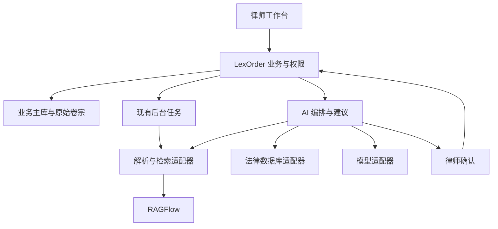

# 律序 · LexOrder 融合实施计划

核验日期：2026-11-15。本文是本分支的实施路线，区分已核实的上游基础、首批交付目标与后续增量；计划条目不代表已经实现或通过验证。当前发布范围和本次运行结果以仓库 README 及对应验证记录为准，不能沿用上游历史测试结果作为本次证明。

## 1. 目标与基线

以 **律序 · LexOrder** 为统一业务系统，基于 LawLink v2.0.1 扩展客户维护、案件办理、材料检索、AI 辅助和法律数据库接入。客户、案件、正式期限、文档版本、委托和财务在 LexOrder 中维护；外部服务提供解析、检索和模型能力，正式业务变更经过既有授权与确认流程。当前仓库：[zaenzhang/LexOrder](https://github.com/zaenzhang/LexOrder)。

本分支固定的已核实基线：

- 上游：[lawflow-boop/LawLink](https://github.com/lawflow-boop/LawLink)。
- 标签：`v2.0.1`。
- 提交：`4736aa100515bb15f47443cdb6b0ae65745e5fff`。
- 技术栈：沿用 Next.js、React、TypeScript、Prisma、PostgreSQL 及现有组件体系。
- 部署范围：律师个人加少量助理，单实例业务系统；不在首版建设共享 SaaS 多租户。
- 业务范围：保留既有案件类型；首批选择两类真实业务流程和 3—5 份常用文书做深度适配与验收。

来源与许可清单见 [UPSTREAM_SOURCES.md](UPSTREAM_SOURCES.md)。正式吸收后续上游修复时，应固定新提交并重新执行受影响流程的验收。

## 2. 已有能力与实际增量

下表“已有”指固定版本源码中存在相应模型或实现，不等同于已经在本次云环境验证。

| 领域 | 已核实的上游基础 | 后续整合增量 |
| --- | --- | --- |
| 客户与收案 | `Client`、`Contact`、`Intake`；合作状态、来源、标签、冲突检查与收案流程 | 尚未成案的客户沟通与跟进、客户全景、转案件保留历史 |
| 案件与阶段 | `Matter`、`MatterProcedure`、`MatterStage`、`StageTemplate`、`Task` | 今日计划、清单版本、生成任务的来源和实例快照 |
| 期限与提醒 | `DeadlineRule`、`Deadline`、`Holiday`、`ReminderDelivery`；服务端复核、人工确认与改期保护、投递台账 | 结构化触发事件、不可覆盖的规则修订、完整计算记录与重算差异 |
| 文档与搜索 | `Document` 的版本链、校验值、文本层和处理状态；既有正文搜索 | 页段定位、完整解析生命周期、检索映射与覆盖范围 |
| 事实与争点 | `EvidenceItem` 的事实、主张、分析、争点、待核实分类，单个材料来源与页码 | 多来源关联、发生日期、支持或矛盾关系、事实时间线 |
| AI | `ReviewRecord`、`SmsSuggestion`、现有模型调用与外发日志 | 统一建议确认、分析范围、引用与目标版本检查 |
| 文书 | `DocumentTemplate`、生成时上下文快照、既有 DOCX 模板引擎 | 模板修订、条件字段、缺项检查、引用清单 |
| 委托与财务 | `Engagement`、`EngagementMatter`，以及账单、应收、实收、核销链 | 顾问交付、续约、服务报告及周期关系 |
| 后台任务 | `JobQueue` 的去重、租约与失败重试，`ExternalCallLog` | 解析、索引和撤回同步任务，用量与关联记录 |

实施时保持以下语义：

1. `Document` 的一行代表一个文件版本，`familyId` 串联版本。引用绑定具体 `Document.id` 和校验值，不另建平行版本系统。
2. `Task` 和 `Note` 当前必须关联案件。客户尚未成案的跟进先使用独立对象，在工作台聚合展示，避免全面改变既有权限、归档和提醒假设。
3. `Engagement.endedAt` 表示实际委托终止；顾问服务约定期限来自 `Intake/Matter.serviceStart` 与 `serviceEnd`。服务到期与终止分别处理。
4. `EvidenceItem` 已有事实和争点分类，不重复建立另一套无关联事实库；`TimelineEvent` 的操作记录与事实发生时间线保持区别。
5. `Matter.serviceStatus` 虽然保留字段和部分服务代码，上游已移除对应 UI，不能将字段存在描述为用户已经可用的服务工作流。
6. 已有期限重算保护、正文搜索、提醒台账和模板引擎应增强复用，不能列为从零开发。

## 3. 吸收哪些项目优势

| 来源 | 采用的业务优势 | 首选方式 |
| --- | --- | --- |
| 案齐 ANQI | 个人今日计划、程序事件关联期限、计算可解释、建议待办 | 从行为规格和验收场景出发，在 LexOrder 原生实现 |
| Kosmos | 原文高亮、事实时间线、事实关联材料与证人 | 增强既有 `EvidenceItem` 和文档阅读器 |
| Frappe CRM | 客户活动、下一次跟进、转化时保留沟通与任务 | 原生客户模块，统一客户与案件身份 |
| Twenty | 关联视图、常用筛选、责任人与通知交互 | 先采用交互行为，具体包另行核对许可与依赖 |
| Paperless-ngx | 扫描材料处理、检索与归档流程 | 补全现有文档处理；大规模扫描归档再评估独立服务 |
| RAGFlow | 解析、混合检索、重排与片段返回 | 固定版本的独立 API 服务 |
| Counsel OS | 案件上下文、版本引用、实践知识与材料分离、文书审阅 | 审核模块后选择性移植，其余转化为原生逻辑 |
| j-lawyer、Docassemble | 案件表单、模板变量、条件问卷与文书装配 | 优先增强现有字段和模板，复杂访谈后置 |

迁移国外项目的工作方法与数据关系；法定期间、法域日历、法院文书与财务规则需按实际执业范围配置和验收。不能仅凭国外项目的预设值生成本地法律结论。

Kosmos 官方文档说明，原生案件聊天引擎及界面已于 2026 年 10 月退役，当前通过远程 MCP 使用外部客户端。它的旧聊天模块不作为可直接移入的现成产品。Counsel OS 亦明确说明扫描 PDF OCR、全面法律研究等范围尚未完成。[来源与现状](UPSTREAM_SOURCES.md#3-参考项目及采用边界)

## 4. 总体架构

RAGFlow 中的文本块和向量是可重建的派生索引；法律数据库仍由服务商维护。浏览器只调用 LexOrder，服务端决定检索范围、提供商权益与正式写入权限。模型和检索服务不直接修改正式案件与财务数据。

结构化业务搜索、卷宗正文检索、外部法律依据可从统一入口进入，但结果保留类型、来源与版本。默认以当前案件为范围，引用其他案件必须明确选择并具有相应权限。

## 5. 模块设计

### 5.1 客户、咨询与今日工作

增加客户沟通和客户跟进，支持尚未成案时记录沟通、负责人、下一次联系、等待材料和处理状态。客户页聚合案件、咨询、委托、沟通、待跟进和费用，每条内容继续执行其案件及财务权限；能打开客户页不等于能读取该客户的全部案件。

收案转案件继续经过现有冲突检查和收案门禁。转化预览明确复用或新建的客户、联系人和材料；保留原咨询 ID。未完成客户跟进可继续保留，或转成案件任务并记录关联。同一提交重试不得重复建案。

个人计划日期与任务截止日期、正式程序期限分开。首页聚合必须处理、今天计划、等待与跟进、待我确认四类事项，并保留每条记录的来源身份。

阶段模板增加修订与实例快照。模板修改只影响后续实例；旧案采用新模板需要明确选择。任务完成者、完成时间和生成来源可追溯。

### 5.2 期限与程序事件

复用已有期限规则、人工确认、改期和提醒流程，补充：

- 结构化触发事件：类型、日期、来源材料及位置、确认人与版本。
- 规则修订：适用条件、法域、依据、有效期间与不可覆盖的版本。
- 计算记录：输入、规则版本、日历版本、业务时区、过程、结果及复核状态。
- 重算预览：输入变化时显示受影响期限和差异，经复核后再应用。

已人工确认或调整的期限保持现有保护。AI 可以提取材料所记载日期，形成事件候选；确认后再由确定性规则计算期限。中国内地案件的业务日期沿用上海时区，不能依赖服务器或浏览器的本地时区。具体期间和顺延口径由律师核定，不以模型推断作为规则来源。

### 5.3 文档、事实与原文引用

增加 `SourceAnchor` 与 `EvidenceSourceLink`，让一条事实关联多份材料，一份材料关联多个争点。来源关系可标注支持、矛盾或待核实；模型建议与律师确认结果分别保留。

PDF 引用记录具体文档版本、校验值、物理页码及位置；Word 优先采用段落或字符定位，转 PDF 时保留转换版本和映射。定位能力不足时明确说明，不生成虚构页码。上传 v2 后，旧引用仍指向 v1；来源撤回时标记状态，不静默改指最新版。

原件保持原样，OCR 文本、转换文件和索引分别作为派生结果处理。页面显示真实覆盖范围，包括处理中、部分成功、失败和未索引。解析失败与没有检出相关内容不能混淆。

### 5.4 卷宗检索与法库

使用 `RetrievalProvider` 适配 RAGFlow，锁定 API 版本，验证上传、启动解析、检索与删除。文档到外部索引的映射记录解析器版本、索引代次与同步状态。复用 `JobQueue`，长 OCR 拆成提交和轮询任务，或实现租约续期；重试不得重复写入。

个人规模可以一案一数据集，但数据集分开不能替代权限判断。LexOrder 在服务端计算允许的文档范围，片段进入模型前重新校验。RAGFlow 1.0 支持返回生成的知识汇总片段，首期设置 `include_knowledge_compilation=false`，优先使用可回到原文的来源片段。

文件撤回后立即从新检索与模型上下文中排除，再异步清理外部索引；失败继续重试，历史引用显示来源已撤回。历史成果与审计保留按明确政策处理。

法库从既有元典模块开始抽出统一 `LegalProvider`。首批接入一个已获授权的平台，保存检索条件、查询时间、提供商、原始 ID、来源链接、引用与版本。元典法规详情的 `refer_date` 可用于指定参考日期。[官方接口](https://open.chineselaw.com/api-docs/rh_fg_detail.html)

各提供商声明支持的能力；鉴权失败、限流、超时、不支持与无结果分别显示。网页会员、API、全文缓存、向量化及再展示分别按授权处理。调用记录扩展 `ExternalCallLog`，避免另一套重复日志。

### 5.5 AI 建议与文书

拟新增 `AiRun` 记录模型、提示模板版本、案件范围、读过的材料版本、实际覆盖和引用；统一 `WorkProposal` 接收 AI、规则或导入产生的候选动作，区分来源。

已有 `SmsSuggestion` 经适配进入同一确认面板。支持接受、修改后接受、拒绝、暂缓；执行时重新校验权限、目标版本和来源。目标记录或材料已变化时要求重新复核。已拒绝建议只在相关业务状态实质变化后重提，并说明变化原因。

保留 `ReviewRecord.truncated` 等覆盖信息。个人方法库、案件证据与外部法律依据区分来源；缺少依据时呈现缺口。正式费用、期限与对外发送继续经过明确业务动作。

文书继续复用 `DocumentTemplate`，补模板修订、条件字段、必填检查、案件快照、引用清单与成果入卷。首批 3—5 份模板按实际业务选择。原生 Word 复杂修订和完整 Docassemble 分支访谈后置，先验证中文编号、表格、脚注与交叉引用。

### 5.6 顾问服务与续约

交付台账关联现有委托、案件与具体成果版本，区分内部完成、已交付和客户确认。服务报告从台账取事实，不能把内部草稿列为已交付。

首期按 `serviceEnd` 判断到期；实际提前终止后停止续约流程，但保留未结费用与未完成交付的收尾。多期续约增加不可覆盖的周期记录，以当前已确认周期作为唯一日期来源，旧字段作为兼容展示或派生值；每一期费用仍进入现有财务链。

## 6. 增量数据设计

以下名称是设计草案，不代表当前 schema 已全部加入。

| 拟新增或扩展 | 用途 | 复用对象 |
| --- | --- | --- |
| `ClientActivity`、`ClientFollowUp` | 未成案沟通、下次跟进、负责人和状态 | Client、Contact、Intake |
| Task 计划字段、模板修订与快照 | 计划日期、生成来源、清单实例 | Task、StageTemplate、MatterStage |
| 程序事件、规则修订、计算记录 | 期限来源、规则与日历版本、差异 | MatterProcedure、DeadlineRule、Deadline |
| `SourceAnchor`、`EvidenceSourceLink` | 版本引用、页段位置、多证据关联 | Document、EvidenceItem |
| `DocumentIndexBinding` | 外部索引 ID、解析版本与同步状态 | Document、JobQueue |
| `AiRun`、`WorkProposal` | 分析范围、引用、建议、确认与去重 | ReviewRecord、SmsSuggestion |
| 研究记录、法律依据引用 | 条件、提供商、依据版本与授权缓存 | Matter、Document、ExternalCallLog |
| 模板修订与问卷配置 | 条件字段、必填检查、生成快照 | DocumentTemplate、CustomFieldDef |
| 服务交付与周期 | 交付、续约、成果版本与费用关联 | Engagement、Matter、既有财务 |

保持现有客户、案件和文档 ID 稳定，按模块增量迁移。先增加兼容结构，再回填抽查，最后切换入口。新增字段不能悄悄改变旧字段含义。

## 7. 首批交付边界

首批目标是把固定基线在云环境中运行起来，建立可继续开发和验证的仓库，逐步落地上述原生增量。完成声明必须同时有代码、可达入口和实际验证证据。

本轮执行范围：固定基线的真实云环境搭建、可执行安装与验证入口、仓库内实施计划，以及客户跟进的小闭环。**客户归属、沟通、跟进、事务服务与客户详情入口已实现；数据库、组件和 HTTP 检查见 [本次验证](WORKBENCH_VALIDATION.md)。真实浏览器交互与移动端视觉验收受环境限制，尚未完成。**原文锚点、完整检索与 AI 建议等其余路线仍是后续目标。

1. 固定基线和来源记录，保留上游 MIT 版权与许可。
2. 明确云环境依赖、数据库、私有文件存储和启动命令，配置只保存在部署环境。
3. 默认安装初始化管理员和系统基础字典、规则、空白模板，**业务数据为空**。
4. 只有单独验收脚本可以在独立验收环境生成明确标注的合成样本；合成客户、案件、费用和材料不得混入默认初始化。
5. 实际打开登录和核心业务页面，验证所选首批流程；未配置外部模型、OCR 或法库时明确显示配置状态，基础办案继续可用。
6. 上传源码和计划至用户指定 GitHub，密钥、运行数据库、附件、备份、缓存与验收产物不进入提交。

RAGFlow 接通、商业法库授权、完整事实引用、统一 AI 建议和复杂文书能力分别验收，不能因应用已启动而统称完成。

## 8. 批次与工期

前提：一名熟悉技术栈的开发者，律师每周提供样本和反馈，首家接口权限及时到位。两名开发者可以在公共模型和权限确定后并行开发独立模块，但排期不简单除以二。

| 批次 | 内容 | 预估 | 完成标准 |
| --- | --- | --- | --- |
| 0 基线 | 固定版本、部署、功能回归、权限映射、两类业务样本 | 1 周 | 同一基线可复现，核心页面与恢复流程可验证 |
| 1 日常工作 | 客户跟进、今日计划、转化历史、期限追溯 | 2—3 周 | 咨询到成案历史连续，期限变化可解释 |
| 2 卷宗与事实 | 处理状态、原文锚点、多来源事实、时间线 | 2—3 周 | 事实回到指定版本，处理缺口可见 |
| 3 检索与 AI | RAGFlow、首家法库、研究引用、建议确认 | 2—3 周 | 案内检索、研究与建议确认连通 |
| 4 文书与服务 | 3—5 份模板、交付、续约、服务报告 | 2 周 | 成果入卷，来源与服务期可追溯 |
| 5 试用与发布 | 真实样本、修正、导出恢复、升级说明 | 1—2 周 | 通过端到端验收后用于日常工作 |

基础开发与试用约 10—14 周，加约两周适配与反馈预留，整体按 **12—16 周**规划。该估算不包括接口授权等待、复杂 OCR 研发、第二法库、原生 Word 复杂修订、完整 Docassemble 或多人 SaaS。

### 首批任务清单

| 编号 | 任务 | 主要验收 |
| --- | --- | --- |
| B01 | 基线、空白初始化、权限矩阵、恢复演练 | 不携带业务样本，能复现部署 |
| B02 | 客户沟通与跟进 | 无案件也能维护客户，负责人明确 |
| B03 | 客户全景、今日计划、转化预览 | 历史连续、提交幂等 |
| B04 | 事件、规则修订、计算记录 | 人工期限受保护，改期有依据 |
| B05 | 来源锚点、事实多来源 | 原文可回看，版本不漂移 |
| B06 | 解析队列与索引映射 | 重试不重复，覆盖与失败可见 |
| B07 | RAGFlow 适配器 | 查询与输出分别检查权限 |
| B08 | 元典适配、研究引用 | 来源、版本、错误状态明确 |
| B09 | 分析记录与统一建议 | 过期复核，采纳幂等 |
| B10 | 模板修订、生成与归档 | 缺项明确，生成来源可查 |
| B11 | 顾问交付、续约与报告 | 到期、终止、交付、确认区分 |
| B12 | 综合试用、恢复、升级说明 | 可恢复、可导出、可关闭增量 |

## 9. 验收场景

以下均为目标场景，须记录执行环境、提交、样本和结果后才能标记通过。

1. 客户尚未成案时可沟通和跟进，转案件后记录仍可追溯，重复提交不重复建案。
2. 客户全景不披露无权案件、材料或财务。
3. 修改个人计划不会改变任务截止或正式期限。
4. 纠正来源事件后显示期限差异，人工确认或调整的期限不被静默覆盖。
5. 一条事实可关联多份证据，上传 v2 后旧引用仍指向 v1。
6. OCR 失败、部分解析、长文截断和未索引材料可见。
7. 后台重试不重复生成索引、事实或文书，超时任务可恢复。
8. 撤销案件权限后，检索、AI 历史、引用和附件路径使用新权限。
9. 删除材料后立即退出新检索与模型上下文，异步清理失败可重试。
10. 法律依据保留参考日期、来源与版本；失败、不支持与无结果分开。
11. AI 建议生成后目标已变化时重新复核，采纳重试不重复写入。
12. 文书保留模板版本、字段快照和材料引用，模板更新不改写旧成果。
13. 服务到期不等同委托终止，续约保留历史，草稿不列为已交付。
14. 备份恢复业务库与原件后能重建索引；外部 AI 或检索不可用时基础办案继续可用。

## 10. 发布与维护

每个模块按可审阅的小批次提交，附数据变更、权限和验证证据。已有业务变更后不能用旧库覆盖新数据作为一般回退；优先关闭新入口并使用兼容代码。数据库与原件成套备份恢复，派生索引重建。

上游更新和外部 API 版本升级先在测试环境验证。业务提交与后台任务使用可靠的事务或待投递记录，避免保存成功但同步任务丢失。权限在读取、任务执行和结果输出阶段分别检查。

仓库验证沿用 lint、typecheck、Prisma 校验和生产构建；UI 改动增加实际业务交互验证。只修复本次变更相关问题，不把计划执行扩成无边界审计。

费用分为开发、服务器与存储、备份、OCR、模型和法律数据库接口。本文件是工程工期估算，不构成供应商报价，也不假定开源软件没有运行维护成本。
